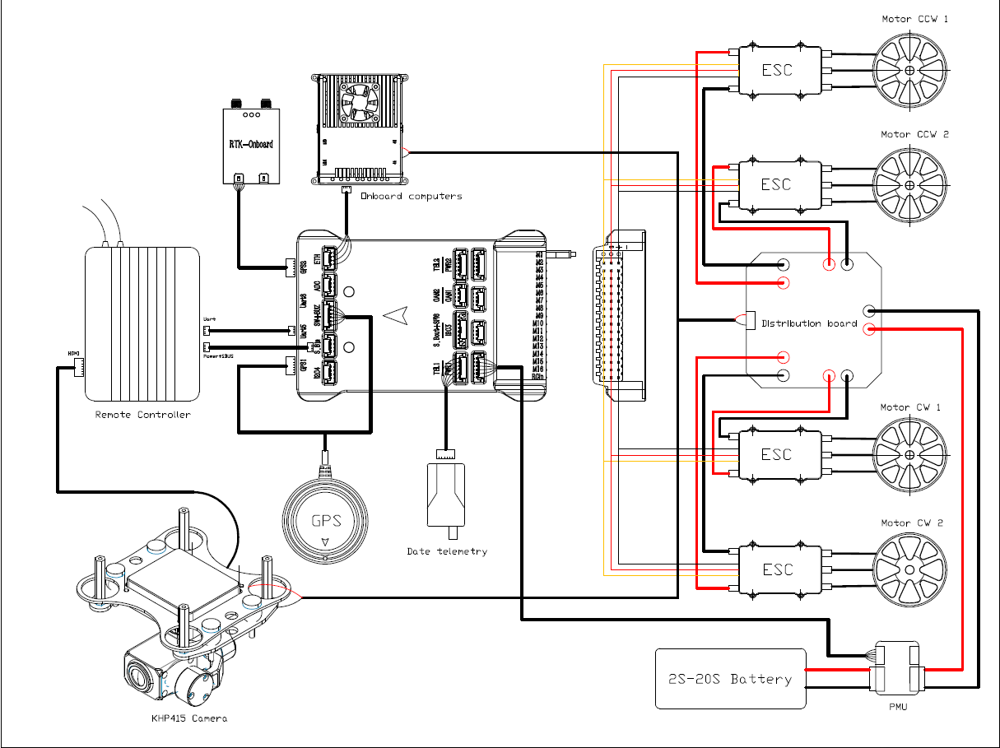
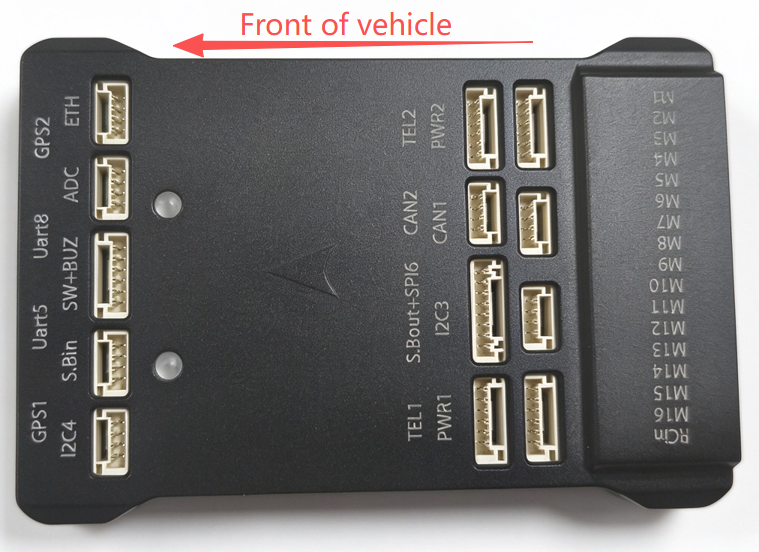
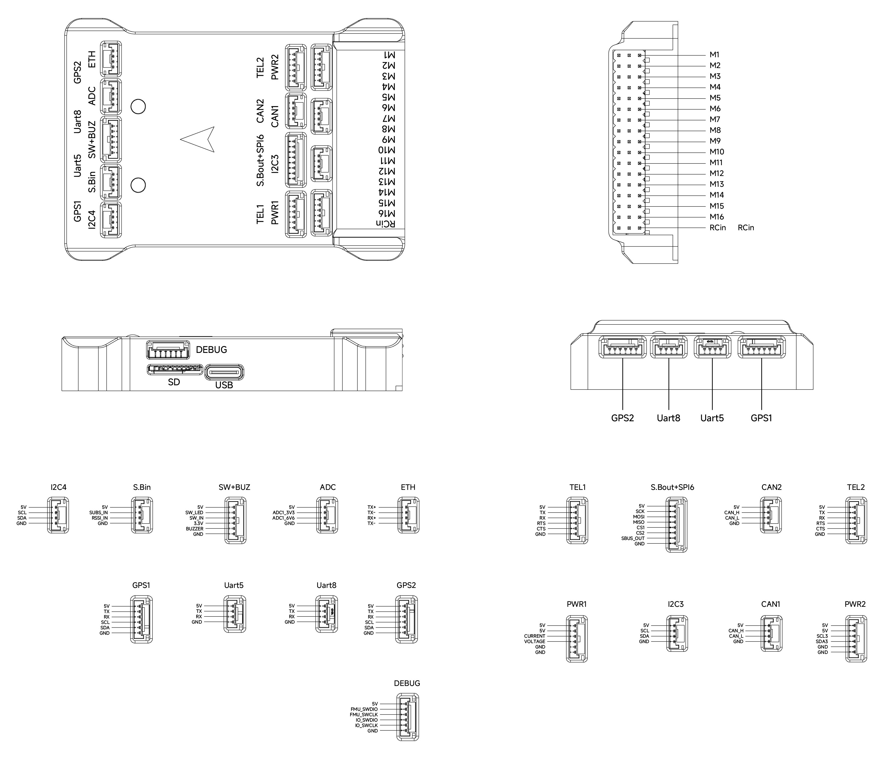

# CyberX-v10 Wiring Quick Start

<Badge type="tip" text="main (PX4 v2.0)" />

This quick start guide shows how to power the [CyberX-v10](../flight_controller/cyberx_v10.md) flight controller and connect its most important peripherals.

## Wiring Chart Overview

The image below shows how to connect the most important sensors and peripherals.
We'll go through each of these in detail in the following sections.

| Port              | Function                                                                                                        |
| :---------------- | :-------------------------------------------------------------------------------------------------------------- |
| `PWR1`            | Analog (ADC) power module                                                                                       |
| `PWR2`            | I2C power module                                                                                                |
| `GPS1`, `GPS2`    | GPS/RTK modules                                                                                                 |
| `SW+BUZ`          | Safety switch, safety LED and buzzer (usually from the GPS module)                                              |
| `TEL1`, `TEL2`    | Telemetry radios or other MAVLink devices                                                                       |
| `Uart5`           | Spare serial port                                                                                               |
| `Uart8`           | RC input for CRSF receivers                                                                                     |
| `S.Bin`           | SBUS receiver (`SBUS_IN`) and RSSI input (`RSSI_IN`)                                                            |
| `RCin`            | SBUS or PPM receiver (pin on the servo rail)                                                                    |
| `I2C3`, `I2C4`    | I2C peripherals, such as an MS4525DO airspeed sensor                                                            |
| `CAN1`, `CAN2`    | [DroneCAN](../dronecan/index.md) peripherals                                                                    |
| `ETH`             | Ethernet devices, such as companion computers                                                                   |
| `ADC`             | Two analog inputs (3.3V and 6.6V)                                                                               |
| `S.Bout+SPI6`     | SBUS output and external SPI bus                                                                                |
| `M1`–`M8`         | IO PWM outputs, for ESCs and servos                                                                             |
| `M9`–`M16`        | FMU PWM outputs, for ESCs, servos and camera triggers; `M9`–`M14` also support [DShot](../peripherals/dshot.md) |
| `USB`             | Connection to a computer, for example to load firmware                                                          |
| `DEBUG`           | SWD debug port for the FMU and IO processors                                                                    |
| microSD card slot | Log storage (a card is pre-inserted at the factory)                                                             |

## Vehicle Front

Mount the CyberX-v10 with the arrow on its case pointing towards the front of the vehicle.

::: info
If the controller cannot be mounted in the recommended/default orientation (e.g. due to space constraints) you will need to configure the autopilot software with the orientation that you actually used: [Flight Controller Orientation](../config/flight_controller_orientation.md).
:::

## GPS + Compass + Buzzer + Safety Switch + LED

The CyberX-v10 can be purchased with a GNSS module that has an integrated compass, safety switch, buzzer and LEDs.
The module has two 6-pin connectors: connect them to the `GPS1` and `SW+BUZ` ports.

A second GPS module (for example, an RTK or redundant GPS) can be connected to the `GPS2` port.

The GPS/compass should be [mounted on the frame](../assembly/mount_gps_compass.md) as far away from other electronics as possible, with the direction markings towards the front of the vehicle (separating the compass from other electronics will reduce interference).

::: info
The safety switch is disabled by default, so it has no effect unless you enable it.
To use it, set [CBRK_IO_SAFETY](../advanced_config/parameter_reference.md#CBRK_IO_SAFETY) to `0`.
When enabled, PX4 will not let you arm the vehicle until you press and hold the safety switch for 1 second.
You can press the safety switch again to enable safety and disarm the vehicle (this can be useful if, for whatever reason, you are unable to disarm the vehicle from your remote control or ground station).
For more information see [Arming Sequence: Pre Arm Mode & Safety Button](../advanced_config/prearm_arm_disarm.md#arming-sequence-pre-arm-mode-safety-button).
:::

## Radio Control

A remote control (RC) radio system is required if you want to _manually_ control your vehicle (PX4 does not require a radio system for autonomous flight modes).

You will need to [select a compatible transmitter/receiver](../getting_started/rc_transmitter_receiver.md) and then _bind_ them so that they communicate (read the instructions that come with your specific transmitter/receiver).

- SBUS receivers connect to the **S.Bin** port or the **RCin** pin.
- PPM receivers connect to the **RCin** pin.
- CRSF receivers connect to the **Uart8** port.

For more information about selecting a radio system, receiver compatibility, and binding your transmitter/receiver pair, see: [Remote Control Transmitters & Receivers](../getting_started/rc_transmitter_receiver.md).

## Power

The CyberX-v10 is supplied with a PMU Lite power module that supports 2S to 20S lithium batteries.
The module has both an analog (ADC) and an I2C interface: connect its analog connector to `PWR1` and its I2C connector to `PWR2`.

The CyberX-v10 is configured by default for an analog power monitor on `PWR1`, and an INA228 I2C power monitor on `PWR2` that reports voltage and current.
The power module's VCC output must provide at least 3A continuous current, and should default to 5.2V.
A lower voltage of 5V is still acceptable but discouraged.

## Telemetry (Radio) System

[Telemetry radios](../telemetry/index.md) may be used to communicate with and control a vehicle in flight from a ground station (for example, you can direct the UAV to a particular position, or upload a new mission).

The vehicle-based radio should be connected to the `TEL1` or `TEL2` port (if connected to `TEL1`, no further configuration is required).
The other radio is connected to your ground station computer or mobile device (usually by USB).

## SD Card

SD cards are highly recommended as they are needed to [log and analyse flight details](../getting_started/flight_reporting.md), to run missions, and to use DroneCAN peripherals.
An SD card is already installed in the CyberX-v10 when it leaves the factory.

:::tip
For more information see [Basic Concepts > SD Cards (Removable Memory)](../getting_started/px4_basic_concepts.md#sd-cards-removable-memory).
:::

## Motors/Servos

Motors and servos can be connected to any of the `M1`–`M8` (IO) and `M9`–`M16` (FMU) outputs, and are then assigned to outputs in [Actuator Configuration](../config/actuators.md#actuator-outputs).
`M1`–`M8` appear there as **PWM MAIN** outputs, and `M9`–`M16` as **PWM AUX** outputs.

::: tip
Use the FMU outputs (`M9`–`M16`) for motors where possible: they have lower latency than the IO outputs, and `M9`–`M14` support [DShot](../peripherals/dshot.md).
:::

## Servo Power Supply

The CyberX-v10 does not supply power to the servo rail.
If the rail must power servos or other hardware, connect an external BEC (e.g. a BEC-equipped ESC or a separate 5V BEC) to one of the power (+) pins on `M1`–`M16`.
For more information see [PWM Servos and ESCs](../peripherals/pwm_escs_and_servo.md).

::: info
The power rail voltage must be appropriate for the servo being used!
:::

## Other Peripherals

The wiring and configuration of optional/less common components is covered within the topics for individual [peripherals](../peripherals/index.md).

## Pinouts

## Configuration

General configuration information is covered in: [Autopilot Configuration](../config/index.md).

QuadPlane-specific configuration is covered here: [QuadPlane VTOL Configuration](../config_vtol/vtol_quad_configuration.md).

## Further Information

- [CyberX-v10](../flight_controller/cyberx_v10.md) (PX4 Doc Overview page)
- [CyberCraft International Limited](https://int.woocoo.vip/)
