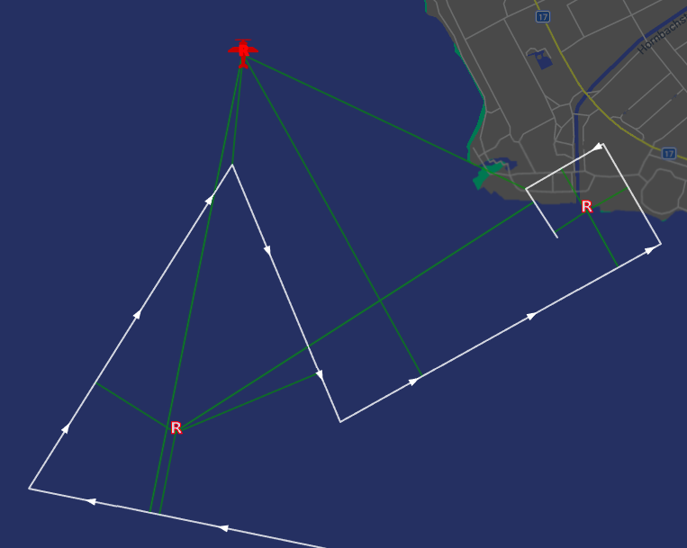
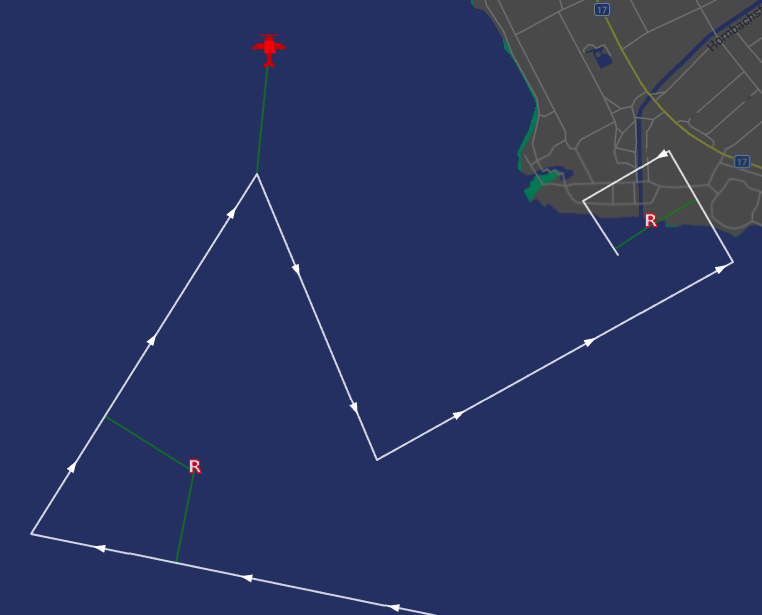
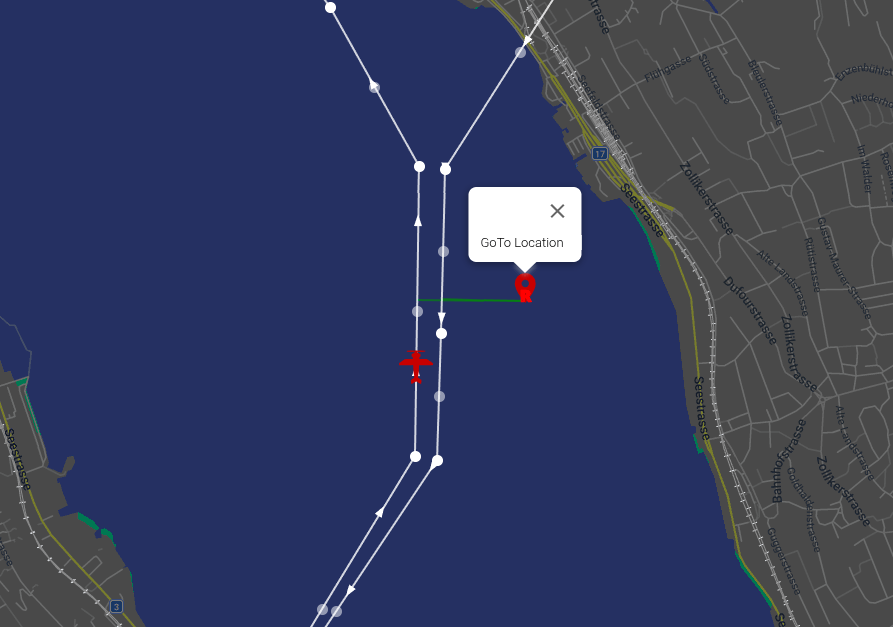
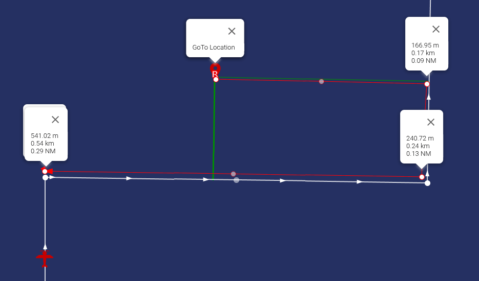
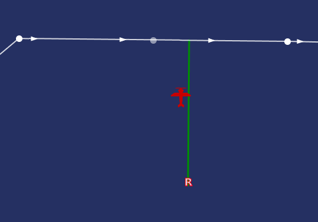

# Mission Route Planning

<Badge type="tip" text="main (PX4 v2.0)" />

Mission route planning helps the vehicle rejoin an uploaded mission or use that route to return to a landing destination.
It provides:

- [Smart mission rejoin](#smart-mission-rejoin): Rejoin the route after leaving it, for example after manual repositioning or a GoTo.
- [Route-following Return](#route-following-return): Follow the mission route towards a [safe point](../flying/plan_safety_points.md) or mission endpoint, then land or hold as configured.

Enable smart rejoin with [MIS_ROUTE_JOIN](../advanced_config/parameter_reference.md#MIS_ROUTE_JOIN) (off by default).
Select route-following Return with [RTL_TYPE=7](../flight_modes/return.md#rtl_type_7).

::: warning
Both features need firmware built with the [mission route cache](../advanced/mission_route_cache.md), and the whole mission must fit in it.
SITL builds include it by default, but most flight controller builds do not; see [Parameters and Build Configuration](#parameters-and-build-configuration).
[Direct fallback](#route-following-fallback) can leave the mission corridor and select a different destination using `RTL_TYPE=3` rules.
Review the fallback conditions below before relying on the mission route as a return corridor.
:::

::: info
Route-following Return supports fixed-wing, multicopter and VTOL vehicles.
VTOL vehicles change flight mode to match the selected route legs, including when following the mission in reverse.
After a fixed-wing system failure, Route-following Return keeps the selected route and continues in multicopter mode, skipping front transitions while the failure remains active.
:::

::: warning
The planner checks branch-in, branch-off and direct-to-goal segments against loaded geofences; see [Geofence Checks](#geofence-checks).
These checks do not cover obstacles, the space needed to turn, or VTOL landing approaches.
:::

## How It Works

Both features choose where to join the route using the vehicle's current position and mission progress.
Smart rejoin continues the mission; route-following Return chooses a destination and may fly the route forwards or backwards to reach it.

When the vehicle is already near the selected destination or branch-off leg, [route-skip shortcuts](#route-skip-shortcuts) can avoid an unnecessary trip back to the route.

### Smart Mission Rejoin {#smart-mission-rejoin}

When Mission mode is activated in flight with smart rejoin enabled, the vehicle:

1. Selects a branch-in point and altitude on the route using [Vehicle Projection](#vehicle-projection).
2. Flies straight to that point, changing altitude on the way.
   Unlike a resume without smart rejoin, it does not first climb in place to the mission altitude.
3. Continues towards the mission end in the mission direction, accounting for any active loop as described below.

Mission then continues from the first mission item after the branch-in point.
As when you select a mission item, skipped items are not executed, but the speed, camera and gimbal settings up to that item are restored.

If the branch-in lands on an active [`DO_JUMP` loop segment](#vehicle-projection), the loop's repeat count is preserved:

- While repeats remain, the resumed path continues to the jump target, so the loop is still flown.
- Once repeats are exhausted, the planner picks the loop exit with the shorter **total** path to the mission end: forward to the jump target, or back to the waypoint before the jump command.
  Both paths include any fixed-wing U-turn penalty, a fixed 4000 m here; `RTL_FW_UTURN_PEN` only applies to Return.
  Because the whole path counts, the vehicle may rewind most of the loop when the mission end lies near the loop start.

The projection search margin is set by [MIS_MC_SEG_DIST](../advanced_config/parameter_reference.md#MIS_MC_SEG_DIST) (multicopter) and [MIS_FW_SEG_DIST](../advanced_config/parameter_reference.md#MIS_FW_SEG_DIST) (fixed-wing).
If a rejoin cannot be planned, Mission mode resumes without smart rejoin and reports a warning.
This can happen while the mission is still loading into the [route cache](../advanced/mission_route_cache.md).
Camera-trigger survey resume takes precedence over smart rejoin.
Mission returns to the previous survey waypoint without a branch-in.
Selecting a mission item explicitly cancels a pending smart rejoin.
A finished mission is not rejoined: Mission mode holds, as it does without smart rejoin.

When the selected route target is a landing item and the vehicle is within its horizontal acceptance radius, Mission executes the landing directly, as route Return does.
This lets a paused multicopter descent resume without a front transition to restore the approach's fixed-wing state.
After moving outside that radius, for example with GoTo, resuming Mission uses normal smart rejoin, including reaching the route altitude before any required front transition.

When a VTOL rejoin requires a front transition, the vehicle follows this sequence:

1. Fly to the branch-in waypoint.
2. Wait for any active back transition to finish, retaining the branch-in position target.
3. Hold at the branch-in position and align the heading towards the next mission waypoint.
4. Start the front transition once position and heading alignment are complete, then resume the mission after reaching fixed-wing mode.

Back-transition completion starts the alignment step even if the vehicle has drifted outside the branch-in acceptance radius.
The vehicle must still reach the alignment position before starting the front transition.
These temporary steps do not mark the next uploaded mission waypoint as reached.

### Route-Following Return {#route-following-return}

With `RTL_TYPE=7`, Return uses the mission route as a return corridor:

1. Select a branch-in point using [Vehicle Projection](#vehicle-projection).
2. Choose a safe point and branch-off point using [Safe-Point Scoring](#safe-point-scoring), or a mission takeoff/landing endpoint if no safe point is usable.
3. Join and follow the route in the selected direction, then fly to the destination.

The takeoff endpoint is the position of the mission `TAKEOFF` or `VTOL_TAKEOFF` item, at Home altitude.
It is only used when that item is the first position item of the mission and the Home altitude is valid.
For fixed-wing and VTOL missions this item is the climb-out or transition point, not the launch position.

[Route-skip shortcuts](#route-skip-shortcuts) may bypass the join and route when the vehicle is already near the destination or branch-off leg.

Route-following Return does not yet support `MAV_CMD_DO_RETURN_PATH_START` to designate a return-path segment.
The planner considers the mission route without restricting its join and return path to the segment between this marker and `MAV_CMD_DO_LAND_START`.

An active [`DO_JUMP` loop segment](#vehicle-projection) is used as return geometry only: the vehicle does not repeat the loop.
It leaves the loop through the exit with the shorter total path to the goal, using the same rule as [Smart Mission Rejoin](#smart-mission-rejoin).

Route following skips waypoint hold times and timed or unlimited loiter holds, but preserves `LOITER_TO_ALT`.
The vehicle approaches these loiters at its current altitude, then changes altitude in the loiter before continuing.

::: details How VTOL Transitions Work Along the Route

VTOL transition commands belong to the preceding position waypoint in the uploaded mission.
For example, `A → front transition → B → back transition → C` is flown in reverse as `C → B` in multicopter mode, then a front transition at `B`, followed by `B → A` in fixed-wing mode.
The vehicle flies each leg in the mode used in the forward mission, even when travelling in reverse.
A back transition between the last waypoint and the mission `LAND` item is flown at the landing point, not at that waypoint.
Before a front transition, it waits for any back transition to finish, holds its position and aligns towards the next route target.
It advances the route after the transition completes.
An ongoing front transition may finish when route-following Return is activated; direct fallback cancels it.

PX4 determines each leg's mode from the closest preceding `MAV_CMD_NAV_VTOL_TAKEOFF` (fixed-wing) or `MAV_CMD_DO_VTOL_TRANSITION` command.
When no preceding command defines the mode, PX4 looks ahead in the nominal mission order: a front transition implies multicopter mode before it, and a back transition implies fixed-wing mode before it.
A preceding command always takes priority, including when two front transitions or two back transitions follow one another.
Lookahead passes `DO_JUMP` commands as if their repeats were exhausted, continuing to the next mission item without following the jump target or changing the repeat count.
It stops at a landing, takeoff, or unreadable item; if no mode can be inferred, the vehicle keeps its current mode.
This mode selection applies to smart rejoin and route-following Return, including its time estimate.
Normal Mission execution continues to execute the uploaded transition commands.
:::

At a rally point or mission takeoff endpoint, the vehicle first approaches at the altitude held when leaving the route.
It then follows the destination arrival policy configured by [RTL_DESCEND_ALT](../advanced_config/parameter_reference.md#RTL_DESCEND_ALT), [RTL_LAND_DELAY](../advanced_config/parameter_reference.md#RTL_LAND_DELAY), and [RTL_LOITER_RAD](../advanced_config/parameter_reference.md#RTL_LOITER_RAD):

- A negative landing delay holds indefinitely above the destination.
- A positive landing delay waits at the descent altitude for the configured time before landing.
- With zero landing delay, a multicopter lands after horizontal arrival; a fixed-wing vehicle first descends in the destination loiter.

The descent altitude is relative to the destination and is capped at the arrival altitude, so arrival does not introduce another return-altitude climb.
Landings at rally points and takeoff endpoints use [RTL_PLD_MD](../advanced_config/parameter_reference.md#RTL_PLD_MD) for precision landing.
An uploaded mission landing command keeps its own landing and precision-landing settings.
The destination descent and delay described above do not apply to it.
As in Mission mode, a VTOL flying in fixed-wing mode back-transitions and lands vertically at a mission `LAND` item when [NAV_FORCE_VT](../advanced_config/parameter_reference.md#NAV_FORCE_VT) is enabled (default).
It does the same when the mission back-transitions before that `LAND` item.
A VTOL arriving in fixed-wing mode can use the selected rally point's landing approach, then back-transitions and lands through the existing VTOL landing sequence.
If arrival starts during a front transition, the vehicle still back-transitions before landing.
An approach is retained even when Return starts in multicopter mode, but is only flown if the vehicle reaches the destination phase in fixed-wing mode.

Before Return is activated, its time estimate is refreshed every two seconds using a branch-in recomputed from the current mission index and vehicle position.
During Return, the estimate follows the remaining route and arrival stages, counting sequential loiter altitude changes and multicopter landing descent separately from horizontal approach.
With a negative landing delay, it estimates time to the indefinite hold.
For VTOL, the estimate uses the flight mode of each route leg and multicopter mode for the final vertical descent.
It does not model transition duration or turning dynamics.

#### Direct Fallback and Route Deviations {#route-following-fallback}

Direct fallback reselects the destination using [RTL_TYPE=3](../flight_modes/return.md#rtl_type_3): home, an eligible rally point or a mission landing pattern.
When route planning is available in the firmware, a critical message reports a direct fallback when Return starts or while it is active.
The destination can differ from the route goal, and the vehicle can fly outside the mission corridor to reach it.
The direct-RTL climb and landing approach still apply; selecting a mission landing pattern means flying directly to that pattern before following it.

Fallback occurs when:

- The firmware is built without route planning (`CONFIG_NAVIGATOR_FULL_MISSION_CACHE_SIZE=0`).
  A pre-arm warning reports this when `RTL_TYPE=7` is set.
- The mission has not passed feasibility validation with the current Home position and geofence, or validation is still pending.
- The mission or rally points are not loaded in the [route cache](../advanced/mission_route_cache.md) yet, or the mission is larger than the cache.
- The geofence is loading, unavailable, or cannot check a candidate path.
- No usable rally point or mission endpoint can be reached through the route.
- The vehicle is neither a multicopter nor a fixed-wing.
  VTOL vehicles are supported in hover, forward flight and transitions.

During route following, changes to the mission, rally points or geofence trigger replanning.
If that replan cannot be accepted, the same direct fallback applies.
Once the destination arrival or landing sequence has begun, these changes do not replace it.

If the fallback was caused by a loading cache, geofence or mission validation, Return retries route planning once these inputs are ready.
It checks every two seconds, until the fallback starts its descent or landing.
Other planning failures are not retried.

## Point Projection

This is the shared projection step used by both the [Vehicle Projection](#vehicle-projection) and the [Safe-Point Scoring](#safe-point-scoring) below.
The projected point is the vehicle in one case and a safe point (rally point) in the other.

The planner draws a perpendicular projection from the point onto every route segment and keeps up to three candidates per point.
A projection is a valid candidate only if its cross-track distance is within a search margin of the closest candidate's cross-track distance.
Separate parameters control the search margins for the vehicle and rally points; see [Parameters and Build Configuration](#parameters-and-build-configuration).
When more than three projections fall within the margin, only the three with the smallest cross-track distance are kept and the rest are dropped.

The mission route planner supports [`DO_JUMP`](https://mavlink.io/en/messages/common.html#MAV_CMD_DO_JUMP) mission loop commands.
The active jump segment is the segment running from the waypoint before the jump command to the first position waypoint at the jump target.
A point projects onto a loop segment using the same cross-track and margin rule as any other segment.
How that candidate is then used differs for the vehicle branch-in ([Vehicle Projection](#vehicle-projection)) and for safe-point branch-offs ([Safe-Point Scoring](#safe-point-scoring)).

::: details Click here for more detail on how projections land on segments and corners

A projection is normally perpendicular to the point on a segment, but it is only kept if it is a _local minimum_ of the distance to the route.
This rule decides what happens at a waypoint, where two segments meet:

- An interior projection, one that lands part-way along a segment, is always kept.
- A projection that lands exactly on a waypoint (a corner) is kept only at the end of the route, or when the previous segment and the current segment both project onto that same shared corner.
  This happens when two consecutive segments form a V-shape and the point is closest to the apex:

```text
 A \      / C
    \    /          P projects onto corner B from both segments.
     \  /           Both projections land on B, so the shared
    B \/            corner is kept as a single candidate.

       ^
       P
```

This is why some projections in the images below land on a waypoint instead of perpendicular to a segment.
:::

The example below uses a large margin.
The mission route is drawn in white and the projections of the vehicle and the rally points (`R`) in green.
Every rally point has three projections because the margin is large.



Here is the same route with a smaller margin.
Some projections are dropped because their cross-track distance is greater than the closest projection's cross-track distance plus the margin.



With a margin of zero, each rally point keeps only its single closest projection.

<a id="stacked-waypoints"></a>

::: details Click here to see how stacked waypoints (same latitude and longitude) are handled

Two consecutive waypoints that share latitude and longitude form a vertical segment, for example a climb waypoint above `TAKEOFF` or a descent waypoint above `LAND`.
Every point projects onto such a segment at the same spot.
Without special handling, the route end would be a branch-off candidate for every rally point, and a diagonal path from it could beat following the route.

- **Rally-point projections**: a vertical segment never creates its own endpoint candidate.
  The adjacent horizontal leg decides: a rally point beside that leg branches off from the leg, and only a rally point beyond the route end keeps the endpoint as a candidate.
  Interior stacks keep the normal corner rules, and an entirely vertical mission keeps its final location as a candidate.
- **Vehicle projection**: the vertical segment is kept when it matches the current mission index and flight direction, at both `LAND` and `TAKEOFF`.
  A vehicle that drifts during a landing therefore keeps `LAND` as its first target.
  This exception is disabled during an active `DO_JUMP`.

**Limitation**: after a distant GoTo while targeting `LAND`, the vertical segment at `LAND` can still be selected.
The vehicle may then fly a diagonal path back to the route end instead of joining a closer leg.
It flies that path at the approach altitude.

:::

## Geofence Checks {#geofence-checks}

Before selecting a branch-in or branch-off point, the planner checks the segment between that point and the vehicle or safe point.
Both ends must be within the permitted area, altitude and distance-from-home limits.
A segment that touches or crosses an inclusion or exclusion fence boundary is rejected.

The planner checks the candidates retained by [Point Projection](#point-projection), up to three per vehicle or safe point.
It does not search for replacements.
If no branch-in candidate passes, smart rejoin or route-following Return uses its existing fallback.
If no safe point has a usable branch-off, Return can still select a mission takeoff or landing endpoint.

[Route-skip shortcuts](#route-skip-shortcuts) are checked separately because they fly directly to the destination instead of following the checked branch-in and branch-off segments.
Uploaded mission segments are checked by mission feasibility validation, except `DO_JUMP` loop edges, which Mission, smart rejoin and route-following Return can fly.
The planner does not find detours around fences or check landing-approach geometry.
A VTOL arriving in fixed-wing mode flies from the branch-off point to the selected landing-approach loiter.
That leg and the loiters are not checked.

When the vehicle already breaches the loaded fence, the planner skips the checks of segments that start at the vehicle, to allow recovery along the route.
Branch-off segments are still checked, so a breach cannot route the vehicle through a fence on the way to a safe point.
If the fence is unavailable or still loading:

- When Mission mode starts, smart rejoin is skipped with a warning and is not retried during that activation.
- Return uses [direct fallback](#route-following-fallback) and retries route planning once the fence is ready, as described there.

If a loaded fence cannot check a segment, for example a path too long to subdivide, planning fails like any other planning failure: an active Return uses direct fallback and does not retry.

## Vehicle Projection

When a feature needs to rejoin the route, the first step is to project the current vehicle position onto the mission path and choose a "branch-in" point.
The vehicle may have left the route (for example with a GoTo), so the planner picks the point that best preserves mission continuity.

The branch-in point is chosen in three phases:

**Phase 1: Identifying valid candidates:**

The vehicle is projected onto the route as described in [Point Projection](#point-projection).
Candidates must pass the [Geofence Checks](#geofence-checks) before selection.

**Phase 2: Selecting the best branch-in point:**

The best candidate is chosen with a priority system:

- Priority 1: a candidate is selected immediately if it lies on the segment the vehicle is currently expected to be flying (the last targeted waypoint index, or the last flown `DO_JUMP` segment when known).
  This includes the vertical segment being flown at takeoff or landing (see [Stacked Waypoints](#stacked-waypoints)).
- Priority 2: if no candidate matches Priority 1, the planner scores each candidate by summing the following distances, and keeps the lowest:
  - Cross-track distance: from the vehicle to the projection on the route.
  - Distance along the route to the last-flown segment: from the projection, following the mission path to whichever end of the last-flown segment is closer.
    This selects the candidate that gets the vehicle back to where it was last flying if available, or the best match for a close in-sequence segment if it is not.

**Example 1:**

The outbound and inbound legs of this mission run close to each other.
While on the outbound leg, the vehicle deviates east to a GoTo location (e.g. due to incoming traffic).
The GoTo location is closer to the inbound leg, but both legs are within the margin, so the projection step returns one candidate on each.
The outbound leg is the segment the vehicle is expected to fly, so it wins on Priority 1.
It would also win on Priority 2: from the inbound projection, the route back to the outbound leg covers almost the whole mission.
The vehicle rejoins the outbound leg and continues the mission.



**Example 2:**

The vehicle is flying north and deviates to a GoTo location that has two valid branch-in candidates.
Neither projection lies on the current segment, so each candidate is scored by summing its cross-track distance and the distance along the route to the last-flown segment.
Take the candidate projected onto the east segment.
Its score is the cross-track distance (166.95 m) plus the distance along the route back to the last-flown segment (the red lines).
The distance labels in the image add up along this path, so the last label (541.02 m) is the score.
The closer end of the last-flown segment is used, and the along-route distance is the sum of the straight lines between waypoints.
The other candidate, projected onto the south segment, wins because its total distance is smaller.



**Phase 3: Determining the branch-in altitude:**

- Linear interpolation: by default the altitude is interpolated between the start and end waypoint altitudes of the segment (for example, rejoining on segment 2-3 interpolates between waypoint 2 and waypoint 3).
- Special case (land): if the branch-in point falls on a land segment, the previous waypoint altitude is used.
- Special case (vertical segments): if both waypoints of the segment share the same latitude and longitude ([stacked waypoints](#stacked-waypoints)), the segment end waypoint altitude is used.
- Special case (route ends): when the first item to fly is `LAND`, or `TAKEOFF` while flying the route in reverse, and the vehicle is already inside that item's horizontal acceptance radius, the join keeps the vehicle's current altitude.
  Both items sit at ground level, and without this rule a vehicle already descending onto them would first be sent back up to the approach altitude.
  Outside the acceptance radius the rules above apply as usual: a vehicle 30 m from a stacked takeoff with a 10 m acceptance radius rejoins at the stack's end altitude.

**`DO_JUMP` loop segments:** the vehicle can also branch-in on a loop edge.
A loop edge is projected and scored like any other segment, so it competes as an ordinary candidate.
This matters because the loop edge might be the only valid candidate, for example after a GoTo close to the loop edge.

What happens after joining a loop depends on the selected flight mode (see [Smart Mission Rejoin](#smart-mission-rejoin) and [Route-Following Return](#route-following-return)).

## Safe-Point Scoring

For a route-following return, the vehicle follows the mission route until it reaches a "branch-off" point and then flies straight to a safe point.
The planner first finds the candidate branch-off points and then selects the safe point with the lowest total return cost.

This runs in two phases:

**Phase 1: Identifying valid candidates:**

The eligible safe points are projected onto the route using the same [Point Projection](#point-projection) described above.
Vertical segments at the route ends do not add their own branch-off candidates (see [Stacked Waypoints](#stacked-waypoints)).
The vehicle was already projected by the [Vehicle Projection](#vehicle-projection) step, so its branch-in point is reused here rather than recomputed.

**Phase 2: Selecting the best projection point:**

Each candidate branch-off is scored by total path cost, and the lowest wins.
The cost is built from:

- Along-route distance: along the route geometry from the vehicle projection to the safe-point projection (branch-off point), using straight lines between waypoints.
- Branch-off leg: the straight-line distance from the safe-point projection to the safe point (the off-route leg flown after leaving the route).
- U-turn penalty: for fixed-wing vehicles and VTOL vehicles in fixed-wing mode or front transition, an extra distance penalty is added when the path would require an immediate U-turn, so forward-flowing paths are preferred.
  The U-turn is detected by comparing the vehicle's current velocity with its desired course: towards the branch-in point when far from the route, or along the selected route direction when close to it.
  If the two are more than 90° apart, the penalty is applied.
  Set [RTL_FW_UTURN_PEN](../advanced_config/parameter_reference.md#RTL_FW_UTURN_PEN) to 0 to disable this penalty.
  Multicopters, VTOL vehicles in hover, and VTOL vehicles that join a route leg flown in multicopter mode are exempt, because they can turn on the spot.

As the planner gathers the safe points to consider, it filters out the ones it cannot use:

- Rally points with invalid coordinates or unsupported frames are skipped.
- A VTOL in fixed-wing mode also skips rally points without a landing approach when [RTL_APPR_FORCE](../advanced_config/parameter_reference.md#RTL_APPR_FORCE) is set.
- Every remaining safe point gets up to three projections.
- Branch-off segments must pass the [Geofence Checks](#geofence-checks) before scoring.

Safe-point branch-off candidates on loop segments are more restricted:

- If the vehicle is not itself flying a loop, safe-point projections on loop segments are skipped.
  This prevents a return from entering a mission loop just to reach a branch-off point.
- If the vehicle and selected safe point project onto the same active loop segment, the return path may follow that loop edge to the branch-off point.
- If the selected safe point is outside the active loop, the planner first chooses how to leave the loop (shortest overall path), then follows the normal route towards the selected branch-off point or fallback endpoint.

## Route-Skip Shortcuts

After a destination has been selected, the vehicle can skip joining and following the route in these cases:

- **Direct-to-safe-point**: if the vehicle is already horizontally within [NAV_ACC_RAD](../advanced_config/parameter_reference.md#NAV_ACC_RAD) of the selected safe point, go straight to it.
- **Close-to-branch-leg**: if the vehicle is already close to the selected branch-off leg and at the branch-off altitude, continue straight towards the goal.
- **Endpoint goal**: for a mission `LAND` or `TAKEOFF` goal, the route-ends rule of [Vehicle Projection](#vehicle-projection) Phase 3 applies.
  When that endpoint is the first item to fly and the vehicle is inside its acceptance radius, the Return skips route following and flies directly to it.

These shortcuts are applied only after selection, so they never change which goal wins the cost comparison.
The direct segment to the destination must also pass the [Geofence Checks](#geofence-checks).
If flying straight to the safe point would cross a fence or breach a limit, the vehicle follows the selected route instead.
For a nearby mission landing or takeoff endpoint, the branch-in point may already count as reached, so following the route could immediately lead to the same rejected segment.
In that case, the planner rejects the plan and uses the existing fallback.

**Example:** In the image below the vehicle is already on the branch-off leg, after a GoTo or a cancelled Return.
If a new Return is requested, the vehicle flies straight to the rally point (`R`) instead of flying back to the branch-in point only to branch off again.



## Parameters and Build Configuration

| Setting            | Purpose                                                                           | Default |
| ------------------ | --------------------------------------------------------------------------------- | ------- |
| [MIS_ROUTE_JOIN]   | Enable smart rejoin on airborne Mission activation.                               | `0`     |
| [MIS_MC_SEG_DIST]  | Extra cross-track search margin for vehicle projections in multicopter mode.      | 30 m    |
| [MIS_FW_SEG_DIST]  | Extra cross-track search margin for vehicle projections in fixed-wing mode.       | 150 m   |
| [RTL_RP_SEG_DIST]  | Extra cross-track search margin for rally-point projections.                      | 30 m    |
| [RTL_FW_UTURN_PEN] | Additional distance cost for a fixed-wing reversal during route-following Return. | 4000 m  |

[MIS_ROUTE_JOIN]: ../advanced_config/parameter_reference.md#MIS_ROUTE_JOIN
[MIS_MC_SEG_DIST]: ../advanced_config/parameter_reference.md#MIS_MC_SEG_DIST
[MIS_FW_SEG_DIST]: ../advanced_config/parameter_reference.md#MIS_FW_SEG_DIST
[RTL_RP_SEG_DIST]: ../advanced_config/parameter_reference.md#RTL_RP_SEG_DIST
[RTL_FW_UTURN_PEN]: ../advanced_config/parameter_reference.md#RTL_FW_UTURN_PEN

`CONFIG_NAVIGATOR_FULL_MISSION_CACHE_SIZE` must be greater than zero and large enough for the entire uploaded mission.
The parameters above only exist in firmware built with a non-zero cache size.
POSIX builds (SITL and Linux boards) default to 500 mission items and other boards to 0; `px4_fmu-v6c_visionTargetEstStatic` sets 300.
To use it on a NuttX board, set the cache size in the board configuration and check that the RAM fits.
The cache uses 56 bytes per item, and the Navigator task stack grows by about 3.8 KB in builds with the cache:

```ini
CONFIG_NAVIGATOR_FULL_MISSION_CACHE_SIZE=300
```

An oversized mission can still be flown in Mission mode, but smart rejoin and route-following Return cannot use it.
See [Safe-Point Batching](#safe-point-batching) for the rally-point batch configuration and memory trade-off.

::: details Firmware Configuration: Safe-Point Batching

### Safe-Point Batching {#safe-point-batching}

`CONFIG_NAVIGATOR_SAFE_POINT_BATCH_SIZE` controls how many rally points are checked in each scan of the mission route.
Its default is `1` (`32` on testing builds), with a supported range of `1` to `32`.
More rally points than fit in one batch require additional scans, increasing planning time.
Increasing the batch size reduces the number of scans but uses more static RAM: 400 to 500 bytes per rally point, 13.7 KB at 32.

Geofence checks use the same candidates and do not scan the mission again.
They check up to `min(32, 3 * CONFIG_NAVIGATOR_SAFE_POINT_BATCH_SIZE)` segments at a time, from one static buffer.

For firmware builds with enough memory, all supported rally points can be checked in one scan:

```ini
CONFIG_NAVIGATOR_SAFE_POINT_BATCH_SIZE=32
```

:::
