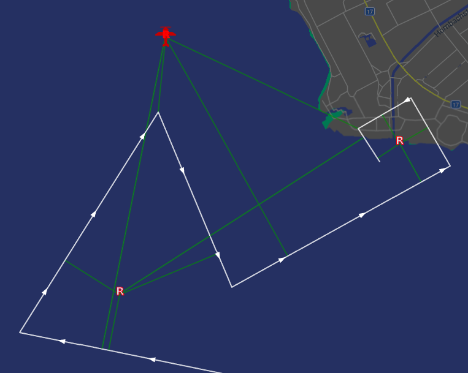
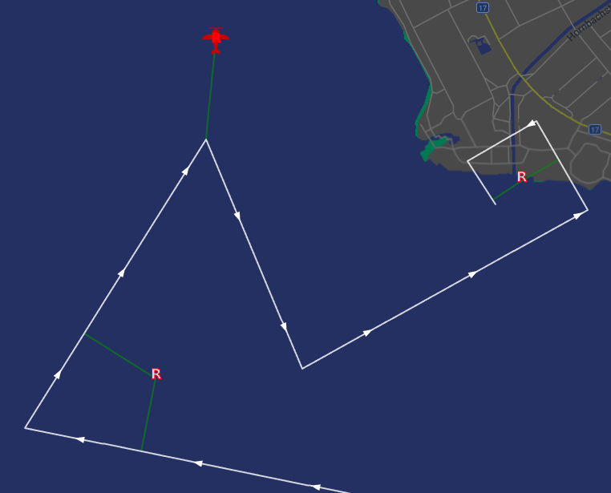
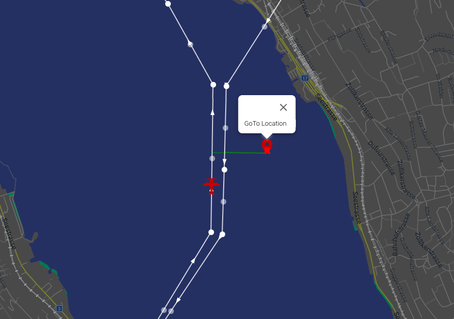
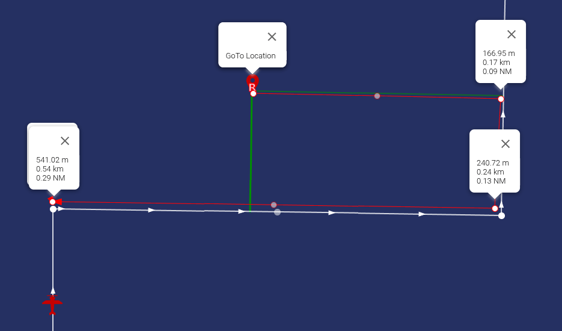

# Mission Route Planning

<Badge type="tip" text="main (PX4 v2.0)" />

Mission route planning lets a multicopter use the uploaded mission as a route:

- [Smart mission rejoin](#smart-mission-rejoin): rejoin the mission after leaving it, for example after manual repositioning or a GoTo.
  Enable it with [MIS_ROUTE_JOIN](../advanced_config/parameter_reference.md#MIS_ROUTE_JOIN) (off by default).
- [Route-following Return](#route-following-return): follow the mission route to a [rally point](../flying/plan_safety_points.md), or to the mission landing or takeoff point.
  Select it with [RTL_TYPE=7](../flight_modes/return.md#rtl_type_7).

::: warning
Both need firmware built with the [mission route cache](../advanced/mission_route_cache.md), and the whole mission must fit in it.
SITL builds include it by default, but most flight controller builds do not; see [Parameters and Build Configuration](#parameters-and-build-configuration).
:::

::: info
Both support multicopters only, including helicopters and coaxials, which report as rotary wing.
Other vehicles, including VTOL vehicles in hover, resume the mission as they do without smart rejoin.
With `RTL_TYPE=7` they return to the closest rally point or Home, as with `RTL_TYPE=0`, with one VTOL exception described in [Return Mode](../flight_modes/return.md#rtl_type_7).
:::

::: warning
The planner checks the legs it adds to the mission against the loaded geofence; see [Geofence Checks](#geofence-checks).
These checks do not cover obstacles.
:::

## Smart Mission Rejoin {#smart-mission-rejoin}

When Mission mode resumes a mission in flight with smart rejoin enabled, the vehicle:

1. Selects a branch-in point and altitude on the route using [Vehicle Projection](#vehicle-projection).
2. Climbs in place to the branch-in altitude if it is more than [NAV_MC_ALT_RAD](../advanced_config/parameter_reference.md#NAV_MC_ALT_RAD) below it, as Mission does before a higher mission item.
   It climbs only to the branch-in altitude: a higher mission item after it is climbed to along the route.
3. Flies straight to the branch-in point.
   From above, it descends on the way.
4. Continues towards the mission end in the mission direction, accounting for any active loop as described below.

Mission then continues with the waypoint at the end of the joined leg.
If the current item is a command inside that leg, for example a gripper release, the vehicle flies back to the waypoint at the start of the leg instead, so the command runs where it was planned.
As when you select a mission item, skipped items are not executed, but the speed, camera and gimbal settings up to that item are restored.
A branch-in point before the paused item flies the legs from there again and runs their commands again, for example a payload release.

If the branch-in lands on an active [`DO_JUMP` loop segment](#vehicle-projection), the loop's repeat count is preserved:

- While repeats remain, the resumed path continues to the jump target, so the loop is still flown.
- Once repeats are exhausted, the planner picks the loop exit with the shorter **total** path to the mission end: forward to the jump target, or back to the waypoint before the jump command.
  Because the whole path counts, the vehicle may rewind most of the loop when the mission end lies near the loop start.

Mission records a loop, and counts its repeat, when it takes the jump.
A pause on the jump edge of the last repeat therefore finds the repeats exhausted, and the rejoin may skip that last pass.
A pause while Mission runs the commands just before a `DO_JUMP` is not on the loop yet: a rejoin on that leg flies back to the waypoint before the commands and runs them again.

The projection search margin is set by [MIS_MC_SEG_DIST](../advanced_config/parameter_reference.md#MIS_MC_SEG_DIST).
The leg from the vehicle to the branch-in point must pass the [Geofence Checks](#geofence-checks) when the join is planned.
If a rejoin cannot be planned, Mission mode resumes without smart rejoin and reports a warning.
This can happen while the mission is still loading into the route cache, or while the geofence is loading.
A camera survey paused while triggering is joined too: the vehicle does not fly back to the previous survey waypoint, as it does without smart rejoin.
The camera restarts only when the vehicle reaches the joined mission item, so the rest of the paused survey leg has no images.
Keep smart rejoin off for camera surveys.
A finished mission is not rejoined: Mission mode holds, as it does without smart rejoin.

With smart rejoin enabled, starting or continuing Mission while airborne attempts to join the route, including the first start after an upload or reboot and a new flight after disarming.
The join may skip earlier mission items, even on the first start.
Starting Mission on the ground follows the mission normally; a later airborne resume can use smart rejoin.

Selecting a mission item while Mission mode is paused makes it the current item of the next resume, like any other current item.
This includes `MAV_CMD_MISSION_START` with a first item, sent while Mission mode is not active.
The rejoin then flies the leg to that item if the leg is within the search margin; otherwise it may branch in before or after the item.
Selecting another item while Mission mode is active flies to it directly, as without smart rejoin.
Resetting the jump counters while Mission mode is active also ends a join in progress: the vehicle flies to the current item.

An upload while Mission is active replaces the mission using normal mission handling; it does not immediately plan a join.
Smart rejoin is attempted on the next airborne Mission activation, subject to route-cache availability.

The rejoin branches in on a leg near the vehicle (see [Vehicle Projection](#vehicle-projection)), and Mission continues the mission in order from there, also when the current item is in the landing sequence (from the `DO_LAND_START` item, or the landing item if there is none).
A `MAV_CMD_DO_LAND_START` sent while Mission mode is not active can therefore fly earlier mission legs before the landing; sent while Mission mode is active, it flies to the landing directly.

When smart rejoin is eligible, the selected route target is a landing item and the vehicle is within its horizontal acceptance radius, Mission executes the landing directly.
This lets a paused descent continue without first climbing back to the approach altitude.
After moving outside that radius, for example with GoTo during a paused descent, resuming Mission uses normal smart rejoin: the vehicle climbs in place back to the route altitude, then flies to the branch-in point.

## Route-Following Return {#route-following-return}

With `RTL_TYPE=7`, Return uses the mission route as its return path:

1. It selects a branch-in point on the route, as [smart mission rejoin](#smart-mission-rejoin) does, and the goal with the lowest route cost: the [rally point](#safe-point-scoring) it reaches with the shortest flight along the route and then off it.
   Without a usable rally point, the goal is the mission landing or the takeoff point, whichever is closer along the route.
2. It climbs in place if it is more than [NAV_MC_ALT_RAD](../advanced_config/parameter_reference.md#NAV_MC_ALT_RAD) below the branch-in point, then flies to it.
3. It follows the route, forwards or backwards, to the branch-off point where it leaves the route for the rally point, or to the landing or takeoff item.
4. It leaves the route at the route altitude and flies level to the rally point.
   Only if the route at the branch-off point is less than [RTL_DESCEND_ALT](../advanced_config/parameter_reference.md#RTL_DESCEND_ALT) above the rally point does it climb on its last route leg, to `RTL_DESCEND_ALT` above the rally point; it never descends before it is above the rally point.
   Example with `RTL_DESCEND_ALT` 30 m and a rally point at 20 m: a route at 30 m climbs to 50 m before it leaves the route, a route at 100 m stays at 100 m until the vehicle is above the rally point.
   A rally point that the vehicle cannot reach `RTL_DESCEND_ALT` above it inside the geofence (its altitude limit included) is not used.
   It flies to the takeoff point at the altitude it had on the route.
   Above a rally point or the takeoff point it waits [RTL_LAND_DELAY](../advanced_config/parameter_reference.md#RTL_LAND_DELAY), at most [RTL_DESCEND_ALT](../advanced_config/parameter_reference.md#RTL_DESCEND_ALT) above the goal, and lands.
   A negative delay holds above the goal without landing.
   The landing uses [RTL_PLD_MD](../advanced_config/parameter_reference.md#RTL_PLD_MD) for precision landing.
5. A mission landing is flown as in Mission mode, with its own precision landing setting and without the delay.

The takeoff point is the position of the mission `TAKEOFF` item, at Home altitude.
This is not always where the vehicle took off.
It is a goal only when that item is the first position item of the mission, and only with a valid Home altitude.

[Route-skip shortcuts](#route-skip-shortcuts) fly straight to the goal when the vehicle is already next to it.

Along the route:

- Waypoint hold times and loiter times are skipped; a `LOITER_TO_ALT` item still changes altitude.
- Return ignores `DO_JUMP` items: after the last item of a loop it flies on to the item after the jump, and the repeat counts do not change.
- The route sets the altitude.
  Return does not climb to [RTL_RETURN_ALT](../advanced_config/parameter_reference.md#RTL_RETURN_ALT), also not when a [Detect and Avoid](../advanced_features/detect_and_avoid.md) traffic action starts it.
- The current mission item moves along with the route, so a later Mission resume continues from the last route item of the Return.
  The branch-off point and the wait above the goal are not reported as reached items.
  The move above a rally point and its landing report the route item the vehicle was flying toward when it left the route, although it did not fly there.
- Selecting a mission item while Return is active does not change the route.
  The next route item Return reaches replaces the selection.
- Speed changes, camera and gimbal commands of the mission are not applied again: Return flies at the default cruise speed, [MPC_XY_CRUISE](../advanced_config/parameter_reference.md#MPC_XY_CRUISE), which its time estimate also assumes.

Before Return starts, the route is planned every two seconds from the current position and mission item, also on the ground.
After a pause, Return plans again from where the vehicle is; paused during the wait, it waits the whole delay again.
Its time estimate is used by the [distance-aware return failsafe](../config/safety.md#distance-aware-return-failsafe); during Return the estimate counts the legs that are left.

### No Route Available {#route-following-no-route}

Return has no route when:

- No mission is uploaded, or Mission has not checked it against the current geofence yet, or rejected it.
- The mission or the rally points are still loading into the route cache, or the mission does not fit in the cache.
- The geofence is loading or unavailable.
- No goal can be reached through the route, for example because every leg to the route crosses the geofence.
- The mission has no landing, its first position item is not a `TAKEOFF`, and no rally point is usable.
- Next to the landing or takeoff point, the straight leg to it crosses the geofence.

Without a route the preflight checks show `No mission route for Return`: a switch to Return is denied, and a failsafe that would return lands instead.
A Return that is already flying brakes and holds where the vehicle stops, at its altitude, and reports `Return: no mission route, holding`.
The mission is not marked finished.
It does not land there on its own, so configure a [battery failsafe](../config/safety.md#battery-level-failsafe) that lands.
While airborne, Return plans again every two seconds and continues along the route once one is found, reporting `Return: mission route found`.
A plan that fails keeps the hold point.
After touchdown Return no longer plans.
Started on the ground, Return stays there with or without a route and reports itself complete, as the other return types do.
It stays there also if the land detector then reports a takeoff, for example when the vehicle is lifted by hand.

### Uploads During Return

An upload of a mission, rally points or a geofence makes the route outdated, and Return plans again at once from where the vehicle is, also above the goal (the move, the turn above a mission landing, the wait).
It can fly to another goal, wait above the same goal again from the start, or hold until the upload is loaded and checked; it briefly shows the hold message then.
Only the final descent keeps its landing.

## Point Projection

This is the projection step of the [Vehicle Projection](#vehicle-projection) and the [Safe-Point Scoring](#safe-point-scoring) below.

The planner draws a perpendicular projection from the point onto every route segment and keeps the four closest as candidates.
After the [Geofence Checks](#geofence-checks), a candidate is kept only if its cross-track distance is within a search margin of the closest candidate left.
The search margin is [MIS_MC_SEG_DIST](../advanced_config/parameter_reference.md#MIS_MC_SEG_DIST) for the vehicle and [RTL_RP_SEG_DIST](../advanced_config/parameter_reference.md#RTL_RP_SEG_DIST) for rally points.
Projections beyond the four closest are dropped, even inside the margin.

The mission route planner supports [`DO_JUMP`](https://mavlink.io/en/messages/common.html#MAV_CMD_DO_JUMP) mission loop commands.
The active jump segment is the segment running from the waypoint before the jump command to the first position waypoint at the jump target.
A point projects onto a loop segment using the same cross-track and margin rule as any other segment.

::: details Click here for more detail on how projections land on segments and corners

A projection is normally perpendicular to the point on a segment, but it is only kept if it is a _local minimum_ of the distance to the route.
This rule decides what happens at a waypoint, where two segments meet:

- An interior projection, one that lands part-way along a segment, is always kept.
- A projection that lands exactly on a waypoint (a corner) is kept only at the end of the route, or when the previous segment and the current segment both project onto that same shared corner.
  This happens when two consecutive segments form a V-shape and the point is closest to the apex:

```text
 A \      / C
    \    /          P projects onto corner B from both segments.
     \  /           Both projections land on B, so the shared
    B \/            corner is kept as a single candidate.

       ^
       P
```

This is why some projections in the images below land on a waypoint instead of perpendicular to a segment.
:::

The example below uses a large margin.
The mission route is drawn in white and projections in green.
The images also show rally points (`R`) and their projections, which route-following Return uses.



Here is the same route with a smaller margin.
Some projections are dropped because their cross-track distance is greater than the closest projection's cross-track distance plus the margin.



With a margin of zero, each point keeps only its single closest projection.

<a id="stacked-waypoints"></a>

::: details Click here to see how stacked waypoints (same latitude and longitude) are handled

Two consecutive waypoints that share latitude and longitude form a vertical segment, for example a climb waypoint above `TAKEOFF` or a descent waypoint above `LAND`.
Every point projects onto such a segment at the same spot.
The vehicle keeps the vertical segment as a candidate when it matches the current mission index, at both `LAND` and `TAKEOFF`.
A vehicle that drifts during a landing therefore keeps `LAND` as its first target.
This exception is disabled during an active `DO_JUMP`.

**Limitation**: after a distant GoTo while targeting `LAND`, the vertical segment at `LAND` can still be selected.
The vehicle may then fly a diagonal path back to the route end instead of joining a closer leg.
It flies that path at the approach altitude.

:::

## Geofence Checks {#geofence-checks}

Before selecting a branch-in point, the planner checks the segment from the vehicle to that point against the loaded geofence.
For Return it also checks the segment from each branch-off point to its rally point, and the direct segment of a [route-skip shortcut](#route-skip-shortcuts).
A segment that touches or crosses an inclusion or exclusion fence boundary is rejected.
Mission legs passed the altitude and distance-from-home limits in the mission check, so points on them are not checked against those limits again.
Rally points are checked against every limit.

The planner checks the candidates kept by [Point Projection](#point-projection), up to four, once the route has been scanned.
A candidate that fails is removed before the search margin is applied, so it cannot hide a farther candidate among the four.

This has a limit: projections beyond the four closest are never checked.
If the four closest projections all fail, the rejoin cannot be planned, even when a farther leg has a clear path.
If only some of them fail, the planner uses the ones left, even when a leg beyond the four would cost less.

When the vehicle is outside a fence polygon or circle, the planner skips the checks of segments that start at the vehicle, to allow recovery along the route.
A vehicle outside only the altitude or distance-from-home limits gets no exemption: its segments are checked.
If the fence is unavailable or still loading, smart rejoin is skipped with a warning and is not retried during that activation, and Return has [no route](#route-following-no-route) until the fence is ready.
The planner does not find detours around fences.

## Vehicle Projection

To rejoin the route, the planner projects the current vehicle position onto the mission path and chooses a "branch-in" point.
The vehicle may have left the route (for example with a GoTo), so the planner picks the point that best preserves mission continuity.

The branch-in point is chosen in three phases:

**Phase 1: Identifying valid candidates:**

The vehicle is projected onto the route as described in [Point Projection](#point-projection).
Candidates must pass the [Geofence Checks](#geofence-checks) before selection.

**Phase 2: Selecting the best branch-in point:**

The best candidate is chosen with a priority system:

- Priority 1: a candidate is selected immediately if it lies on the segment the vehicle is currently expected to be flying (the last targeted waypoint index, or the last flown `DO_JUMP` segment when known).
  This includes the vertical segment being flown at takeoff or landing (see [Stacked Waypoints](#stacked-waypoints)).
- Priority 2: if no candidate matches Priority 1, the planner scores each candidate by summing the following distances, and keeps the lowest:
  - Cross-track distance: from the vehicle to the projection on the route.
  - Distance along the route to the last-flown segment: from the projection, following the mission path to whichever end of the last-flown segment is closer.
    This selects the candidate that gets the vehicle back to where it was last flying if available, or the best match for a close in-sequence segment if it is not.

**Example 1:**

The outbound and inbound legs of this mission run close to each other.
While on the outbound leg, the vehicle deviates east to a GoTo location (e.g. due to incoming traffic).
The GoTo location is closer to the inbound leg, but both legs are within the margin, so the projection step returns one candidate on each.
The outbound leg is the segment the vehicle is expected to fly, so it wins on Priority 1.
It would also win on Priority 2: from the inbound projection, the route back to the outbound leg covers almost the whole mission.
The vehicle rejoins the outbound leg and continues the mission.



**Example 2:**

The vehicle is flying north and deviates to a GoTo location that has two valid branch-in candidates.
Neither projection lies on the current segment, so each candidate is scored by summing its cross-track distance and the distance along the route to the last-flown segment.
Take the candidate projected onto the east segment.
Its score is the cross-track distance (166.95 m) plus the distance along the route back to the last-flown segment (the red lines).
The distance labels in the image add up along this path, so the last label (541.02 m) is the score.
The closer end of the last-flown segment is used, and the along-route distance is the sum of the straight lines between waypoints.
The other candidate, projected onto the south segment, wins because its total distance is smaller.



**Phase 3: Determining the branch-in altitude:**

- Linear interpolation: by default the altitude is interpolated between the start and end waypoint altitudes of the segment (for example, rejoining on segment 2-3 interpolates between waypoint 2 and waypoint 3).
- Special case (land): if the branch-in point falls on a land segment, the previous waypoint altitude is used.
- Special case (vertical segments): if both waypoints of the segment share the same latitude and longitude ([stacked waypoints](#stacked-waypoints)), the segment end waypoint altitude is used.
- Special case (landing): when the first item to fly is `LAND` and the vehicle is already inside its horizontal acceptance radius, the join keeps the vehicle's current altitude.
  `LAND` sits at ground level, and without this rule a vehicle already descending onto it would first be sent back up to the approach altitude.
  Outside the acceptance radius the rules above apply as usual.

**`DO_JUMP` loop segments:** the vehicle can also branch-in on a loop edge.
A loop edge is projected and scored like any other segment, so it competes as an ordinary candidate.
This matters because the loop edge might be the only valid candidate, for example after a GoTo close to the loop edge.

What happens after joining a loop is described in [Smart Mission Rejoin](#smart-mission-rejoin).

## Safe-Point Scoring {#safe-point-scoring}

For route-following Return, the planner projects each rally point onto the route as described in [Point Projection](#point-projection), with the margin [RTL_RP_SEG_DIST](../advanced_config/parameter_reference.md#RTL_RP_SEG_DIST).
Each projection is a candidate branch-off point, where the vehicle would leave the route for that rally point.
Branch-off segments must pass the [Geofence Checks](#geofence-checks).

The planner scores each candidate by the distance along the route from the branch-in point to the branch-off point, plus the distance from the branch-off point to the rally point.
The candidate with the lowest score wins, and the vehicle follows the route in the direction of the shorter path.
Any usable rally point wins over the mission landing and the takeoff point, even when the mission landing is closer.

A rally point projected onto a `DO_JUMP` loop edge is only usable when the vehicle joins the route on that same loop edge.
This keeps a Return from entering a loop just to reach a branch-off point.

## Route-Skip Shortcuts {#route-skip-shortcuts}

Once the goal is selected, the vehicle skips the route in these cases:

- **Next to the rally point**: within [NAV_ACC_RAD](../advanced_config/parameter_reference.md#NAV_ACC_RAD) of it, the vehicle flies straight to it.
- **On the branch-off leg**: within NAV_ACC_RAD of the leg from the branch-off point to the rally point and at the branch-off altitude, the vehicle continues straight to the rally point.
- **Above the landing or takeoff item**: within NAV_ACC_RAD of the first item to fly, when it is the landing (or the takeoff point flown backwards), the vehicle flies straight to it at its current altitude.
  A landing that was paused during its descent continues there.

The shortcuts never change which goal wins.
The direct segment must pass the [Geofence Checks](#geofence-checks); if it fails next to a rally point, the vehicle follows the route instead.
Next to the landing or takeoff point, Return then has no route.

## Parameters and Build Configuration

| Setting           | Purpose                                                       | Default |
| ----------------- | ------------------------------------------------------------- | ------- |
| [MIS_ROUTE_JOIN]  | Enable smart rejoin when Mission resumes a mission in flight. | `0`     |
| [MIS_MC_SEG_DIST] | Search margin for the leg to rejoin, also for Return.         | 30 m    |
| [RTL_TYPE]        | `7` selects route-following Return.                           | `0`     |
| [RTL_RP_SEG_DIST] | Search margin for the leg next to each rally point.           | 30 m    |

[MIS_ROUTE_JOIN]: ../advanced_config/parameter_reference.md#MIS_ROUTE_JOIN
[MIS_MC_SEG_DIST]: ../advanced_config/parameter_reference.md#MIS_MC_SEG_DIST
[RTL_TYPE]: ../advanced_config/parameter_reference.md#RTL_TYPE
[RTL_RP_SEG_DIST]: ../advanced_config/parameter_reference.md#RTL_RP_SEG_DIST

`CONFIG_NAVIGATOR_FULL_MISSION_CACHE_SIZE` must be greater than zero and large enough for the entire uploaded mission.
The parameters above, except `RTL_TYPE`, only exist in firmware built with a non-zero cache size.
POSIX builds (SITL and Linux boards) default to 500 mission items and other boards to 0; `px4_fmu-v6c_visionTargetEstStatic` sets 300.
To use smart rejoin on a NuttX board, set the cache size in the board configuration and check that the RAM fits; see the [mission route cache](../advanced/mission_route_cache.md) for its memory use.
Builds with the cache also raise the Navigator task stack from 3584 to 6000 bytes, and the route planner reserves 312 bytes of static RAM per slot of `CONFIG_NAVIGATOR_SAFE_POINT_BATCH_SIZE` (16 by default; `px4_fmu-v6c_visionTargetEstStatic` sets 32, about 10 KB; smart rejoin uses one slot, route-following Return all of them for the rally points):

```ini
CONFIG_NAVIGATOR_FULL_MISSION_CACHE_SIZE=300
```

An oversized mission can still be flown in Mission mode, but smart rejoin and route-following Return cannot use it.
