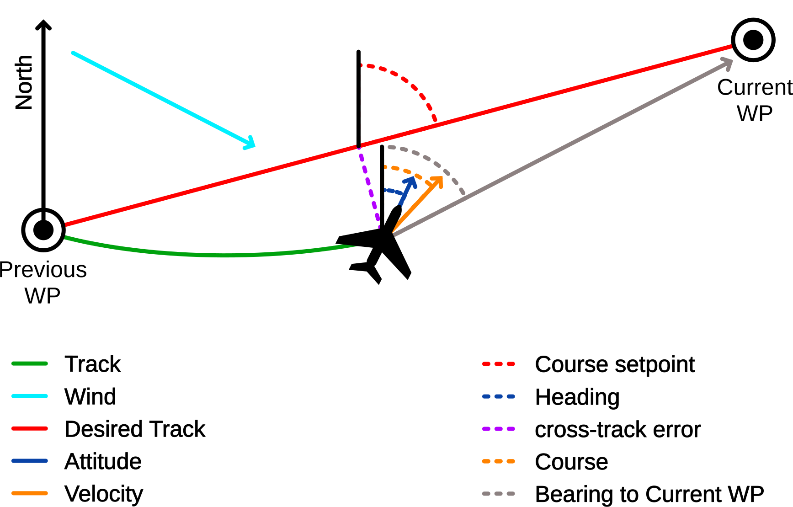
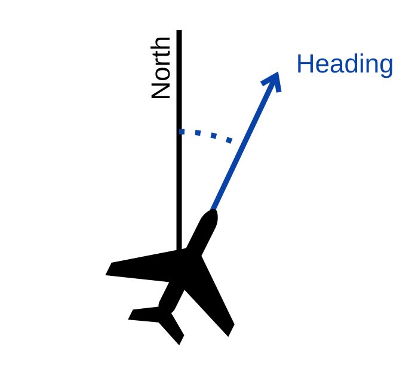
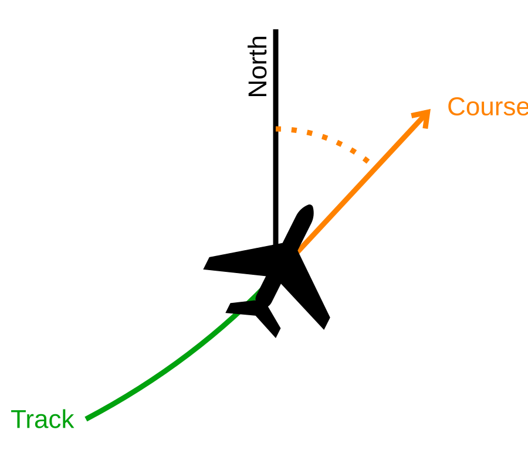
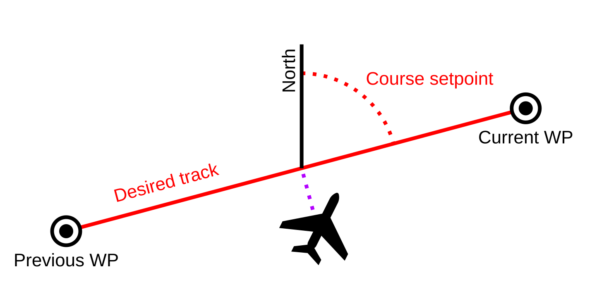
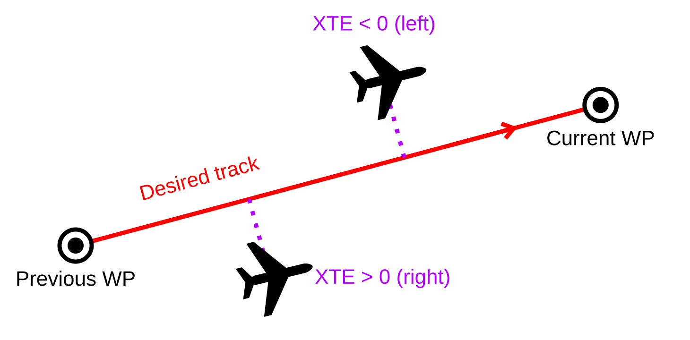
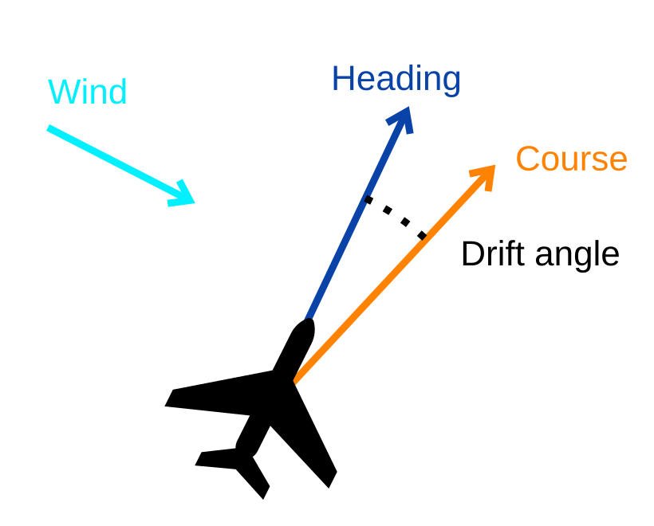
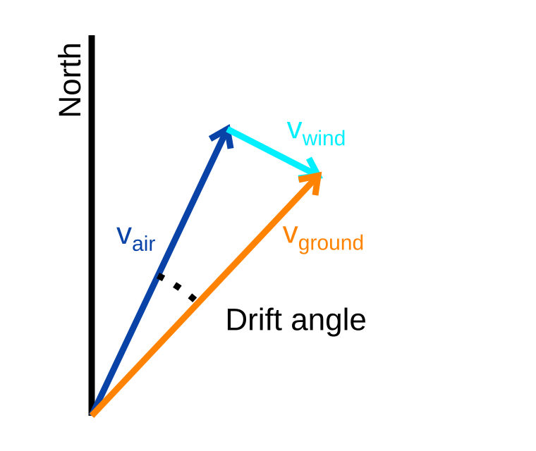

# Navigation Terminology

This page explains the navigation terms you meet when operating PX4, reading logs or tuning: _heading_, _course_, _track_, _bearing_, _cross-track error_ and _drift angle_.
PX4 uses the official definitions of these terms from aviation and marine navigation, with one deliberate exception: _course_ (see [Course](#course)).

For the official definitions quoted with their sources, how conflicting definitions are resolved, ground vehicle terms, and where PX4 represents things differently, see [Navigation Terminology (Advanced)](../concept/navigation_terminology_advanced.md).

::: tip
In short: **heading** is where the vehicle _points_, **course** is where it _moves_ over the ground, **course setpoint** is where it _should move_, and **bearing** is where something _is_.
:::

## Summary

| Term                                      | Official meaning                                              | Example in PX4                            |
| ----------------------------------------- | ------------------------------------------------------------- | ----------------------------------------- |
| [Heading](#heading)                       | Direction in which the body x-axis of the vehicle points.     | `vehicle_local_position.heading`          |
| [Course](#course)                         | Actual direction of motion over the ground.                   | `sensor_gnss.course`                      |
| [Course setpoint](#course-setpoint)       | Intended direction of motion over the ground.                 | `fixed_wing_lateral_setpoint.course`      |
| [Track](#track-and-desired-track)         | Actual path of the vehicle over the ground.                   | Path plotted from a log                   |
| [Desired track](#track-and-desired-track) | Intended path over the ground, such as between two waypoints. | Line from previous to current waypoint    |
| [Bearing](#bearing)                       | Direction from one point to another.                          | `pure_pursuit_status.bearing_to_waypoint` |
| [Cross-track error](#cross-track-error)   | Perpendicular distance from the desired track, and side.      | `pure_pursuit_status.crosstrack_error`    |
| [Drift angle](#drift-angle)               | Angle between heading and track.                              | —                                         |

_Overview figure: vehicle seen from above, north arrow, desired track between two waypoints, heading arrow along the body x-axis, ground velocity arrow (course), course setpoint along the desired track (measured at the point of the desired track closest to the vehicle), bearing to the next waypoint, cross-track error as the perpendicular to the desired track._

## Directions and Frames

All directions on this page are measured **clockwise from true north**: north is 0°, east is 90°, south is 180° and west is 270°.
_QGroundControl_ and MAVLink navigation fields (for example `GLOBAL_POSITION_INT.hdg`) show them in degrees from 0° to 360°.
Internally, PX4 uses radians, usually from $-\pi$ to $\pi$ (west is $-\pi/2$), which matters when you read logs.

PX4 describes positions and orientations in two main frames:

- **NED (north, east, down):** The local earth-fixed frame, with its origin where the estimator started.
  Positions and velocities in `vehicle_local_position` are in NED.
- **FRD (front, right, down):** The body frame, fixed to the vehicle.
  The [heading](#heading) is the direction of the body front axis.

A compass measures magnetic north, which differs from true north by the _magnetic declination_.
The estimator corrects for this automatically, using the World Magnetic Model or [EKF2_MAG_DECL](../advanced_config/parameter_reference.md#EKF2_MAG_DECL) depending on [EKF2_DECL_TYPE](../advanced_config/parameter_reference.md#EKF2_DECL_TYPE).

## Terms

### Heading

The heading is where the x-axis (nose, or bow, or front) of the vehicle points.
It says nothing about the direction in which the vehicle _moves_: a multicopter can fly sideways, a plane crabs in a crosswind, and a boat is pushed off by wind and current.

PX4 uses _heading_ and _yaw_ (the yaw angle of the vehicle attitude) as synonyms: `vehicle_local_position.heading` is the Euler yaw angle, and heading setpoints are named `yaw`.
The yaw angle is the direction of the body x-axis projected onto the horizontal plane, so the two only part ways when the x-axis points (nearly) straight up or down, where the heading is undefined.
Note that _yaw_ also names the rotation about the vertical axis (yaw rate, yaw moment), which is not a direction.

PX4 represents the heading using:

- [`vehicle_local_position.heading`](../msg_docs/VehicleLocalPosition.md) (estimate).
- [`trajectory_setpoint.yaw`](../msg_docs/TrajectorySetpoint.md) and [`rover_attitude_setpoint.yaw_setpoint`](../msg_docs/RoverAttitudeSetpoint.md) (setpoints).
- MAVLink [`GLOBAL_POSITION_INT.hdg`](https://mavlink.io/en/messages/common.html#GLOBAL_POSITION_INT) and [`VFR_HUD.heading`](https://mavlink.io/en/messages/common.html#VFR_HUD).

### Course

The course is the direction the vehicle _actually_ moves over the ground: the direction of its ground velocity.
It is also called _course over ground_ (COG) in marine navigation, and it is what a GNSS receiver reports as "course" and what avionics show as _TRK_ (track).
It is undefined when the vehicle is stationary, and noisy at low speed.

PX4 represents the course using:

- [`sensor_gnss.course`](../msg_docs/SensorGnss.md) ("Course over ground, not heading").
- MAVLink [`GPS_RAW_INT.cog`](https://mavlink.io/en/messages/common.html#GPS_RAW_INT).

### Course Setpoint

The course setpoint is the direction the vehicle _should_ move over the ground, for example along the line to the next waypoint.
Whether the vehicle actually moves that way is shown by the [course](#course).

PX4 represents the course setpoint using:

- [`fixed_wing_lateral_setpoint.course`](../msg_docs/FixedWingLateralSetpoint.md) ("Desired direction of travel over ground w.r.t (true) North").

::: warning PX4 differs from aviation and marine navigation
In aviation and marine navigation, bare _course_ means the _intended_ direction, and the actual direction is the _course over ground_ or _track angle_.
PX4 instead uses _course_ for the measured or estimated direction and _course setpoint_ for the intended one, like _heading_ and _heading setpoint_.
Keep this in mind when you read aviation or marine sources, for example the FAA wind correction angle, which applies to the course setpoint in PX4 terms.
See [Course Is the Actual Direction](../concept/navigation_terminology_advanced.md#course-is-the-actual-direction) for the reasoning.
:::

### Track and Desired Track

- **Track:** The actual path the vehicle traced over the ground, such as the path plotted from a log.
  Its direction at any point is the [course](#course).
- **Desired track:** The intended path over the ground, which the vehicle tries to follow.
  This is usually the line between two waypoints, but it can also be a line along a course setpoint the vehicle holds.

::: info
In marine navigation, bare "track" means the _intended_ path.
To avoid confusion, PX4 always writes _desired track_ for the intended path.
:::

### Bearing

A bearing is the direction from one point to another, for example from the vehicle to the next waypoint.
It depends only on the two positions, not on where the vehicle points or moves.

PX4 represents the bearing using:

- [`pure_pursuit_status.bearing_to_waypoint`](../msg_docs/PurePursuitStatus.md).

### Cross-Track Error

The cross-track error (XTE) is how far the vehicle is off the [desired track](#track-and-desired-track), measured perpendicular to it, and on which side.

In PX4, the cross-track error is **positive when the vehicle is to the right of the desired track**, and negative when it is to the left, looking in the direction of travel.

PX4 represents the cross-track error using:

- [`pure_pursuit_status.crosstrack_error`](../msg_docs/PurePursuitStatus.md) (rovers).
- [`fixed_wing_lateral_guidance_status.signed_track_error`](../msg_docs/FixedWingLateralGuidanceStatus.md) (fixed-wing).

### Drift Angle

The drift angle is the difference between where the vehicle points ([heading](#heading)) and where it moves ([course](#course)).
Wind causes it for aircraft, wind and current for boats, and wheel slip for rovers.
Multicopters and mecanum rovers can also move sideways on purpose.

### Airspeed and Ground Speed

Ground speed (called _speed over ground_, SOG, in marine navigation) is the speed over the ground, in the direction of the course.
Airspeed is the speed through the air (see [Airspeed in PX4](../config_fw/airspeed_scale_handling.md#airspeed-in-px4) for indicated, calibrated and true airspeed).
The two differ by the wind.

### Wind Direction

Wind is reported by the direction it blows **from**: a wind "from 90°" blows from the east towards the west.

PX4 wind estimates are velocity vectors instead, which point where the air moves **to**.
A wind from the north therefore has a negative `windspeed_north` in PX4.

PX4 represents the wind using:

- [`wind.windspeed_north`](../msg_docs/Wind.md) and `wind.windspeed_east` (estimate, NED).
- MAVLink [`WIND_COV.wind_x`](https://mavlink.io/en/messages/common.html#WIND_COV) and `WIND_COV.wind_y` (same sign convention as `wind`).

## Wind Triangle

Heading and course differ because the vehicle moves through air (or water) that itself moves over the ground:

$$
\mathbf{v}_{ground} = \mathbf{v}_{air} + \mathbf{v}_{wind}
$$

- The direction of $\mathbf{v}_{ground}$ is the **course**, and its magnitude is the **ground speed**.
- For a fixed-wing aircraft, $\mathbf{v}_{air}$ points along the **heading**, and its magnitude is the **airspeed**.
- The angle between the heading and $\mathbf{v}_{ground}$ is the **drift angle**.

## Further Information

[Navigation Terminology (Advanced)](../concept/navigation_terminology_advanced.md) covers:

- The official definitions of each term, quoted from the aviation, marine and ground vehicle sources, and the rule PX4 uses when they disagree.
- The reference frames in detail (WGS 84, NED, FRD, along-track/cross-track), north references and z-up conventions such as ROS and ISO 8855.
- Why PX4 uses _course_ for the actual direction, unlike aviation and marine navigation.
- Ground vehicle terms (yaw, course and sideslip angle), and why _sideslip_ means different things for planes and rovers.
- Where PX4 represents things differently from the norms, and existing field names that deviate.
- Guidelines for contributors, and terms PX4 does not use yet.
