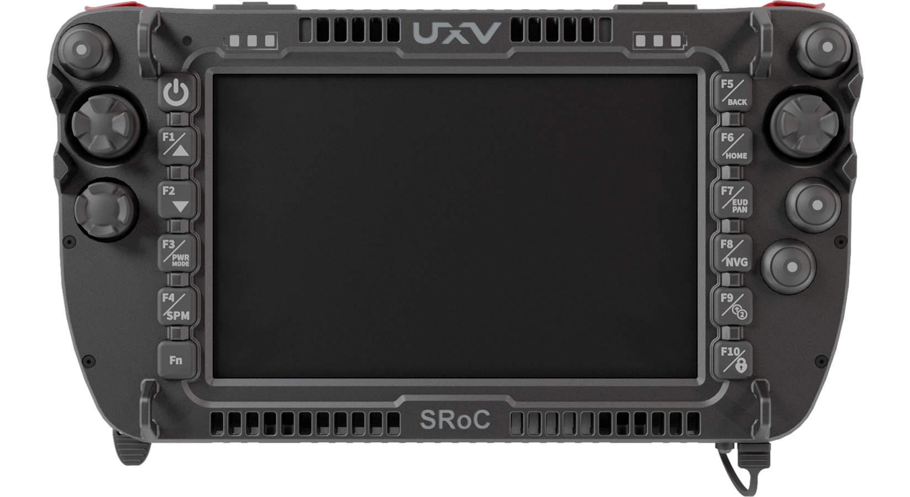

# Integrated Ground Control Stations

A GCS typically includes manual control sticks, a display, a computer, telemetry, video capture, and aerials for the control, video, and data links.
An integrated GCS combines these into one handheld or portable device.
For PX4, the device typically runs _QGroundControl_ (QGC).

The main benefit is that a single unit provides both manual control and full ground control station features, such as mission planning, telemetry, and video.
Having fewer components also simplifies setup and shortens preparation time before vehicle operation.

 

## Supported Controllers

Handheld controllers supported by PX4:

- [CubePilot Herelink](https://docs.cubepilot.org/herelink/herelink-overview)
- [SIYI UniRC 10 Pro](https://shop.siyi.biz/products/siyi-unirc-10-pro)
- [UXV Technologies SRoC 7" Android/Linux/Windows](https://www.uxvtechnologies.com/ground-control-stations/sroc-windows)
- [UXV Technologies SRoC S26](https://www.uxvtechnologies.com/ground-control-stations/sroc-s26)
- [UXV Technologies Micronav](https://www.uxvtechnologies.com/ground-control-stations/micronav)

Portable/stationary GCS supported by PX4:

- [UXV Technologies G2Nav](https://www.uxvtechnologies.com/ground-control-stations/g2nav)

## Selection Criteria

Factors to consider when selecting an integrated GCS:

- **Manual Control Method**: Some units send manual control as MAVLink messages over the telemetry link, while others output a standard RC signal from the air unit (see [PX4 Configuration](#px4-configuration)).
  An RC signal has lower latency, and can be combined with a separate RC system as a backup.
- **Swappable Radio**: Some units allow the radio to be swapped easily, which slightly increases the weight of the system.
- **Operating System**: Devices are sold with Windows, Android, or Linux, and must be able to run QGC for PX4.
- **Video and Payload Interfaces**: Units differ in the camera inputs (such as Ethernet or HDMI) and payload connections they provide on the air unit.
- **Batteries**: Some units have integrated batteries, while others have swappable ones.
- **Durability**: Some units have ruggedised housings with dust and water ratings, while others do not.

All of these factors are reflected in the price and weight of the GCS.

## PX4 Configuration

An integrated GCS is configured in the same way as the separate components it replaces.
Check the device documentation to find out how it connects to the flight controller, and then configure PX4 as described below.

### Manual Control

An integrated GCS sends manual control inputs to PX4 in one of two ways, depending on the device:

- **MAVLink messages over the telemetry link:** Configure the controller as a joystick in QGC, as described in [Joystick Setup](../config/joystick.md).
  You don't need to perform [Radio Setup](../config/radio.md).
- **A standard RC signal output from the air unit:** Connect the air unit to the flight controller's RC input, and then configure it as an RC system using [Radio Setup](../config/radio.md) and [Flight Mode Configuration](../config/flight_mode.md).
  Make sure that the air unit signals loss of the link to PX4, as described in [Radio Setup > RC Loss Detection](../config/radio.md#rc-loss-detection).

PX4 locks to the first valid manual control source it detects, so no further configuration is needed if you only have one source.
If you have more than one (for example, a joystick and a backup RC system), use [COM_RC_IN_MODE](../advanced_config/parameter_reference.md#COM_RC_IN_MODE) to set their priority and fallback behaviour, as described in [Manual Control > PX4 Configuration](../config/manual_control.md#px4-configuration).

### Telemetry Link

The air unit connects to a MAVLink port on the flight controller, usually over a serial port or Ethernet.

- **Serial:** The `TELEM1` port is configured for a GCS link by default, at 57600 baud (see [MAVLink Peripherals > Default MAVLink Ports](../peripherals/mavlink_peripherals.md#default_ports)).
  If the air unit uses a different baud rate, set the corresponding parameter, such as [SER_TEL1_BAUD](../advanced_config/parameter_reference.md#SER_TEL1_BAUD), to match it.
- **Ethernet:** Set up the flight controller on the same network as the air unit, as described in [PX4 Ethernet Setup](../advanced_config/ethernet_setup.md).

### Failsafes

Set up the [Manual Control Loss Failsafe](../config/safety.md#manual-control-loss-failsafe) and the [Data Link Loss Failsafe](../config/safety.md#data-link-loss-failsafe).

If manual control is sent as MAVLink messages, control and telemetry share the same radio link.
Losing that link triggers both failsafes at the same time, so their actions ([NAV_RCL_ACT](../advanced_config/parameter_reference.md#NAV_RCL_ACT) and [NAV_DLL_ACT](../advanced_config/parameter_reference.md#NAV_DLL_ACT)) should be consistent.
If manual control is sent as an RC signal, the two links can fail independently.

### Arming and Flight Modes

With MAVLink manual control, you arm the vehicle and select flight modes from QGC, or with controller buttons that you map in **Vehicle Setup > Joystick**.
With an RC signal, you use stick gestures or switches, as described in [Flight Mode Configuration](../config/flight_mode.md) and [Safety > Arm/Disarm Switch](../config/safety.md#arm-disarm-switch).

### Video, Cameras and Gimbals

Video streaming is usually configured on the GCS and air unit, not in PX4.
If the camera or gimbal is controlled through PX4, see [Cameras](../camera/index.md) and [Gimbal Configuration](../advanced/gimbal_control.md).

## See Also

- [Manual Control](../config/manual_control.md)
- [Joystick Setup](../config/joystick.md)
- [Radio Control (RC) Systems](../getting_started/rc_transmitter_receiver.md)
- [Safety (Failsafe) Configuration](../config/safety.md)
