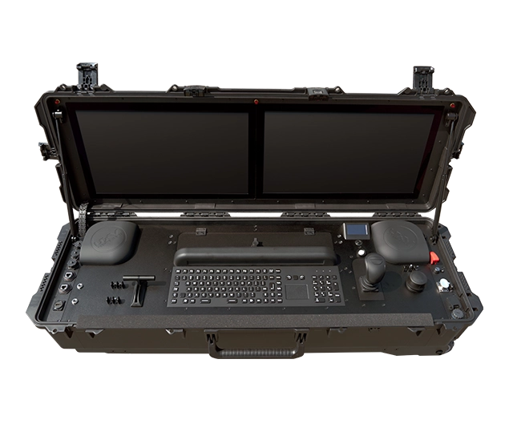

# Integrated Ground Control Stations

A GCS typically includes a human-machine interface, a computer, telemetry, video capture, and aerials for the control, video, and data links. An integrated GCS combines these into one handheld or portable device. For PX4, the device runs QGroundControl.

This simplifies setup and shortens preparation time, as there are fewer components to prepare before vehicle operation.

::: tip
To combine control and telemetry into one stream, MAVLink messages carry the control inputs alongside the telemetry. Refer to the [Joystick Setup](../config/joystick.md) page for a detailed guide.
:::

## Overview

Factors to consider when selecting an integrated GCS:

- **Radio Compatibility**: Some units allow the radio to be swapped easily, which slightly increases the weight of the system.

- **Operating System**: Devices are sold with Windows, Android, or Linux, and must be able to run QGC for PX4.

- **Batteries**: Some units have integrated batteries, while others have swappable ones.

- **Durability**: Some units have ruggedized housings with dust and water ratings, while others do not.

All of these factors are reflected in the price and weight of the controller.

## Types of Integrated GCS

### Handheld Controllers

A handheld controller is a small unit that the operator carries during vehicle operation.

GCS in this category:

- [CubePilot Herelink](https://docs.cubepilot.org/herelink/herelink-overview)

- [SIYI UniRC 10 Pro](https://shop.siyi.biz/products/siyi-unirc-10-pro)

- [UXV Technologies SRoC 7" Android/Linux/Windows](https://www.uxvtechnologies.com/ground-control-stations/sroc-windows) (confirmed to work with PX4 and QGC)

- [UXV Technologies SRoC S26](https://www.uxvtechnologies.com/ground-control-stations/sroc-s26) (confirmed to work with PX4 and QGC)

- [UXV Technologies Micronav](https://www.uxvtechnologies.com/ground-control-stations/micronav) (confirmed to work with PX4 and QGC)

### Stationary, Transportable GCS

The form factor and weight of this type of GCS do not allow it to be moved during vehicle operation. It is designed to be packed up easily and transported to a different location after operation.

GCS in this category:

- [Alpha Unmanned Systems G-Case Duo](https://www.alphaunmannedsystems.com/product/ground-control-station)

- [UXV Technologies G2Nav](https://www.uxvtechnologies.com/ground-control-stations/g2nav) (confirmed to work with PX4 and QGC)