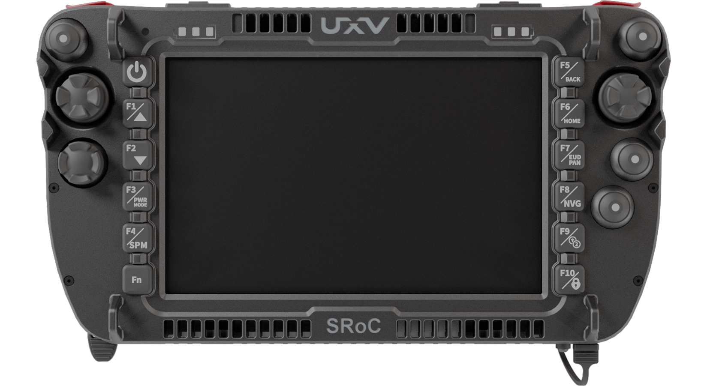
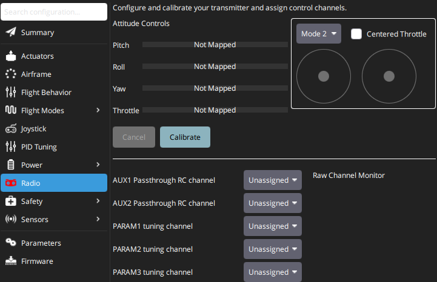

# Joystick Setup

A [computer joystick](https://en.wikipedia.org/wiki/Joystick) or [gamepad](https://en.wikipedia.org/wiki/Gamepad) connected to a device running _QGroundControl_ (QGC) can be used to manually control a vehicle using MAVLink messages over the telemetry link.
This combines radio control and telemetry into a single stream, which simplifies the setup.

[Integrated Ground Control Stations (GCS)](../config/integrated_gcs.md) go a step further and join the computer and the Joystick/Gamepad into one device.

## Joystick Control Use

To set up Joystick with _QGC_ to control a vehicle running PX4, refer to the QGC docs for the most up-to-date guide: [QGroundControl > Joystick Setup](https://docs.qgroundcontrol.com/master/en/qgc-user-guide/setup_view/joystick.html).

::: tip
[Radio Setup](../config/radio.md) is not required when using only a joystick, because a joystick is not an RC controller.
As a result, the __Radio__ tab stays unconfigured (red) in QGC, as seen in the picture below.
You can safely ignore this.

:::

::: info
QGC uses the cross-platform [SDL2](https://www.libsdl.org/index.php) library to convert joystick movements into _MAVLink_ [MANUAL_CONTROL](https://mavlink.io/en/messages/common.html#MANUAL_CONTROL) messages, which are then sent to PX4 over the telemetry channel.
As a result, a joystick-based control system requires a reliable, high-bandwidth, low-latency telemetry channel so that the vehicle responds promptly to joystick movements.
:::

Joysticks are also commonly used by developers to fly vehicles in simulation.

::: tip
Not all PX4 frame types support negative thrust.
:::
