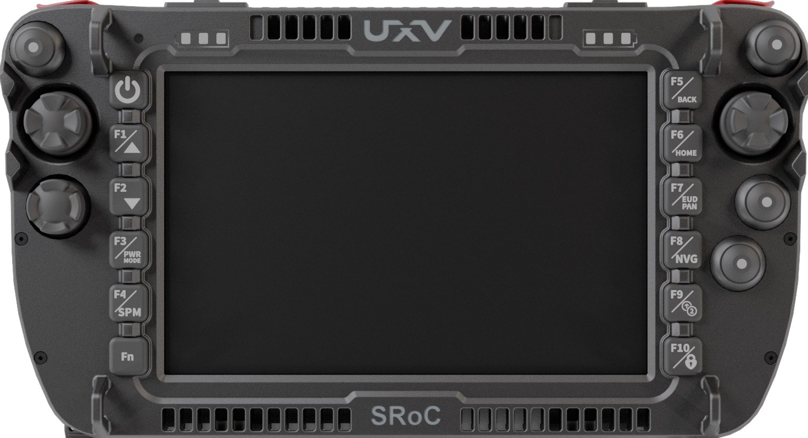
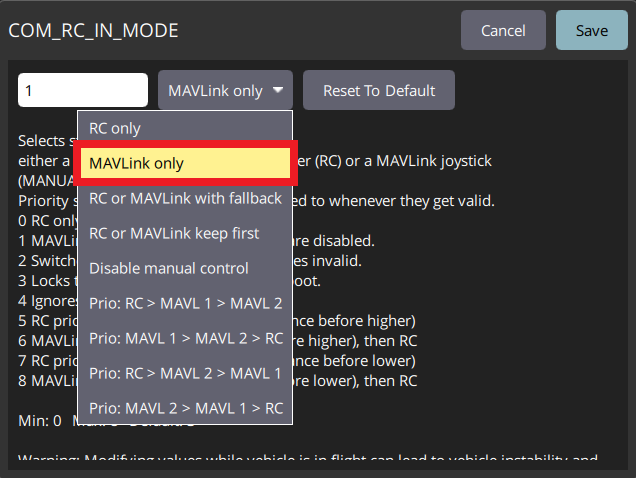
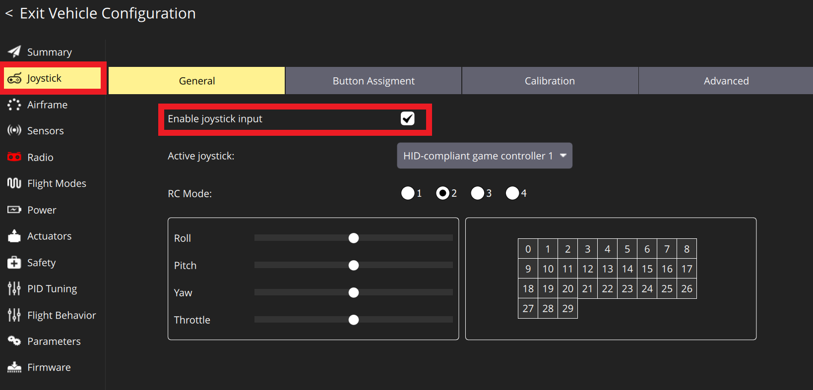
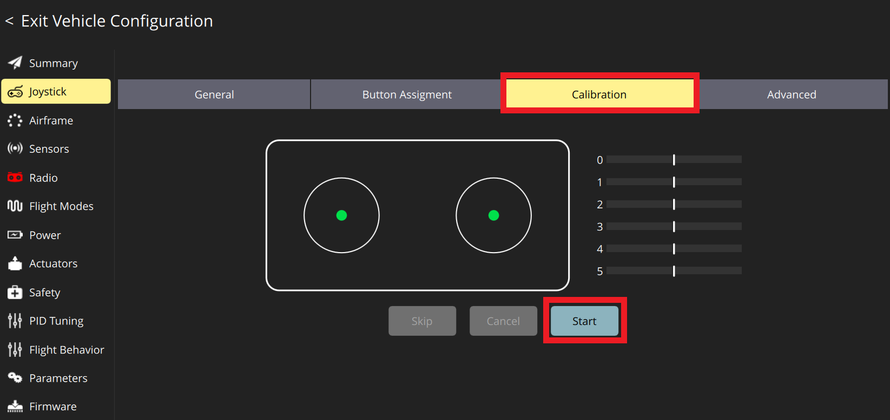
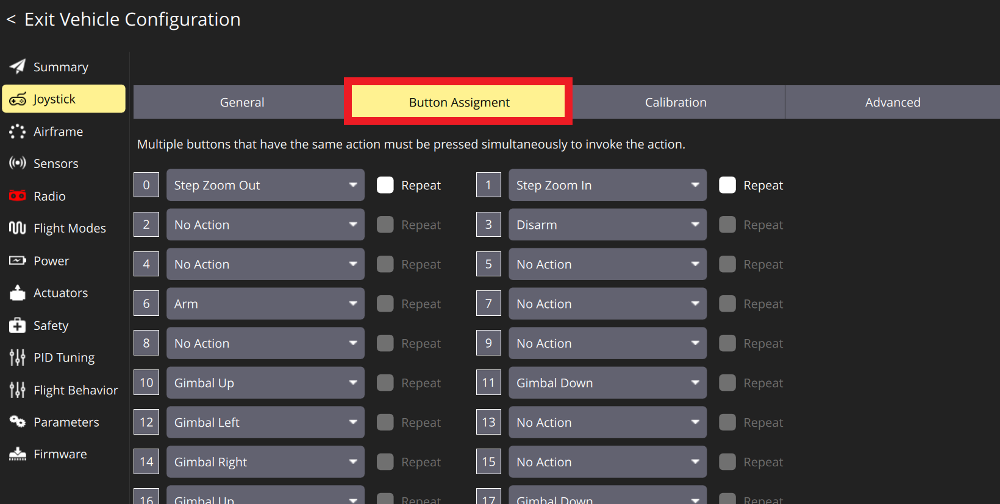
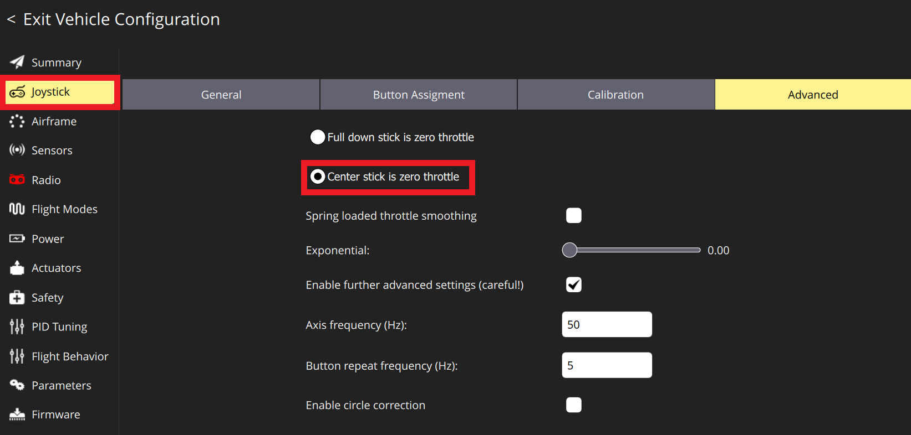

# Joystick Setup

A [computer joystick](https://en.wikipedia.org/wiki/Joystick) or [gamepad](https://en.wikipedia.org/wiki/Gamepad) connected to a device running *QGroundControl* can be used to manually control a vehicle using MAVLink messages over the telemetry link.

## Introduction

Setting up joystick control through telemetry is advantageous because it combines radio control and telemetry into a single stream, which simplifies the setup.

::: info
*QGroundControl* uses the cross-platform [SDL2](https://www.libsdl.org/index.php) library to convert joystick movements into MAVLink [MANUAL_CONTROL](https://mavlink.io/en/messages/common.html#MANUAL_CONTROL) messages, which are then sent to PX4 over the telemetry channel.
As a result, a joystick-based control system requires a reliable, high-bandwidth, low-latency telemetry channel so that the vehicle responds promptly to joystick movements.
:::

Joysticks are also commonly used by developers to fly vehicles in simulation.

## Integrated Ground Control Stations

Some manual control units go a step further and integrate the computer and joysticks into one device.
Examples of such integrated GCS devices are the [UXV Technologies SRoC](https://www.uxvtechnologies.com/ground-control-stations/sroc-windows) and the [CubePilot Herelink](https://docs.cubepilot.org/herelink/herelink-overview).
Integrated GCS devices are described in [Integrated GCS](../config/integrated_gcs.md).

## Enabling PX4 Joystick Support

For the most up-to-date information about joystick setup, refer to the QGC docs: [QGroundControl > Joystick Setup](https://docs.qgroundcontrol.com/master/en/qgc-user-guide/setup_view/joystick.html).

Step-by-step setup in QGC:

1. Connect to the flight controller using telemetry or USB.

2. Open *QGroundControl* and go to **QGC Logo > Vehicle Configuration > Parameters**.

3. Set [`COM_RC_IN_MODE`](../advanced_config/parameter_reference.md#COM_RC_IN_MODE) to **MAVLink Only**.

   

   ::: tip
   The default **RC or MAVLink keep first** will also work if you only have a joystick connected.
   :::

4. Connect the joystick to the computer.
   This enables the joystick configuration tab in QGC Vehicle Configuration.

5. Select the **Enable Joystick Input** checkbox.

   

::: tip
[Radio Setup](../config/radio.md) is not required when using only a joystick, because a joystick is not an RC controller.
As a result, the **Radio** tab stays red in QGC (as seen in the picture above).
You can safely ignore this.
:::

## Calibration and Button Mapping

1. Calibrate the joystick in the **Calibration** tab.
   QGC asks you to move each axis to its furthest position, one axis at a time.

   

2. Map the buttons in the **Button Assignment** tab.
   Press the buttons one at a time, see which one lights up in QGC, and select its function.

   

3. (Optional) Set the centre stick as zero throttle in the **Advanced** tab.

   

4. (Optional) Allow negative thrust in the **Advanced** tab by selecting the corresponding checkbox.

   ::: tip
   Not all PX4 frame types support negative thrust.
   :::

5. (Optional) Adjust the exponential slider in the **Advanced** tab.
   Increasing the exponential value changes the throttle curve from linear to progressively more exponential, which gives more sensitivity around the centre for precise manoeuvres.

## Flight Modes

- **Normal**: The user controls the vehicle in the same way as with a normal radio. MAVLink [MANUAL_CONTROL](https://mavlink.io/en/messages/common.html#MANUAL_CONTROL) messages are sent.

- **Attitude**: The user controls the vehicle's attitude. MAVLink [SET_ATTITUDE_TARGET](https://mavlink.io/en/messages/common.html#SET_ATTITUDE_TARGET) messages are sent.

- **Position**: The user controls the vehicle's position. MAVLink [SET_POSITION_TARGET_LOCAL_NED](https://mavlink.io/en/messages/common.html#SET_POSITION_TARGET_LOCAL_NED) messages with a position-only bitmask are used.

- **Force**: The user controls the forces applied to the vehicle. MAVLink [SET_POSITION_TARGET_LOCAL_NED](https://mavlink.io/en/messages/common.html#SET_POSITION_TARGET_LOCAL_NED) messages with a force-only bitmask are used.

- **Velocity**: The user controls the vehicle's velocity. MAVLink [SET_POSITION_TARGET_LOCAL_NED](https://mavlink.io/en/messages/common.html#SET_POSITION_TARGET_LOCAL_NED) messages with a velocity-only bitmask are used.