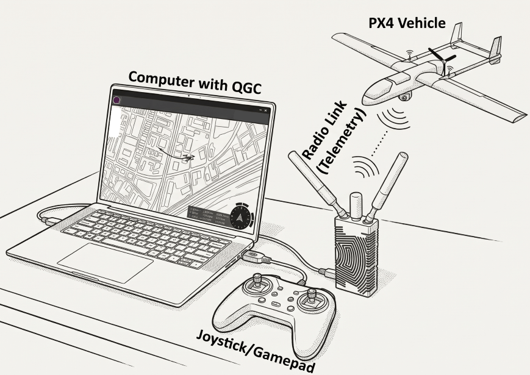

# Joystick Setup

A [computer joystick](https://en.wikipedia.org/wiki/Joystick) or [gamepad](https://en.wikipedia.org/wiki/Gamepad) connected to a device running _QGroundControl_ (QGC) can be used to manually control a vehicle (instead/as well as an [RC Transmitter](../config/radio.md))

This approach sends Joystick movements and button presses encoded as MAVLink [MANUAL_CONTROL](https://mavlink.io/en/messages/common.html#MANUAL_CONTROL) messages over the telemetry link, which provides a simpler and (usually) less expensive setup than using a separate [RC Transmitter](../config/radio.md).

Joysticks are often used in [Integrated Ground Control Stations](../config/integrated_gcs.md) and are recommended for flying the vehicle in simulation.

::: tip
A joystick-based controller system requires a reliable, high-bandwidth telemetry link to ensure that the vehicle is responsive to joystick movements.
[RC Transmitters](../config/radio.md) are preferred for vehicle bring-up and in other situations where very low latency is required.
:::

## Enabling PX4 Joystick Support

Information about how to set up a joystick is covered in: [QGroundControl > Joystick Setup](https://docs.qgroundcontrol.com/master/en/qgc-user-guide/setup_view/joystick.html).

::: tip
[Radio Setup](../config/radio.md) is not required when using only a joystick.
:::

Note:

- If you have multiple Joysticks and/or also have an RC Controller, set [COM_RC_IN_MODE](../advanced_config/parameter_reference.md#COM_RC_IN_MODE) as described in [Manual Control > PX4 Configuration](../config/manual_control.md#px4-configuration).
- Manual control and telemetry share one link so you should set [Manual Control Loss](../config/safety.md#manual-control-loss-failsafe) and [Data Link Loss](../config/safety.md#data-link-loss-failsafe) failsafe actions consistently.

## Developer Information

QGC uses the cross-platform [SDL](https://www.libsdl.org/) library to convert joystick movements to MAVLink [MANUAL_CONTROL](https://mavlink.io/en/messages/common.html#MANUAL_CONTROL) messages, which are then sent to PX4 over the telemetry link.
PX4 also defines fixed meanings to some of the `MANUAL_CONTROL` button values, and these are mapped to user-selected functions by the ground station.

Other ground stations and MAVLink APIs may use different methods to map joystick controls to `MANUAL_CONTROL` messages.
