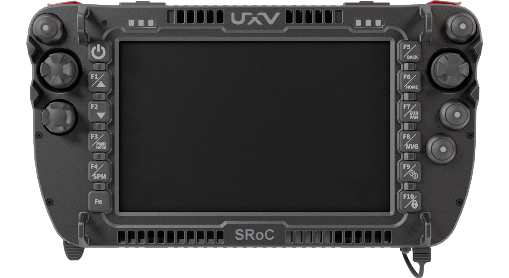
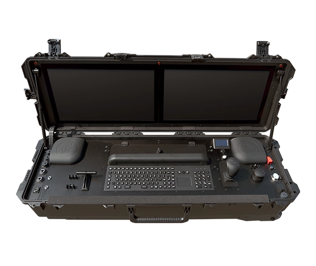
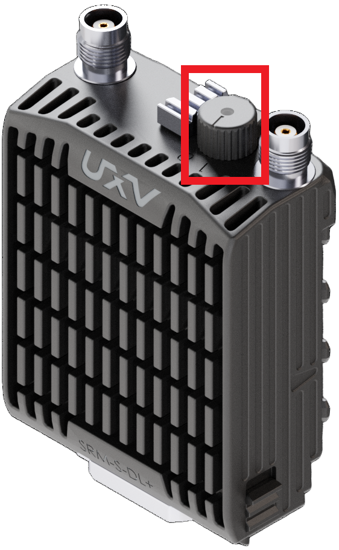

# UXV Technologies Ground Control Stations

[UXV Technologies](https://www.uxvtechnologies.com/ground-control-stations) manufactures enterprise-grade [integrated ground control stations](integrated_gcs.md) (GCSs) that can run *QGroundControl* and control PX4 vehicles using [Ethernet-enabled flight controllers](../advanced_config/ethernet_setup.md#supported-flight-controllers).

::: info
PX4 does not manufacture this hardware.
[Contact UXV Technologies](https://www.uxvtechnologies.com/contact) for support.
:::

<!-- The intention is to publish UXV Technologies documentation soon and replace the website links with links to the relevant hardware documentation. -->
<!-- I would also like to add more controllers once they have been tested with PX4, so the page is structured to accommodate future additions. -->

<!-- Tested with QGroundControl v5.1.5 and PX4 v1.17.0. -->

<table style="width: 100%; table-layout: fixed;">
  <colgroup>
    <col style="width: 60%;">
    <col style="width: 30%;">
    <col style="width: 10%;">
  </colgroup>
  <thead>
    <tr>
      <th>GCS Image</th>
      <th>Name</th>
      <th>Link</th>
    </tr>
  </thead>
  <tbody>
    <tr>
      <td>
        
      </td>
      <td>
        SRoC 7" Windows
      </td>
      <td>
        <a href="https://www.uxvtechnologies.com/ground-control-stations/sroc-windows">Website</a>
      </td>
    </tr>
    <tr>
      <td>
        
      </td>
      <td>
        G2Nav
      </td>
      <td>
        <a href="https://www.uxvtechnologies.com/ground-control-stations/g2nav">Website</a>
      </td>
    </tr>
  </tbody>
</table>

## Control over Telemetry Setup

### Install QGC

Install *QGroundControl* on the controller by following the [official installation guide](https://docs.qgroundcontrol.com/master/en/qgc-user-guide/getting_started/download_and_install.html).

::: info
Some controllers may not have Wi-Fi connectivity.
In this case, install *QGroundControl* from a USB drive or another offline source.
:::

### Set Up Hardware

<!-- This section should link to the UXV Technologies documentation instead of describing the setup procedure once that documentation becomes available. -->

1. Insert a UXV Technologies SRM (Swappable Radio Module) radio into the SRM interface on the GCS.
   The SRM interface provides Ethernet and power connections to the radio.

1. Connect the flight controller to an IP-based radio using an Ethernet cable.
   It is recommended to use a UXV Technologies SRM, which can be connected through the UXV Technologies [SRM Airside ETH](https://www.uxvtechnologies.com/communication/srm-airside-ethernet) module.

   ::: tip
   In certain setups, the size or weight of an SRM may be a significant drawback.
   A UXV Technologies SRM integrates radios from various vendors.
   Instead of using an SRM, you can also use standalone radios connected to a vehicle or GCS via USB, Ethernet, or other protocols.
   Refer to the vendor-specific documentation for more details.
   :::

1. Turn on both the GCS-side and vehicle-side radios.

   ::: warning
   Ensure that the antennas are connected before powering on the radios, as operating without antennas may damage them.
   :::

{width=30%}

A UXV Technologies SRM radio has a switch for powering the radio on.

### Ethernet Setup with PX4 and QGC

1. Set up the data link by following the [IP-Based Radio](../ip_based_radios/index.md#point-to-point-connection-setup) guide.
   <!-- Alternatively, use the path for IP-based radios nested under telemetry radios once a decision has been made. -->

1. [Connect](../advanced_config/ethernet_setup.md#qgroundcontrol-setup-example) to the flight controller in *QGroundControl*.
   Confirm that telemetry works in the same way as with a direct USB or Ethernet cable connection.
   The GCS can now be used for waypoint missions and other non-manual flight modes.

   ::: tip
   To test the setup without the radios, connect the SRoC directly to the flight controller using a UXV Technologies [SRM-RJ45](https://www.uxvtechnologies.com/communication/srm-rj45) module and an Ethernet cable.
   :::

1. (Optional) Open *UXV Suite* (preinstalled on UXV Technologies GCSs) and configure the joystick input.
   For example, you can adjust the sensitivity and deadbands of the joysticks.

1. (Optional) Follow the [Joystick Setup](joystick.md) guide to send manual control messages over the telemetry link.
