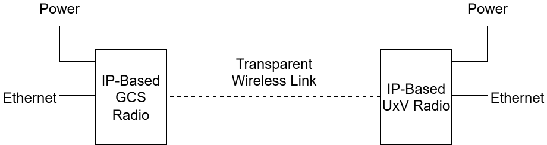

# IP-Based Radios

IP-based radios provide wireless communication between networked devices, such as PX4 [flight controllers](../flight_controller/index.md), [companion computers](../companion_computer/index.md), and [ground control stations](../getting_started/px4_basic_concepts.md#ground-control-stations) (GCS).

IP-based radios extend an Ethernet network over a radio link: devices connected to the vehicle's radio and the ground radio are on the same IP network, as if joined by an Ethernet cable.

This has two advantages:

- Many communication streams, such as [MAVLink](../mavlink/index.md) telemetry and video, can share the link within the available [bandwidth](<https://en.wikipedia.org/wiki/Bandwidth_(computing)>).
- Some radios support [mesh networking](https://en.wikipedia.org/wiki/Mesh_networking), which allows many vehicles and GCSs to connect to each other.

## Supported IP-Based Radios

These IP radios have been tested with PX4:

- [Doodle Labs](https://doodlelabs.com/) — tested with PX4 v1.16.0 and _QGroundControl_ v5.0.8.
- [Microhard](https://www.microhardcorp.com/products.php) IP-based modules, such as the one used in the [AIRLink](../flight_controller/airlink.md) telemetry set.
  Microhard Pico serial radios are covered in [Microhard Serial Telemetry Radios](../telemetry/microhard_serial.md).

IP-based radios from other brands can be added with testing and setup evidence.

::: info
[UXV Technologies Swappable Radio Modules (SRM)](https://www.uxvtechnologies.com/news/increase-flexibility-and-efficiency-with-our-new-swappable-radio-modules) package radios from several of these vendors in rugged modules with a common connector.
PX4 setup is the same as for the radio inside the module.
:::

## PX4 Setup

PX4 setup is the same for all IP-based radios.
The radios themselves are configured using each vendor's own tools.

1. Connect the vehicle-side radio to the flight controller's Ethernet port.
   See the [list of supported PX4 flight controllers](../advanced_config/ethernet_setup.md#supported-flight-controllers).
2. Connect the GCS to the ground-side radio.
3. Configure the radio link according to the manufacturer's instructions.
   Each device on the network, usually including the radios, has its own IP address.
   Make sure that no two devices share the same IP address, and that all devices are on the same [subnet](https://en.wikipedia.org/wiki/Subnet).
4. [Configure Ethernet on PX4](../advanced_config/ethernet_setup.md) and [configure _QGroundControl_](../advanced_config/ethernet_setup.md#qgroundcontrol-setup-example) to send MAVLink over the network.
5. If several vehicles share the network, give each vehicle a unique System ID ([MAV_SYS_ID](../advanced_config/parameter_reference.md#MAV_SYS_ID)).

::: tip
If your flight controller does not have an Ethernet port, connect the radio to a [companion computer](../companion_computer/index.md), which routes MAVLink between the flight controller and the network.
:::

## See Also

- [Telemetry Radios](../telemetry/index.md)
- [Ethernet Setup](../advanced_config/ethernet_setup.md)
