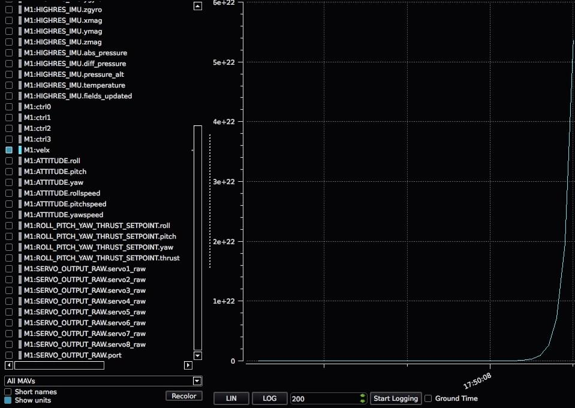

# Send and Receive Debug Values

It is often necessary during software development to output individual important numbers.
This is where the generic `NAMED_VALUE_FLOAT`, `DEBUG` and `DEBUG_VECT` packets of MAVLink come in.

## Mapping between MAVLink Debug Messages and uORB Topics

MAVLink debug messages are translated to/from uORB topics.
In order to send or receive a MAVLink debug message, you have to respectively publish or subscribe to the corresponding topic.
Here is a table that summarizes the mapping between MAVLink debug messages and uORB topics:

| MAVLink message   | uORB topic      |
| ----------------- | --------------- |
| NAMED_VALUE_FLOAT | debug_key_value |
| DEBUG             | debug_value     |
| DEBUG_VECT        | debug_vect      |

## Tutorial: Send String / Float Pairs

This tutorial shows how to send the MAVLink message `NAMED_VALUE_FLOAT` using the associated uORB topic `debug_key_value`.

Publishing a debug value works like publishing any other topic (see [First Application Tutorial](../modules/hello_sky.md#publishing-data)).
First add the headers:

```cpp
#include <string.h>
#include <drivers/drv_hrt.h>
#include <uORB/Publication.hpp>
#include <uORB/topics/debug_key_value.h>
```

Then add the publication as a member of your module class (one publication is sufficient for different published names):

```cpp
uORB::Publication<debug_key_value_s> _debug_key_value_pub{ORB_ID(debug_key_value)};
```

And publish the value wherever it is computed, for example in `Run()`:

```cpp
debug_key_value_s debug_key_value{};
strncpy(debug_key_value.key, "velx", sizeof(debug_key_value.key));
debug_key_value.value = position[0];
debug_key_value.timestamp = hrt_absolute_time();
_debug_key_value_pub.publish(debug_key_value);
```

:::warning
Multiple debug messages must have enough time between their respective publishings for Mavlink to process them.
This means that either the code must wait between publishing multiple debug messages, or alternate the messages on each function call iteration.
:::

The result in QGroundControl then looks like this on the real-time plot:



## Tutorial: Receive String / Float Pairs

The following code snippets show how to receive the `velx` debug variable that was sent in the previous tutorial.

First, add a subscription to the topic `debug_key_value` as a member of your module class.
A `uORB::SubscriptionCallbackWorkItem` schedules the module every time a new value arrives (see [First Application Tutorial](../modules/hello_sky.md#subscribing-to-sensor-data)):

```cpp
#include <string.h>
#include <uORB/SubscriptionCallback.hpp>
#include <uORB/topics/debug_key_value.h>
..
uORB::SubscriptionCallbackWorkItem _debug_key_value_sub{this, ORB_ID(debug_key_value)};
```

Register the callback once when the module starts, for example in `task_spawn()`:

```cpp
_debug_key_value_sub.registerCallback();
```

When a new message is available on the `debug_key_value` topic, `update()` copies it in `Run()`.
Do not forget to filter it based on its key attribute in order to discard the messages with key different than `velx`:

```cpp
debug_key_value_s debug_key_value;

if (_debug_key_value_sub.update(&debug_key_value)) {
	// filter message based on its key attribute
	if (strncmp(debug_key_value.key, "velx", sizeof(debug_key_value.key)) == 0) {
		PX4_INFO("velx: %8.4f", (double)debug_key_value.value);
	}
}
```
