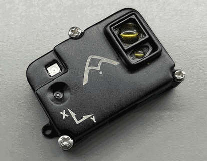
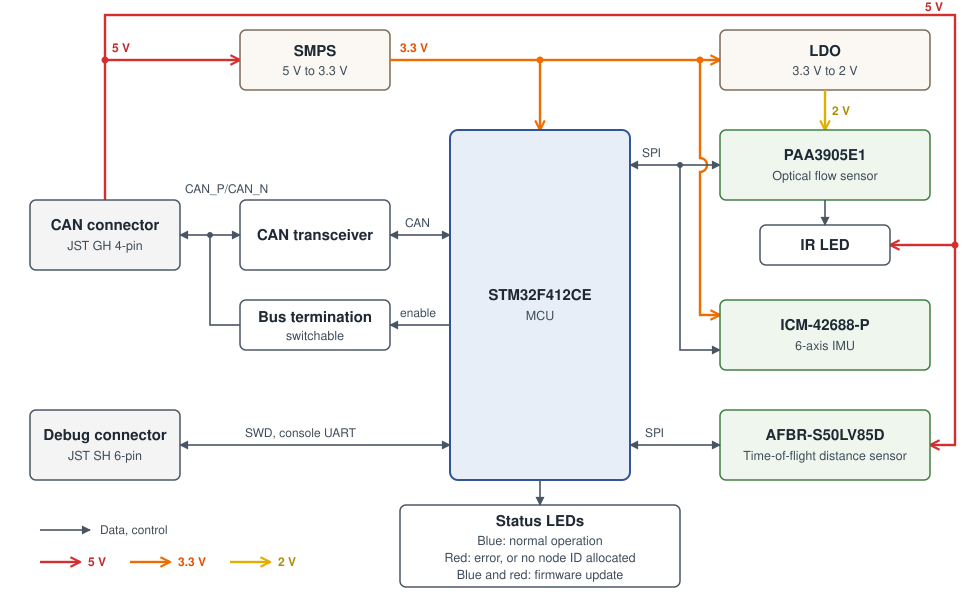

# Agam FloRange

<Badge type="tip" text="main (PX4 v2.0)" />

::: warning
PX4 does not manufacture this (or any) autopilot component.
Contact the [manufacturer](https://www.agamrobotics.com/) for hardware support or compliance issues.
:::

Agam FloRange is [Agam Robotics'](https://www.agamrobotics.com/) [DroneCAN](index.md) [optical flow](../sensor/optical_flow.md), [distance sensor](../sensor/rangefinders.md), and IMU module.
Its primary use is to provide local positioning in the absence of global positioning devices such as GNSS modules, as well as to improve stability.

## Where to Buy

Order this module from:

- [Agam Robotics](https://www.agamrobotics.com/product-page/agam-florange-sensor)

## Hardware Specifications

- Sensors
  - PixArt PAA3905E1 Optical Flow Sensor
    - Wide working distance from 80mm to infinity, no calibration required
    - Supports synchronised multi-chip operation and automatic mode switching
  - Broadcom AFBR-S50LV85D Time-of-Flight Distance Sensor ([datasheet](https://docs.broadcom.com/doc/AFBR-S50LV85D-DS))
    - Integrated 850nm laser light source, Laser Class 1 eye safe
    - Receiver Field-of-View (FoV) of 12.4° x 5.4° with 32 pixels, 1.55° x 1.55° each
    - Transmitter (laser) beam of 2° x 2°, illuminating 1 to 3 pixels
    - Typical distance range up to 30m
    - Operates in up to 200k lux ambient light
    - Sensor supply: 5V, typically 33mA
  - InvenSense ICM-42688-P 6-Axis IMU
  - IR LED for low-light operation
- STM32F412CE MCU
- Single Pixhawk Standard CAN Connector (4 Pin JST GH)
- Software-switchable built-in CAN termination
- Pixhawk Standard Debug Connector (6 Pin JST SH)
- 5V supply from the CAN connector
- Small Form Factor: 44.95mm x 29.4mm x 15.59mm
- Weight: 9.38g (including enclosure)
- Designed and manufactured in India

## Hardware Setup

### Wiring

Connect Agam FloRange to the flight controller's CAN bus with the provided cable.
For more information, refer to the [CAN Wiring](../can/index.md#wiring) instructions.

::: info
Agam FloRange has a single CAN connector, so it is normally the last node on the bus.
Enable its built-in termination by setting [CANNODE_TERM](#CANNODE_TERM) to `1`.
If more than one module is connected through a CAN splitter, enable termination only on the module furthest from the flight controller.
:::

| Pin | Signal    | Wire  |
| --- | --------- | ----- |
| 1   | VCC (+5V) | Red   |
| 2   | CAN_H     | Black |
| 3   | CAN_L     | Black |
| 4   | GND       | Black |

Twist the VCC/GND and CAN_H/CAN_L wires as pairs to reduce electromagnetic interference and crosstalk, as described in [Cable Wiring Basics > UAVCAN cables](../assembly/cable_wiring.md#uavcan-cables).

### Mounting

Mount the module with the sensors facing down and the X arrow on the enclosure pointing towards the front of the vehicle.
This corresponds to the default value (`0`) of the parameter [SENS_FLOW_ROT](../advanced_config/parameter_reference.md#SENS_FLOW_ROT).
Change the parameter appropriately if using a different orientation.

## Firmware Setup

Agam FloRange runs the [PX4 DroneCAN Firmware](px4_cannode_fw.md).
It supports firmware updates over the CAN bus and [dynamic node allocation](index.md#node-id-allocation).
Firmware can also be flashed over SWD using the [Pixhawk Debug Mini](../debug/swd_debug.md#pixhawk-debug-mini) connector, which additionally provides the [System Console](../debug/system_console.md).
Agam FloRange ships with recent firmware pre-installed, but if you want to build and flash the latest firmware yourself, see [PX4 DroneCAN Firmware > Building the Firmware](px4_cannode_fw.md#building-the-firmware).

- Firmware target: `agam_florange_default`
- Bootloader target: `agam_florange_canbootloader`

## PX4 Configuration

::: info
Agam FloRange will not boot if the flight controller has no SD card installed when it is powered on.
:::

### Enable DroneCAN

The steps are:

- In _QGroundControl_ set the parameter [UAVCAN_ENABLE](../advanced_config/parameter_reference.md#UAVCAN_ENABLE) to `2` for dynamic node allocation (or `3` if also using [DroneCAN ESCs](../dronecan/escs.md)) and reboot (see [Finding/Updating Parameters](../advanced_config/parameters.md)).
- Connect Agam FloRange to the flight controller's CAN bus (see [Wiring](#wiring)).

Once DroneCAN is enabled, the module is detected on boot.

DroneCAN configuration in PX4 is explained in more detail in [DroneCAN > Enabling DroneCAN](index.md#enabling-dronecan).

### Flow and Rangefinder Parameters

Set the following parameters in _QGroundControl_, depending on which functions of the module you use:

- Enable optical flow fusion with [EKF2_OF_CTRL](../advanced_config/parameter_reference.md#EKF2_OF_CTRL) (enabled by default).
- To optionally disable GPS aiding, set [EKF2_GPS_CTRL](../advanced_config/parameter_reference.md#EKF2_GPS_CTRL) to `0`.
- Enable [UAVCAN_SUB_FLOW](../advanced_config/parameter_reference.md#UAVCAN_SUB_FLOW).
- Enable [UAVCAN_SUB_RNG](../advanced_config/parameter_reference.md#UAVCAN_SUB_RNG).
- Set [UAVCAN_RNG_MIN](../advanced_config/parameter_reference.md#UAVCAN_RNG_MIN) to `0.08`, the minimum working distance of the flow sensor, and [UAVCAN_RNG_MAX](../advanced_config/parameter_reference.md#UAVCAN_RNG_MAX) to `30`, the maximum range of the distance sensor.
- If using the distance sensor for height aiding, enable [EKF2_RNG_CTRL](../advanced_config/parameter_reference.md#EKF2_RNG_CTRL) and set [EKF2_RNG_A_HMAX](../advanced_config/parameter_reference.md#EKF2_RNG_A_HMAX) to `10` and [EKF2_RNG_QLTY_T](../advanced_config/parameter_reference.md#EKF2_RNG_QLTY_T) to `0.2`.
- Set [SENS_FLOW_MINHGT](../advanced_config/parameter_reference.md#SENS_FLOW_MINHGT) to `0.08`, the minimum height of the flow sensor, and [SENS_FLOW_MAXHGT](../advanced_config/parameter_reference.md#SENS_FLOW_MAXHGT) to `30`, the maximum range of the distance sensor.
- Set [SENS_FLOW_MAXR](../advanced_config/parameter_reference.md#SENS_FLOW_MAXR) to `7.4` to match the PAA3905 maximum angular flow rate.
- The parameters [EKF2_OF_POS_X](../advanced_config/parameter_reference.md#EKF2_OF_POS_X), [EKF2_OF_POS_Y](../advanced_config/parameter_reference.md#EKF2_OF_POS_Y), [EKF2_OF_POS_Z](../advanced_config/parameter_reference.md#EKF2_OF_POS_Z) and [EKF2_RNG_POS_X](../advanced_config/parameter_reference.md#EKF2_RNG_POS_X), [EKF2_RNG_POS_Y](../advanced_config/parameter_reference.md#EKF2_RNG_POS_Y), [EKF2_RNG_POS_Z](../advanced_config/parameter_reference.md#EKF2_RNG_POS_Z) can be set to account for the offset of the module from the vehicle centre of gravity.

When optical flow is the only source of horizontal position/velocity, reduce the horizontal position gain [MPC_XY_P](../advanced_config/parameter_reference.md#MPC_XY_P) (for example to `0.5`) to reduce oscillations.

## Agam FloRange Configuration

On the module, you may need to configure the following parameters:

| Parameter                                                                                                | Description                                                                                                     |
| -------------------------------------------------------------------------------------------------------- | --------------------------------------------------------------------------------------------------------------- |
| [CANNODE_NODE_ID](../advanced_config/parameter_reference.md#CANNODE_NODE_ID) | CAN node ID. Set to `0` (default) for dynamic node allocation, or to `1`-`125` for a static node ID.            |
| [CANNODE_TERM](../advanced_config/parameter_reference.md#CANNODE_TERM)          | Built-in CAN bus termination. Set to `1` if the module is the last node on the CAN bus (see [Wiring](#wiring)). |

## LED Meanings

- Solid blue indicates normal operation.
- Solid blue and red (both on) indicates a firmware update.
- Solid red indicates an error, or that the module is waiting for a node ID to be allocated (briefly, on every boot).

If the red LED stays on, there is an error and you should check the following:

- Make sure the flight controller has an SD card installed.
- Make sure Agam FloRange has `agam_florange_canbootloader` installed prior to flashing `agam_florange_default`.
- Remove binaries from the root and `ufw` directories of the SD card and try to build and flash again.

## See Also

- [DroneCAN > Node ID Allocation](index.md#node-id-allocation)
- [PX4 DroneCAN Firmware](px4_cannode_fw.md)
