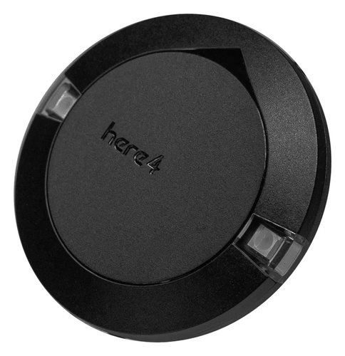

# CubePilot Here4 RTK GNSS (DroneCAN)

The [CubePilot Here4](https://docs.cubepilot.org/here-4/here-4-manual) is a dual-band (L1/L5) [RTK GNSS](../gps_compass/rtk_gps.md) module that connects to the flight controller via [DroneCAN](../dronecan/index.md).
It integrates a u-blox NEO-F9P receiver, an RM3100 compass, a barometer, an IMU and RGB LEDs.



::: warning
CubePilot has issued safety service bulletins for the Here4, including a [mandatory bootloader update before further flight](https://docs.cubepilot.org/service-bulletins-and-critical-notices/safety-service-bulletins/sb_0000010-mandatory-here4-bootloader-update-before-further-flight) (SB_0000010).
Check the bulletins before flying (see [Receiver Configuration](#receiver_configuration) for the firmware and bootloader update).
:::

## Variants

- [Here4 Base](https://docs.cubepilot.org/here-4/here-4-base): RTK base station with an external antenna connector, for use with _QGroundControl_.
- [Here4 Blue](https://docs.cubepilot.org/here-4/here-4-blue): Here4 with integrated Bluetooth Remote ID (CubeID).

## Specifications {#specifications}

From the [CubePilot Here4 manual](https://docs.cubepilot.org/here-4/here-4-manual):

- **Receiver:** u-blox NEO-F9P
- **Constellations:** GPS, GLONASS, Galileo, BeiDou, QZSS, SBAS
- **Bands:** L1/L5
- **Update rate:** Up to 20Hz (RTK)
- **Position accuracy:** 0.01m + 1ppm CEP (RTK)
- **Compass:** RM3100
- **Barometer:** MS5611
- **IMU:** ICM42688
- **Processor:** STM32H757, running CubePilot's AP_Periph-based firmware
- **Interface:** DroneCAN, two CAN ports (only one supported by the current firmware; see [Wiring](#wiring))
- **Input voltage:** 5V (CAN connector)
- **Connector:** JST-GH 4-pin
- **Operating temperature:** -40°C to +85°C
- **Dimensions:** 16 x 68mm
- **Weight:** 60g (with cable)

## Where to Buy {#store}

- [CubePilot Resellers](https://cubepilot.org/#/reseller/list)

## Hardware Setup {#hardware_setup}

### Mounting {#mounting}

Mount the module as far away from other electronics as possible, with its direction marker pointing towards the front of the vehicle.
For more information, see [Mounting a Compass](../assembly/mount_gps_compass.md).

### Pinouts {#pinouts}

CAN connector, from the [Here4 manual](https://docs.cubepilot.org/here-4/here-4-manual):

| Pin | Signal |
| --- | ------ |
| 1   | 5V     |
| 2   | CAN_H  |
| 3   | CAN_L  |
| 4   | GND    |

### Wiring {#wiring}

Connect the Here4 to the `CAN1` or `CAN2` port of the flight controller using the supplied 4-pin CAN cable.
The Here4 is powered from the CAN port.
If the Here4 is the last node on the bus, enable its termination resistor (see [PX4 Configuration](#px4_configuration)).
For more information, refer to the [CAN Wiring](../can/index.md#wiring) instructions.

::: warning
The Here4 has two CAN ports, but the current firmware only supports one of them: the port whose cable has green, blue, white and grey wires.
If the other port is used, the Here4 does not appear on the bus (see [Testing](#testing)).
:::

## PX4 Configuration {#px4_configuration}

1. Set the PX4 parameters:
   - [UAVCAN_ENABLE](../advanced_config/parameter_reference.md#UAVCAN_ENABLE) to `2` (`Sensors Automatic Config`), or `3` if you also use [DroneCAN ESCs](../dronecan/escs.md).
   - [UAVCAN_PUB_RTCM](../advanced_config/parameter_reference.md#UAVCAN_PUB_RTCM) to `1` for RTK, so that PX4 forwards RTCM corrections to the Here4.
     See [DroneCAN > RTK GPS](../dronecan/index.md#rtk-gps) and [RTK GNSS](../gps_compass/rtk_gps.md#positioning-setup-configuration) for the base station setup.
   - [UAVCAN_SUB_BARO](../advanced_config/parameter_reference.md#UAVCAN_SUB_BARO) to `1` to also use the Here4 barometer.

2. Power cycle the vehicle.

   The Here4 is then assigned a node ID via dynamic node allocation, and its GNSS and compass are used without further configuration.

3. Set the parameters on the Here4 itself, if needed:
   - `CAN_TERMINATOR` to `1` if the Here4 is the last node on the CAN bus, to enable its termination resistor (off by default).
   - `BARO_ENABLE` to `1` to use the barometer (disabled by default).

   Set and save them either in the _QGroundControl_ parameters of the Here4 component, or from the [MAVLink Shell](../debug/mavlink_shell.md) (the node ID is shown by `uavcan status`):

   ```sh
   uavcan param set <node-id> CAN_TERMINATOR 1
   uavcan param set <node-id> BARO_ENABLE 1
   uavcan param save <node-id>
   ```

   Then power cycle the vehicle again.

If the Here4 is not positioned at the vehicle centre of gravity, set its offset using [SENS_GNSS0_OFFX](../advanced_config/parameter_reference.md#SENS_GNSS0_OFFX), [SENS_GNSS0_OFFY](../advanced_config/parameter_reference.md#SENS_GNSS0_OFFY) and [SENS_GNSS0_OFFZ](../advanced_config/parameter_reference.md#SENS_GNSS0_OFFZ).

DroneCAN configuration in PX4 is explained in more detail in [DroneCAN > PX4 Configuration](../dronecan/index.md#px4-configuration).

## Testing {#testing}

Run `uavcan status` in the [MAVLink Shell](../debug/mavlink_shell.md).
The Here4 should be listed under `Online nodes` with mode `OPERAT`, and the `gnss`, `mag` and (if enabled) `baro` sensors should each show a channel bound to the Here4 node ID.
If the Here4 is connected by its unsupported CAN port, it is not listed, and the status shows TX frames and an equally growing number of HW errors, with no RX frames.

To check RTK, run `listener sensor_gnss`: `fix_type` is `5` for an RTK float solution and `6` for RTK fixed.

## Receiver Configuration {#receiver_configuration}

CubePilot publishes the Here4 firmware and release notes at [GNSSPeriph-release](https://github.com/CubePilot/GNSSPeriph-release/releases).

PX4 can update the Here4 from the SD card, as described in [DroneCAN > Firmware Update](../dronecan/index.md#firmware-update):

1. Copy `Here4_FW.bin` from the release archive to the root of the SD card.
2. Reboot with the Here4 connected.
   PX4 moves the file to `/fs/microsd/ufw/1043.bin` (1043 is the Here4 board ID) and updates the Here4 if its firmware differs.
   During the update `uavcan status` shows the Here4 with mode `SW_UPD`, and then `OPERAT` again once it has completed.

You can check the installed version with `listener device_information`, in the message whose `name` is `com.cubepilot.here4`: `firmware_version` shows the major and minor version followed by the git hash of the build in decimal (DroneCAN does not report the patch version).

If the Here4 stays in `SW_UPD` without completing, remove the file from `/fs/microsd/ufw/` and update the Here4 with CubePilot's tools instead (see the bulletin below).

According to [SB_0000010](https://docs.cubepilot.org/service-bulletins-and-critical-notices/safety-service-bulletins/sb_0000010-mandatory-here4-bootloader-update-before-further-flight), a Here4 with the updated bootloader breathes blue at boot.
If yours does not, follow the bulletin: update the firmware, then set the Here4 parameter `FLASH_BOOTLOADER` to `1` to update the bootloader.

## Further Information {#further_information}

- [CubePilot Here4 Manual](https://docs.cubepilot.org/here-4/here-4-manual) (docs.cubepilot.org)
