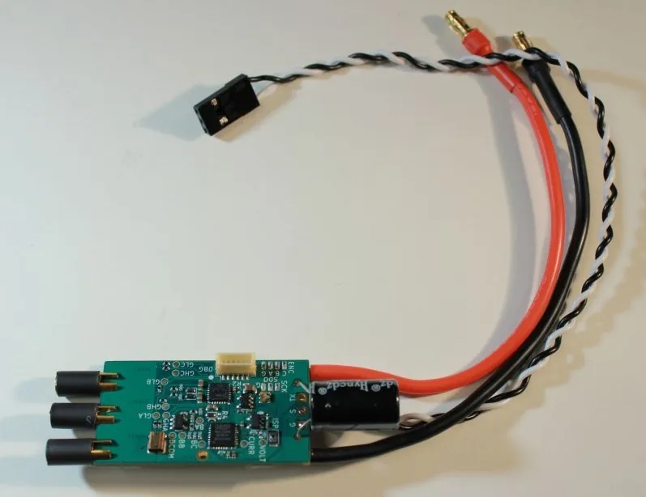
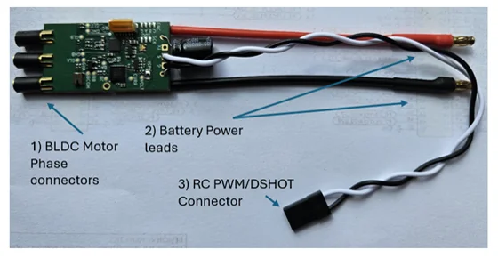
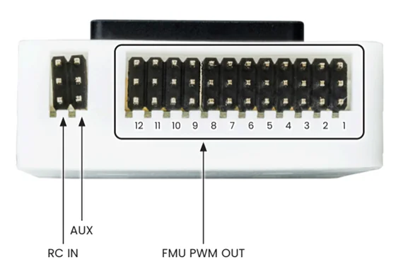

# NXP MR-ESC-AM32

The [MR-ESC-AM32](https://nxp-robotics.github.io/robotics-docs/platforms/mr-esc-am32-mcxa133/overview.html) is the electronic speed controller (ESC) reference design of the NXP Mobile Robotics family.
It is a brushless DC (BLDC) motor controller based on the open-source AM32 firmware.
It is designed for drones, robotic vehicles, and other applications requiring sensorless BLDC motor control under the direction of an external flight controller or motor-control system.
The board is intended as a validated ESC starting point that customers can evaluate, reproduce, and customise for their own vehicles.

The ESC is built around an NXP MCXA133 microcontroller, an Arm Cortex-M33 MCU running the NXP port of the AM32 firmware.
It implements six-step commutation using back-EMF zero-cross detection and accepts [RC-PWM](../peripherals/pwm_escs_and_servo.md), [DShot](../peripherals/dshot.md), and [bidirectional DShot (BDShot)](../peripherals/dshot.md#bidirectional-dshot-telemetry) control interfaces.

## Where to Buy

Order this module from:

- [NXP MR-ESC-AM32](https://www.nxp.com/part/MR-ESC-AM32)

## Hardware Specifications

- Battery Voltage: 2-6s
  - 5.5V Minimum
  - 24V Maximum
- Current Rating:  25 A continuous current, 50A peak current
- Input Protocols (auto-detected)
  - DShot
  - Bidirectional DShot
  - PWM
- 6 Pin JST-SH Debug
- Dimensions
  - Size: approx. 42mm x 24mm

## Hardware Setup

### Wiring

Connect the ESC signal and ground wires to an FMU PWM output on your flight controller.
On the [NXP MR-VMU-RT1176](../flight_controller/nxp_mr_vmu_rt1176.md) shown below, ground is the top row of **FMU PWM OUT**, and DShot is available on outputs 1–8.

## Firmware Setup

To flash your MR-ESC-AM32, follow the steps in [Installing and configuring software tools](https://nxp-robotics.github.io/robotics-docs/platforms/mr-esc-am32-mcxa133/user-manual/installing-software-tools.html).

After flashing, configure the ESC to match your motor and the input signal from the flight controller, as described in [Configuring the hardware](https://nxp-robotics.github.io/robotics-docs/platforms/mr-esc-am32-mcxa133/user-manual/configuring-the-hardware.html).
On an MR-VMU-RT1176 this procedure replaces PX4 with ESC passthrough firmware, so reflash PX4 afterwards.

## PX4 Configuration

Assign motors to outputs and select the output protocol (PWM, DShot or BDShot) in [Actuator Configuration](../config/actuators.md).
With PWM, [calibrate the ESC](../advanced_config/esc_calibration.md).
See [DShot ESCs](../peripherals/dshot.md) for DShot and BDShot setup.
