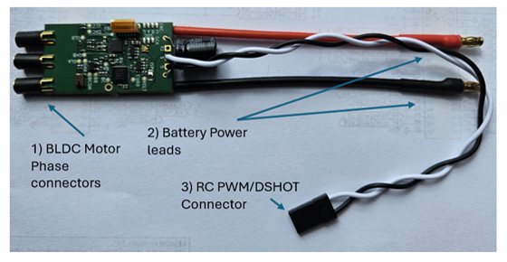

# NXP MR-ESC-AM32

The [MR-ESC-AM32](https://nxp-robotics.github.io/robotics-docs/platforms/mr-esc-am32-mcxa133/overview.html) is the electronic speed controller (ESC) reference design of the NXP Mobile Robotics family. It is a brushless DC (BLDC) motor controller based on the open-source AM32 firmware and implemented with an NXP MCX A microcontroller. It is designed for drones, robotic vehicles, and other applications requiring sensorless BLDC motor control under the direction of an external flight controller or motor-control system. The board is intended as a validated ESC starting point that customers can evaluate, reproduce, and customize for their own vehicles.

The controller is built around an NXP MCXA133 microcontroller, an Arm Cortex-M33 MCU running the NXP port of the AM32 firmware. It implements six-step commutation using back-EMF (BEMF) zero-cross detection and accepts RC-PWM, DShot, and bidirectional DShot control interfaces.

# Where to Buy
Order this module from:

- [NXP MR-ESC-AM32](https://www.nxp.com/part/MR-ESC-AM32)
 
# Hardware Setup

## Wiring

Connect signal and ground wire to the PWM output from your flight controller.

# Firmware setup

The be able to flash your MR-ESC-AM32 please follow the steps in [Installing and configuring software tools](https://nxp-robotics.github.io/robotics-docs/platforms/mr-esc-am32-mcxa133/user-manual/installing-software-tools.html)

After flashing, it is important to configure your esc to match you motor specifications and the input you are feeding to it from the flight controller. For detailed steps on that please see [https://nxp-robotics.github.io/robotics-docs/platforms/mr-esc-am32-mcxa133/user-manual/configuring-the-hardware.html](https://nxp-robotics.github.io/robotics-docs/platforms/mr-esc-am32-mcxa133/user-manual/configuring-the-hardware.html)

## Flight controller Setup

### PX4 Configuration

Assign motors to outputs using the Actuator configuration screen.