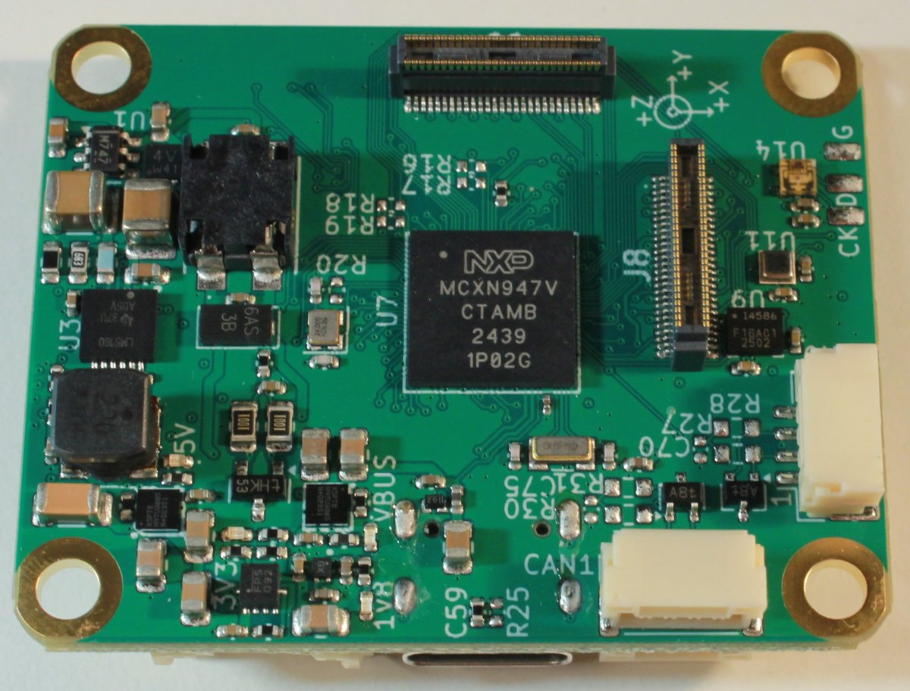
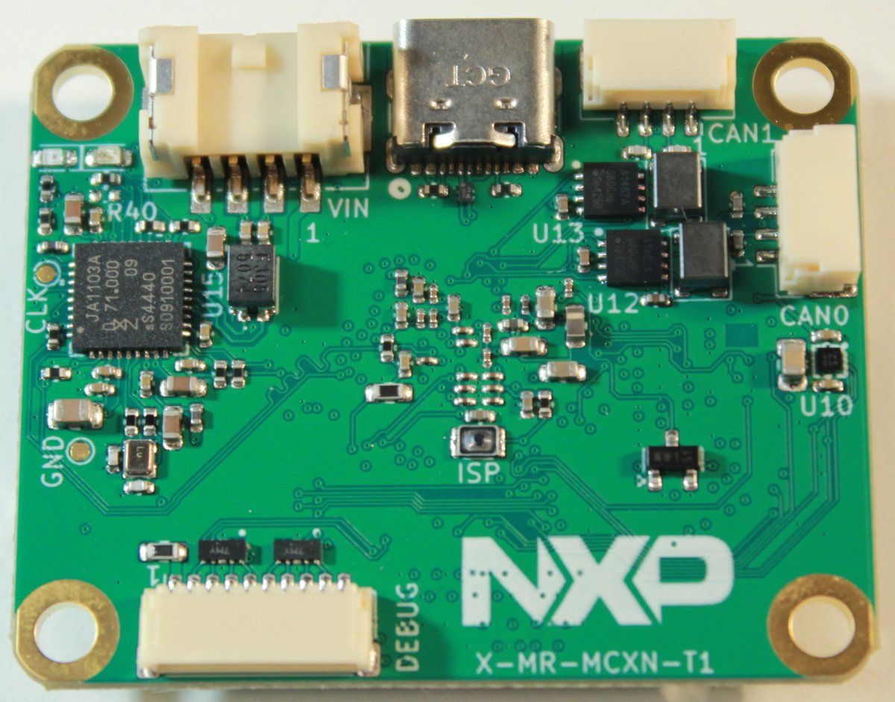

# NXP MR-MCXN-T1

The [NXP MR-MCXN-T1](https://nxp-robotics.github.io/robotics-docs/platforms/mr-mcxn-t1/overview.html) Hub is the sensor and I/O node reference design of the NXP Mobile Robotics family.
It is a networked node built around an NXP MCXN947 (Arm Cortex-M33) microcontroller that aggregates on-board sensors and distributes them over automotive [100BASE-T1 Ethernet](index.md) and CAN-FD, acting as a distributed sensor and I/O hub in a [Time-Sensitive Networking (TSN)](https://en.wikipedia.org/wiki/Time-Sensitive_Networking) robotics system.

It is intended as a validated, open node design that can be evaluated, reproduced, and extended with custom [shields](#shields-add-on-boards).

<table>
  <tbody>
    <tr>
      <td align="center"></td>
      <td align="center"></td>
    </tr>
    <tr>
      <td align="center">Top view</td>
      <td align="center">Bottom view</td>
    </tr>
  </tbody>
</table>

## Where to Buy

Order this module from:

- [NXP MR-MCXN-T1](https://www.nxp.com/part/MR-MCXN-T1)

## Technical Specifications

- NXP MCXN947 microcontroller (Arm Cortex-M33)
- Sensors
  - ICM-45686 6-axis IMU
  - BMM350 magnetometer
  - BMP581 barometer
- 100BASE-T1 automotive Ethernet (NXP TJA1103 PHY), combined with the power input on a single connector
- Two CAN-FD channels (NXP TJA1462 transceivers), JST-GH connectors ([Pixhawk Connector Standard](https://github.com/pixhawk/Pixhawk-Standards/blob/master/DS-009%20Pixhawk%20Connector%20Standard.pdf))
- USB 2.0 high-speed device port (USB Type-C)
- SWD / JTAG / console debug connector (Pixhawk standard)
- Addressable RGB LED
- RTC backup battery connector
- Power input: 3S to 12S battery (~9–50 V), or USB
- Two DF40 board-to-board connectors exposing FlexComm, FlexIO, ADC, DAC, SAI, PDM, and FlexPWM for add-on shields
- [Open hardware design files and BOM](https://github.com/NXP-Robotics/mr_mcxn_t1_hub)

## Hardware Setup

The board is powered either from a 3S–12S battery or from USB.
The main power input and the 100BASE-T1 Ethernet pair are carried together on connector J1 (4-pin Molex Micro-Lock Plus, on the bottom of the board), so one cable can provide both power and the network link.

The MR-MCXN-T1 is connected to the rest of the vehicle network over a single twisted-pair 100BASE-T1 link.
The hub is the link slave by default (remove resistor R41 to make it the master), so the other end of the link must be the master.
For more information on T1 wiring and networking, see [T1 Ethernet Peripherals > Wiring](index.md#wiring).

## Firmware Setup

The MR-MCXN-T1 runs firmware from the NXP Robotics SDK.
For instructions on deploying and running firmware on the node, see the [MR-MCXN-T1 Deploy and Run Quick Start](https://nxp-robotics.github.io/robotics-docs/platforms/mr-mcxn-t1/getting-started/mr-mcxn-t1-quick-start.html).

## Flight Controller / T1 Hub Configuration

The MR-MCXN-T1 communicates with PX4 over the network using [Zenoh](../middleware/zenoh.md)/ZROS.
PX4 must be built with the [`zenoh` module](../middleware/zenoh.md#px4-firmware), with the hub's sensor topics added to its subscriptions (see the NXP guide below).
For setting up PX4–hub communication, see [Zenoh_PX4 Communication on the MR-MCXN-T1 using ZROS](https://nxp-robotics.github.io/robotics-docs/platforms/mr-mcxn-t1/application-notes/zenoh/index.html).

## Shields / Add-on Boards

The two DF40 board-to-board connectors allow the hub to be extended with add-on shields that provide additional sensors or connectors:

- [Optical flow (OFLO) shield](https://www.nxp.com/part/MR-MCXN-T1-OFL): PAA3905E1 optical flow sensor with light source, AFBR-S50LX85D time-of-flight rangefinder, and two more IMUs (ICM-45686, ICM-42688).
- [F9P GNSS shield](https://www.nxp.com/part/MR-MCXN-T1-F9P): u-blox F9P GNSS module.
- [I/O expander board](https://www.nxp.com/part/MR-MCXN-T1-IO): JST-GH connectors for 2× UART, 2× SPI, 2× I2C, GPS, a quadrature decoder and two 4-in-1 ESCs, with Pixhawk-standard pinouts where one applies.

Design files are in the [MR-MCXN-T1 add-on boards repository](https://github.com/CogniPilot/spinali_mcxn_t1_shields).

## See Also

- [MR-MCXN-T1 documentation](https://nxp-robotics.github.io/robotics-docs/platforms/mr-mcxn-t1/index.html) (NXP Robotics SDK)
