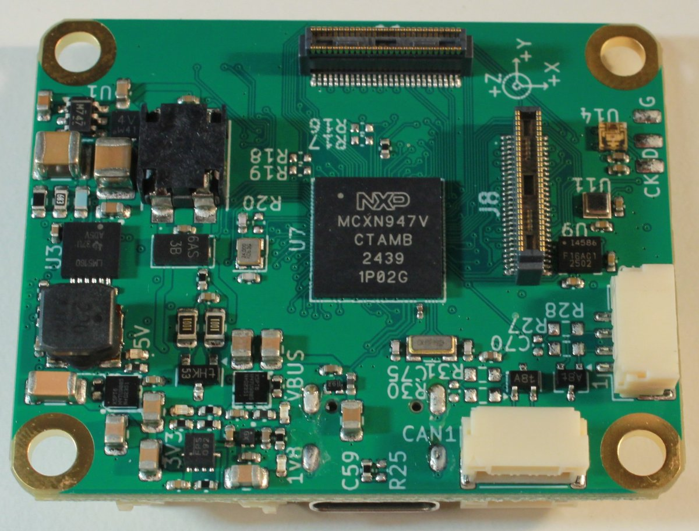
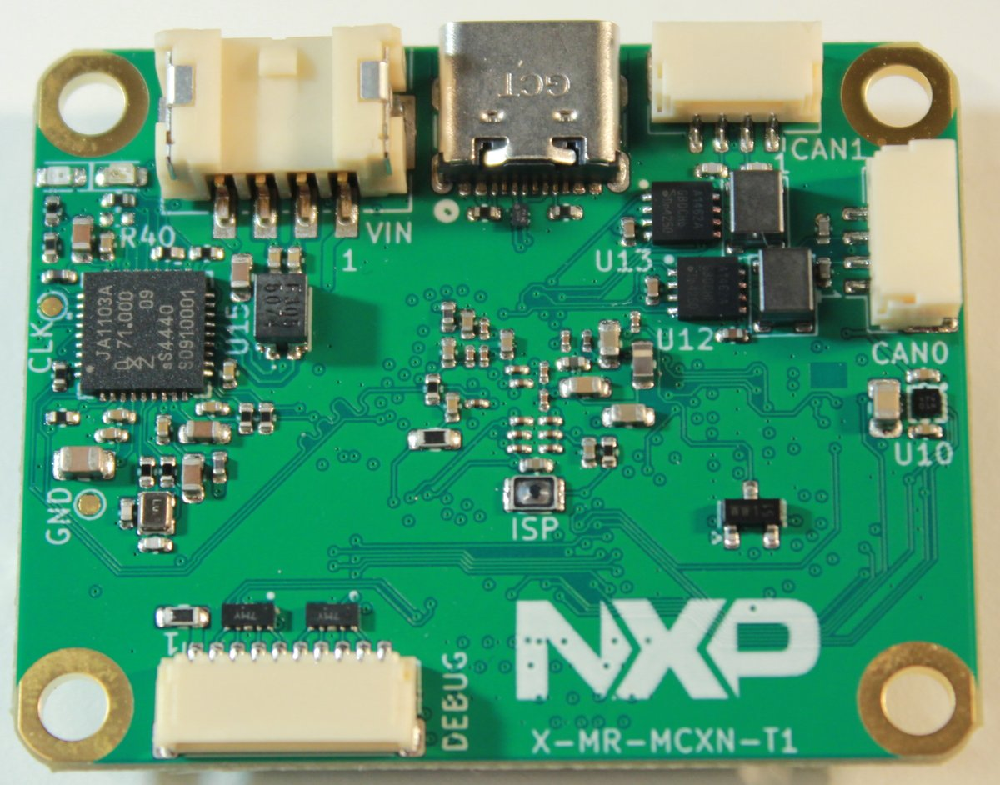

# NXP MR-MCXN-T1

The [NXP MR-MCXN-T1](https://nxp-robotics.github.io/robotics-docs/platforms/mr-mcxn-t1/overview.html) Hub is the sensor and I/O node reference design of the NXP Mobile Robotics family.
It is a networked node built around an NXP MCXN947 (Arm Cortex-M33) microcontroller that aggregates on-board sensors and distributes them over automotive [100BASE-T1 Ethernet](index.md) and CAN-FD, acting as a distributed sensor/IO hub in a Time-Sensitive Networking (TSN) robotics system.

It is intended as a validated, open node design that can be evaluated, reproduced, and extended with custom shields.

<table>
  <tr>
    <td align="center"></td>
    <td align="center"></td>
  </tr>
  <tr>
    <td align="center">Top view</td>
    <td align="center">Bottom view</td>
  </tr>
</table>

## Where to Buy

Order this module from:

- [NXP MR-MCXN-T1](https://www.nxp.com/part/MR-MCXN-T1)

## Technical Specifications

- NXP MCXN947 microcontroller (Arm Cortex-M33)
- Sensors
  - ICM-45686 6-axis IMU
  - BMM350 magnetometer
  - BMP581 barometer
- 100BASE-T1 automotive Ethernet (NXP TJA1103 PHY), combined with the power input on a single connector
- Two CAN-FD channels (NXP TJA1462 transceivers), JST-GH connectors (Dronecode DS-009)
- USB 2.0 high-speed device port (USB Type-C)
- SWD / JTAG / console debug connector (DS-009)
- Addressable RGB LED
- RTC backup battery connector
- Power input: 3S to 12S battery (~9–50 V), or USB
- Two DF40 board-to-board connectors exposing FlexComm, FlexIO, ADC, DAC, SAI, PDM, and FlexPWM for add-on shields
- [Open hardware design files and BOM](https://github.com/NXP-Robotics/mr_mcxn_t1_hub)

## Hardware Setup

The board is powered either from a 3S–12S battery or from USB.
The main power input and the 100BASE-T1 Ethernet pair are carried together on a single connector, so one cable can provide both power and the network link.

The MR-MCXN-T1 is connected to the rest of the vehicle network over a single twisted-pair 100BASE-T1 link.
One end of the link must be configured as the PHY master and the other as the slave.
For more information on T1 wiring, PHY roles, and networking, see [T1 Ethernet Peripherals > Wiring](index.md#wiring).

## Firmware Setup

The MR-MCXN-T1 runs firmware from the NXP Robotics SDK.
For instructions on deploying and running firmware on the node, see the [MR-MCXN-T1 Deploy and Run Quick Start](https://nxp-robotics.github.io/robotics-docs/platforms/mr-mcxn-t1/getting-started/mr-mcxn-t1-quick-start.html).

## Flight Controller / T1 Hub Configuration

The MR-MCXN-T1 communicates with PX4 over the network using Zenoh/ZROS.
For setting up PX4–hub communication, see [Zenoh_PX4 Communication on the MR-MCXN-T1 using ZROS](https://nxp-robotics.github.io/robotics-docs/platforms/mr-mcxn-t1/application-notes/zenoh/index.html).

## Shields / Add-on Boards

The two DF40 board-to-board connectors allow the hub to be extended with add-on shields, including:

- An [optical flow (OFLO) sensor shield](https://www.nxp.com/part/MR-MCXN-T1-OFL)
- A [F9P GNSS sensor shield](https://www.nxp.com/part/MR-MCXN-T1-F9P)
- An [IO expander board](https://www.nxp.com/part/MR-MCXN-T1-IO)

## See Also

- [MR-MCXN-T1 documentation](https://nxp-robotics.github.io/robotics-docs/platforms/mr-mcxn-t1/index.html) (NXP Robotics SDK)
