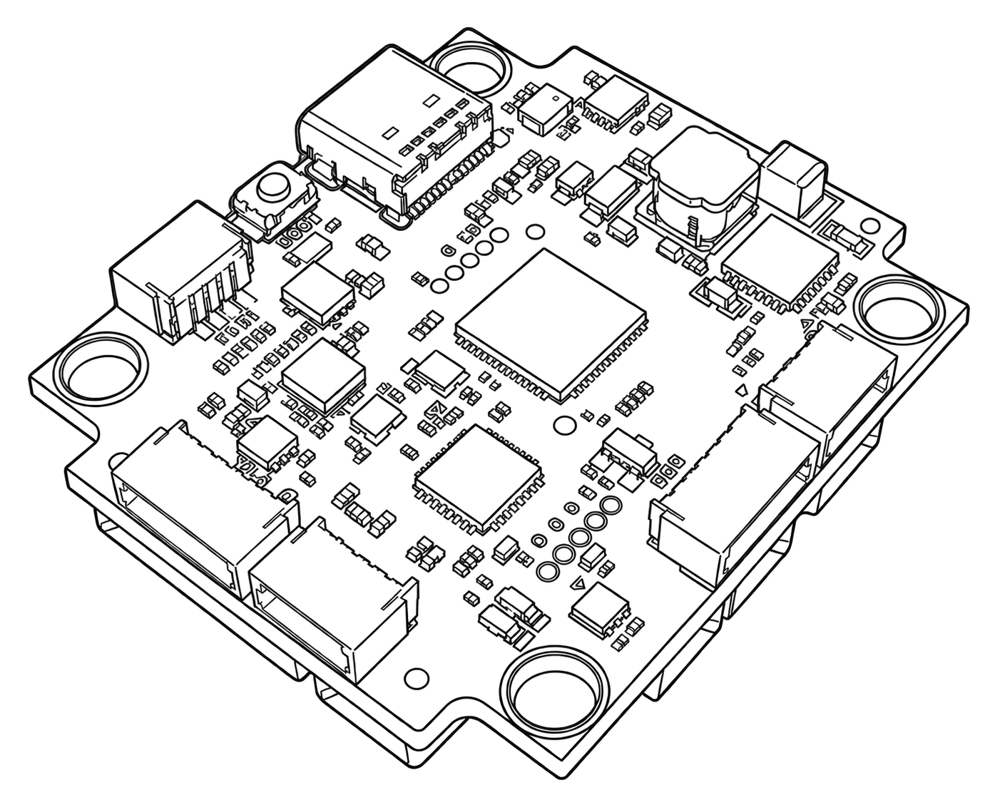
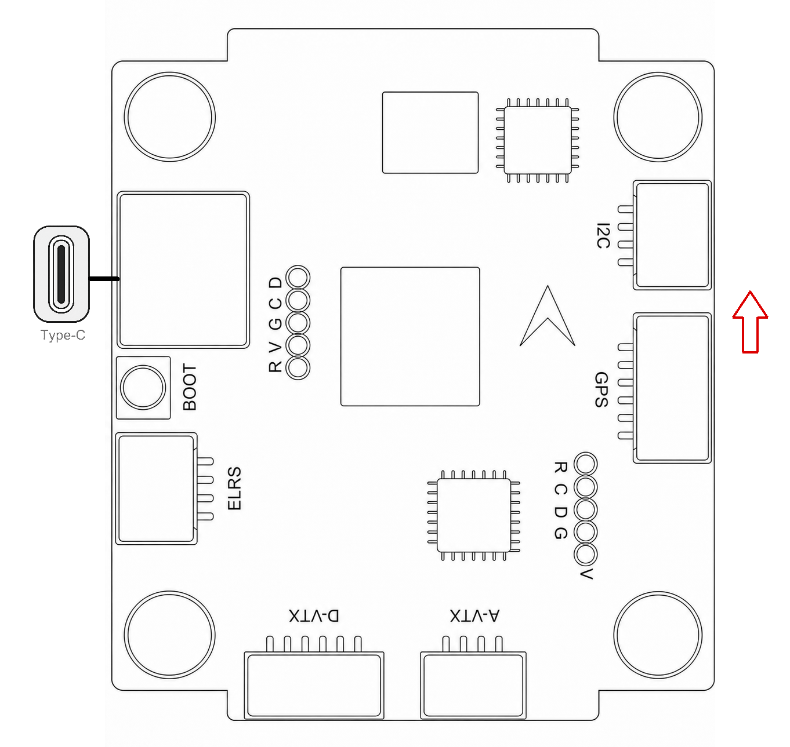
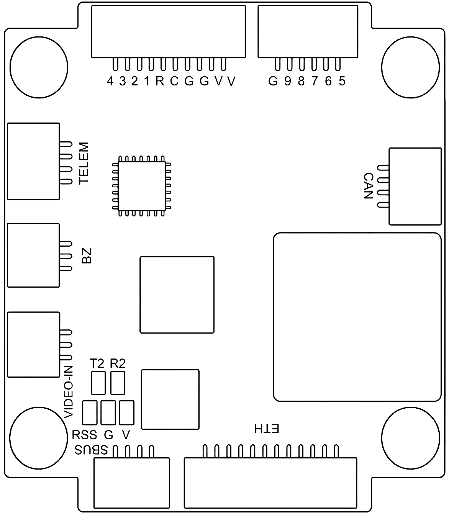
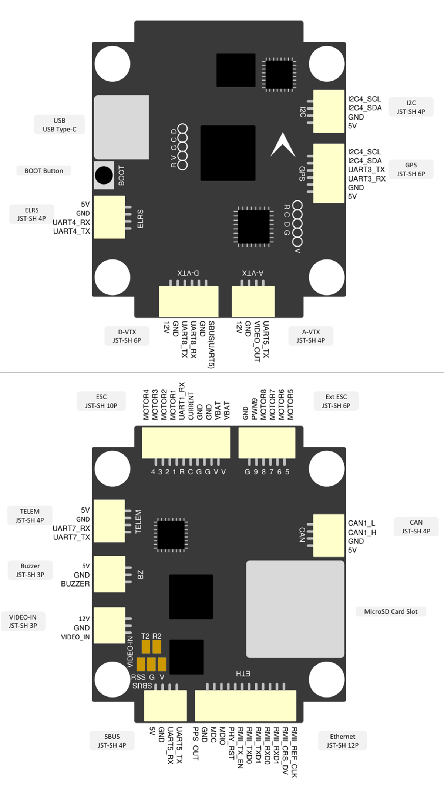
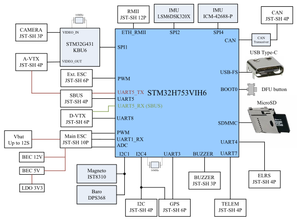
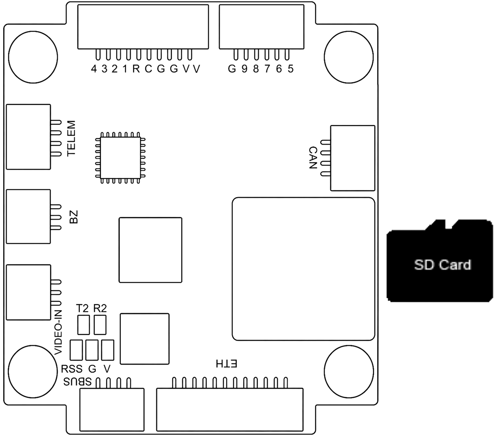
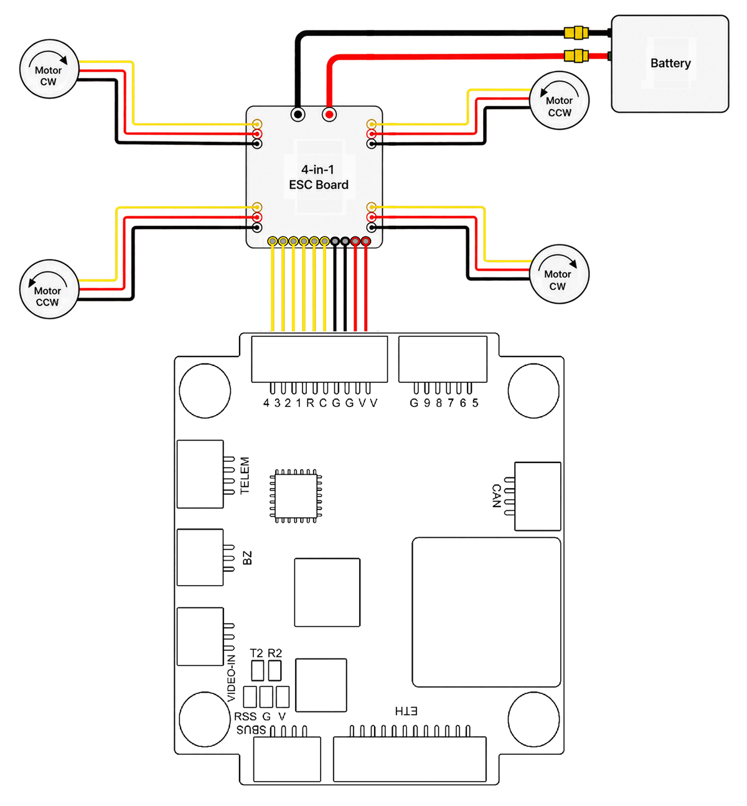
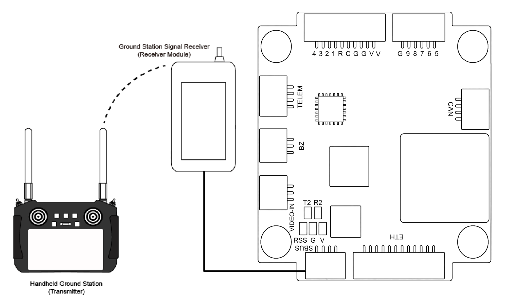
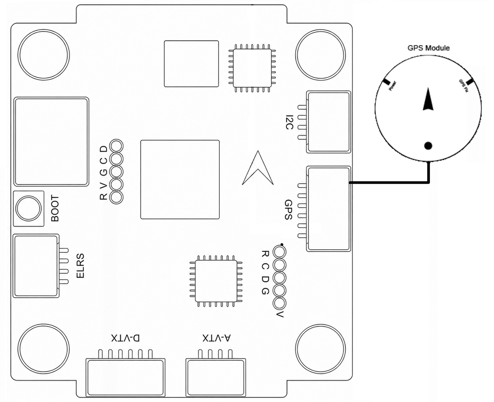

# Accton Godwit GFH7

<Badge type="tip" text="main (PX4 v2.0)" />

::: warning
PX4 does not manufacture this (or any) autopilot.
Contact the [manufacturer](https://www.accton-iot.com/godwit/) for hardware support or compliance issues.
:::

The [Godwit GFH7](https://www.accton-iot.com/godwit/g-fh7.html) is a compact flight controller from Accton, designed for fixed-wing, VTOL, and other UAV applications.
It uses an STM32H753 flight-management processor, dual IMUs, an integrated barometer and compass, and solder-free connectors for flexible system integration.
The board supports PX4, ArduPilot, Betaflight, and iNAV flight-control software.







::: info
This flight controller is [manufacturer supported](../flight_controller/autopilot_manufacturer_supported.md).
:::

## Specifications {#specifications}

### Processor {#processor}

- **Main FMU processor:** [STM32H753VIH6](https://www.st.com/en/microcontrollers-microprocessors/stm32h753vi.html) (Arm® Cortex®-M7 at 480 MHz, 2 MB flash, 1 MB RAM)

### Sensors {#sensors}

- **IMU:** [TDK InvenSense ICM-42688-P](https://invensense.tdk.com/products/motion-tracking/6-axis/icm-42688-p/) (SPI4), [STMicroelectronics LSM6DSK320X](https://www.st.com/en/mems-and-sensors/lsm6dsk320x.html) (SPI2)
- **Barometer:** [Infineon DPS368](https://www.infineon.com/cms/en/product/sensor/pressure-sensors/pressure-sensors-for-iot/dps368/) (I2C1)
- **Magnetometer:** iSentek IST8310 (I2C1)
- **Heater:** resistive IMU heater, off by default (see [IMU Heater](#imu_heater))

### Interfaces {#interfaces}

- **PWM outputs:** 8 (plus `PWM9` for a NeoPixel LED strip)
- **Serial ports:** 7: `TELEM`, `GPS`, `ELRS`, `SBUS`, `D-VTX`, `ESC` (ESC telemetry, RX only), and the `T2`/`R2` solder pads
- **I2C buses:** 2 (1 external, 1 internal)
- **SPI buses:** 3, all internal (both IMUs and the OSD)
- **CAN buses:** 1
- **Ethernet:** RMII and PPS on a connector (reserved for future use; not enabled in PX4)
- **USB:** USB Type-C, with DFU button
- **RC input:** Yes (serial, on the `SBUS` and `ELRS` connectors)
- **Parameter storage:** processor flash
- **SD card:** microSD slot
- **ADC inputs:** 3 (battery voltage, battery current, and analog RSSI)
- **OSD:** analog (AT7456-compatible)
- **Other:** 2 LED indicators, buzzer, video input, and video output

### Electrical Data {#electrical_data}

- **Input voltage:** 4S to 12S LiPo
- **Current draw:** 110 mA at 5 V (static), plus up to 67 mA with the IMU heater on
- **BEC output:** 5 V/3 A and 12 V/3 A (supports power-saving mode)
- **Power monitoring:** one analog input (battery voltage and current)

### Mechanical Data {#mechanical_data}

- **Dimensions:** 36 x 42 x 8.63 mm
- **Weight:** 10.6 g
- **Mounting hole spacing:** 30.5 x 30.5 mm, M4

## Where to Buy {#store}

Product information and availability are provided on the [Accton-IoT Godwit GFH7 product page](https://www.accton-iot.com/godwit/g-fh7.html).

## Pinouts {#pinouts}

Refer to the [Godwit GFH7 product page](https://www.accton-iot.com/godwit/g-fh7.html) and the [Godwit GFH7 datasheet](https://www.accton-iot.com/godwit/assets/doc/DS-Godwit%20FPV%20G-FH7.pdf) for the latest board information and interface definition.



### Block Diagram {#block_diagram}

The block diagram below shows the main components (sensors and power supply) and how they connect to the STM32H753 FMU.



## Power {#power}

The board is powered from the battery through the `VBAT` pins on the `ESC` connector (JST-SH 10P), which also carries the ESC's battery current signal (`CURRENT` pin).
Onboard BECs supply 5 V/3 A and 12 V/3 A to peripherals.

The 12 V output is on at boot.
To switch it from your transmitter, assign an RC switch to [RC_MAP_PAY_SW](../advanced_config/parameter_reference.md#RC_MAP_PAY_SW): the 12 V output then stays off until the switch is set to on.

Battery voltage monitoring is configured by default ([BAT1_V_DIV](../advanced_config/parameter_reference.md#BAT1_V_DIV) is set to `17.0`).
Current monitoring depends on the ESC's current sensor, so you must set [BAT1_A_PER_V](../advanced_config/parameter_reference.md#BAT1_A_PER_V) as described in [Battery and Power Module Setup](../config/battery.md).

## Voltage Ratings {#voltage_ratings}

The board can be powered from the battery input (`VBAT` pins on the `ESC` connector) or from USB.

### Normal Operation Maximum Ratings

Under these conditions all power sources will be used in this order to power the system:

1. **Battery** input (4S to 12S LiPo, up to 50.4 V)
2. **USB** input (4.75 V to 5.25 V)

### Absolute Maximum Ratings

Under these conditions the system will not draw any power (will not be operational), but will remain intact.

1. **Battery** input (65 V)

::: info
The flight controller keeps working below 13 V on the battery input.
The 12 V output for the camera and VTX is generated from the battery input, and needs about 13 V or more to stay at 12 V.
Below that, the camera and VTX lose power.
:::

## PWM Outputs {#pwm_outputs}

The board has 8 PWM outputs, on the `MOTOR1`-`MOTOR8` pins of the `ESC` and `Ext ESC` connectors.
All 8 outputs support [DShot](../peripherals/dshot.md) and [bidirectional DShot](../peripherals/dshot.md#bidirectional-dshot-telemetry).

The outputs are in 2 groups:

- Outputs 1-4 in group 1 (Timer1)
- Outputs 5-8 in group 2 (Timer8)

All outputs within the same group must use the same output protocol and rate.

The `PWM9` pin on the `Ext ESC` connector drives a NeoPixel (WS2812-compatible) LED strip of up to 8 LEDs, and can't be used as an actuator output.

## SD Card (Optional) {#sd_card}

The board has a microSD card slot, which PX4 uses for flight logs and other data.
See [SD Cards](../getting_started/px4_basic_concepts.md#sd-cards-removable-memory) for more information.



## IMU Heater {#imu_heater}

The board has a resistive IMU heater, which draws up to 67 mA (0.33 W) from the 5 V supply.

The heater is off by default.
To enable it, set [SENS_EN_THERMAL](../advanced_config/parameter_reference.md#SENS_EN_THERMAL) to `1` and reboot.
The target temperature is set by [HEATER1_TEMP](../advanced_config/parameter_reference.md#HEATER1_TEMP), which this board sets to 45 °C.

If you enable the heater, run the [accelerometer calibration](../config/accelerometer.md) only after `heater status` (in the [MAVLink Shell](../debug/mavlink_shell.md)) shows that the sensor temperature has reached the set temperature.

## Serial Port Mapping {#serial_port_mapping}

| UART   | Device     | Port             | Connector                                                |
| ------ | ---------- | ---------------- | -------------------------------------------------------- |
| USART1 | /dev/ttyS0 | EXT2             | `ESC` (ESC telemetry, RX only)                           |
| USART2 | /dev/ttyS1 | TELEM 2          | `T2`/`R2` solder pads                                    |
| USART3 | /dev/ttyS2 | GPS 1            | `GPS`                                                    |
| UART4  | /dev/ttyS3 | TELEM/SERIAL 4   | `ELRS` (CRSF by default)                                 |
| UART5  | /dev/ttyS4 | Radio Controller | `SBUS`, `D-VTX` (`SBUS` pin, RX only), `A-VTX` (TX only) |
| UART7  | /dev/ttyS5 | TELEM 1          | `TELEM`                                                  |
| UART8  | /dev/ttyS6 | TELEM 3          | `D-VTX`                                                  |

`EXT2` is receive-only, so it can't be used for MAVLink or other two-way protocols.
It reads [ESC telemetry](../peripherals/dshot.md#esc-telemetry) from the `ESC` connector ([DSHOT_TEL_CFG](../advanced_config/parameter_reference.md#DSHOT_TEL_CFG) is set to `EXT2` by default).

No ports have flow control.

## Interface Summary {#interface_summary}

| Interface         | Function                                         |
| ----------------- | ------------------------------------------------ |
| `ESC` / `Ext ESC` | Connect the ESC and motor system.                |
| `GPS`             | Connect a GPS module.                            |
| `SBUS` / `ELRS`   | Connect an RC receiver.                          |
| `TELEM`           | Connect a telemetry radio or MAVLink device.     |
| `CAN`             | Connect CAN peripherals.                         |
| `I2C`             | Connect external I2C sensors.                    |
| `BZ`              | Connect an external buzzer.                      |
| `VIDEO-IN`        | Connect the analog video input.                  |
| `A-VTX` / `D-VTX` | Connect an analog or digital video transmitter.  |

## Assembly {#assembly}

### Wiring Diagrams {#wiring_diagram}

Refer to the [Godwit GFH7 product page](https://www.accton-iot.com/godwit/g-fh7.html) and the [Godwit GFH7 datasheet](https://www.accton-iot.com/godwit/assets/doc/DS-Godwit%20FPV%20G-FH7.pdf) for the latest wiring and connector information.

")

")

The diagram below shows how to connect the ESC and motors to the `ESC` and `Ext ESC` connectors.



### Radio Control {#radio_control}

A remote control (RC) radio system is required if you want to manually control your vehicle (PX4 does not require a radio system for autonomous flight modes).
See [Radio Control Systems](../getting_started/rc_transmitter_receiver.md) for how to select a transmitter/receiver.

The board has two receiver connectors (JST-SH 4P), both wired to FMU UARTs:

- `ELRS` (UART4, PX4 port `TELEM/SERIAL 4`): CRSF/ExpressLRS is enabled on this port by default ([RC_CRSF_PRT_CFG](../advanced_config/parameter_reference.md#RC_CRSF_PRT_CFG) is set to `TELEM/SERIAL 4`).
  [CRSF telemetry](../telemetry/crsf_telemetry.md) to the transmitter is also enabled by default ([RC_CRSF_TEL_EN](../advanced_config/parameter_reference.md#RC_CRSF_TEL_EN)).
- `SBUS` (UART5, PX4 port `Radio Controller`): for S.BUS receivers.
  To use it, set [RC_SBUS_PRT_CFG](../advanced_config/parameter_reference.md#RC_SBUS_PRT_CFG) to `Radio Controller` and `RC_CRSF_PRT_CFG` to `Disabled`.
  The `SBUS` pin on the `D-VTX` connector is wired to the same UART input, for digital video systems that output S.BUS.

Other protocols are enabled by setting [RC_DSM_PRT_CFG](../advanced_config/parameter_reference.md#RC_DSM_PRT_CFG) or [RC_GHST_PRT_CFG](../advanced_config/parameter_reference.md#RC_GHST_PRT_CFG) to the port the receiver is connected to.
Only one protocol can be active on a port.
PPM receivers are not supported, so PWM receivers can't be used either, even with a PPM encoder.

The vehicle boots in Stabilized mode ([multicopter](../flight_modes_mc/manual_stabilized.md), [fixed-wing](../flight_modes_fw/stabilized.md)) instead of the PX4 default of Hold mode ([COM_FLTMODE_BOOT](../advanced_config/parameter_reference.md#COM_FLTMODE_BOOT) is set to `Stabilized`).
A flight mode switch, if you assign one with [RC_MAP_FLTMODE](../advanced_config/parameter_reference.md#RC_MAP_FLTMODE), overrides this.



### GPS & Compass {#gps_compass}

Connect a [GPS/compass module](../gps_compass/index.md) to the `GPS` connector (JST-SH 6P), which carries USART3 (PX4 port `GPS 1`) and the external I2C bus (I2C4) for the compass.
See [Mounting the GPS/Compass](../assembly/mount_gps_compass.md) for placement.

An external compass (usually built into the GPS module) is recommended over the onboard IST8310, because it can be mounted away from motors and power wiring.



### Telemetry Radios (Optional) {#telemetry}

Connect the radio to the `TELEM` connector (PX4 port `TELEM 1`), which is configured for MAVLink by default.

Telemetry radios are used to provide a wireless data link between the vehicle and a ground control station (GCS) such as _QGroundControl_.
This allows you to monitor flight data, change missions in real time, and receive in-flight status updates.
See [Telemetry Radios](../telemetry/index.md).

### CAN {#can}

The `CAN` connector (JST-SH 4P) is used for [DroneCAN](../dronecan/index.md) peripherals such as GPS modules, ESCs, and sensors.
DroneCAN is disabled by default: enable it by setting [UAVCAN_ENABLE](../advanced_config/parameter_reference.md#UAVCAN_ENABLE).

### OSD {#osd}

The board has an [analog OSD](../peripherals/osd.md#atxxxx-analog-osd) chip (AT7456-compatible), which is enabled by default in NTSC mode.
Connect the camera to `VIDEO-IN` and the analog video transmitter to `A-VTX`.
Set [OSD_ATXXXX_CFG](../advanced_config/parameter_reference.md#OSD_ATXXXX_CFG) to `2` for PAL, or `0` to disable it, and reboot.

For a digital video transmitter on the `D-VTX` connector, set [MSP_OSD_CONFIG](../advanced_config/parameter_reference.md#MSP_OSD_CONFIG) to `TELEM 3` to enable [MSP OSD](../peripherals/osd.md#msp-osd).

## Building Firmware {#building_firmware}

::: tip
From PX4 v2.0, most users will not need to build this firmware!
It is pre-built and automatically installed by _QGroundControl_ when appropriate hardware is connected.
:::

The board ships with the PX4 bootloader.

To [build PX4](../dev_setup/building_px4.md) for this target from source:

```sh
make accton-godwit_gfh7_default
```

For a debug build with the system console enabled (`accton-godwit_gfh7_debug`), see [Debug Port](#debug_port).

## Debug Port {#debug_port}

The top face has two unpopulated five-pad test/debug groups for manufacturing, debugging, or hardware verification.
They don't follow the [Pixhawk Debug](../debug/swd_debug.md#pixhawk-standard-debug-ports) connector standards, so a debug probe must be wired to the pads directly.

The `R V G C D` pad group is the [SWD interface](../debug/swd_debug.md) of the STM32H753 FMU:

| Pad | Signal    | Voltage |
| --- | --------- | ------- |
| `R` | ST_RST_L  | 3.3 V   |
| `V` | VDD3V3    | 3.3 V   |
| `G` | GND       | GND     |
| `C` | FMU_SWCLK | 3.3 V   |
| `D` | FMU_SWDIO | 3.3 V   |

The `R C D G V` pad group is the SWD interface of the OSD co-processor (STM32G431), which is not used by PX4:

| Pad | Signal     | Voltage |
| --- | ---------- | ------- |
| `R` | OSD_NRST   | 3.3 V   |
| `C` | G431_SWCLK | 3.3 V   |
| `D` | G431_SWDIO | 3.3 V   |
| `G` | GND        | GND     |
| `V` | VDD3V3     | 3.3 V   |

These pads are not general user interfaces: only connect an SWD debug probe to them, and do not apply power to them or use them as GPIO, UART, or I2C interfaces.

The default firmware does not provide a serial [System Console](../debug/system_console.md).
Use the [MAVLink Shell](../debug/mavlink_shell.md) over USB or a telemetry link instead.

The debug build enables the system console on UART4 (the `ELRS` connector):

```sh
make accton-godwit_gfh7_debug
```

`TELEM/SERIAL 4` is not available in that build, so an ELRS receiver can't be used.
To use an S.BUS receiver on the `SBUS` connector instead, set [RC_SBUS_PRT_CFG](../advanced_config/parameter_reference.md#RC_SBUS_PRT_CFG) to `Radio Controller`.

## Further Information {#further_information}

- [Accton-IoT Godwit GFH7](https://www.accton-iot.com/godwit/g-fh7.html) (product page)
- [Godwit GFH7 documentation](https://www.accton-iot.com/godwitdoc/g-fh7doc.html)
- [Godwit GFH7 datasheet](https://www.accton-iot.com/godwit/assets/doc/DS-Godwit%20FPV%20G-FH7.pdf)
- Sales: [sales@accton-iot.com](mailto:sales@accton-iot.com)
- Support: [support@accton-iot.com](mailto:support@accton-iot.com)
