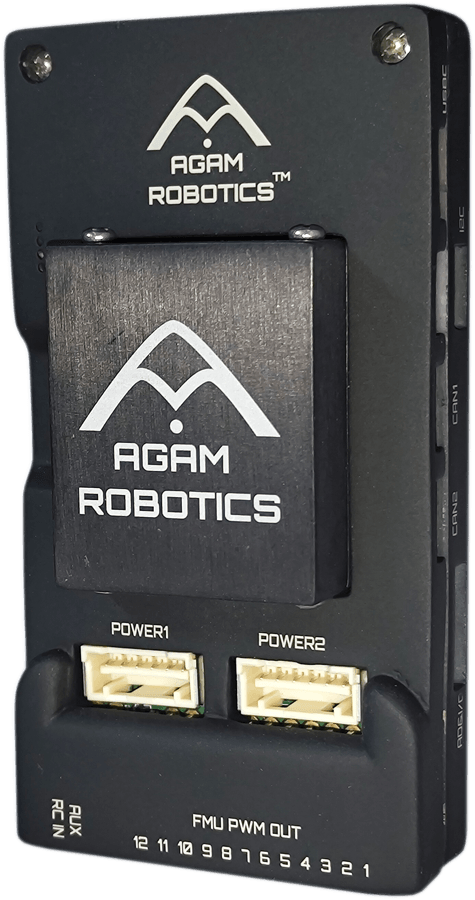

# Agam Autopilot v6X-RT

<Badge type="tip" text="main (PX4 v2.0)" />

::: warning
PX4 does not manufacture this (or any) autopilot.
Contact the [manufacturer](https://www.agamrobotics.com/) for hardware support or compliance issues.
:::

The [Agam Autopilot v6X-RT](https://www.agamrobotics.com/product-page/agam-pixhawk-6x-full-set) flight controller is [Agam Robotics'](https://www.agamrobotics.com/) implementation of the [NXP-led FMUv6X-RT reference design](../flight_controller/nxp_mr_vmu_rt1176.md).

The board ships with one of two [sensor sets](#sensors).
Its three IMUs and two barometers are each on a separate bus, and two of the IMUs are on a shock-isolated sensor board, separate from the FMU board.
A 100BASE-T1 (2-wire) [Ethernet](#ethernet) port connects companion computers, cameras and other networked devices.



::: info
This flight controller is [manufacturer supported](../flight_controller/autopilot_manufacturer_supported.md).
:::

## Specifications {#specifications}

### Processor {#processor}

- **Main FMU processor:** [NXP i.MX RT1176 (MIMXRT1176DVMAA)](https://www.nxp.com/products/i.MX-RT1170) (Arm® Cortex®-M7 at 996 MHz, 2 MB RAM). The second Cortex®-M4 core (400 MHz) is unused by PX4.
- **Code store:** no internal flash. Code executes in place from a 64 MB external octal SPI flash, of which PX4 uses the first 4 MB.
- **Secure element:** [NXP EdgeLock SE051](https://www.nxp.com/products/SE051), field-updatable, certified to CC EAL 6+

### Sensors {#sensors}

The board ships with one of two sensor sets (Sensor Set 1 or Sensor Set 3, per [DS-020](https://github.com/pixhawk/Pixhawk-Standards/blob/master/DS-020%20Pixhawk%20Autopilot%20v6X-RT%20Standard.pdf)).
The IMU on SPI1 is on the FMU board; the other two are on the shock-isolated sensor board.
Each sensor domain has its own power control.

- **IMU:**
  - Sensor Set 1: [InvenSense ICM-42686-P](https://www.invensense.tdk.com/en-us/products/6-axis/icm-42686-p) (SPI1), [InvenSense ICM-42688-P](https://www.invensense.tdk.com/en-us/products/6-axis/icm-42688-p) (SPI2), [Bosch BMI088](https://www.bosch-sensortec.com/en/products/motion-sensors/imus/bmi088/) (SPI3)
  - Sensor Set 3: 2× [InvenSense ICM-45686](https://www.invensense.tdk.com/en-us/products/6-axis/icm-45686) (SPI1, SPI2), [Bosch BMI088](https://www.bosch-sensortec.com/en/products/motion-sensors/imus/bmi088/) (SPI3)
- **Barometer:** 2× Bosch BMP388 (Sensor Set 1) or 2× [Bosch BMP390](https://www.bosch-sensortec.com/en/products/environmental-sensors/pressure-sensors/bmp390/) (Sensor Set 3) (I2C3, I2C2)
- **Magnetometer:** [Bosch BMM150](https://www.bosch-sensortec.com/media/boschsensortec/downloads/datasheets/bst-bmm150-ds001.pdf) (Sensor Set 1) or [Bosch BMM350](https://www.bosch-sensortec.com/en/products/motion-sensors/magnetometers/bmm350) (Sensor Set 3) (I2C3)
- **Heater:** on the sensor board; not supported by the default firmware

::: tip
By default PX4 runs a single EKF2 instance on the IMU selected by the sensors module, which switches to another IMU if the selected one fails.
To [run an EKF2 instance on each IMU](../advanced_config/tuning_the_ecl_ekf.md#running-multiple-ekf-instances), set [SENS_IMU_MODE](../advanced_config/parameter_reference.md#SENS_IMU_MODE) to `Disabled (0)`, reboot, set [EKF2_MULTI_IMU](../advanced_config/parameter_reference.md#EKF2_MULTI_IMU) to `3`, and reboot again.
See [Agam's IMU triple redundancy notes](https://agamrobotics.gitbook.io/docs/autopilots-flight-controller/quickstart/imu-triple-redundancy-feature) for more information.
:::

### Interfaces {#interfaces}

- **PWM outputs:** 12 FMU outputs, 8 of which support DShot
- **Serial ports:** 8 (`GPS1`, `GPS2`, `TELEM1`, `TELEM2`, `TELEM3`, `UART&I2C`, `RC IN`/`DSM RC`, Debug Console)
- **I2C buses:** 4 (I2C3 internal, I2C2 shared between the internal barometer and `POWER2`, I2C1 and I2C6 external)
- **SPI buses:** 4, of which SPI6 is external with 2 chip selects, 2 data-ready lines, a sync line and a reset line
- **CAN buses:** 3 (CAN-FD)
- **Ethernet:** 100BASE-T1 (2-wire)
- **USB:** Yes (USB 2.0)
- **RC input:** Yes (`RC IN` and a dedicated Spektrum/DSM `DSM RC` port)
- **NFC:** antenna port, connected to the SE051 secure element
- **Parameter storage:** FRAM (FM25V02A, 256 Kbit) on FlexSPI2
- **SD card:** MicroSD slot

### Electrical Data {#electrical_data}

- **Input voltage:** 4.9 V to 5.5 V on `POWER1` and `POWER2` (6 V maximum); 4.75 V to 5.25 V on USB
- **Servo rail input:** 0 V to 36 V
- **Output current limits:** 1.5 A on `TELEM1`; 1.5 A for all other ports combined
- **Power monitoring:** 2 digital power inputs; INA226, INA228 or INA238, detected automatically

### Mechanical Data {#mechanical_data}

- **Dimensions:** flight controller module 39 × 32 × 16 mm; baseboard 95 × 50 × 19 mm
- **Weight:** 90 g
- **Operating temperature:** -40 °C to 85 °C

## Where to Buy {#store}

Order from the [Agam Robotics store](https://www.agamrobotics.com/product-page/agam-pixhawk-6x-full-set).

## Pinouts {#pinouts}

For the pinout of each port see the [Agam Autopilot v6X-RT baseboard port pinouts](https://agamrobotics.gitbook.io/docs/autopilots-flight-controller/quickstart/baseboard-port) (Agam Robotics Docs).

The pinout follows the same standards as other FMUv6X-RT boards:

- [DS-012 Pixhawk Autopilot v6X Standard](https://github.com/pixhawk/Pixhawk-Standards/blob/master/DS-012%20Pixhawk%20Autopilot%20v6X%20Standard.pdf)
- [DS-010 Pixhawk Autopilot Bus Standard](https://github.com/pixhawk/Pixhawk-Standards/blob/master/DS-010%20Pixhawk%20Autopilot%20Bus%20Standard.pdf)
- [DS-009 Pixhawk Connector Standard](https://github.com/pixhawk/Pixhawk-Standards/blob/master/DS-009%20Pixhawk%20Connector%20Standard.pdf)

Pin 2 on the `AD&IO` port is marked `FMU_CAP` (`GPIO_EMC_B1_20`), but isn't used for camera capture by the default firmware.

## Power {#power}

The board has three power inputs, `POWER1`, `POWER2` and USB, and has triple-redundant power when all three are connected.
`POWER1` and `POWER2` are 6-circuit, 2.00 mm pitch [Molex CLIK-Mate](https://www.molex.com/en-us/products/part-detail/5024430670) connectors.

Battery monitoring is digital: `POWER1` and `POWER2` carry I2C for a digital power module.
INA226, INA228 and INA238 monitors are detected automatically; to start only one driver, set [SENS_EN_INA226](../advanced_config/parameter_reference.md#SENS_EN_INA226), [SENS_EN_INA228](../advanced_config/parameter_reference.md#SENS_EN_INA228) or [SENS_EN_INA238](../advanced_config/parameter_reference.md#SENS_EN_INA238) to 1.
An ADS1115 external ADC can be enabled with [ADC_ADS1115_EN](../advanced_config/parameter_reference.md#ADC_ADS1115_EN) for analog monitoring.
See [Battery and Power Module Setup](../config/battery.md) for configuration.

::: info
The `FMU PWM OUT` port is not powered by `POWER1` or `POWER2`.
The output rail must be [separately powered](../peripherals/pwm_escs_and_servo.md) if it needs to power servos or other hardware.
:::

## Voltage Ratings {#voltage_ratings}

### Normal Operation Maximum Ratings

Under these conditions the power sources are used in this order:

1. `POWER1` and `POWER2` inputs (4.9 V to 5.5 V)
2. USB input (4.75 V to 5.25 V)

### Absolute Maximum Ratings

Under these conditions the system doesn't draw power (isn't operational), but remains intact.

1. `POWER1` and `POWER2` inputs (operational range 4.1 V to 5.7 V, 0 V to 10 V undamaged)
2. USB input (operational range 4.1 V to 5.7 V, 0 V to 6 V undamaged)
3. Servo input: `VDD_SERVO` pin of `FMU PWM OUT` (0 V to 42 V undamaged)

## PWM Outputs {#pwm_outputs}

The board has 12 FMU PWM outputs, on the `FMU PWM OUT` port.
The default firmware is built with PX4IO support, so these outputs are labelled `AUX` in the [actuator configuration](../config/actuators.md), although the board has no PX4IO.

Outputs 1-8 support [DShot](../peripherals/dshot.md) and [Bidirectional DShot](../peripherals/dshot.md#bidirectional-dshot-telemetry).
Outputs 9-12 do not support DShot.

Each output has its own FlexPWM submodule, so there are no output groups: protocol and rate can be set per output.

## Ethernet {#ethernet}

The board has a 100BASE-T1 (2-wire) Ethernet port, `ETH`.
Connecting a device with a standard Ethernet port needs a 100BASE-T1 media converter.

The board requests its IP address using DHCP.
MAVLink instance 2 runs on Ethernet by default, broadcasting on UDP port 14550.
See [PX4 Ethernet Setup](../advanced_config/ethernet_setup.md) for how to configure it.

## SD Card (Optional) {#sd_card}

The board has a MicroSD card slot.
For information about choosing and using an SD card see [SD Cards (Removable Memory)](../getting_started/px4_basic_concepts.md#sd-cards-removable-memory).

## Serial Port Mapping {#serial_port_mapping}

| UART     | Device       | Port              | Flow Control |
| -------- | ------------ | ----------------- | ------------ |
| LPUART1  | `/dev/ttyS0` | Debug Console     |              |
| LPUART3  | `/dev/ttyS1` | `GPS1`            |              |
| LPUART4  | `/dev/ttyS2` | `TELEM1`          | Yes          |
| LPUART5  | `/dev/ttyS3` | `GPS2`            |              |
| LPUART6  | `/dev/ttyS4` | `RC IN`, `DSM RC` |              |
| LPUART8  | `/dev/ttyS5` | `TELEM2`          | Yes          |
| LPUART10 | `/dev/ttyS6` | `TELEM3`          | Yes          |
| LPUART11 | `/dev/ttyS7` | `UART&I2C`        |              |

::: info
The mapping above applies to the running PX4 firmware.
The bootloader enables only LPUART8 (`TELEM2`), so when flashing firmware over UART with [`px4_uploader.py`](https://github.com/PX4/PX4-Autopilot/blob/main/Tools/px4_uploader.py) you must connect to the `TELEM2` port.
:::

## Assembly {#assembly}

Agam Autopilot v6X-RT is based on the NXP FMUv6X-RT reference design, and differs from it only in enclosure.
Wiring is similar to the [Holybro Pixhawk 6X](../flight_controller/pixhawk6x.md#connections) and other boards that follow the [Pixhawk Connector Standard](https://github.com/pixhawk/Pixhawk-Standards/blob/master/DS-009%20Pixhawk%20Connector%20Standard.pdf).

For wiring and assembly, follow the [Pixhawk 6X Wiring Quick Start](../assembly/quick_start_pixhawk6x.md).
This board has no PX4IO and no `I/O PWM OUT` port: motors and servos connect to `FMU PWM OUT`, and RC receivers need their protocol enabled (see [Radio Control](#radio_control)).

### Radio Control {#radio_control}

An RC radio system is required if you want to manually control your vehicle (PX4 does not require a radio system for autonomous flight modes).
You will need to [select a compatible transmitter/receiver](../getting_started/rc_transmitter_receiver.md) and then bind them so that they communicate (read the instructions that come with your specific transmitter/receiver).

Connect the receiver to the `RC IN` port, or a Spektrum/DSM receiver to the `DSM RC` port, which supplies the receiver's 3.3 V on pin 1 (`VDD_3V3_SPEKTRUM`).
Both go to the FMU (LPUART6, `/dev/ttyS4`).

The firmware includes the [CRSF](../telemetry/crsf_telemetry.md), DSM, GHST and S.BUS drivers (see [PX4-Compatible Receivers](../getting_started/rc_transmitter_receiver.md#compatible_receivers)), but none is enabled by default.
Enable the one for your receiver by [setting](../advanced_config/parameters.md) its port parameter to `Radio Controller` (300): [RC_CRSF_PRT_CFG](../advanced_config/parameter_reference.md#RC_CRSF_PRT_CFG), [RC_DSM_PRT_CFG](../advanced_config/parameter_reference.md#RC_DSM_PRT_CFG), [RC_GHST_PRT_CFG](../advanced_config/parameter_reference.md#RC_GHST_PRT_CFG) or [RC_SBUS_PRT_CFG](../advanced_config/parameter_reference.md#RC_SBUS_PRT_CFG).
Only one protocol can be enabled on the port.
PPM is not supported by the default firmware, so PPM receivers (and PWM receivers through a PPM encoder) can't be used.

### GPS & Compass {#gps_compass}

The board has two GPS ports:

- `GPS1` (LPUART3): GPS, I2C (I2C1) for a compass, safety switch and buzzer.
- `GPS2` (LPUART5): GPS.

An external compass on `GPS1` is detected automatically.
The board has an onboard compass (see [Sensors](#sensors)), but an [external compass](../gps_compass/magnetometer.md) on the GPS module is recommended.
See [Mounting a GPS/Compass](../assembly/mount_gps_compass.md) for more information.

### Telemetry Radios (Optional) {#telemetry}

The board has three [telemetry](../telemetry/index.md) ports, `TELEM1`, `TELEM2` and `TELEM3`, each with flow control.
A telemetry radio connected to `TELEM1` needs no further configuration.

### CAN {#can}

The board has three CAN-FD ports, `CAN1`, `CAN2` and `CAN3`.
They can be used for [DroneCAN](../dronecan/index.md) peripherals, such as GPS modules, [ESCs](../peripherals/esc_motors.md) and power modules.

DroneCAN is not enabled by default: set [UAVCAN_ENABLE](../advanced_config/parameter_reference.md#UAVCAN_ENABLE) to enable it.

### OSD {#osd}

The default firmware includes the [MSP OSD](../peripherals/osd.md#msp-osd) driver.
Connect the air unit to a free serial port and set [MSP_OSD_CONFIG](../advanced_config/parameter_reference.md#MSP_OSD_CONFIG) to that port.

## Building Firmware {#building_firmware}

::: tip
From PX4 v2.0, most users will not need to build this firmware!
It is pre-built and automatically installed by _QGroundControl_ when appropriate hardware is connected.
:::

To [build PX4](../dev_setup/building_px4.md) for this target:

```sh
make agam_fmu-v6xrt_default
```

The board also has specialised build variants: `agam_fmu-v6xrt_rover` and `agam_fmu-v6xrt_bench`.

## Secure Boot

The board supports [Bootloader Secure Boot](../advanced_config/bootloader_secure_boot.md), which only runs firmware signed with a key the bootloader trusts.
The build targets are:

- `agam_fmu-v6xrt_bootloader_secureboot`: the secure bootloader.
- `agam_fmu-v6xrt_secureboot`: PX4 firmware, signed as part of the build.

## Debug Port {#debug_port}

The [PX4 System Console](../debug/system_console.md) and [SWD interface](../debug/swd_debug.md) run on the `FMU Debug` port.

The pinout and connector comply with the [Pixhawk Debug Full](../debug/swd_debug.md#pixhawk-debug-full) interface defined in the [Pixhawk Connector Standard](https://github.com/pixhawk/Pixhawk-Standards/blob/master/DS-009%20Pixhawk%20Connector%20Standard.pdf) (JST-SH 1 mm pitch, 10-pin connector).
Pin 6 is `SPI6_MOSI_EXTERNAL1` (pin function `JTAG_TDO`), which carries `SWO` when the debug port is in serial-wire mode.

| Pin        | Signal           | Volt   |
| ---------- | ---------------- | ------ |
| 1 (red)    | `FMU_VDD_3V3`    | +3.3 V |
| 2 (black)  | `FMU_USART_TX`   | +3.3 V |
| 3 (black)  | `FMU_USART_RX`   | +3.3 V |
| 4 (black)  | `FMU_SWD_IO`     | +3.3 V |
| 5 (black)  | `FMU_SWD_CK`     | +3.3 V |
| 6 (black)  | `SWO`            | +3.3 V |
| 7 (black)  | NFC GPIO         | +3.3 V |
| 8 (black)  | `GPIO_EMC_B2_12` | +3.3 V |
| 9 (black)  | `FMU_nRST`       | +3.3 V |
| 10 (black) | `GND`            | GND    |

For information about using this port see:

- [SWD Debug Port](../debug/swd_debug.md)
- [PX4 System Console](../debug/system_console.md)

## Peripherals

- [Agam GNSS01 CAN](https://agamrobotics.gitbook.io/docs/gnss-and-rtk-systems/agam-gnss01-can)
- [Agam GNSS02 CAN RTK](https://agamrobotics.gitbook.io/docs/gnss-and-rtk-systems/agam-gnss02-can-rtk)
- [Agam GNSS Base RTK](https://agamrobotics.gitbook.io/docs/gnss-and-rtk-systems/agam-gnss-base-rtk)
- [Agam FloRange Sensor](https://agamrobotics.gitbook.io/docs/sensors/agam-florange-sensor)
- [Rangefinders/Distance sensors](../sensor/rangefinders.md)

## Further Information {#further_information}

- [Update Pixhawk 6X-RT Bootloader](../advanced_config/bootloader_update_v6xrt.md)
- [Agam Autopilot v6X-RT Documentation](https://agamrobotics.gitbook.io/docs/autopilots-flight-controller/quickstart) (Agam Robotics Docs)
- [Agam Autopilot v6X-RT setup video playlist](https://www.youtube.com/playlist?list=PLv71BKC3TLci9fgwV4U6_2C2Uxtrm3SQE) (YouTube, Agam Robotics)
- [Pixhawk 6X Wiring Quick Start](../assembly/quick_start_pixhawk6x.md)
- [Agam Digital Power Module (DPM01)](https://agamrobotics.gitbook.io/docs/digital-power-modules-dpm/dpm01-6s)
- [Agam Analog Power Module (APM)](https://agamrobotics.gitbook.io/docs/analog-power-modules-apm/generic)
- [Announcing the Pixhawk FMUv6X-RT](https://dronecode.org/announcing-the-pixhawk-fmuv6x-rt/) (Dronecode Foundation)
- [Pixhawk FMUv6X-RT open standard](https://github.com/pixhawk/Pixhawk-Standards/blob/master/DS-020%20Pixhawk%20Autopilot%20v6X-RT%20Standard.pdf)
- [Pixhawk Autopilot Bus Standard](https://github.com/pixhawk/Pixhawk-Standards/blob/master/DS-010%20Pixhawk%20Autopilot%20Bus%20Standard.pdf)
- [Pixhawk Connector Standard](https://github.com/pixhawk/Pixhawk-Standards/blob/master/DS-009%20Pixhawk%20Connector%20Standard.pdf)
