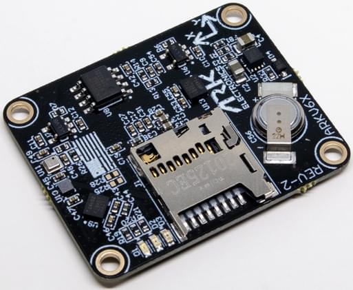

# ARK Electronics ARKV6X

<Badge type="tip" text="PX4 v1.13" />

::: warning
PX4 does not manufacture this (or any) autopilot.
Contact the [manufacturer](https://arkelectron.com/contact-us/) for hardware support or compliance issues.
:::

The USA-built [ARKV6X](https://docs.arkelectron.com/products/flight-controller/arkv6x) flight controller is based on the [FMUv6X](https://github.com/pixhawk/Pixhawk-Standards/blob/master/DS-012%20Pixhawk%20Autopilot%20v6X%20Standard.pdf) and [Pixhawk Autopilot Bus](https://github.com/pixhawk/Pixhawk-Standards/blob/master/DS-010%20Pixhawk%20Autopilot%20Bus%20Standard.pdf) open source standards.

With triple synced IMUs, data averaging, voting, and filtering are possible.
The Pixhawk Autopilot Bus (PAB) form factor enables the ARKV6X to be used on any [PAB-compatible carrier board](../flight_controller/pixhawk_autopilot_bus.md), such as the [ARK Pixhawk Autopilot Bus Carrier](../flight_controller/ark_pab.md).
The ARKV6X must be used with a carrier board, which provides all of its connectors for power, peripherals and outputs.



::: info
This flight controller is [manufacturer supported](../flight_controller/autopilot_manufacturer_supported.md).
:::

## Specifications {#specifications}

### Processor {#processor}

- **Main FMU processor:** [STM32H743IIK6](https://www.st.com/en/microcontrollers-microprocessors/stm32h743ii.html) (Arm Cortex-M7, 480 MHz, 2 MB flash, 1 MB RAM)
- **IO processor:** [PX4IO](../hardware/reference_design.md#main-io-function-breakdown) v2, on carriers that fit one

### Sensors {#sensors}

- **IMU:**
  - ARKV6X: 2× [InvenSense ICM-42688-P](https://www.invensense.tdk.com/en-us/products/6-axis/icm-42688-p) (SPI2, SPI3), [InvenSense IIM-42652](https://www.invensense.tdk.com/en-us/products/6-axis/iim-42652) (industrial, SPI1)
  - ARKV6X Extended Range: 3× [InvenSense IIM-42653](https://www.invensense.tdk.com/en-us/products/6-axis/iim-42653) (SPI1, SPI2, SPI3), for a 4000 degrees per second (dps) gyroscope and 32 g accelerometer range.
    The Extended Range needs PX4 v1.14 or later.
- **Barometer:** [Bosch BMP390](https://www.bosch-sensortec.com/en/products/environmental-sensors/pressure-sensors/bmp390/) (I2C4)
- **Magnetometer:** [Bosch BMM150](https://www.bosch-sensortec.com/media/boschsensortec/downloads/datasheets/bst-bmm150-ds001.pdf) (I2C4)
- **Heater:** 1 W, keeps the sensors warm in extreme conditions. It regulates on the temperature of the IIM-42652 (IIM-42653 on the Extended Range).

### Interfaces {#interfaces}

- **PWM outputs:** 8 FMU outputs, plus 8 from PX4IO on carriers that fit one (see [PWM Outputs](#pwm_outputs))
- **Serial ports:** 8 (`GPS1`, `GPS2`, `TELEM1`, `TELEM2`, `TELEM3`, `UART4/I2C3` (`TELEM4`), PX4IO or `RC/SBUS`, Debug Console)
- **I2C buses:** 4 (I2C4 internal, the rest external)
- **SPI buses:** 5, of which SPI6 is external with 2 chip selects and 2 data-ready lines
- **CAN buses:** 2
- **Ethernet:** 100 Mbps
- **USB:** Yes
- **RC input:** Yes
- **Parameter storage:** FRAM (FM25V02A) on SPI5
- **SD card:** MicroSD slot
- **LED indicators:** Yes

### Electrical Data {#electrical_data}

- **Input voltage:** 5 V nominal (4.8 V minimum, 5.5 V absolute maximum)
- **Current draw:** 500 mA (300 mA main system, 200 mA heater)
- **Power monitoring:** 2 digital power inputs (INA226 by default)

### Mechanical Data {#mechanical_data}

- **Dimensions:** 36 × 29 × 5 mm
- **Mounting hole spacing:** 31.4 × 24.4 mm (4 × Ø2.3 mm holes)
- **Weight:** 5.0 g
- **Form factor:** [Pixhawk Autopilot Bus (PAB)](https://github.com/pixhawk/Pixhawk-Standards/blob/master/DS-010%20Pixhawk%20Autopilot%20Bus%20Standard.pdf)
- **Operating temperature:** -10 °C to +60 °C

## Where to Buy {#store}

Order from ARK Electronics (US):

- [ARKV6X](https://arkelectron.com/product/arkv6x/)
- [ARKV6X Extended Range](https://arkelectron.com/product/arkv6x-iim-42653/)

## Pinouts {#pinouts}

For the pinout of the ARKV6X see the [DS-010 Pixhawk Autopilot Bus Standard](https://github.com/pixhawk/Pixhawk-Standards/blob/master/DS-010%20Pixhawk%20Autopilot%20Bus%20Standard.pdf).

## Power {#power}

The ARKV6X is powered with 5 V from its carrier board, through the PAB connector.

On the ARK PAB Carrier, power comes in on `POWER1` and `POWER2`, which are 6-pin Molex CLIK-Mate connectors.
The carrier selects between `POWER1`, `POWER2` and USB automatically, using an LTC4417 power selector.

Battery monitoring is digital: both power ports carry I2C for a digital power module.
INA226 power monitors are enabled by default ([SENS_EN_INA226](../advanced_config/parameter_reference.md#SENS_EN_INA226)).
The [ARK 12S PAB Power Module](../power_module/ark_12s_pab_power_module.md) uses an INA238 instead: set [SENS_EN_INA226](../advanced_config/parameter_reference.md#SENS_EN_INA226) to 0 and [SENS_EN_INA238](../advanced_config/parameter_reference.md#SENS_EN_INA238) to 1 (see its page for the full setup).
See [Battery and Power Module Setup](../config/battery.md) for configuration.

::: info
The PWM output port on the ARK PAB Carrier does not supply power (`VDD_SERVO` is not connected).
Servos and other hardware on the outputs must be [powered separately](../peripherals/pwm_escs_and_servo.md).
:::

## Voltage Ratings {#voltage_ratings}

The ARKV6X takes 5 V from its carrier through the PAB connector: 4.8 V minimum, 5.5 V absolute maximum.

On the ARK PAB Carrier, power is taken from `POWER1`, then `POWER2`, then USB.
The carrier has overvoltage protection at 5.85 V and undervoltage protection at 3.81 V.

::: warning
An input up to 5.85 V is still selected by the carrier and passed straight to the ARKV6X.
Keep the supply at or below the ARKV6X's 5.5 V absolute maximum.
:::

## PWM Outputs {#pwm_outputs}

The ARKV6X provides 8 FMU PWM outputs, and 8 more from a PX4IO on carriers that fit one.
How many reach a connector depends on the carrier: the [ARK PAB Carrier](../flight_controller/ark_pab.md) has no PX4IO, and breaks out FMU outputs 1-8.
The default firmware is built with PX4IO support, so the FMU outputs are labelled `AUX` in the [actuator configuration](../config/actuators.md), whichever carrier is used.
The `ark_fmu-v6x_encrypted_logs` build has no PX4IO support: its FMU outputs are labelled `MAIN`, and a carrier's PX4IO outputs and RC input aren't available.

FMU outputs 1-6 support [DShot](../peripherals/dshot.md) and [Bidirectional DShot](../peripherals/dshot.md#bidirectional-dshot-telemetry).
Outputs 7-8 do not support DShot.
PX4IO outputs do not support DShot.

The 8 FMU outputs are in 3 groups:

- Outputs 1-4 in group1 (Timer5)
- Outputs 5-6 in group2 (Timer4)
- Outputs 7-8 in group3 (Timer12)

All outputs within the same group must use the same output protocol and rate.

A ninth timer channel, `FMU_CAP` (Timer1), is intended for camera capture, and appears in the actuator configuration as `PWM Capture 1`.
It is a normal timer channel, so it can also be used as a ninth PWM or OneShot output (with any output function), but not DShot.
On the ARK PAB Carrier it is pin 2 of the `ADIO` port (see [Camera Capture Configuration](../camera/fc_connected_camera.md#camera-capture-configuration)).

## Ethernet {#ethernet}

The ARKV6X supports Ethernet.
On the ARK PAB Carrier it is a 100 Mbps, 4-pin JST-GH `ETH` port.

The ARKV6X has the static IP address `192.168.0.4` by default (gateway `192.168.0.1`), and doesn't use DHCP.
MAVLink instance 2 runs on Ethernet by default, on UDP port 14550.
See [PX4 Ethernet Setup](../advanced_config/ethernet_setup.md) for how to configure it.

## SD Card (Optional) {#sd_card}

The ARKV6X has a MicroSD card slot.
For information about choosing and using an SD card see [SD Cards (Removable Memory)](../getting_started/px4_basic_concepts.md#sd-cards-removable-memory).

## Serial Port Mapping {#serial_port_mapping}

| UART   | Device       | Port                    | Flow Control |
| ------ | ------------ | ----------------------- | ------------ |
| USART1 | `/dev/ttyS0` | `GPS1`                  |              |
| USART2 | `/dev/ttyS1` | `TELEM3`                | Yes          |
| USART3 | `/dev/ttyS2` | Debug Console           |              |
| UART4  | `/dev/ttyS3` | `UART4/I2C3` (`TELEM4`) |              |
| UART5  | `/dev/ttyS4` | `TELEM2`                | Yes          |
| USART6 | `/dev/ttyS5` | PX4IO or `RC/SBUS`      |              |
| UART7  | `/dev/ttyS6` | `TELEM1`                | Yes          |
| UART8  | `/dev/ttyS7` | `GPS2`                  |              |

::: info
The mapping above applies to the running PX4 firmware.
The ARKV6X bootloader enables only UART7 (`TELEM1`), so when flashing firmware over UART with [`px4_uploader.py`](https://github.com/PX4/PX4-Autopilot/blob/main/Tools/px4_uploader.py) you must connect to the `TELEM1` port — no other UART will respond in bootloader mode.
:::

## Assembly {#assembly}

The sections below describe the [ARK PAB Carrier](../flight_controller/ark_pab.md); see its page for the connector pinouts.

### Radio Control {#radio_control}

A remote control (RC) radio system is required if you want to manually control your vehicle (PX4 does not require a radio system for autonomous flight modes).
You will need to [select a compatible transmitter/receiver](../getting_started/rc_transmitter_receiver.md) and then bind them so that they communicate.

How a receiver connects depends on the carrier:

- **ARK PAB Carrier** (no PX4IO): connect the receiver to the 5-pin JST-GH `RC/SBUS` port, which goes to the FMU (USART6, `/dev/ttyS5`).
  The firmware includes the [CRSF](../telemetry/crsf_telemetry.md), DSM, GHST and S.BUS drivers (see [PX4-Compatible Receivers](../getting_started/rc_transmitter_receiver.md#compatible_receivers)), but none is enabled by default.
  Enable the one for your receiver by [setting](../advanced_config/parameters.md) its port parameter to `Radio Controller` (300): [RC_CRSF_PRT_CFG](../advanced_config/parameter_reference.md#RC_CRSF_PRT_CFG), [RC_DSM_PRT_CFG](../advanced_config/parameter_reference.md#RC_DSM_PRT_CFG), [RC_GHST_PRT_CFG](../advanced_config/parameter_reference.md#RC_GHST_PRT_CFG) or [RC_SBUS_PRT_CFG](../advanced_config/parameter_reference.md#RC_SBUS_PRT_CFG).
  Only one protocol can be enabled on the port.
  The carrier's `PPM` port is not supported by the default firmware, so PPM receivers can't be used.
  PX4 can't read a receiver on the carrier's `DSM` port.
  Connect a DSM (Spektrum) receiver to the `RC/SBUS` port, powered with 3.3 V from pin 4 (`VDD_3V3_SPEKTRUM`).
  PX4 and _QGroundControl_ can't bind a receiver on this port, because the bind pulses go only to the `PPM` and `DSM` ports: bind it another way, such as with the receiver's bind button.
- **Carriers with a PX4IO**: connect the receiver to the carrier's RC input, which goes to the PX4IO.
  The PX4IO detects the [protocols it supports](../modules/modules_driver.md#px4io) automatically.
  CRSF and GHST receivers can't be decoded by the PX4IO, and must be connected to an FMU serial port instead.

### GPS & Compass {#gps_compass}

The ARK PAB Carrier has two GPS ports:

- `GPS1`: 10-pin JST-GH, with GPS (USART1), I2C, safety switch, safety LED and buzzer.
- `GPS2`: 6-pin JST-GH, with GPS (UART8) and I2C.

The ARKV6X has an onboard BMM150 magnetometer, but an [external compass](../gps_compass/magnetometer.md) on the GPS module is recommended.
See [Mounting a GPS/Compass](../assembly/mount_gps_compass.md) for more information.

### Telemetry Radios (Optional) {#telemetry}

The ARK PAB Carrier has three [telemetry](../telemetry/index.md) ports, `TELEM1`, `TELEM2` and `TELEM3`, each a 6-pin JST-GH connector with flow control.
A telemetry radio connected to `TELEM1` needs no further configuration.

### CAN {#can}

The ARK PAB Carrier has two CAN ports, `CAN1` and `CAN2`, each a 4-pin JST-GH connector.
They can be used for [DroneCAN](../dronecan/index.md) peripherals, such as GPS modules, [ESCs](../peripherals/esc_motors.md) and power modules.

DroneCAN is not enabled by default: set [UAVCAN_ENABLE](../advanced_config/parameter_reference.md#UAVCAN_ENABLE) to enable it.
DroneCAN ESCs are on `CAN2` by default ([UAVCAN_ESC_IFACE](../advanced_config/parameter_reference.md#UAVCAN_ESC_IFACE)).

## Building Firmware {#building_firmware}

::: tip
Most users will not need to build this firmware!
It is pre-built and automatically installed by _QGroundControl_ when appropriate hardware is connected.
:::

To [build PX4](../dev_setup/building_px4.md) for this target:

```sh
make ark_fmu-v6x_default
```

The board also has specialised build variants: `ark_fmu-v6x_rover`, `ark_fmu-v6x_zenoh`, `ark_fmu-v6x_mavlink-dev` and `ark_fmu-v6x_encrypted_logs`.

## Debug Port {#debug_port}

The [PX4 System Console](../debug/system_console.md) (USART3) and [SWD interface](../debug/swd_debug.md) are on the carrier's FMU debug port.
On the ARK PAB Carrier this is a 10-pin JST-SH port that follows the [Pixhawk Debug Full](../debug/swd_debug.md#pixhawk-debug-full) standard.

## Further Information {#further_information}

- [ARK Electronics ARKV6X](https://docs.arkelectron.com/products/flight-controller/arkv6x) (ARK Docs)
- [ARKV6X Datasheet](https://github.com/ARK-Electronics/ark-hardware/blob/main/ARKV6X/datasheet/ARKV6X_Datasheet.pdf) (ARK)
- [ARKV6X 3D model](https://github.com/ARK-Electronics/ark-hardware/tree/main/ARKV6X/model) (ARK)
- [ARK Pixhawk Autopilot Bus Carrier](../flight_controller/ark_pab.md)
- [Pixhawk Autopilot FMUv6X Standard](https://github.com/pixhawk/Pixhawk-Standards/blob/master/DS-012%20Pixhawk%20Autopilot%20v6X%20Standard.pdf)
- [Pixhawk Autopilot Bus Standard](https://github.com/pixhawk/Pixhawk-Standards/blob/master/DS-010%20Pixhawk%20Autopilot%20Bus%20Standard.pdf)
