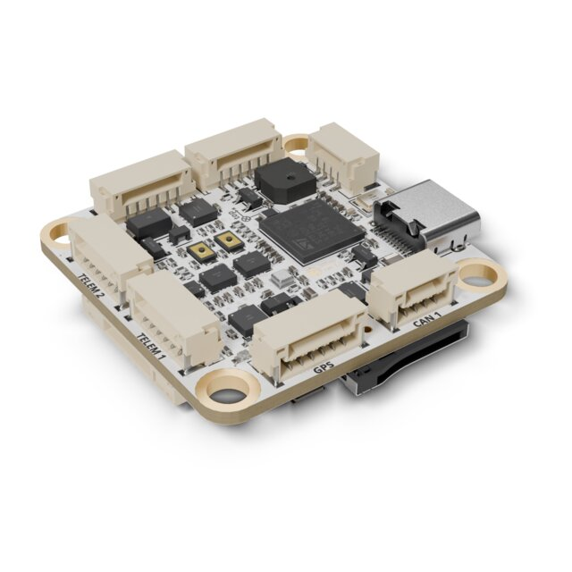
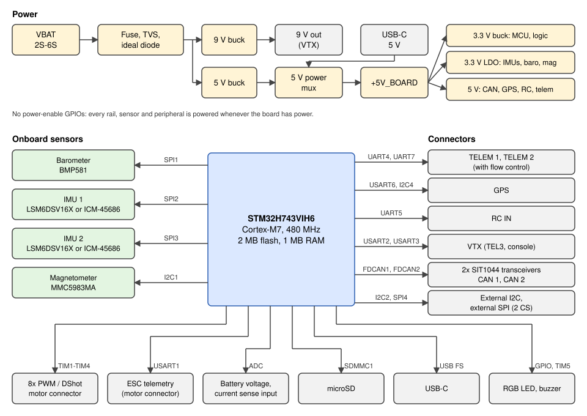

# Avian Automata 305AP

<Badge type="tip" text="PX4 main (v2.0)" />

::: warning
PX4 does not manufacture this (or any) autopilot.
Contact the [manufacturer](https://docs.avianautomata.com) for hardware support or compliance issues.
:::

The _305AP_ is a compact flight controller designed by Avian Automata.
It is built around the STM32H743 processor with two IMU slots, an onboard barometer and magnetometer, two CAN buses, and eight motor outputs.



::: info
This flight controller is [manufacturer supported](../flight_controller/autopilot_manufacturer_supported.md).
:::

## Specifications {#specifications}

- **MCU:**
  - STM32H743VIH6 (32-bit Arm® Cortex®-M7, 480 MHz)
- **IMU:**
  - 2x IMU slots on separate SPI buses, each fitted with either an ST LSM6DSV16X or a TDK InvenSense ICM-45686 (detected at boot)
- **Barometer:**
  - Bosch BMP581
- **Magnetometer:**
  - MEMSIC MMC5983MA
- **Interfaces:**
  - 7x UARTs
  - 2x CAN (FDCAN1, FDCAN2)
  - 2x external I2C (one on the GPS connector)
  - 1x external SPI with two chip selects
  - 8x PWM outputs (DShot supported)
  - microSD card slot
  - 1x USB-C (USB 2.0 Full Speed)
- **Power:**
  - Input range: 2S-6S (approximately 7 V to 25.2 V)
  - Battery voltage sense, plus an analog current sense input (no onboard current shunt)
  - Regulated 5 V and 9 V outputs

### Mechanical Data {#mechanical_data}

- **Dimensions:** 36.5 mm x 36.5 mm
- **Mounting hole spacing:** 30.5 mm x 30.5 mm, M4 holes sized for M3 rubber vibration isolators

## Where to Buy {#store}

Order from the [Avian Automata store](https://www.avianautomata.com/products/305ap).

## Block Diagram



## Pinouts {#pinouts}

All connectors are JST-GH, except for the 12-pin motor connector and the 3-pin RC connector.
Pin 1 is marked on each connector housing.

### Power (CN1)

| Pin | Signal  |
| --- | ------- |
| 1-3 | VBAT_IN |
| 4-6 | GND     |

### TELEM 1 (CN2) and TELEM 2 (CN3)

| Pin | Signal | TELEM 1 (UART4) | TELEM 2 (UART7) |
| --- | ------ | --------------- | --------------- |
| 1   | +5V    |                 |                 |
| 2   | TX     | PA0             | PE8             |
| 3   | RX     | PA1             | PE7             |
| 4   | CTS    | PB0             | PE10            |
| 5   | RTS    | PB14            | PE9             |
| 6   | GND    |                 |                 |

### GPS (CN4)

This is a 6-pin port, not the 10-pin Pixhawk GPS port.

| Pin | Signal   | MCU  |
| --- | -------- | ---- |
| 1   | +5V      |      |
| 2   | UART TX  | PC6  |
| 3   | UART RX  | PC7  |
| 4   | I2C4 SCL | PD12 |
| 5   | I2C4 SDA | PD13 |
| 6   | GND      |      |

### CAN 1 (U18) and CAN 2 (U19)

| Pin | Signal |
| --- | ------ |
| 1   | +5V    |
| 2   | CAN_H  |
| 3   | CAN_L  |
| 4   | GND    |

Both buses are fully terminated on the board, so do not add external termination.

### External I2C (U20)

| Pin | Signal   | MCU  |
| --- | -------- | ---- |
| 1   | +5V      |      |
| 2   | I2C2 SCL | PB10 |
| 3   | I2C2 SDA | PB11 |
| 4   | GND      |      |

### External SPI (CN7)

| Pin | Signal    | MCU  |
| --- | --------- | ---- |
| 1   | +5V       |      |
| 2   | SPI4 SCK  | PE2  |
| 3   | SPI4 MISO | PE13 |
| 4   | SPI4 MOSI | PE6  |
| 5   | CS1       | PC13 |
| 6   | CS2       | PC14 |
| 7   | GND       |      |

### Motors (U21)

| Pin | Signal        | MCU  | Timer    |
| --- | ------------- | ---- | -------- |
| 1   | +5V           |      |          |
| 2   | Current sense | PC3  |          |
| 3   | ESC telemetry | PA9  |          |
| 4   | Motor 1       | PA8  | TIM1 CH1 |
| 5   | Motor 2       | PE11 | TIM1 CH2 |
| 6   | Motor 3       | PA15 | TIM2 CH1 |
| 7   | Motor 4       | PA2  | TIM2 CH3 |
| 8   | Motor 5       | PA7  | TIM3 CH2 |
| 9   | Motor 6       | PB1  | TIM3 CH4 |
| 10  | Motor 7       | PB7  | TIM4 CH2 |
| 11  | Motor 8       | PD14 | TIM4 CH3 |
| 12  | GND           |      |          |

### VTX (CN6)

| Pin | Signal   | MCU |
| --- | -------- | --- |
| 1   | +9V      |     |
| 2   | UART TX  | PD5 |
| 3   | UART RX  | PD6 |
| 4   | GND      |     |
| 5   | SBUS out | PD8 |
| 6   | GND      |     |

The 9 V rail is only available when the board is powered from the battery.

### RC IN (U22)

| Pin | Signal | MCU  |
| --- | ------ | ---- |
| 1   | +5V    |      |
| 2   | RC_IN  | PB13 |
| 3   | GND    |      |

## Power {#power}

The board has no power-enable GPIOs: every rail, sensor and peripheral is powered whenever the board has power, except the 9 V rail, which needs battery power.

The board measures battery voltage with a 10k/1k divider ([BAT1_V_DIV](../advanced_config/parameter_reference.md#BAT1_V_DIV) defaults to `11.0`).
There is no onboard current shunt.
To measure current, connect an external sensor to the current sense pin on the motor connector and set [BAT1_A_PER_V](../advanced_config/parameter_reference.md#BAT1_A_PER_V), which defaults to `0`.

## PWM Outputs {#pwm_outputs}

The 8 outputs are in 4 groups:

- Outputs 1-2 in group 1 (TIM1)
- Outputs 3-4 in group 2 (TIM2)
- Outputs 5-6 in group 3 (TIM3)
- Outputs 7-8 in group 4 (TIM4)

All outputs support PWM and [DShot](../peripherals/dshot.md).
Outputs 1-2 default to DShot300 ([PWM_MAIN_TIM0](../advanced_config/parameter_reference.md#PWM_MAIN_TIM0) = `-4`).
All outputs in a group must use the same protocol and rate.

## Serial Port Mapping {#serial_port_mapping}

| UART   | Device     | PX4 Port | Board Connector    |
| ------ | ---------- | -------- | ------------------ |
| USART1 | /dev/ttyS0 |          | Motors (ESC telem) |
| USART2 | /dev/ttyS1 | TEL3     | VTX                |
| USART3 | /dev/ttyS2 | Console  | VTX (SBUS pin)     |
| UART4  | /dev/ttyS3 | TEL1     | TELEM 1            |
| UART5  | /dev/ttyS4 | RC       | RC IN              |
| USART6 | /dev/ttyS5 | GPS1     | GPS                |
| UART7  | /dev/ttyS6 | TEL2     | TELEM 2            |

ESC serial telemetry (`Motors` pin 3, USART1) is not supported by the default firmware.

`TEL3` is the port labelled `VTX` on the board.
By default it runs [MSP OSD](../peripherals/osd.md) at 115200 baud.

## Assembly {#assembly}

### Radio Control {#radio_control}

RC input is on **UART5** (`/dev/ttyS4`, `RC IN` connector), wired as a single-wire port.
The receiver protocol is auto-detected by default ([RC_INPUT_PROTO](../advanced_config/parameter_reference.md#RC_INPUT_PROTO) = `-1`).
PPM receivers are not supported.
DSM receivers can't be bound from _QGroundControl_ on this board: bind them before connecting.
CRSF telemetry back to the transmitter needs a full-duplex port, so connect those receivers to `TELEM 1` instead.
Set [MAV_0_CONFIG](../advanced_config/parameter_reference.md#MAV_0_CONFIG) to `Disabled` (MAVLink uses `TELEM 1` by default), [RC_CRSF_PRT_CFG](../advanced_config/parameter_reference.md#RC_CRSF_PRT_CFG) to `TELEM 1` and [RC_CRSF_TEL_EN](../advanced_config/parameter_reference.md#RC_CRSF_TEL_EN) to `1`, then reboot.

## Building Firmware {#building_firmware}

To [build PX4](../dev_setup/building_px4.md) for this target:

```sh
make avianautomata_305ap_default
```

The firmware can be installed in any of the normal ways:

- Build and upload the source:

  ```sh
  make avianautomata_305ap_default upload
  ```

- [Load the firmware](../config/firmware.md) using _QGroundControl_.
  You can use either pre-built firmware or your own custom firmware.

## Debug Port {#debug_port}

The NuttX console output is on USART3 TX (`PD8`), the `SBUS out` pin of the VTX connector.
The port is transmit-only, so use the [MAVLink Shell](../debug/mavlink_shell.md) over USB for an interactive console.

## Further Information {#further_information}

- [305AP documentation](https://docs.avianautomata.com)
