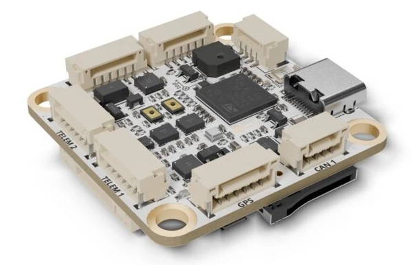

# Avian Automata 305AP

<Badge type="tip" text="main (PX4 v2.0)" />

::: warning
PX4 does not manufacture this (or any) autopilot.
Contact the [manufacturer](https://docs.avianautomata.com) for hardware support or compliance issues.
:::

The [305AP](https://www.avianautomata.com/products/305ap) is a compact flight controller designed by [Avian Automata](https://www.avianautomata.com/).
It is built around the STM32H743 processor with two IMU slots, an onboard barometer and magnetometer, two CAN buses, and eight motor outputs.



::: info
This flight controller is [manufacturer supported](../flight_controller/autopilot_manufacturer_supported.md).
:::

## Specifications {#specifications}

### Processor {#processor}

- **Main FMU processor:** [STM32H743VIH6](https://www.st.com/en/microcontrollers-microprocessors/stm32h743vi.html) (32-bit Arm® Cortex®-M7, 480 MHz, 2 MB flash, 1 MB RAM)

### Sensors {#sensors}

- **IMU:** 2 slots (SPI2, SPI3), each fitted with either an [ST LSM6DSV16X](https://www.st.com/en/mems-and-sensors/lsm6dsv16x.html) or a [TDK InvenSense ICM-45686](https://www.invensense.tdk.com/en-us/products/6-axis/icm-45686) (detected at boot)
- **Barometer:** [Bosch BMP581](https://www.bosch-sensortec.com/en/products/environmental-sensors/pressure-sensors/bmp581/) (SPI1)
- **Magnetometer:** [MEMSIC MMC5983MA](https://www.memsic.com/magnetometer-5) (I2C1)

### Interfaces {#interfaces}

- **PWM outputs:** 8, all supporting [DShot](../peripherals/dshot.md)
- **Serial ports:** 7 (`TELEM 1`, `TELEM 2`, `GPS`, `RC IN`, `VTX`, the debug console on `VTX`, and ESC telemetry on the `Motors` connector)
- **I2C buses:** 3 (I2C1 internal; I2C2 and I2C4 external, I2C4 on the `GPS` connector)
- **SPI buses:** 4, of which SPI4 is external with 2 chip selects
- **CAN buses:** 2 (FDCAN1, FDCAN2)
- **USB:** USB-C (USB 2.0 Full Speed)
- **RC input:** Yes
- **Parameter storage:** microSD card
- **SD card:** microSD slot
- **OSD:** MSP OSD on `VTX`

### Electrical Data {#electrical_data}

- **Input voltage:** 2S-6S (6.4 V to 25.2 V)
- **Power monitoring:** 1 analog battery voltage input, plus an analog current sense input (no onboard current shunt)
- **Power outputs:** regulated 5 V and 9 V (9 V at battery voltage on 2S)

### Mechanical Data {#mechanical_data}

- **Dimensions:** 36.5 mm x 36.5 mm
- **Weight:** 11 g (with microSD card)
- **Mounting hole spacing:** 30.5 mm x 30.5 mm, M4 holes sized for M3 rubber vibration isolators

## Where to Buy {#store}

Order from the [Avian Automata store](https://www.avianautomata.com/products/305ap).

## Block Diagram


## Pinouts {#pinouts}

All connectors are JST-GH.
Pin 1 is marked on each connector housing.

### Power (CN1)

| Pin | Signal  |
| --- | ------- |
| 1-3 | VBAT_IN |
| 4-6 | GND     |

### TELEM 1 (CN2) and TELEM 2 (CN3)

| Pin | Signal | TELEM 1 (UART4) | TELEM 2 (UART7) |
| --- | ------ | --------------- | --------------- |
| 1   | +5V    |                 |                 |
| 2   | TX     | PA0             | PE8             |
| 3   | RX     | PA1             | PE7             |
| 4   | CTS    | PB0             | PE10            |
| 5   | RTS    | PB14            | PE9             |
| 6   | GND    |                 |                 |

### GPS (CN4)

This is a 6-pin port, not the 10-pin Pixhawk GPS port.

| Pin | Signal   | MCU  |
| --- | -------- | ---- |
| 1   | +5V      |      |
| 2   | UART TX  | PC6  |
| 3   | UART RX  | PC7  |
| 4   | I2C4 SCL | PD12 |
| 5   | I2C4 SDA | PD13 |
| 6   | GND      |      |

### CAN 1 (U18) and CAN 2 (U19)

| Pin | Signal |
| --- | ------ |
| 1   | +5V    |
| 2   | CAN_H  |
| 3   | CAN_L  |
| 4   | GND    |

### External I2C (U20)

| Pin | Signal   | MCU  |
| --- | -------- | ---- |
| 1   | +5V      |      |
| 2   | I2C2 SCL | PB10 |
| 3   | I2C2 SDA | PB11 |
| 4   | GND      |      |

### External SPI (CN7)

| Pin | Signal    | MCU  |
| --- | --------- | ---- |
| 1   | +5V       |      |
| 2   | SPI4 SCK  | PE2  |
| 3   | SPI4 MISO | PE13 |
| 4   | SPI4 MOSI | PE6  |
| 5   | CS1       | PC13 |
| 6   | CS2       | PC14 |
| 7   | GND       |      |

The firmware includes the [MS5611](../modules/modules_driver_baro.md#ms5611) barometer and [PMW3901](../sensor/pmw3901.md) optical flow drivers for sensors on this port, but doesn't start them.
To use one, start it from [extras.txt](../concept/system_startup.md#starting-additional-applications-extras-txt) on the SD card, for example `ms5611 -S -b 1 -c 2 start` for an MS5611 on `CS2`.

### Motors (U21)

| Pin | Signal        | MCU  | Timer    |
| --- | ------------- | ---- | -------- |
| 1   | +5V           |      |          |
| 2   | Current sense | PC3  |          |
| 3   | ESC telemetry | PA9  |          |
| 4   | Motor 1       | PA8  | TIM1 CH1 |
| 5   | Motor 2       | PE11 | TIM1 CH2 |
| 6   | Motor 3       | PA15 | TIM2 CH1 |
| 7   | Motor 4       | PA2  | TIM2 CH3 |
| 8   | Motor 5       | PA7  | TIM3 CH2 |
| 9   | Motor 6       | PB1  | TIM3 CH4 |
| 10  | Motor 7       | PB7  | TIM4 CH2 |
| 11  | Motor 8       | PD14 | TIM4 CH3 |
| 12  | GND           |      |          |

### VTX (CN6)

| Pin | Signal   | MCU |
| --- | -------- | --- |
| 1   | +9V      |     |
| 2   | GND      |     |
| 3   | UART TX  | PD5 |
| 4   | UART RX  | PD6 |
| 5   | GND      |     |
| 6   | SBUS out | PD8 |

### RC IN (U22)

| Pin | Signal | MCU  |
| --- | ------ | ---- |
| 1   | +5V    |      |
| 2   | RC_IN  | PB13 |
| 3   | GND    |      |

## Power {#power}

The board is powered from the battery on the 6-pin JST-GH `Power` connector (2S-6S), or from USB-C.
The board has no power-enable GPIOs: every rail, sensor and peripheral is powered whenever the board has power, except the 9 V rail, which needs battery power.

Battery monitoring is analog.
The board measures battery voltage with a 10k/1k divider ([BAT1_V_DIV](../advanced_config/parameter_reference.md#BAT1_V_DIV) defaults to `11.0`).
There is no onboard current shunt.
To measure current, connect an external sensor to the current sense pin on the `Motors` connector and set [BAT1_A_PER_V](../advanced_config/parameter_reference.md#BAT1_A_PER_V), which defaults to `0` (see [Amps per volt](../config/battery.md#current_divider)).
See [Battery and Power Module Setup](../config/battery.md) for configuration.

The board can't sense its 5 V rail or detect USB VBUS, so the arming power-supply check is disabled ([CBRK_SUPPLY_CHK](../advanced_config/parameter_reference.md#CBRK_SUPPLY_CHK) defaults to `894281`).

## Voltage Ratings {#voltage_ratings}

- `Power` input: 2S-6S, 6.4 V to 25.2 V (35 V DC absolute maximum)
- USB input: 5 V nominal (5.5 V recommended maximum, 6 V absolute maximum)

## PWM Outputs {#pwm_outputs}

The 8 outputs are in 4 groups:

- Outputs 1-2 in group 1 (TIM1)
- Outputs 3-4 in group 2 (TIM2)
- Outputs 5-6 in group 3 (TIM3)
- Outputs 7-8 in group 4 (TIM4)

All outputs support PWM and [DShot](../peripherals/dshot.md), and default to DShot300 ([PWM_MAIN_TIM0](../advanced_config/parameter_reference.md#PWM_MAIN_TIM0) to `PWM_MAIN_TIM3` = `-4`).
The firmware also supports [bidirectional DShot](../peripherals/dshot.md#bidirectional-dshot-telemetry) on all outputs, but it hasn't yet been verified on this board.
All outputs in a group must use the same protocol and rate.

## SD Card (Optional) {#sd_card}

The board has a push-push microSD card slot on the bottom.
Parameters are stored on the card, so they can't be saved without one.
For information about choosing and using an SD card see [SD Cards (Removable Memory)](../getting_started/px4_basic_concepts.md#sd-cards-removable-memory).

## Serial Port Mapping {#serial_port_mapping}

| UART   | Device       | Port               | Connector              | Flow Control |
| ------ | ------------ | ------------------ | ---------------------- | ------------ |
| USART1 | `/dev/ttyS0` | ESC telemetry      | `Motors` (pin 3)       |              |
| USART2 | `/dev/ttyS1` | `TELEM 3`          | `VTX`                  |              |
| USART3 | `/dev/ttyS2` | Debug Console      | `VTX` (`SBUS out` pin) |              |
| UART4  | `/dev/ttyS3` | `TELEM 1`          | `TELEM 1`              | Yes          |
| UART5  | `/dev/ttyS4` | `Radio Controller` | `RC IN`                |              |
| USART6 | `/dev/ttyS5` | `GPS 1`            | `GPS`                  |              |
| UART7  | `/dev/ttyS6` | `TELEM 2`          | `TELEM 2`              | Yes          |

[ESC telemetry](../peripherals/dshot.md#esc-telemetry) from `Motors` pin 3 (USART1) is enabled by default, so leave [DSHOT_TEL_CFG](../advanced_config/parameter_reference.md#DSHOT_TEL_CFG) at `Disabled`.

::: info
The bootloader enables no UART, so firmware can only be flashed over USB.
:::

## Assembly {#assembly}

### Radio Control {#radio_control}

A remote control (RC) radio system is required if you want to manually control your vehicle (PX4 does not require a radio system for autonomous flight modes).
You will need to [select a compatible transmitter/receiver](../getting_started/rc_transmitter_receiver.md) and then bind them so that they communicate.

Connect the receiver to the 3-pin JST-GH `RC IN` connector, a single-wire port on the FMU (UART5, `/dev/ttyS4`).

- S.BUS, DSM, SUMD, ST24, [CRSF](../telemetry/crsf_telemetry.md) and GHST receivers are detected automatically, with no configuration ([RC_INPUT_PROTO](../advanced_config/parameter_reference.md#RC_INPUT_PROTO) = `Auto`).
- PPM receivers are not supported, so PWM receivers can't be connected through a PPM encoder either.
- DSM receivers can't be bound from _QGroundControl_ on this board: bind them before connecting.
- CRSF telemetry back to the transmitter needs a full-duplex port, so connect those receivers to `TELEM 1` or `TELEM 2` instead.
  Set [RC_CRSF_PRT_CFG](../advanced_config/parameter_reference.md#RC_CRSF_PRT_CFG) to that port and [RC_CRSF_TEL_EN](../advanced_config/parameter_reference.md#RC_CRSF_TEL_EN) to `1`, then reboot.
  On `TELEM 1`, also set [MAV_0_CONFIG](../advanced_config/parameter_reference.md#MAV_0_CONFIG) to `Disabled`, since MAVLink uses it by default.

The DSM, GHST and S.BUS drivers can also be run on another serial port, using [RC_DSM_PRT_CFG](../advanced_config/parameter_reference.md#RC_DSM_PRT_CFG), [RC_GHST_PRT_CFG](../advanced_config/parameter_reference.md#RC_GHST_PRT_CFG) or [RC_SBUS_PRT_CFG](../advanced_config/parameter_reference.md#RC_SBUS_PRT_CFG).
Only one protocol can be active on a port.

### GPS & Compass {#gps_compass}

The 6-pin JST-GH `GPS` connector carries GPS (USART6) and I2C (I2C4) for the compass in a GPS module.
It has no safety switch, buzzer or LED signals.

The board has an onboard MMC5983MA magnetometer.
The `+5V` pins on all connectors come from the board's 5 V rail, so a load on them that varies in flight (servos, a companion computer, a video transmitter) can upset the onboard compass.
On such vehicles, use an [external compass](../gps_compass/magnetometer.md) in a GPS module.
See [Mounting a GPS/Compass](../assembly/mount_gps_compass.md) for more information.

### Telemetry Radios (Optional) {#telemetry}

The board has two [telemetry](../telemetry/index.md) ports, `TELEM 1` and `TELEM 2`, each a 6-pin JST-GH connector with flow control.
A telemetry radio connected to `TELEM 1` needs no further configuration.

### CAN {#can}

The board has two CAN ports, `CAN 1` and `CAN 2`, each a 4-pin JST-GH connector, for [DroneCAN](../dronecan/index.md) peripherals.
Both buses are fully terminated on the board, so do not add external termination.

DroneCAN is not enabled by default: set [UAVCAN_ENABLE](../advanced_config/parameter_reference.md#UAVCAN_ENABLE) to enable it.

### OSD {#osd}

Connect the video transmitter to the 6-pin JST-GH `VTX` connector, which carries 9 V power, a UART (USART2) and the `SBUS out` pin.
[MSP OSD](../peripherals/osd.md) runs on this UART (`TELEM 3`) by default, at 115200 baud ([MSP_OSD_CONFIG](../advanced_config/parameter_reference.md#MSP_OSD_CONFIG) = `TELEM 3`, [SER_TEL3_BAUD](../advanced_config/parameter_reference.md#SER_TEL3_BAUD) = `115200`).
The 9 V rail is only available when the board is powered from the battery, and runs at battery voltage on 2S.

::: warning
Pin 6 (`SBUS out`) carries the PX4 System Console output.
If your air unit's cable has an SBUS wire, leave it unconnected.
:::

## Building Firmware {#building_firmware}

::: tip
From PX4 v2.0, most users will not need to build this firmware!
It is pre-built and automatically installed by _QGroundControl_ when appropriate hardware is connected.
:::

To [build PX4](../dev_setup/building_px4.md) for this target:

```sh
make avianautomata_305ap_default
```

The board also has a rover build variant: `avianautomata_305ap_rover`.

## Debug Port {#debug_port}

The FMU's [PX4 System Console](../debug/system_console.md) output is on USART3 TX (PD8) at 57600 baud, the `SBUS out` pin of the `VTX` connector.
The port is transmit-only, so use the [MAVLink Shell](../debug/mavlink_shell.md) over USB for an interactive console.

The [SWD interface](../debug/swd_debug.md) isn't brought out: its pins (PA13 and PA14) are used by the second IMU slot.

## Further Information {#further_information}

- [305AP documentation](https://docs.avianautomata.com/305ap/intro)
