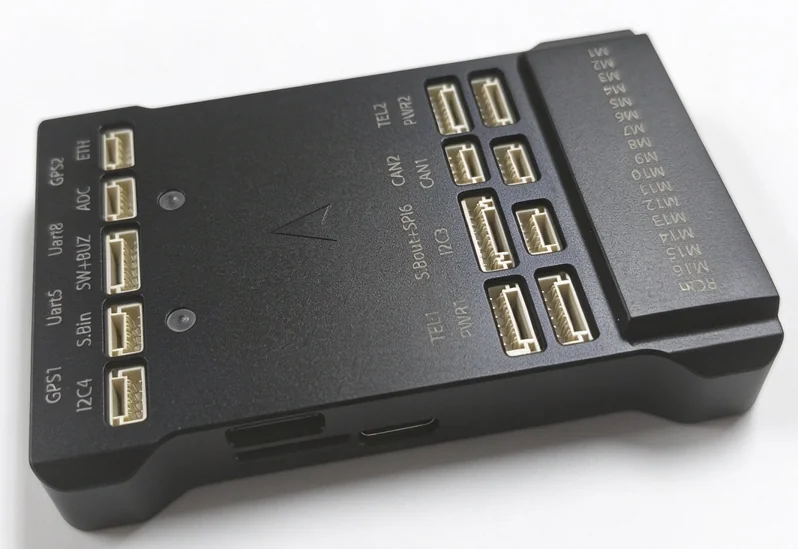
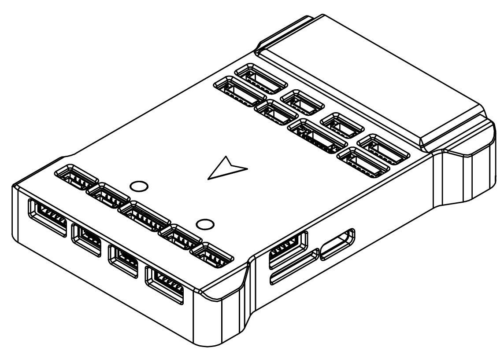
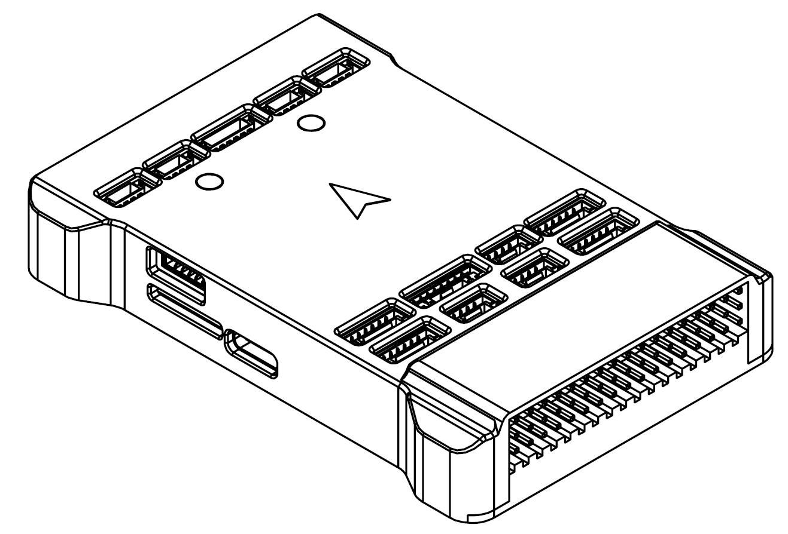
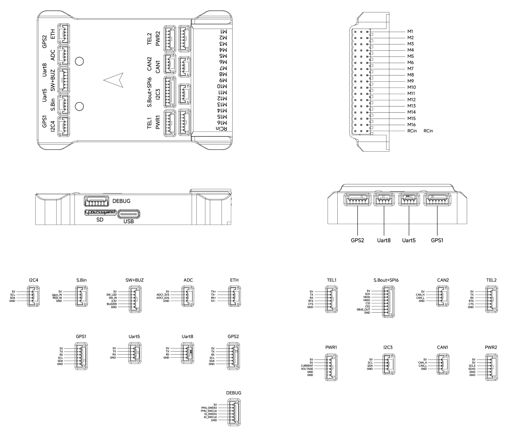
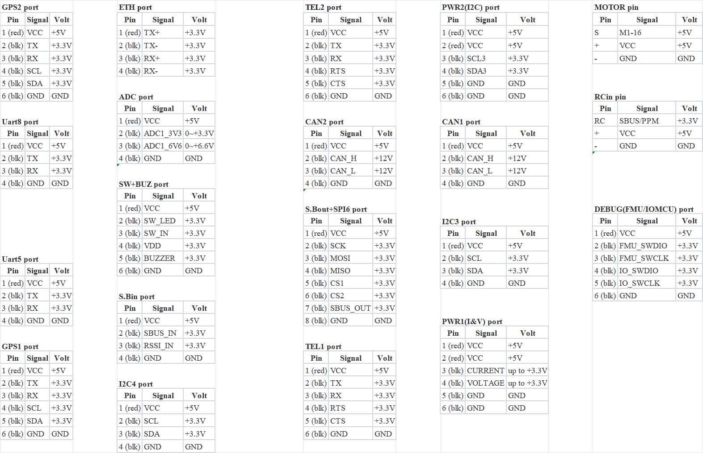
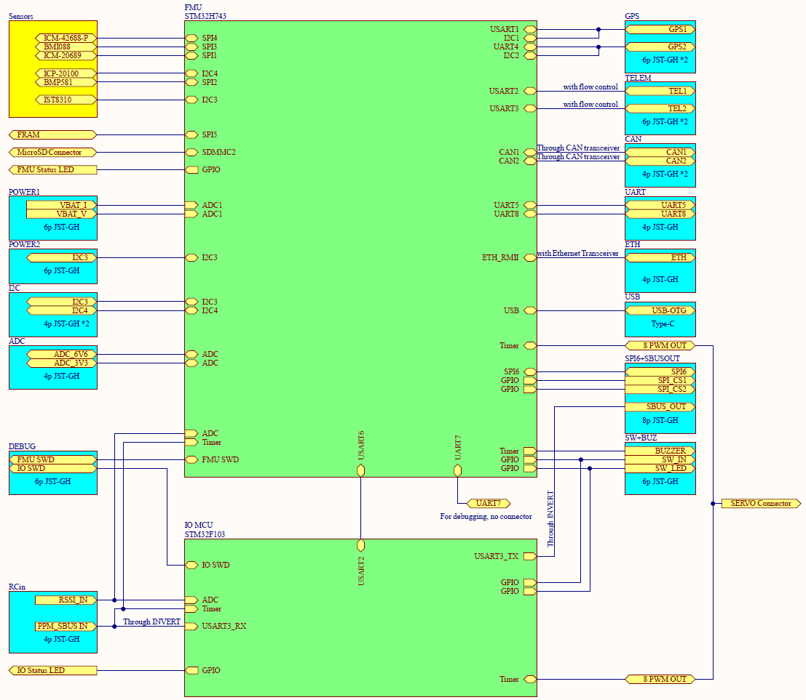

# CyberCraft CyberX-v10

<Badge type="tip" text="main (PX4 v2.0)" />

::: warning
PX4 does not manufacture this (or any) autopilot.
Contact the [manufacturer](https://int.woocoo.vip/) for hardware support or compliance issues.
:::

The CyberX-v10 is an advanced autopilot manufactured by [CyberCraft International Limited](https://int.woocoo.vip/).

The autopilot is recommended for commercial system integration, but is also suitable for academic research and other applications.
It brings you ultimate performance, stability, and reliability in every aspect.



::: info
This flight controller is [manufacturer supported](../flight_controller/autopilot_manufacturer_supported.md).
:::

## Specifications {#specifications}

### Processor {#processor}

- **Main FMU processor:** [STM32H743IIK6](https://www.st.com/en/microcontrollers-microprocessors/stm32h743ii.html) (32 Bit Arm® Cortex®-M7, 480 MHz, 2 MB Flash, 1 MB RAM)
- **IO processor:** PX4IO v2, on carriers that fit one.

### Sensors {#sensors}

- **IMU:** ICM-20689 (SPI1), [BMI088](https://www.bosch-sensortec.com/en/products/motion-sensors/imus/bmi088) (SPI3), [ICM-42688-P](https://www.invensense.tdk.com/en-us/products/6-axis/icm-42688-p) (SPI4)
- **Barometer:** [BMP581](https://www.bosch-sensortec.com/en/products/environmental-sensors/pressure-sensors/bmp581) (SPI2), [ICP-20100](https://www.invensense.tdk.com/en-us/products/smartindustrial/icp-20100) (I2C4)
- **Magnetometer:** IST8310 (I2C3)

### Interfaces {#interfaces}

- **PWM outputs:** 16 (8 IO + 8 FMU)
- **Serial ports:** 6 (`GPS1`, `GPS2`, `TEL1`, `TEL2`, `Uart5`, `Uart8`), `TEL1` and `TEL2` with flow control
- **Connectors:** JST GH (1.25 mm pitch)
- **I2C buses:** 4 (I2C1 and I2C2 on the `GPS1` and `GPS2` ports; I2C3 and I2C4 shared between on-board sensors and the `I2C3` and `I2C4` ports; I2C3 also on `PWR2`)
- **SPI buses:** 6, of which SPI6 is external with 2 chip select lines
- **CAN buses:** 2 (`CAN1`, `CAN2`)
- **Ethernet:** 100 Mbps, with transformer
- **USB:** Type-C
- **RC input:** SBUS on `S.Bin`, SBUS or PPM on `RCin`, CRSF or GHST on `Uart8`
- **RSSI input:** 1 analog/PWM
- **Analog inputs:** 2 on the `ADC` port (3.3 V and 6.6 V)
- **Power inputs:** 2 (`PWR1` ADC, `PWR2` I2C)
- **Parameter storage:** FRAM (FM25V02A) on SPI5
- **SD card:** microSD card slot
- **Debug port:** 1 (`DEBUG`, FMU and IO debug)

### Electrical Data {#electrical_data}

- **Input voltage:** 4.75 V to 5.5 V (`PWR1`, `PWR2`)
- **Current draw:** 500 mA
- **USB power input:** 4.75 V to 5.25 V
- **Power monitoring:** 1 analog (`PWR1`) and 1 digital (`PWR2`, INA228), both on by default
- **Output current limits:** `TEL1` and `TEL2` combined 1.5 A; all other ports combined 1.5 A

### Mechanical Data {#mechanical_data}

- **Dimensions:** 83 x 57 x 15.1 mm
- **Weight:** 72.4 g

## Where to Buy {#store}

Order from [CyberCraft International Limited](https://int.woocoo.vip/detail).

## Pinouts {#pinouts}









## Power {#power}

::: warning
The PWM outputs (`M1` to `M16`) are not powered by the `PWR1` or `PWR2` ports.
The servo rail must be [separately powered](../peripherals/pwm_escs_and_servo.md) if it needs to power servos or other hardware.
:::

**Voltage monitoring**

The board has connectors for two power monitors.

- `PWR1` -- ADC
- `PWR2` -- I2C

The board is configured by default for an analog power monitor on `PWR1`.
An INA228 I2C power monitor (address 0x40) on `PWR2` is also started by default.
Other I2C power monitors, such as the INA226 or INA238, must be started manually.

The power module supplied with the CyberX-v10 has both an analog interface and a digital I2C interface.
Connect the analog interface to `PWR1` and the I2C interface to `PWR2`.

See [Battery Estimation Tuning (Power Setup)](../config/battery.md) for how to configure the battery and power monitor.

## Voltage Ratings {#voltage_ratings}

CyberX-v10 has the following three power sources configuration:

- `PWR1`: One analog ADC channel for monitoring the main power input voltage.
- `PWR2`: One I2C-based power monitoring IC that monitors the same physical power input and provides additional voltage/current measurements.
- `USB`: USB power is provided for debugging and development purposes only.

::: info
`PWR1` and `PWR2` are two independent monitoring methods for the same physical power source, rather than two separate power inputs.
:::

**Normal Operation Maximum Ratings**

Under these conditions all power sources will be used in this order to power the system:

1. `PWR1` and `PWR2` inputs (4.75 V to 5.5 V)
2. `USB` input (4.75 V to 5.25 V)

**Absolute Maximum Ratings**

Under these conditions the system will not draw any power (will not be operational), but will remain intact.

1. `PWR1` and `PWR2` inputs (operational range 4.7 V to 6 V, 0 V to 6 V undamaged)
2. `USB` input (operational range 4.7 V to 5.7 V, 0 V to 6 V undamaged)
3. **Servo rail input:** `+` (VCC) pins of `M1` to `M16` (0 V to 6 V undamaged)

## PWM Outputs {#pwm_outputs}

The CyberX-v10 supports up to 16 PWM outputs.
The first 8 outputs (labelled `M1` to `M8`) are controlled by the dedicated STM32F103 IO processor.
The remaining 8 outputs (labelled `M9` to `M16`) are the "auxiliary" outputs directly attached to the STM32H743 FMU.

All 16 outputs support normal PWM.
The FMU outputs `M9` to `M14` support [DShot](../peripherals/dshot.md), including [Bidirectional DShot](../peripherals/dshot.md#bidirectional-dshot-telemetry).
The IO outputs `M1` to `M8`, and the FMU outputs `M15` and `M16`, do not support DShot.

The 8 IO PWM outputs are in 3 groups:

- Outputs `M1`, `M2` in group 1
- Outputs `M3`, `M4` in group 2
- Outputs `M5`, `M6`, `M7`, `M8` in group 3

The 8 FMU PWM outputs are in 3 groups:

- Outputs `M9`, `M10`, `M11` and `M12` in group 1
- Outputs `M13` and `M14` in group 2
- Outputs `M15` and `M16` in group 3

Channels within the same group need to use the same output rate.
If any channel in a group uses DShot then all channels in the group need to use DShot.

## Ethernet {#ethernet}

The board has a 100 Mbps Ethernet port with an on-board transformer, on the 4-pin `ETH` connector (TX+, TX-, RX+, RX-).

MAVLink is enabled on Ethernet by default ([MAV_2_CONFIG](../advanced_config/parameter_reference.md#MAV_2_CONFIG) is set to `1000`), broadcasting on UDP port 14550.
See [PX4 Ethernet Setup](../advanced_config/ethernet_setup.md) for how to configure the network.

## SD Card (Optional) {#sd_card}

The board has a microSD card slot, on the side of the case beside the `USB` and `DEBUG` ports.
SD cards are used for [log files and for storing missions](../getting_started/px4_basic_concepts.md#sd-cards-removable-memory).

## Serial Port Mapping {#serial_port_mapping}

| UART   | Device     | Port               | Flow Control |
| ------ | ---------- | ------------------ | ------------ |
| USART1 | /dev/ttyS0 | `GPS1`             | No           |
| USART2 | /dev/ttyS1 | `TEL1`             | Yes          |
| USART3 | /dev/ttyS2 | `TEL2`             | Yes          |
| UART4  | /dev/ttyS3 | `GPS2`             | No           |
| UART5  | /dev/ttyS4 | `Uart5` (EXT2)     | No           |
| USART6 | /dev/ttyS5 | PX4IO              | No           |
| UART7  | /dev/ttyS6 | Unused             | No           |
| UART8  | /dev/ttyS7 | `Uart8` (RC input) | No           |

::: info
In the product, UART7 does not have an external connector, but it exists on the circuit board for debugging purposes.
:::

::: info
The bootloader enables only UART5, so `Uart5` is the only serial port that [px4_uploader.py](https://github.com/PX4/PX4-Autopilot/blob/main/Tools/px4_uploader.py) can flash firmware over.
:::

## Assembly {#assembly}

The [CyberX-v10 Wiring Quick Start](../assembly/quick_start_cyberx_v10.md) provides instructions on how to assemble required/important peripherals including GPS, Power Module etc.

### Wiring Diagram {#wiring_diagram}



### Radio Control {#radio_control}

A Radio Control (RC) system is required if you want to manually control your vehicle (PX4 does not require a radio system for autonomous flight modes).

You will need to [select a compatible transmitter/receiver](../getting_started/rc_transmitter_receiver.md) and then bind them so that they communicate (read the instructions that come with your specific transmitter/receiver).

The board has two RC input paths:

- `S.Bin` and `RCin` (on the servo rail) go to the [IO processor](../modules/modules_driver.md#px4io), which detects the protocol with no configuration.
  SBUS receivers connect to `S.Bin` or `RCin`, and PPM receivers connect to `RCin`.
- `Uart8` goes to the FMU, where the [rc_input](../modules/modules_driver_radio_control.md#rc-input) driver detects the protocol with no configuration.
  Use it for CRSF receivers, which the IO processor can't decode.
  PX4 uses `Uart8`s `RX` pin as the receiver port and its `TX` pin as the transmit port.
  [RC_PORT_CONFIG](../advanced_config/parameter_reference.md#RC_PORT_CONFIG) sets the port that `rc_input` uses, and defaults to `Radio Controller` (`Uart8`).

Spektrum/DSM receivers are not supported.

If your receiver outputs individual PWM signals (one wire per channel) it must be connected via a [PPM encoder](../getting_started/rc_transmitter_receiver.md#connecting-receivers).

### GPS & Compass {#gps_compass}

PX4 supports GPS modules connected to the GPS ports listed below.
GPS modules should be [mounted on the frame](../assembly/mount_gps_compass.md) as far away from other electronics as possible, with the direction marker pointing towards the front of the vehicle.

The GPS ports are:

- `GPS1`: 6-pin port with UART and I2C (for an external compass).
- `GPS2`: 6-pin port with UART and I2C (for an external compass).
  Set [GPS_2_CONFIG](../advanced_config/parameter_reference.md#GPS_2_CONFIG) to `GPS 2` to use it.

The GPS ports do not include safety switch, LED or buzzer pins.
These are on the separate `SW+BUZ` port.

The board has an on-board IST8310 magnetometer, but an external compass is recommended as the primary compass, with the IST8310 as a backup.

### Telemetry Radios (Optional) {#telemetry}

[Telemetry radios](../telemetry/index.md) may be used to communicate with and control a vehicle in flight from a ground station (for example, you can direct the UAV to a particular position, or upload a new mission).

The vehicle-based radio should be connected to the `TEL1` or `TEL2` port.
If connected to `TEL1`, no further configuration is required.
The other radio is connected to your ground station computer or mobile device (usually by USB).

### CAN {#can}

The board has two CAN ports, `CAN1` and `CAN2`, which can be used for [DroneCAN](../dronecan/index.md) peripherals.
DroneCAN is disabled by default.
To enable it, set [UAVCAN_ENABLE](../advanced_config/parameter_reference.md#UAVCAN_ENABLE).

### OSD {#osd}

The default firmware includes the [MSP OSD](../peripherals/osd.md#msp-osd) driver, for HD VTX units that render the OSD themselves.
Connect the VTX to a free serial port, such as `Uart5`, and set [MSP_OSD_CONFIG](../advanced_config/parameter_reference.md#MSP_OSD_CONFIG) to that port (`EXT2` for `Uart5`).
No port is assigned by default.

## Building Firmware {#building_firmware}

::: tip
From PX4 v2.0, most users will not need to build this firmware!
It will be pre-built and automatically installed by _QGroundControl_ when appropriate hardware is connected.
Boards are shipped with the bootloader pre-installed, so you do not need to build or flash it yourself.
:::

To [build PX4](../dev_setup/building_px4.md) for this target, execute:

```sh
make cyberx_v10_default
```

## Debug Port {#debug_port}

The `DEBUG` port provides the [SWD interface](../debug/swd_debug.md) for both the FMU and the IO processor.
It uses a 6-pin JST GH (1.25 mm pitch) connector with the pinout below, which is not a [Pixhawk Debug](../debug/swd_debug.md#pixhawk-standard-debug-ports) port.
A `DEBUG` cable is supplied with the board.
The port does not include the [PX4 System Console](../debug/system_console.md) UART.

| Pin     | Signal    | Voltage |
| ------- | --------- | ------- |
| 1 (red) | 5V+       | +5V     |
| 2 (blk) | FMU_SWDIO | +3.3V   |
| 3 (blk) | FMU_SWCLK | +3.3V   |
| 4 (blk) | IO_SWDIO  | +3.3V   |
| 5 (blk) | IO_SWCLK  | +3.3V   |
| 6 (blk) | GND       | GND     |

## Further Information {#further_information}

- [CyberCraft International Limited](https://int.woocoo.vip/) (manufacturer)
- [CyberX-v10 Wiring Quick Start](../assembly/quick_start_cyberx_v10.md)
