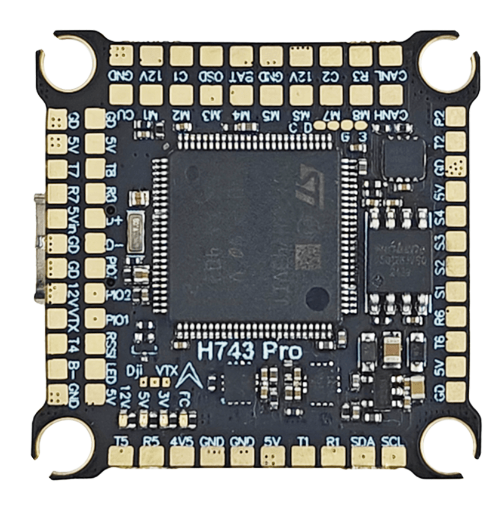
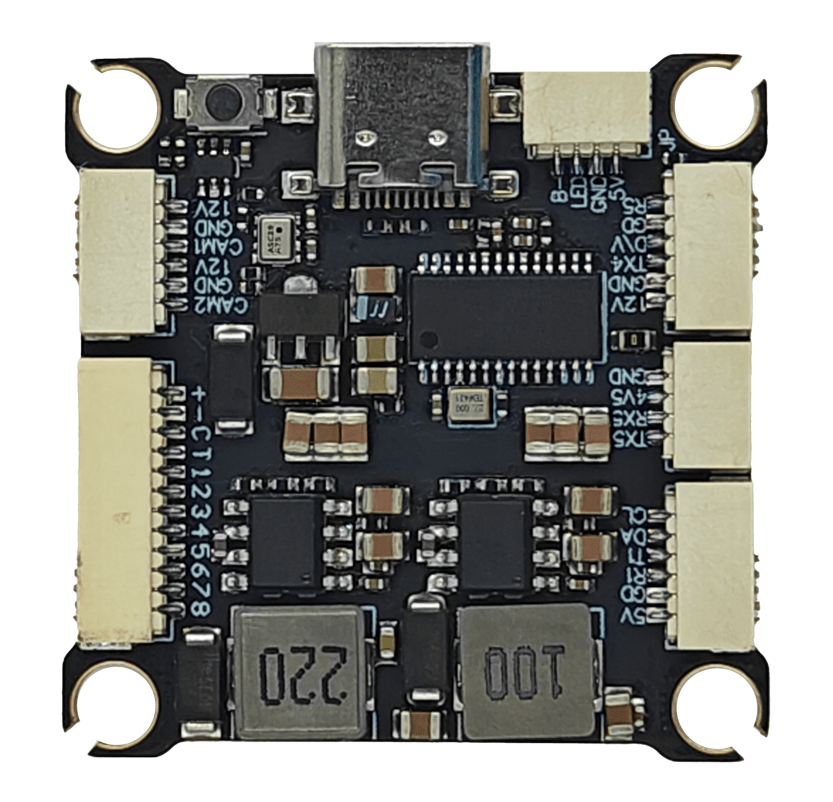
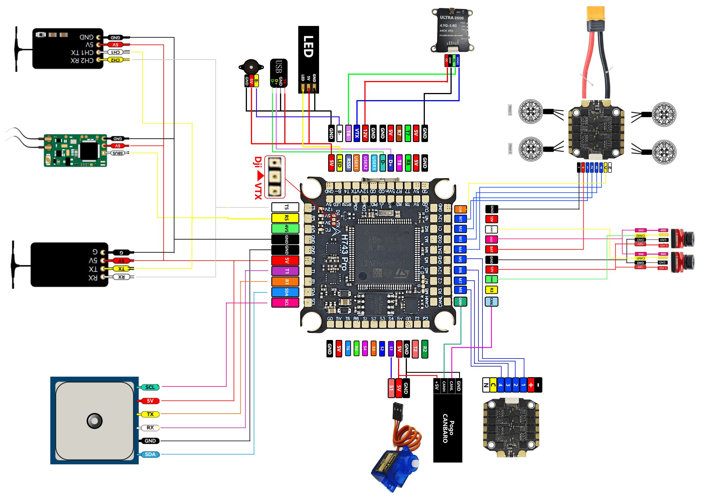
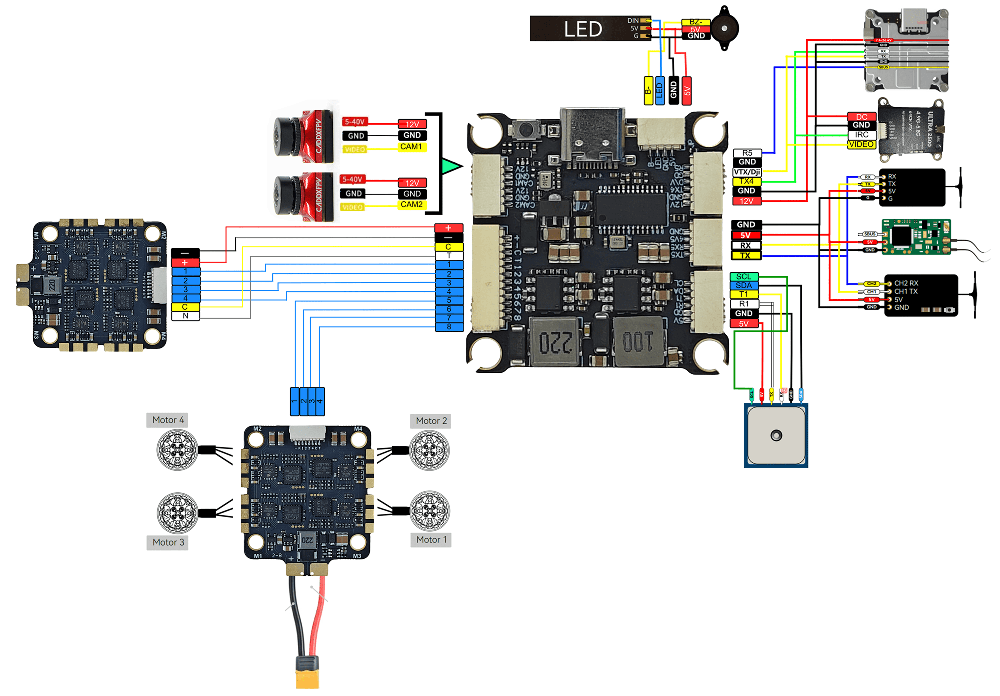

# DAKEFPV H743 Pro

<Badge type="tip" text="main (PX4 v2.0)" />

::: warning
PX4 does not manufacture this (or any) autopilot.
Contact the [manufacturer](https://www.dakefpv.com/) for hardware support or compliance issues.
:::

The DAKEFPV H743 Pro is an STM32H743-based flight controller with CAN bus support, designed for FPV racing and freestyle, manufactured by [DAKEFPV](https://www.dakefpv.com/).
It has the same sensors as the [DAKEFPV H743](dakefpv_h743.md), and adds a CAN port and separate DShot timer groups for `M5`–`M6` and `M7`–`M8`.




::: info
This flight controller is [manufacturer supported](../flight_controller/autopilot_manufacturer_supported.md).
:::

## Specifications {#specifications}

### Processor {#processor}

- **Main FMU processor:** [STM32H743VI](https://www.st.com/en/microcontrollers-microprocessors/stm32h743vi.html) (Arm Cortex-M7 at 480MHz, 2MB flash, 1MB RAM)

### Sensors {#sensors}

- **IMU:** 2x [InvenSense ICM-42688-P](https://invensense.tdk.com/products/motion-tracking/6-axis/icm-42688-p/) (SPI1, SPI4; independent power supply)
- **Barometer:** SPL06 (I2C2; requires battery power)
- **Magnetometer:** none (external compass optional)

### Interfaces {#interfaces}

- **PWM outputs:** 12 (8 motor `M1`–`M8`, 4 servo `S1`–`S4`)
- **Serial ports:** 8 (`GPS1`, `GPS2`, `TELEM1`, `TELEM2`, `TELEM3`, `TELEM4`, RC, debug console)
- **I2C buses:** 1 (I2C2, shared with the onboard barometer)
- **SPI buses:** 4, all internal (IMUs on SPI1 and SPI4, OSD on SPI2, flash on SPI3)
- **CAN buses:** 1 (CAN1, PD0/PD1)
- **USB:** USB-C
- **RC input:** Yes (UART5)
- **Parameter storage:** processor flash
- **SD card:** none (16MB onboard SPI NOR flash for logs)
- **OSD:** AT7456E analog OSD, and MSP DisplayPort for digital VTX (DJI/HDZero/OpenIPC)
- **Plug-in connectors:** ESC (12-pin), cameras (6-pin), GPS (6-pin), receiver (4-pin), HD VTX (6-pin), LED and buzzer (4-pin)
- **Buzzer:** Yes

### Electrical Data {#electrical_data}

- **Input voltage:** 4S–12S LiPo
- **BEC 3.3V:** 0.5A
- **BEC 5V:** 3A
- **BEC 12V:** 3A (GPIO-controlled, for VTX)
- **Power monitoring:** analog battery voltage and current

### Mechanical Data {#mechanical_data}

- **Mounting hole spacing:** 30.5 × 30.5mm, M4

## Where to Buy {#store}

[DAKEFPV store](https://www.dakefpv.com/)

## Pinouts {#pinouts}

The pad side has the solder pads; signal pins use 3.3V logic.

| Pad                | Signal                                                        | MCU pin     | Voltage |
| ------------------ | ------------------------------------------------------------- | ----------- | ------- |
| `BAT`              | Battery input (also measured as the battery voltage)          | PC1 (sense) | Battery |
| `GND`, `GD`        | Ground                                                        |             |         |
| `12V`              | 12V BEC output for the VTX and cameras, switched by `PIO2`    |             | 12V     |
| `5V`               | 5V BEC output                                                 |             | 5V      |
| `4V5`              | 4.5V output, also powered from USB                            |             | 4.5V    |
| `5Vin`             | USB 5V input, for an external USB connector                   |             | 5V      |
| `D+`, `D-`         | USB data, for an external USB connector                       | PA12, PA11  |         |
| `CU`               | Battery current sensor input                                  | PC0         |         |
| `RSSI`             | Analog RSSI input, not used by PX4                            | PC5         |         |
| `M1`–`M4`          | Motor outputs 1–4                                             | PA0–PA3     |         |
| `M5`, `M6`         | Motor outputs 5–6                                             | PE9, PE11   |         |
| `M7`, `M8`         | Motor outputs 7–8                                             | PC8, PC9    |         |
| `S1`–`S4`          | Servo outputs 9–12                                            | PD12–PD15   |         |
| `LED`              | WS2812 LED strip, not supported by the default firmware       | PB0         |         |
| `B-`               | Buzzer negative pin                                           | PC2         |         |
| `C1`, `C2`         | Analog camera inputs, selected by `PIO1`                      |             |         |
| `VTX`              | Analog video output to the VTX (with OSD overlay)             |             |         |
| `OSD`              | Camera control output, not used by PX4                        | PE5         |         |
| `PIO1`             | Camera switch: high selects `C1`, low `C2`                    | PE2         |         |
| `PIO2`             | 12V BEC enable: high is on                                    | PE3         |         |
| `PIO3`             | User-defined output                                           | PE4         |         |
| `CANH`, `CANL`     | CAN1 bus (transceiver on PD0 RX and PD1 TX)                   |             |         |
| `T1`, `R1`         | USART1 TX/RX (`GPS1`)                                         | PA9, PA10   |         |
| `T2`, `R2`         | USART2 TX/RX (`TELEM1`)                                       | PD5, PD6    |         |
| `R3`               | USART3 RX (`TELEM2`); USART3 TX has no pad                    | PD9         |         |
| `T4`               | UART4 TX (`TELEM3`); UART4 RX is on the HD VTX connector only | PB8         |         |
| `T5`, `R5`         | UART5 TX/RX (RC input)                                        | PB6, PB5    |         |
| `T6`, `R6`         | USART6 TX/RX (`TELEM4`)                                       | PC6, PC7    |         |
| `T7`, `R7`         | UART7 TX/RX (system console)                                  | PE8, PE7    |         |
| `T8`, `R8`         | UART8 TX/RX (`GPS2`)                                          | PE1, PE0    |         |
| `SDA`, `SCL`       | I2C2                                                          | PB11, PB10  |         |
| `C`, `D`, `G`, `3` | SWD debug pads (see [Debug Port](#debug_port))                | PA14, PA13  | 3.3V    |

The component side has the USB-C port, the boot button and six plug-in connectors:

| Connector              | Pins, in silkscreen order                                                                                                                                                |
| ---------------------- | ------------------------------------------------------------------------------------------------------------------------------------------------------------------------ |
| ESC (12-pin)           | `+` (battery), `-` (GND), `C` (current sensor, PC0), `T` (ESC telemetry), `1`–`8` (`M1`–`M8`)                                                                            |
| Cameras (6-pin)        | `12V`, `GND`, `CAM1`, `12V`, `GND`, `CAM2`                                                                                                                               |
| GPS (6-pin)            | `5V`, `GD`, `R1` (USART1 RX), `T1` (USART1 TX), `DA` (I2C2 SDA), `CL` (I2C2 SCL)                                                                                         |
| Receiver (4-pin)       | `TX5` (UART5 TX), `RX5` (UART5 RX), `4V5`, `GND`                                                                                                                         |
| HD VTX (6-pin)         | `12V`, `GND`, `TX4` (UART4 TX, PB8 after the firmware swap), `D/V` (UART4 RX, PB9, or analog video, set by the `Dji`/`VTX` jumper), `GD`, `R5` (S.BUS from the air unit) |
| LED and buzzer (4-pin) | `B-` (buzzer), `LED`, `GD`, `5V`                                                                                                                                         |

According to DAKEFPV, the HD VTX connector's `R5` pin goes through an inverter to UART5 RX, so that the S.BUS output of a digital air unit can be used for RC input.

## Power {#power}

The board is powered from a 4S–12S LiPo battery, connected either through the `+` and `-` pins of the ESC connector or to the `BAT` and `GND` pads (see [Electrical Data](#electrical_data) for the BEC outputs).

Battery voltage and current are measured by the board's analog inputs.
The default scaling is [BAT1_V_DIV](../advanced_config/parameter_reference.md#BAT1_V_DIV) = `16.0` and [BAT1_A_PER_V](../advanced_config/parameter_reference.md#BAT1_A_PER_V) = `83.3`; check these against your battery and ESC as described in [Battery Estimation Tuning](../config/battery.md).

## PWM Outputs {#pwm_outputs}

All outputs within the same group must use the same output protocol and rate.

| Group | Outputs   | Timer | DShot |
| ----- | --------- | ----- | ----- |
| 1     | `M1`–`M4` | TIM2  | ✓     |
| 2     | `M5`–`M6` | TIM1  | ✓     |
| 3     | `M7`–`M8` | TIM8  | ✓     |
| 4     | `S1`–`S4` | TIM4  | ✓     |

[Bidirectional DShot](../peripherals/dshot.md#bidirectional-dshot-telemetry) with eRPM telemetry works on `M1`–`M8` and `S1`–`S3`.
`S4` (TIM4 CH4) can send bidirectional DShot but can't read eRPM telemetry back.

The `LED` pad (for a WS2812 LED strip) is not supported by the default firmware.

::: info
`M5`–`M6` and `M7`–`M8` are in separate timer groups on the Pro, allowing independent DShot rates.
On the DAKEFPV H743 they share one group (TIM4).
:::

## Blackbox Storage {#blackbox_storage}

Logs are written to the onboard 16MB SPI NOR flash (SPI3), mounted as a littlefs filesystem at `/fs/microsd`.
There is no SD card slot.

Missions, geofences and rally points are kept in RAM ([SYS_DM_BACKEND](../advanced_config/parameter_reference.md#SYS_DM_BACKEND) = `1`), so they are lost on reboot.

::: info Two different flash parts are fitted
These boards have shipped with either of two 16MB parts, and the two need different NuttX drivers, so PX4 probes for both at start-up and uses whichever answers:

| JEDEC ID   | Part                 | Driver |
| ---------- | -------------------- | ------ |
| `ef 40 18` | Winbond W25Q128      | `w25`  |
| `20 ba 18` | Micron MT25Q/N25Q128 | `m25p` |

Neither driver accepts the other's manufacturer ID, so a build supporting only one leaves half the boards with no usable storage.
The detected ID is reported at boot, visible with `dmesg` in the [MAVLink Shell](../debug/mavlink_shell.md):

```
[boot] flash: chip ok (JEDEC ef 40 18), registering MTD...
```

If a board reports `chip not recognised`, that line gives the ID the part actually returned.
All-`00` or all-`ff` means the SPI transaction failed rather than the chip being unknown.
:::

## Serial Port Mapping {#serial_port_mapping}

| UART   | Device       | Port           | Board pads             |
| ------ | ------------ | -------------- | ---------------------- |
| USART1 | `/dev/ttyS0` | `GPS1`         | `T1`/`R1`              |
| USART2 | `/dev/ttyS1` | `TELEM1`       | `T2`/`R2`              |
| USART3 | `/dev/ttyS2` | `TELEM2`       | `R3` (RX only)         |
| UART4  | `/dev/ttyS3` | `TELEM3`       | `T4`, HD VTX connector |
| UART5  | `/dev/ttyS4` | RC input       | `T5`/`R5`              |
| USART6 | `/dev/ttyS5` | `TELEM4`       | `T6`/`R6`              |
| UART7  | `/dev/ttyS6` | System console | `T7`/`R7`              |
| UART8  | `/dev/ttyS7` | `GPS2`         | `T8`/`R8`              |

::: warning
The pads are silkscreened by UART number, so `T4` is UART4 — which PX4 exposes as `TELEM3`, not `TELEM4`.
The digital VTX (DJI/HDZero/OpenIPC) plugs into the 6-pin HD VTX connector, which is wired to UART4, so its PX4 port is `TELEM3` ([MSP_OSD_CONFIG](../advanced_config/parameter_reference.md#MSP_OSD_CONFIG) = `103`).
See [OSD](#osd) for how UART4 is swapped to match that connector.
:::

::: info
UART4 (`TELEM3`) is on PB8/PB9.
PD0/PD1 are used by CAN1.
:::

## Assembly {#assembly}

### Wiring Diagram {#wiring_diagram}




### Radio Control {#radio_control}

A remote control (RC) radio system is required if you want to _manually_ control your vehicle (PX4 does not require a radio system for autonomous flight modes).
You will need to [select a compatible transmitter/receiver](../getting_started/rc_transmitter_receiver.md) and then _bind_ them so that they communicate (read the instructions that come with your specific transmitter/receiver).

Connect the receiver to the 4-pin receiver connector (`TX5`, `RX5`, `4V5`, `GND`) or to the `T5`/`R5` pads (UART5, `/dev/ttyS4`), which go directly to the flight controller.
PX4 detects the protocol automatically, with no configuration needed: CRSF/ELRS, GHST, S.BUS, DSM, SUMD and ST24 are supported.
For CRSF, ELRS and GHST, connect both `T5` and `R5` so that telemetry can be sent back to the receiver.
DSM receivers can't be bound from PX4 or _QGroundControl_ on this board, so bind the receiver using its own bind procedure.

PPM receivers are not supported, as the board has no PPM input.
To use a different serial port for RC, set [RC_PORT_CONFIG](../advanced_config/parameter_reference.md#RC_PORT_CONFIG).

### RSSI {#rssi}

The analog RSSI pad (PC5) is not used by PX4.
RSSI is reported automatically for receivers that send it in their protocol, such as CRSF/ELRS.
For other receivers, set [RC_RSSI_PWM_CHAN](../advanced_config/parameter_reference.md#RC_RSSI_PWM_CHAN) to the RC channel that carries RSSI.

### GPS & Compass {#gps_compass}

Connect a [GPS/compass module](../gps_compass/index.md) to the 6-pin GPS connector (`5V`, `GD`, `R1`, `T1`, `DA`, `CL`), which carries `GPS1` and I2C2 for the compass.
The same signals are on the `T1`/`R1` and `SDA`/`SCL` pads.
A second GPS can be connected to `GPS2` (`T8`/`R8`): set [GPS_2_CONFIG](../advanced_config/parameter_reference.md#GPS_2_CONFIG) to `GPS 2`.

The board has no built-in compass, so compass use is disabled by default ([SYS_HAS_MAG](../advanced_config/parameter_reference.md#SYS_HAS_MAG) = `0`, [EKF2_MAG_TYPE](../advanced_config/parameter_reference.md#EKF2_MAG_TYPE) = `5` (None)).
If you connect an external compass, set `SYS_HAS_MAG` to `1` and `EKF2_MAG_TYPE` to `0` (Automatic), then reboot.

### Telemetry Radios (Optional) {#telemetry}

[Telemetry radios](../telemetry/index.md) connect to `TELEM1` (`T2`/`R2` pads), which runs MAVLink by default and needs no further configuration.
`TELEM4` (`T6`/`R6`) is also free for other serial peripherals; `TELEM3` is used by the digital VTX by default.
`TELEM2` only has its RX line broken out (the `R3` pad), so it can only be used for receive-only inputs such as ESC telemetry ([DSHOT_TEL_CFG](../advanced_config/parameter_reference.md#DSHOT_TEL_CFG)).

### CAN {#can}

Connect [DroneCAN](../dronecan/index.md) peripherals to the `CANH`/`CANL` pads (CAN1).
DroneCAN is disabled by default: set [UAVCAN_ENABLE](../advanced_config/parameter_reference.md#UAVCAN_ENABLE) to enable it.

### OSD {#osd}

The AT7456E analog OSD is on SPI2 and is enabled by default for PAL ([OSD_ATXXXX_CFG](../advanced_config/parameter_reference.md#OSD_ATXXXX_CFG) = `2`).
Set it to `1` for NTSC, or `0` to disable the analog OSD; a reboot is required.
Analog OSD and digital HD OSD can run at the same time.

The digital VTX (DJI/HDZero/OpenIPC) uses MSP DisplayPort on the 6-pin HD VTX connector, which is UART4 — PX4 `TELEM3` (`/dev/ttyS3`), which is the default ([MSP_OSD_CONFIG](../advanced_config/parameter_reference.md#MSP_OSD_CONFIG) = `103`).
Use the connector with a stock DJI/OpenIPC harness; this is the tested configuration.

The 6-pin HD VTX connector follows the usual DJI/OpenIPC signal order: 1 = VCC (12V here), 2 = GND, 3 = flight controller TX, 4 = flight controller RX, 5 = signal GND, 6 = S.BUS.
MSP DisplayPort only uses the flight controller's TX line, so pin 3 and a ground are enough; leave pin 4 unconnected unless the VTX also talks back.

::: info UART4 is swapped in firmware to match the connector
On this board the HD VTX connector's pin 3 is routed to PB8 and pin 4 to PB9 — the opposite way round to the signals those positions carry on a standard harness.
The STM32H743 offers UART4 TX only on PB9 and RX only on PB8, so this cannot be corrected by choosing different pins.

PX4 therefore swaps the UART4 peripheral itself (`USART_CR2_SWAP`, applied once during board start-up), so pin 3 carries TX and a stock DJI/OpenIPC harness works as labelled.
This is automatic — there is nothing to configure.
ArduPilot exposes the same swap as a runtime option (`SERIAL4_OPTIONS` bit 3, `SwapTXRX`); PX4 has no equivalent parameter, which is why it is applied in board support.
:::

::: info `Dji`/`VTX` solder jumper
The three-pad solder jumper silkscreened `Dji` and `VTX` selects what the HD VTX connector's `RX4` pin carries: UART4 RX for a digital air unit, or the analog composite video signal when the connector drives an analog VTX.
It is not in the OSD's transmit path, so it does not affect MSP DisplayPort output.

For a digital air unit, fit a 0Ω resistor (or a solder bridge) on the `Dji` side so the connector's `RX4` pin carries UART4 RX.
This has been tested with an OpenIPC air unit on the stock harness.
:::

### Camera Switching and VTX Power {#camera_vtx_power}

Two MCU pins switch the camera input and the 12V VTX supply:

| MCU pin | Function                                | State at boot |
| ------- | --------------------------------------- | ------------- |
| PE2     | Camera switch (low = `C2`, high = `C1`) | High (`C1`)   |
| PE3     | VTX 12V power (low = off, high = on)    | High (on)     |

PX4 has no parameter for these pins.
Set them with the `gpio` command in the [MAVLink Shell](../debug/mavlink_shell.md), for example `gpio write E3 0` to turn off the VTX power.
To apply a setting at every boot, add the command to `/fs/microsd/etc/extras.txt` (see [System Startup](../concept/system_startup.md#starting-additional-applications-extras-txt)).

## PX4 Bootloader Update {#bootloader}

The board ships with Betaflight.
Before PX4 firmware can be installed, the _PX4 bootloader_ must be flashed.
Download the [dakefpv_h743pro_bootloader.bin](https://github.com/PX4/PX4-Autopilot/blob/main/boards/dakefpv/h743pro/extras/dakefpv_h743pro_bootloader.bin) bootloader binary and follow the [DFU Bootloader Update](../advanced_config/bootloader_update_from_betaflight.md#dfu-bootloader-update) instructions.

## Building Firmware {#building_firmware}

::: tip
From PX4 v2.0, most users will not need to build this firmware!
It is pre-built and automatically installed by _QGroundControl_ when appropriate hardware is connected.
:::

To [build PX4](../dev_setup/building_px4.md) for this target:

```sh
make dakefpv_h743pro_default
```

## Installing PX4 Firmware {#installing_firmware}

Once the PX4 bootloader is running, upload firmware with:

```sh
make dakefpv_h743pro_default upload
```

Alternatively, [load the firmware](../config/firmware.md) with _QGroundControl_, using either pre-built firmware or your own custom build.

## Debug Port {#debug_port}

The [PX4 System Console](../debug/system_console.md) runs on UART7 (`T7`/`R7` pads).

The FMU [SWD interface](../debug/swd_debug.md) is on four small solder pads next to the `M5`–`M8` pads (there is no Pixhawk debug connector):

- `C`: SWCLK (PA14)
- `D`: SWDIO (PA13)
- `G`: GND
- `3`: 3.3V
