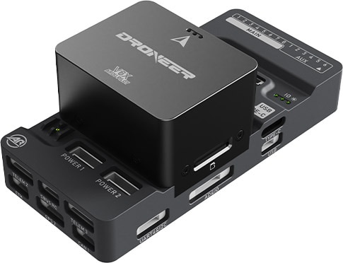

# Droneer X6

<Badge type="tip" text="main (PX4 v2.0)" />

::: warning
PX4 does not manufacture this (or any) autopilot.
Contact the [manufacturer](https://droneer.com/) for hardware support or compliance issues.
:::

The Droneer X6 is a flight controller manufactured by Droneer.
It is based on the open-source [Pixhawk FMUv6X](https://github.com/pixhawk/Pixhawk-Standards/blob/master/DS-012%20Pixhawk%20Autopilot%20v6X%20Standard.pdf) reference design and the [Pixhawk Autopilot Bus](https://github.com/pixhawk/Pixhawk-Standards/blob/master/DS-010%20Pixhawk%20Autopilot%20Bus%20Standard.pdf) specification.



::: info
This flight controller is [manufacturer supported](../flight_controller/autopilot_manufacturer_supported.md).
:::

## Specifications {#specifications}

### Processor {#processor}

- **Main FMU processor:** [STM32H753](https://www.st.com/en/microcontrollers-microprocessors/stm32h753vi.html) (32-bit Arm® Cortex®-M7, 480 MHz, 2 MB flash, 1 MB RAM)
- **IO processor:** [STM32F103](https://www.st.com/en/microcontrollers-microprocessors/stm32f103) (32-bit Arm® Cortex®-M3, 72 MHz, 20 KB SRAM)

### Sensors {#sensors}

- **IMU:** 3x [ICM-45686](https://www.invensense.tdk.com/en-us/products/6-axis/icm-45686) (SPI1, SPI2, SPI3), vibration-isolated on SPI2 and SPI3
- **Barometer:** 2x [ICP-20100](https://www.invensense.tdk.com/en-us/products/smartpressure/icp-20100) (I2C4 and I2C2)
- **Magnetometer:** [RM3100](https://www.pnisensor.com/rm3100/) (I2C4)
- **Heater:** 1 W, controlled by the PX4 heater driver (enable with [SENS_EN_THERMAL](../advanced_config/parameter_reference.md#SENS_EN_THERMAL) set to `1`)

### Interfaces {#interfaces}

- **PWM outputs:** 16: 8 FMU outputs (`AUX`) and 8 PX4IO outputs (`MAIN`)
- **Serial ports:** 8 (`GPS & SAFETY`, `GPS 2`, `TELEM 1`, `TELEM 2`, `TELEM 3`, `UART4&I2C`, PX4IO/RC, Debug Console)
  - `TELEM 2` and `TELEM 3` have full flow control; `TELEM 1` supports TX/RX without RTS/CTS.
  - `UART4&I2C` carries a serial port and an I2C bus
- **GPS ports:** 2
  - `GPS & SAFETY` (GPS1): full GPS port with safety switch
  - `GPS 2`: basic GPS port with I2C
- **I2C buses:** 4 (I2C4 internal; I2C1 on `GPS & SAFETY`, I2C2 on `GPS 2`, I2C3 on `UART4&I2C`)
- **SPI buses:** 5, of which SPI6 is external (`SPI`) with 2 chip select lines, 2 data-ready lines and 1 SPI SYNC line; its reset line is on `AD&IO`
- **CAN buses:** 2 (`CAN 1`, `CAN 2`), each with individual silent control or ESC RX-MUX control
- **Ethernet:** 100 Mbps, transformerless (`ETH`)
- **USB:** 2 ports: USB Type-C (`TYPE-C`) and JST GH1.25 (`USB`)
- **RC input:** `SBUS RC` (PX4IO) for Spektrum/DSM and S.Bus receivers, with analog/PWM RSSI input; `PPM` (FMU, unused by default). S.Bus output on `SBUS OUT`
- **AD & IO port:** `AD&IO`, with 2 additional analog inputs (3.3 V and 6.6 V) and 1 PWM/capture input
- **Power inputs:** 2 DroneCAN power inputs (`POWER 1`, `POWER 2`)
- **Parameter storage:** FRAM (FM25V02A)
- **SD card:** MicroSD slot
- **LED indicators:** Yes

### Electrical Data {#electrical_data}

- **Nominal input voltage:** 5 V
- **USB power input:** 4.75-5.25 V
- **Output current limits:** `TELEM 1` and `GPS 2` combined: 1.5 A; all other ports combined: 1.5 A

### Mechanical Data {#mechanical_data}

- **Weight:** 89 g (module + baseboard)
- **Dimensions:** 84.6 x 39.6 x 32.7 mm
- **Form factor:** [Pixhawk Autopilot Bus (PAB)](https://github.com/pixhawk/Pixhawk-Standards/blob/master/DS-010%20Pixhawk%20Autopilot%20Bus%20Standard.pdf)
- **Operating and storage temperature:** -20 to 85 °C

## Where to Buy {#store}

Order from [Droneer](https://droneer.com/6x-flight-controller/).

## Pinouts {#pinouts}


## Power {#power}

`POWER 1` and `POWER 2` are DroneCAN power inputs: each carries 5 V and a CAN bus (CAN1 on `POWER 1`, CAN2 on `POWER 2`). 'POWER 1' has higher priority.
Battery voltage and current are read from DroneCAN power modules.
DroneCAN is disabled by default (see [CAN](#can)).

See [Battery and Power Module Setup](../config/battery.md).

## PWM Outputs {#pwm_outputs}

The Droneer X6 has 16 PWM outputs: 8 PX4IO outputs (`MAIN`) and 8 FMU outputs (`AUX`).
`AUX` 1-6 are on the servo rail, and `AUX` 7-8 are `TIM12_CH1` and `TIM12_CH2` on the `AD&IO` port.

All 16 outputs support PWM.
`AUX` 1-6 support [DShot](../peripherals/dshot.md) and [bidirectional DShot](../peripherals/dshot.md#bidirectional-dshot-telemetry).

The 8 `MAIN` outputs are in 3 groups:

- Outputs 1 and 2 in group1
- Outputs 3 and 4 in group2
- Outputs 5, 6, 7 and 8 in group3

The 8 `AUX` outputs are in 3 groups:

- Outputs `AUX` 1-4 in group1
- Outputs `AUX` 5-6 in group2
- Outputs `AUX` 7-8 in group3

All outputs within the same group must use the same output protocol and rate.

`FMU_CAP1` (PE11/TIM1_CH2) on the `AD&IO` port is configured as a capture input in the default firmware, not a ninth PWM output.

The PWM signal level is 3.3 V by default.
Set the `PWM_VOLT_SEL` parameter to `1` for 5 V, then reboot.

## Ethernet {#ethernet}

The `ETH` port provides 100 Mbps transformerless Ethernet.
By default [MAVLink instance](../peripherals/mavlink_peripherals.md#mavlink-instances) 2 runs on Ethernet, broadcasting on UDP port 14550.
See [PX4 Ethernet Setup](../advanced_config/ethernet_setup.md).

## SD Card (Optional) {#sd_card}

The flight controller has a microSD card slot on the module's end face, beside `TYPE-C`.
See [SD Cards](../getting_started/px4_basic_concepts.md#sd-cards-removable-memory).

## Serial Port Mapping {#serial_port_mapping}

| UART   | Device     | Port                                | Flow Control |
| ------ | ---------- | ----------------------------------- | ------------ |
| USART1 | /dev/ttyS0 | `GPS & SAFETY` (GPS1)               | No           |
| USART2 | /dev/ttyS1 | `TELEM 3`                           | Yes          |
| USART3 | /dev/ttyS2 | Debug Console (not user-accessible) | No           |
| UART4  | /dev/ttyS3 | `UART4&I2C`                         | No           |
| UART5  | /dev/ttyS4 | `TELEM 2`                           | Yes          |
| USART6 | /dev/ttyS5 | PX4IO/RC                            | No           |
| UART7  | /dev/ttyS6 | `TELEM 1`                           | No           |
| UART8  | /dev/ttyS7 | `GPS 2`                             | No           |

::: info
The bootloader enables only `UART5` (`TELEM 2`), so connect to `TELEM 2` to flash firmware over a UART.
:::

## Assembly {#assembly}

### Radio Control {#radio_control}

A remote control (RC) radio system is required only if you want to fly the vehicle manually.
See [Radio Control Systems](../getting_started/rc_transmitter_receiver.md) for more information.

- `SBUS RC` connects to the PX4IO, which detects the [protocols it supports](../modules/modules_driver.md#px4io) automatically.
- The port also provides an RSSI input (`IO_RSSI_IN`).
- [CRSF](../telemetry/crsf_telemetry.md) and GHST receivers cannot be decoded by the PX4IO.
  Connect them to a free FMU serial port, such as `TELEM 2`, and set [RC_PORT_CONFIG](../advanced_config/parameter_reference.md#RC_PORT_CONFIG) to that port.
- Only one FMU RC serial port can be active at a time.
- PWM receivers with individual channel wires require a [PPM encoder](../getting_started/rc_transmitter_receiver.md#connecting-receivers).
- The separate `PPM` connector is connected to the FMU (PI5/TIM8_CH1), but is not supported by the default firmware when PX4IO is running.
  For PPM-Sum receivers, use the `SBUS RC` input, which is decoded by the PX4IO.

### GPS & Compass {#gps_compass}

- `GPS & SAFETY` (GPS1): USART1, I2C1, safety switch input (`SAFETY_IN`) and safety LED (`LED_SAFETY`).
- `GPS 2`: UART8 and I2C2.
- The safety switch is disabled by default.
  To enable it, set [CBRK_IO_SAFETY](../advanced_config/parameter_reference.md#CBRK_IO_SAFETY) to `0`.

The flight controller has an onboard RM3100 magnetometer.
See [Mounting a GPS/Compass](../assembly/mount_gps_compass.md).

### Telemetry Radios (Optional) {#telemetry}

[Telemetry radios](../telemetry/index.md) connect to `TELEM 1`, `TELEM 2` or `TELEM 3`.
`TELEM 1` needs no further configuration.

### CAN {#can}

`CAN 1` and `CAN 2` connect [DroneCAN](../dronecan/index.md) peripherals.
`POWER 1` and `POWER 2` also carry CAN1 and CAN2.
DroneCAN is disabled by default: enable it with [UAVCAN_ENABLE](../advanced_config/parameter_reference.md#UAVCAN_ENABLE).

## Building Firmware {#building_firmware}

::: tip
From PX4 v2.0, most users will not need to build this firmware!
It is pre-built and automatically installed by _QGroundControl_ when appropriate hardware is connected.
:::

To [build PX4](../dev_setup/building_px4.md) for this target:

```sh
make droneer_x6_default
```

## Further Information {#further_information}

- [Droneer](https://droneer.com/)
- [Pixhawk Autopilot FMUv6X Standard (DS-012)](https://github.com/pixhawk/Pixhawk-Standards/blob/master/DS-012%20Pixhawk%20Autopilot%20v6X%20Standard.pdf)
- [Pixhawk Autopilot Bus Standard (DS-010)](https://github.com/pixhawk/Pixhawk-Standards/blob/master/DS-010%20Pixhawk%20Autopilot%20Bus%20Standard.pdf)
