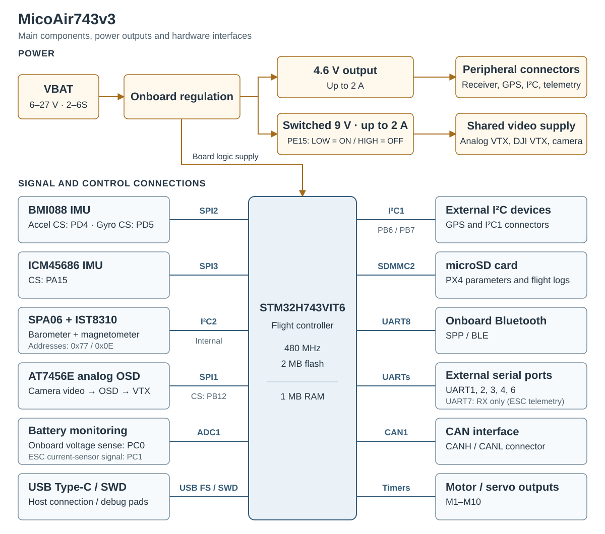
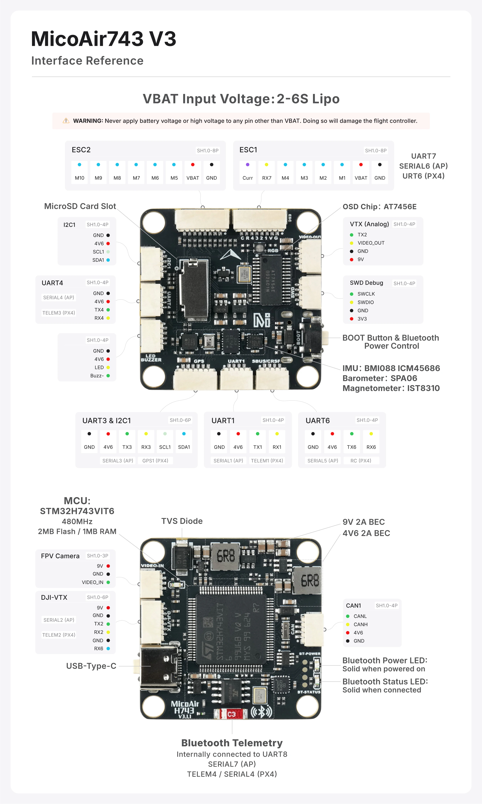
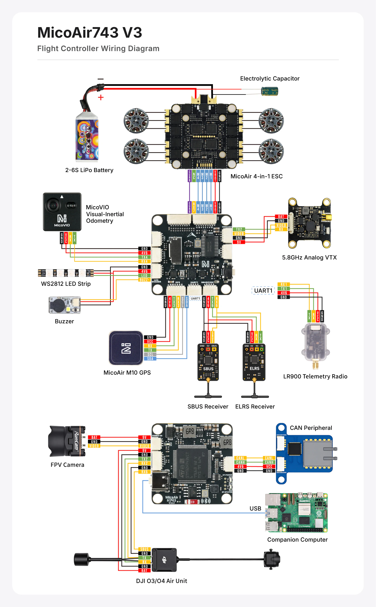

# MicoAir743v3

The MicoAir743v3 is an STM32H743VIT6 flight controller with two IMUs, ten PX4 motor or servo outputs, CAN, and onboard Bluetooth telemetry.
The board measures 36 × 36 × 8 mm, weighs 10 g, and has a 30.5 × 30.5 mm mounting pattern with 4 mm holes.

::: info
This flight controller is [manufacturer supported](../flight_controller/autopilot_manufacturer_supported.md).
The [MicoAir743v3 user manual](https://micoair.com/en/docs/flight-controller/micoair743/micoair743v3-flight-controller) includes connector drawings, dimensions, and a complete MCU pin table.
:::

## Hardware Overview

The 480 MHz Arm Cortex-M7 processor has 2 MB of flash and 1 MB of RAM.
At startup PX4 initialises the BMI088 on SPI2 and the ICM45686 on SPI3, followed by the SPA06 barometer and IST8310 compass on the internal I2C2 bus.
The GPS connector and the separate I2C1 connector share the external bus (SCL on PB6, SDA on PB7).
The CAN1 connector uses PB8 for CAN RX and PB9 for CAN TX.
Install a microSD card before setup.
PX4 uses the SDMMC2 slot to store parameters and flight logs.



## Where to Buy {#store}

The MicoAir743v3 is available from the [MicoAir Tech Store](https://store.micoair.com/product/micoair743v3/).

## Connectors and Power



| Connection | Voltage                | Use                                                                   |
| ---------- | ---------------------- | --------------------------------------------------------------------- |
| VBAT       | 6–27 V (2–6S LiPo)     | Main battery input                                                    |
| 4V6        | 4.6 V, up to 2 A total | Receiver, GPS, CAN and other peripherals                              |
| 9V         | 9 V, up to 2 A total   | Shared supply for the DJI-VTX, VTX (Analog) and FPV Camera connectors |

Pin 1 of the DJI-VTX connector supplies 9 V.
Check the peripheral's input voltage and cable pin order before connecting it.
PX4 enables the shared 9 V rail at startup when the flight battery is connected.

PX4 measures battery voltage on PC0 and reads the current-sensor signal from the ESC1 connector on PC1.
The defaults are `BAT1_V_DIV = 21.12` and `BAT1_A_PER_V = 40.2`.
Calibrate the current scale for the ESC or current sensor installed.

## Serial Port Mapping

The TX and RX pins in the table are named from the flight controller's perspective.
The PX4 port names are the ones used when [configuring serial peripherals](../peripherals/serial_configuration.md).

| Board connection                           | MCU UART | MCU TX / RX | PX4 device   | PX4 port        |
| ------------------------------------------ | -------- | ----------- | ------------ | --------------- |
| UART1 telemetry connector                  | USART1   | PA9 / PA10  | `/dev/ttyS0` | TELEM1          |
| DJI-VTX connector (TX2 also on VTX Analog) | USART2   | PA2 / PA3   | `/dev/ttyS1` | TELEM2          |
| GPS connector                              | USART3   | PD8 / PD9   | `/dev/ttyS2` | GPS1            |
| UART4 telemetry connector                  | UART4    | PA0 / PA1   | `/dev/ttyS3` | TELEM3          |
| Receiver connector (RX6 also on DJI-VTX)   | USART6   | PC6 / PC7   | `/dev/ttyS4` | RC              |
| ESC1 telemetry input (RX7 only)            | UART7    | — / PE7     | `/dev/ttyS5` | UART 6 (`URT6`) |
| Onboard Bluetooth module                   | UART8    | PE1 / PE0   | `/dev/ttyS6` | TELEM4          |

For a CRSF/ELRS receiver, connect receiver TX to RX6 and receiver RX to TX6.
The receiver connector and the DJI-VTX connector share RX6, so connect only one receiver signal to that pin.
TELEM1 runs MAVLink at 57600 baud by default, and TELEM3 is available for a user-configured peripheral.
The onboard Bluetooth module runs MAVLink on TELEM4 at 115200 baud.

## Motor and Servo Outputs

PX4 exposes M1–M10 in the following timer groups.
All outputs on the same timer share the output protocol and rate.

| Outputs (connector)   | MCU pins in output order | Timer | Output protocols |
| --------------------- | ------------------------ | ----- | ---------------- |
| M1, M2, M3, M4 (ESC1) | PE14, PE13, PE11, PE9    | TIM1  | PWM, DShot       |
| M5, M6 (ESC2)         | PB1, PB0                 | TIM3  | PWM, DShot       |
| M7, M8 (ESC2)         | PD12, PD13               | TIM4  | PWM, DShot       |
| M9, M10 (ESC2)        | PE5, PE6                 | TIM15 | PWM              |

The separate LED pad on PD14 is labelled PWM11 in the hardware pinout and is reserved as a GPIO in this PX4 target.
Assign motor and servo functions in the [Actuators](../config/actuators.md) page of _QGroundControl_.

## Video and Wiring

For digital video, connect the air unit to the DJI-VTX connector.
The board assigns [MSP OSD](../peripherals/osd.md) to TELEM2 by default (`MSP_OSD_CONFIG = 102`).
TX2 is shared with the analog VTX connector, so use one serial peripheral on this port at a time.

For analog video, the camera connects to VIDEO_IN on the FPV Camera connector.
The AT7456E on SPI1 feeds VIDEO_OUT on the VTX (Analog) connector.
The analog OSD driver is included in the firmware and is disabled by default.



## Building and Installing PX4

From the root of a PX4 checkout, [build the firmware](../dev_setup/building_px4.md) with the board's default target.

```sh
make micoair_h743-v3_default
```

On a board with a PX4-compatible bootloader, connect the USB-C port and select **Advanced settings > Custom Firmware file** in the _QGroundControl_ [firmware installer](../config/firmware.md#installing-px4-main-beta-or-custom-firmware).
Select `build/micoair_h743-v3_default/micoair_h743-v3_default.px4`.

The matching bootloader has a separate build target.

```sh
make micoair_h743-v3_bootloader
```
