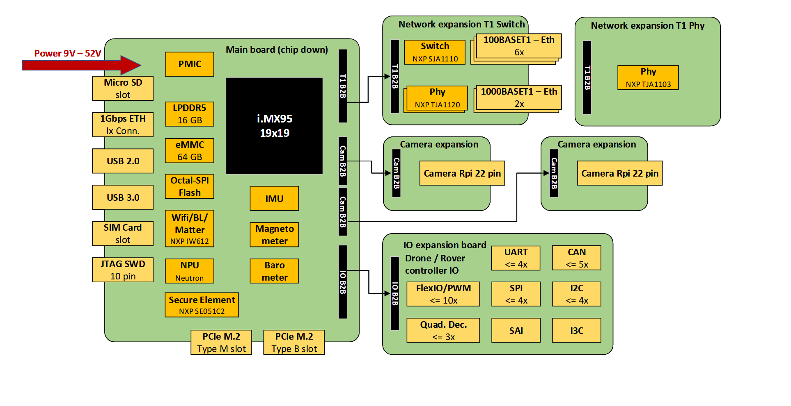
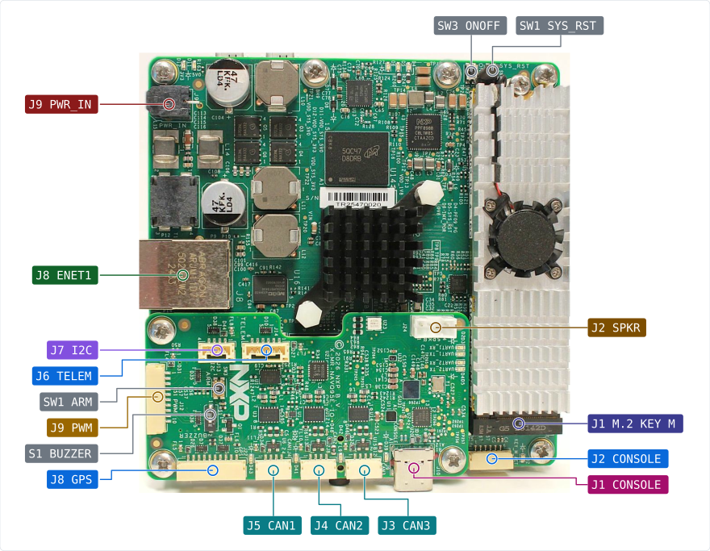
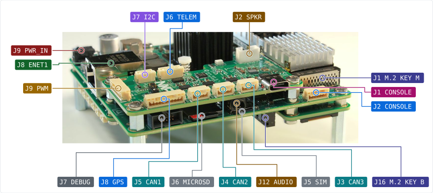
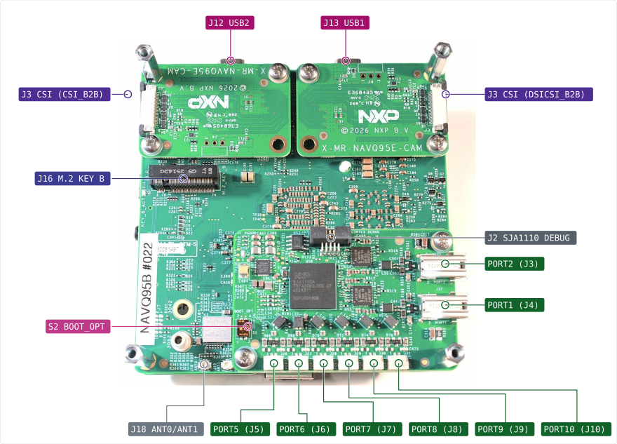

# NXP MR-NavQ95

<Badge type="tip" text="main (PX4 v2.0)" />

::: warning
PX4 does not manufacture this (or any) autopilot.
Contact the [manufacturer](https://www.nxp.com) for hardware support or compliance issues.
:::

The [MR-NavQ95](https://github.com/NXP-Robotics/MR-NAVQ95) is a vehicle computer reference design from NXP Mobile Robotics, built around the NXP i.MX 95.
Linux runs on the Cortex-A55 cores, and PX4 runs on the Cortex-M7 real-time core, started by MCUboot from the on-board octal NOR flash.
The two sides talk over RPMsg: PX4 keeps its parameters, dataman and logs on a filesystem served by Linux, and exposes its shell and two MAVLink links as virtual ttys on the Linux side.
The main board carries the i.MX 95 and the ICM-45686, BMM350 and BMP581 sensors.
The NAVQ95-IO expansion board (the "IO board") carries the BMI088, the USB console, and the CAN, PWM, GPS, TELEM and I2C connectors.



Because the i.MX 95 is an applications processor, the Linux side is a full companion computer rather than just a storage and telemetry bridge.
It brings the parts of a mobile robotics stack that do not belong on a flight controller:

- Up to 6x Arm Cortex-A55 application cores running Linux, next to the Cortex-M7 real-time core used by PX4 and a Cortex-M33 for boot and system control
- eIQ Neutron NPU for on-device machine learning, for example object detection, segmentation or visual navigation, without an external accelerator
- Image Signal Processor with multiple MIPI-CSI inputs, so several cameras (for example a stereo pair plus an RGB camera) can be attached at once
- Arm Mali GPU and hardware H.264/H.265 encode and decode for video streaming and recording
- Audio subsystem (SAI, microphone array support) for voice interaction and acoustic sensing
- Networking: a gigabit RJ45 port on the main board straight off the SoC, plus an XFI lane to the expansion header that by default feeds the NAVQ95-T1SW expansion board with an NXP SJA1110 TSN switch for automotive-style multi-drop vehicle networks; the XFI lane can instead be routed to an SFP+ cage module for fibre or higher-speed copper links
- PCIe, USB and an on-board Wi-Fi/Bluetooth module for links to the ground station and to other vehicles

::: info
Only the Cortex-M7 side is PX4.
All of the above is available to the application running on Linux, which talks to PX4 over the RPMsg MAVLink link described below.
:::

::: info
This flight controller is [manufacturer supported](../flight_controller/autopilot_manufacturer_supported.md).
:::

## Specifications {#specifications}

### Processor {#processor}

- **Main FMU processor:** [NXP i.MX 95](https://www.nxp.com/products/i.MX95).
  PX4 runs on its Arm® Cortex®-M7 core (800 MHz).
  The Cortex®-A55 cores run Linux and the Cortex®-M33 core runs the NXP System Manager.
- **Code store:** on-board octal NOR flash.
  MCUboot starts PX4 from slot0 (7 MB).
  The `ddr` build runs from SDRAM and is loaded by Linux.

### Sensors {#sensors}

- **IMU:** [TDK InvenSense ICM-45686](https://www.invensense.tdk.com/en-us/products/6-axis/icm-45686) (SPI1, on the main board), [Bosch BMI088](https://www.bosch-sensortec.com/en/products/motion-sensors/imus/bmi088/) (SPI8, on the IO board)
- **Barometer:** [Bosch BMP581](https://www.bosch-sensortec.com/en/products/environmental-sensors/pressure-sensors/bmp581/) (I2C1, on the main board)
- **Magnetometer:** [Bosch BMM350](https://www.bosch-sensortec.com/en/products/motion-sensors/magnetometers/bmm350) (I2C1, on the main board)

### Interfaces {#interfaces}

- **PWM outputs:** 8 FMU outputs (7 when output 8 is configured as the buzzer), all [DShot](../peripherals/dshot.md) capable, including bidirectional DShot 300 and 600
- **Serial ports:** 3 (`GPS1`, `TELEM1` with flow control, RC on the main board `J2 CONSOLE`), plus RPMsg virtual ports to Linux (shell, two MAVLink links)
- **I2C buses:** 2 (I2C1 internal, I2C6 external)
- **SPI buses:** 2, both internal
- **CAN buses:** 2 CAN FD buses for PX4, DroneCAN capable (IO board `J4 CAN2` and `J3 CAN3`).
  A third (IO board `J5 CAN1`) belongs to Linux.
- **Ethernet:** none on the PX4 side
- **USB:** none on the PX4 side (the USB ports belong to Linux)
- **RC input:** Yes
- **Parameter storage:** a file on the RPMsg filesystem served by Linux (`/fs/rpmsg/params`)
- **SD card:** none on the PX4 side

### Electrical Data {#electrical_data}

- **Input voltage:** 9 V to 52 V (3S to 12S battery), 60 V absolute maximum
- **Input power:** 60 W between 9 V and 20 V, 125 W between 20 V and 52 V
- **Power monitoring:** 1 analog input, voltage only (`ADC_IN0` measures VIN/64, hence the `BAT1_V_DIV` default of 64.4)

### Mechanical Data {#mechanical_data}

- **Dimensions:** main board 137 x 112 mm, IO board 120 x 79 mm (PCB outline; height and weight are not specified)
- **Memory for PX4:** 256 KB ITCM, 256 KB DTCM and 256 KB OCRAM on the Cortex-M7, and a 7 MB flash slot
- **Operating temperature:** the SoC (`MIMX9596AVZXNMC`, automotive grade) is rated -40 °C to 105 °C ambient (125 °C junction) in the i.MX 95 data sheet.
  The board-level operating temperature is not specified.

## Where to Buy {#store}

The board is not yet released.
Its release will be announced in the [MR-NAVQ95 repository](https://github.com/NXP-Robotics/MR-NAVQ95).

## Pinouts {#pinouts}







Hardware details, schematics and the pinout of every connector are in the [MR-NAVQ95 repository](https://github.com/NXP-Robotics/MR-NAVQ95).
The [connector index](https://github.com/NXP-Robotics/MR-NAVQ95#connector-index) has a drawing and a pin table for each connector.

The TELEM, GPS, I2C and CAN connectors and the main board `J2 CONSOLE` header follow the [Dronecode DS-009 connector standard](https://github.com/pixhawk/Pixhawk-Standards/blob/master/DS-009%20Pixhawk%20Connector%20Standard.pdf).
The PWM header (IO board `J9 PWM`) has its own pin order.

## PWM Outputs {#pwm_outputs}

The 8 outputs are on the IO board `J9 PWM` connector (3.3 V logic), in 4 groups:

- Outputs 1-3 in group 1 (TPM3)
- Outputs 4-5 in group 2 (TPM4)
- Outputs 6-7 in group 3 (TPM5)
- Output 8 in group 4 (TPM6)

Output 8 (GPIO_IO23, IO board `J9` pin 9) can be turned into the GPS buzzer output under **GPIO_IO23** in the board configuration, which enables the tone alarm driver.
The buzzer only sounds with DIP switch `S1` closed.

All outputs support PWM, [DShot](../peripherals/dshot.md) and [bidirectional DShot](../peripherals/dshot.md#bidirectional-dshot-telemetry) (300 and 600).
Outputs in a group share the same protocol and rate, which are set per group with the corresponding `PWM_MAIN_TIMx` parameter.

## Serial Port Mapping {#serial_port_mapping}

| UART    | Device     | Port                                               | Flow Control |
| ------- | ---------- | -------------------------------------------------- | :----------: |
| LPUART2 | /dev/ttyS1 | `RC` (or NSH console over the IO board USB serial) |      No      |
| LPUART5 | /dev/ttyS4 | `GPS1`                                             |      No      |
| LPUART7 | /dev/ttyS6 | `TELEM1`                                           |     Yes      |

LPUART2 is the M7 console port: it reaches the CP2105 USB serial bridge on the IO board (`J1 CONSOLE`, `ttyUSB1` on a Linux host) and the main board `J2 CONSOLE` header (pins 4 and 5).
It is the RC input by default, and the board configuration (**LPUART2** under **MR-NavQ95 board options** in `make nxp_mr-navq95_default boardconfig`) can run an NSH console on it instead.
If you select the console, also clear `CONFIG_BOARD_SERIAL_RC` in the same board configuration; the build fails otherwise.
The schematic and connector drawings name the LPUARTn ports UARTn (UART2 is LPUART2, and so on).
UART2 TX is also the BT_MODE1 boot strap, so leave that line idle while the board resets.

::: warning
With LPUART2 used for RC, do not connect a PC to the second CP2105 port (`ttyUSB1`) of the IO board `J1 CONSOLE` connector.
Its transmitter shares the line with the RC receiver and interferes with the RC UART.
:::

## Assembly {#assembly}

### Radio Control {#radio_control}

A remote control (RC) radio system is required if you want to _manually_ control your vehicle (PX4 does not require a radio system for autonomous flight modes).

You will need to [select a compatible transmitter/receiver](../getting_started/rc_transmitter_receiver.md) and then _bind_ them so that they communicate (read the instructions that come with your specific transmitter/receiver).

The receiver (for example CRSF, ELRS or SBUS) connects to the main board `J2 CONSOLE` header:

| Pin | Signal   | Connection                                                                  |
| --- | -------- | --------------------------------------------------------------------------- |
| 1   | 5 V      | Receiver power                                                              |
| 2   | UART1 TX | Linux console                                                               |
| 3   | UART1 RX | Linux console                                                               |
| 4   | UART2 RX | Receiver TX                                                                 |
| 5   | UART2 TX | Receiver RX, only needed for bidirectional protocols such as CRSF telemetry |
| 6   | GND      | Receiver ground                                                             |

CRSF receivers are enabled by default ([RC_CRSF_PRT_CFG](../advanced_config/parameter_reference.md#RC_CRSF_PRT_CFG) is set to the RC port).
You can enable other protocols by mapping them to the port using their associated parameters, such as [RC_DSM_PRT_CFG](../advanced_config/parameter_reference.md#RC_DSM_PRT_CFG), [RC_GHST_PRT_CFG](../advanced_config/parameter_reference.md#RC_GHST_PRT_CFG), [RC_SBUS_PRT_CFG](../advanced_config/parameter_reference.md#RC_SBUS_PRT_CFG).
Note that only one protocol can be active on a port, so you will have to first disable `RC_CRSF_PRT_CFG`.

There is no PPM input.
PX4 can't bind DSM receivers on this board; use the receiver's or transmitter's own bind procedure.

### GPS & Compass {#gps_compass}

PX4 supports GPS modules connected to the GPS port described below.
The module should be [mounted on the frame](../assembly/mount_gps_compass.md) as far away from other electronics as possible, with the direction marker pointing towards the front of the vehicle.

The GPS port is the IO board `J8 GPS` connector, a standard DS-009 GPS and compass connector:

- UART5 (`GPS1`, `/dev/ttyS4`) for the GPS
- I2C6 for an external compass (also on the IO board `J7 I2C` connector)
- Safety switch line (not supported by PX4 on this board yet)
- Safety LED (on the IO board I/O expander, not driven yet)
- Buzzer (needs DIP switch `S1` closed and the **GPIO_IO23** buzzer option, see [PWM Outputs](#pwm_outputs))

The main board has an onboard Bosch BMM350 magnetometer.
An external compass on `J8 GPS` or `J7 I2C` (I2C6) is detected automatically at boot.

### Telemetry Radios (Optional) {#telemetry}

[Telemetry radios](../telemetry/index.md) may be used to communicate and control a vehicle in flight from a ground station (for example, you can direct the UAV to a particular position, or upload a new mission).

The vehicle-based radio should be connected to the IO board `J6 TELEM` connector (DS-009), which is UART7 (`TELEM1`) with flow control.
A radio on `TELEM1` needs no further configuration.
Without a radio, MAVLink runs over RPMsg to Linux (see [MAVLink and QGroundControl](#mavlink-and-qgroundcontrol)).

### CAN {#can}

PX4 uses two of the three CAN FD buses:

- `can0` is FlexCAN2 on the IO board `J4 CAN2` connector
- `can1` is FlexCAN3 on the IO board `J3 CAN3` connector

The IO board `J5 CAN1` connector belongs to Linux.
Each port has 120 ohm split termination, so each port is a bus end.

[DroneCAN](../dronecan/index.md) is off by default.
The board brings up `can0` and `can1` only when [UAVCAN_ENABLE](../advanced_config/parameter_reference.md#UAVCAN_ENABLE) is above 0.

## Power {#power}

The board is powered through the main board `J9 PWR_IN` connector (Molex Micro-Fit 3.0, 2-pin) from 9 V to 52 V.

Battery monitoring is analog and voltage only, with [BAT1_V_DIV](../advanced_config/parameter_reference.md#BAT1_V_DIV) set to 64.4 by default.
For battery and power module configuration see [Battery and Power Module Setup](../config/battery.md).

The PWM output rail is not powered by the board's power input (main board `J9 PWR_IN`).
The output rail must be [separately powered](../peripherals/pwm_escs_and_servo.md) if it needs to power servos or other hardware.
The rail (IO board `J9 PWM` pin 1, `VDD_CON_PWM`) can only be linked to the board 5 V by fitting R60 (0 ohm), which is not fitted by default.
Do not put more than 5 V on the servo rail while R60 is fitted.

::: warning
Never feed power into the 5 V pins of the JST-GH connectors; they are outputs.
:::

## Voltage Ratings {#voltage_ratings}

### Normal Operation Maximum Ratings

1. `PWR_IN` (main board `J9`): 9 V to 52 V

### Absolute Maximum Ratings

1. `PWR_IN` (main board `J9`): 60 V
2. Servo rail (`VDD_CON_PWM`, IO board `J9` pin 1): 12 V with R60 not fitted (the rail is only sensed, through `ADC_IN6`), 5 V with R60 fitted

## Linux Side {#linux_side}

The Linux side must run the NavQ95 BSP built from [imx-manifest-navq95](https://github.com/NXP-Robotics/imx-manifest-navq95).
It provides the RPMsg links PX4 depends on:

| Linux device     | PX4 side                  | Purpose                                                          |
| ---------------- | ------------------------- | ---------------------------------------------------------------- |
| `/dev/ttynsh`    | NSH console               | PX4 shell (the system console)                                   |
| `/dev/ttyproxy`  | `mavlink` in onboard mode | MAVLink at 921600 baud for the companion computer                |
| `/dev/ttymavmin` | `mavlink` in minimal mode | Second MAVLink link at 115200 baud (flags in `rc.board_mavlink`) |
| `/dev/ttyros`    | none                      | Reserved for a future ROS/uXRCE-DDS link, unused today           |

PX4 has no local storage.
`/fs/rpmsg` on the PX4 side is an RPMsg filesystem (rpmsgfs) served by Linux, and it holds the parameters, dataman and the flight logs.

::: warning
This means PX4 depends on Linux for parameter storage: the parameters are only readable and writable once the Linux side has booted and the rpmsgfs server is running.
Keeping the parameters on the on-board octal NOR flash instead, so the M7 is self-contained, is still work in progress (see [Current Status](#current_status)).
:::

### MAVLink and QGroundControl

There is no telemetry radio in the path by default: the MAVLink link leaves the board over the network.

The onboard-mode `mavlink` instance on PX4 shows up on Linux as `/dev/ttyproxy`.
The BSP hands that device to [mavlink-router](https://github.com/mavlink-router/mavlink-router), which runs as a service and republishes the stream on the network, so several clients can use the same link at the same time:

```
PX4 (M7)  --RPMsg-->  /dev/ttyproxy  -->  mavlink-router  -->  UDP/TCP on Wi-Fi or Ethernet
```

[_QGroundControl_](../getting_started/px4_basic_concepts.md#qgc) connects to that endpoint over either the on-board Wi-Fi or the Ethernet port, and on-board software (MAVSDK, ROS 2 via the uXRCE-DDS bridge, or a camera or mission application) can attach to further endpoints in parallel.
_mavlink-router_ reads its endpoints and ports from its configuration in `/etc/mavlink-router/` on the Linux image; add your ground station address there.

::: tip
If _QGroundControl_ does not find the vehicle, check that the RPMsg links came up on Linux (`ls /dev/ttyproxy`) and that _mavlink-router_ is running (`systemctl status mavlink-router`) before looking at PX4.
:::

## Building Firmware {#building_firmware}

To [build PX4](../dev_setup/building_px4.md) for this target:

```sh
make nxp_mr-navq95_default
```

The build writes two images:

- `build/nxp_mr-navq95_default/nxp_mr-navq95_default.bin`, the plain binary.
- `build/nxp_mr-navq95_default/nxp_mr-navq95_default.signed.bin`, the plain binary wrapped with the MCUboot header and SHA256 trailer by `imgtool`.
  This is the image MCUboot boots from slot0.

The MCUboot header size, slot size and alignment are set in `default.px4board` (`CONFIG_BOARD_MCUBOOT_IMGTOOL_ARGS`) and match the on-board MCUboot, which is built with `CONFIG_BOOT_SIGNATURE_TYPE_NONE`.
`imgtool` is installed by the PX4 setup scripts (`Tools/setup/requirements.txt`); if it is missing, the build warns and skips the signed image.

The `ddr` label (`make nxp_mr-navq95_ddr`) runs from SDRAM and is loaded by Linux instead of MCUboot, so it has no signed image.

### Signing with a Key

The default image carries only a SHA256 trailer and boots on an MCUboot built with `CONFIG_BOOT_SIGNATURE_TYPE_NONE`.
For an MCUboot that verifies signatures, generate a key, pass it in the environment when configuring the build, and bake the matching public key into MCUboot:

```sh
python3 -m imgtool.main keygen -k navq95-signing.pem -t ecdsa-p256
BOARD_MCUBOOT_KEY=/path/to/navq95-signing.pem make nxp_mr-navq95_default
python3 -m imgtool.main getpub -k navq95-signing.pem   # for the MCUboot build
```

The key type must match the MCUboot signature type (`ecdsa-p256`, `rsa-2048`, `rsa-3072` or `ed25519`).
The key is read when CMake configures, so changing it needs a fresh build directory.
Keep the private key out of the repository.

## Installing PX4 Firmware {#installing_firmware}

::: info
MCUboot boots PX4 from slot0 reliably, but the update path is still a developer flow over SWD.
A convenient field update (image upload through Linux into slot1 and an MCUboot swap) is not in place yet; see [Current Status](#current_status).
:::

The firmware is flashed into MCUboot slot0 over SWD with _pyOCD_.
Mainline _pyOCD_ has no i.MX 95 support; use the NXP-Robotics fork, branch `pr-imx95`, which adds the `mimx95_*` targets and the NOR flash algorithm:

```sh
git clone https://github.com/NXP-Robotics/pyOCD -b pr-imx95
cd pyOCD
python3 -m pip install .
```

Set the boot switches and power the board as described in the [NavQ95 manifest README](https://github.com/NXP-Robotics/imx-manifest-navq95#flash-nor-flash-image), then:

```sh
pyocd flash -e sector -a 0x28020000 -t mimx95_cm7_mx25um -f 20M \
  -O vtor=0x28020800 build/nxp_mr-navq95_default/nxp_mr-navq95_default.signed.bin
pyocd reset -t mimx95_cm33 -f 20M
```

- `-a 0x28020000` is slot0.
  _pyOCD_ would otherwise default to the start of the flash region (`0x28000000`), which is MCUboot's own partition.
- `-O vtor=0x28020800` is slot0 plus the 0x800-byte header, i.e. the application vector table.
  _pyOCD_'s CM7 reset on this SoC is a core-only restart: it writes VTOR, loads MSP/PC from that table and resumes, so the application starts directly without going through MCUboot.
- The debugger-initiated reset after flashing (`pyocd reset -t mimx95_cm33`) does not chain-load slot0: MCUboot stays in its serial-recovery loop ("Unable to find bootable image") even though the image in slot0 is valid.
  Power-cycle the board to boot PX4 from slot0.

## Debug Port {#debug_port}

The PX4 [system console](../debug/system_console.md) is `/dev/ttynsh` on the Linux side; there is no dedicated console UART.

The [SWD interface](../debug/swd_debug.md) is on the main board `J7 DEBUG` connector, a standard Arm Cortex 10-pin header (2x5, 1.27 mm), for an external debug probe (J-Link, CMSIS-DAP or any probe _pyOCD_ supports; see the `J7` card in the [MR-NAVQ95 repository](https://github.com/NXP-Robotics/MR-NAVQ95#connector-index)).
It is not a Pixhawk Debug Full or Debug Mini connector.
VTref is 1.8 V, so the probe must support 1.8 V targets.
nRESET is connected through a diode, so the probe can only pull it low.
With _pyOCD_, the M7 core is reached with `pyocd gdb -t mimx95_cm7_mx25um`.

## Current Status {#current_status}

The MR-NavQ95 is a reference design under active development, and the PX4 port is not feature complete.
Known gaps at the time of writing:

- Firmware update:
  MCUboot in the NOR flash boots the signed PX4 image from slot0, but the only supported way to get an image in there is SWD with _pyOCD_.
  There is no Linux-side updater or serial-recovery flow yet, so updating PX4 still needs a debug probe and the boot switches set for flashing.
- Parameter and log storage:
  Parameters, dataman and logs live on the RPMsg filesystem served by Linux.
  Moving the parameter storage to the on-board octal NOR flash, so that PX4 can boot and arm independently of the Linux side, is in progress.
- Virtual Ethernet for PX4:
  All networking is handled by Linux today; PX4 reaches the network only indirectly through the RPMsg MAVLink tty and _mavlink-router_.
  A VSI (virtual station interface) network driver for PX4/NuttX, which would give PX4 its own virtual Ethernet interface on the shared MAC, is in progress.
  With that in place, MAVLink over UDP, [uXRCE-DDS](../middleware/uxrce_dds.md), [Zenoh-pico](../middleware/zenoh.md) and native ROS 2 publishing can run directly from the M7 instead of being proxied by Linux.
- Reboot:
  The `reboot` command, `MAV_CMD_PREFLIGHT_REBOOT_SHUTDOWN` and the reboot that _QGroundControl_ requests after calibration or airframe selection do not restart the M7 yet; power-cycle the board instead.
  An M7 reset through the i.MX 95 System Manager is planned.
- PWM timing and input capture:
  Output group 1 (TPM3) runs from a 133 MHz clock root.
  OneShot is not supported yet on any output, and neither is bidirectional DShot 150.
  The PWM timing code is being reworked, and PWM input capture is not available.
- Defaults may change:
  Port assignments, PWM groups and board defaults can still change as the design and the BSP evolve; check the board files and the BSP manifest against the version you are running.

## Further Information {#further_information}

- [MR-NAVQ95 hardware repository](https://github.com/NXP-Robotics/MR-NAVQ95)
- [NavQ95 Linux BSP manifest](https://github.com/NXP-Robotics/imx-manifest-navq95)
- [NXP community forum](https://community.nxp.com/)
