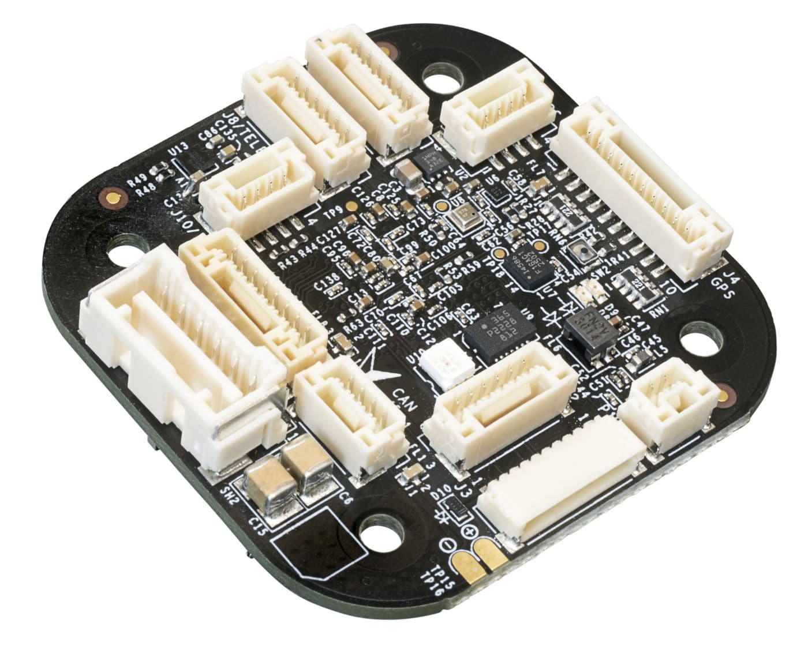

# NXP MR-VMU-TROPIC

<Badge type="tip" text="PX4 v1.17" />

::: warning
PX4 does not manufacture this (or any) autopilot.
Contact the [manufacturer](https://www.nxp.com) for hardware support or compliance issues.
:::

The [MR-VMU-TROPIC](https://github.com/NXP-Robotics/MR-VMU-TROPIC) is NXP's open source reference design of a versatile VMU that can be used for drones, rovers, boats, and more.
As a reference/evaluation design, it is intended to be replicated, modified or integrated in production volume by others.
Since it is a reference design, this particular board is not produced in high volume.
Similar variants will be available from NXP licensees.

The board combines an NXP i.MX RT1064 with sensor technology from Bosch® and InvenSense®, with the FMU, IMUs and other sensors on one compact board.
It is suitable for controlling any autonomous vehicle, in both academic and commercial applications.
The high-performance, low-noise IMUs are designed for better stabilisation.

Besides the standard interfaces, it has 100BASE-T1 (two-wire) automotive Ethernet and 8 PWM outputs, all with [DShot](../peripherals/dshot.md).

The MR-VMU-TROPIC reference design suits developers at corporate research labs, startups, academia and commercial companies who want to try out 100BASE-T1 (two-wire) automotive Ethernet.



::: info
This flight controller is [manufacturer supported](../flight_controller/autopilot_manufacturer_supported.md).
:::

## Specifications {#specifications}

### Processor {#processor}

- **Main FMU processor:** [NXP i.MX RT1064](https://www.nxp.com/products/i.MX-RT1064) Crossover MCU (32-bit Arm® Cortex®-M7 at 600 MHz, 1 MB on-chip SRAM with up to 512 KB configurable as tightly coupled memory (TCM), 4 MB on-chip flash)

### Sensors {#sensors}

- **IMU:** TDK InvenSense ICM-45686 (SPI3), Bosch BMI088 (SPI4).
  Hardware versions with a TDK InvenSense ICM-42686-P in place of the ICM-45686 are also supported.
- **Barometer:** Bosch BMP390 (I2C4)
- **Magnetometer:** Bosch BMM350 (I2C4)

### Interfaces {#interfaces}

- **PWM outputs:** 8, all with DShot and bidirectional DShot
- **Serial ports:** 5 (`GPS`, `TELEM1`, `TELEM2`, `AUX`, `RC`), plus the debug console and an ESC telemetry input; `TELEM1` and `TELEM2` have full flow control
- **I2C buses:** 3 (I2C4 internal; I2C1 and I2C3 external), with 1 external port (`I2C`) for additional sensors and payloads
- **SPI buses:** 2 internal (SPI3, SPI4), plus 1 external (`SPI (OSD)`) with 1 chip select line, 1 data-ready line and 1 reset line, not used by the default firmware
- **CAN buses:** 1 (CAN FD, NXP TJA1462ATK transceiver, 120 Ω termination resistor on board)
- **Ethernet:** 100BASE-T1 (two-wire), 100 Mbps, for transformerless applications and high-speed communication with mission computers (NXP TJA1103 PHY)
- **USB:** USB-C, high speed (480 Mbit/s)
- **RC input:** Yes, dedicated input for CRSF/ELRS
- **Parameter storage:** flash
- **SD card:** microSD slot

### Electrical Data {#electrical_data}

- **Input voltage:** 5.5 V maximum
- **USB power input:** 5 V
- **Current draw:** typically 0.25–0.35 A at 5 V
- **Power monitoring:** 1 digital input on `POWER` (INA226, INA228 or INA238, detected automatically); no analog input

### Mechanical Data {#mechanical_data}

- **Dimensions:** 46 x 45 x 1.57 mm (standard baseboard)
- **Weight:** 12 g (standard baseboard)
- **Operating and storage temperature:** 0–85 °C

## Pinouts {#pinouts}

MR-VMU-TROPIC connectors follow a mix of Pixhawk (e.g. debug) and Betaflight (e.g. motor control) connectors.
All connectors are described in detail on the [NXP Robotics GitHub page](https://github.com/NXP-Robotics/MR-VMU-TROPIC).

### Top Side Connectors

- `J2`: Power input
- `J3`: Debug interface compliant with the Pixhawk Debug Full standard (DCD-F), including SWD and console access
- `J4`: Primary GPS port
- `J5`: CAN: CAN FD interface with a CAN-SIC (Signal Improvement) transceiver
- `J6`: OSD: SPI expansion connector
- `J7`: Auxiliary UART connector
- `J8`: Telemetry port 1
- `J9`: Telemetry port 2
- `J10`: I2C port
- `J11`: RC receiver connector
- `P1`: T1-ETH: 100BASE-T1 two-wire 100 Mbps Ethernet


### Bottom Side Connectors

- `J1`: USB-C interface
- `J12`: PWM_B
- `J13`: PWM_A
- `CN1`: microSD card slot


## Power {#power}

The board has two power rails: **POWER1** and **USB**.
The **POWER1** rail is supplied via the `J2` connector (the 6-circuit [2.00 mm pitch CLIK-Mate wire-to-board PCB receptacle](https://www.molex.com/en-us/products/part-detail/5024430670)) and directly powers the following ports: I2C (`J10`), GPS (`J4`), AUX (`J7`), CAN (`J5`), TELEM1 (`J8`), TELEM2 (`J9`), RC (`J11`) and SPI-OSD (`J6`).

::: warning
Any device connected to these ports must be compatible with the **POWER1** voltage rail.
:::

Battery monitoring is digital, over I2C (I2C3 on the `POWER` port).
An INA226, INA228 or INA238 power monitor is detected automatically.
To start a specific one instead, set [SENS_EN_INA226](../advanced_config/parameter_reference.md#SENS_EN_INA226), [SENS_EN_INA228](../advanced_config/parameter_reference.md#SENS_EN_INA228) or [SENS_EN_INA238](../advanced_config/parameter_reference.md#SENS_EN_INA238) to `1`.

::: info
Analog battery monitoring via an ADC is not supported on this board.
:::

See [Battery and Power Module Setup](../config/battery.md) for configuration.

## Voltage Ratings {#voltage_ratings}

### Normal Operation Maximum Ratings

| Rail       | Minimum | Maximum |
| ---------- | ------- | ------- |
| **USB**    | 4.5 V   | 5.5 V   |
| **POWER1** | 4.9 V   | 5.5 V   |

### Absolute Maximum Ratings

| Rail       | Minimum | Maximum |
| ---------- | ------- | ------- |
| **USB**    | 0 V     | 6 V     |
| **POWER1** | 0 V     | 6 V     |

## PWM Outputs {#pwm_outputs}

The board has 8 PWM outputs.
All of them support [DShot](../peripherals/dshot.md) and [bidirectional DShot](../peripherals/dshot.md#bidirectional-dshot-telemetry).

The outputs are divided into 4 groups:

- Outputs 1-2
- Outputs 3-4
- Outputs 5-6
- Outputs 7-8

All outputs within the same group must use the same output protocol and rate.

Serial ESC telemetry is read on `/dev/ttyS5` (ESC ONEWIRE), and is enabled by default.

## Ethernet {#ethernet}

The `P1` port provides 100BASE-T1 (two-wire) Ethernet.
MAVLink runs on Ethernet by default, using UDP port 14550 ([MAV_2_CONFIG](../advanced_config/parameter_reference.md#MAV_2_CONFIG) is set to `Ethernet`).

See [PX4 Ethernet Setup](../advanced_config/ethernet_setup.md) for more information.

## SD Card (Optional) {#sd_card}

The microSD card slot (`CN1`) is on the bottom of the board.
See [SD Cards (Removable Memory)](../getting_started/px4_basic_concepts.md#sd-cards-removable-memory).

## Serial Port Mapping {#serial_port_mapping}

| UART    | Device     | Port        | Flow Control |
| ------- | ---------- | ----------- | ------------ |
| LPUART6 | /dev/ttyS0 | Debug       | No           |
| LPUART2 | /dev/ttyS1 | `GPS`       | No           |
| LPUART3 | /dev/ttyS2 | `TELEM1`    | Yes          |
| LPUART4 | /dev/ttyS3 | `AUX`       | No           |
| LPUART5 | /dev/ttyS4 | `TELEM2`    | Yes          |
| LPUART7 | /dev/ttyS5 | ESC ONEWIRE | No           |
| LPUART8 | /dev/ttyS6 | `RC`        | No           |

::: info
The `AUX` port is `TELEM 3` in the [serial port configuration](../peripherals/serial_configuration.md).
:::

## Assembly {#assembly}

### Radio Control {#radio_control}

A remote control (RC) radio system is required if you want to _manually_ control your vehicle (PX4 does not require a radio system for autonomous flight modes).
You will need to [select a compatible transmitter/receiver](../getting_started/rc_transmitter_receiver.md) and then _bind_ them so that they communicate.

Connect the receiver to the `RC` port (`J11`), which is the FMU serial port `/dev/ttyS6`.
CRSF receivers are enabled on this port by default, with telemetry.

The default firmware also includes DSM, GHST and S.BUS drivers.
To use one of these protocols, set [RC_CRSF_PRT_CFG](../advanced_config/parameter_reference.md#RC_CRSF_PRT_CFG) to `Disabled`, and then set [RC_DSM_PRT_CFG](../advanced_config/parameter_reference.md#RC_DSM_PRT_CFG), [RC_GHST_PRT_CFG](../advanced_config/parameter_reference.md#RC_GHST_PRT_CFG) or [RC_SBUS_PRT_CFG](../advanced_config/parameter_reference.md#RC_SBUS_PRT_CFG) to `Radio Controller`.
Only one protocol can be active on a port.

### GPS & Compass {#gps_compass}

Connect the GPS module to the `GPS` port (`J4`), which carries the GPS serial port (`/dev/ttyS1`) and the I2C1 bus for an external compass.
The port also carries the safety switch.

See [Mounting the GPS/Compass](../assembly/mount_gps_compass.md) for more information.

### Telemetry Radios (Optional) {#telemetry}

[Telemetry radios](../telemetry/index.md) can be connected to `TELEM1` (`J8`) or `TELEM2` (`J9`).
`TELEM1` needs no further configuration.

### CAN {#can}

Connect [DroneCAN](../dronecan/index.md) peripherals to the `CAN` port (`J5`).
DroneCAN is disabled by default; enable it with [UAVCAN_ENABLE](../advanced_config/parameter_reference.md#UAVCAN_ENABLE).

## Building Firmware {#building_firmware}

::: tip
Most users will not need to build this firmware!
It is pre-built and automatically installed by _QGroundControl_ when appropriate hardware is connected.
:::

To [build PX4](../dev_setup/building_px4.md) for this target:

```sh
make nxp_mr-tropic_default
```

To build the bootloader:

```sh
make nxp_mr-tropic_bootloader
```

## Debug Port {#debug_port}

The [PX4 System Console](../debug/system_console.md) and [SWD interface](../debug/swd_debug.md) run on the FMU debug port (`J3`).

The pinouts and connector comply with the [Pixhawk Debug Full](../debug/swd_debug.md#pixhawk-debug-full) interface defined in the [Pixhawk Connector Standard](https://github.com/pixhawk/Pixhawk-Standards/blob/master/DS-009%20Pixhawk%20Connector%20Standard.pdf) (JST SM10B connector).

| Pin      | Signal           | Volt  |
| -------- | ---------------- | ----- |
| 1 (red)  | `Vtref`          | +3.3V |
| 2 (blk)  | Console TX (OUT) | +3.3V |
| 3 (blk)  | Console RX (IN)  | +3.3V |
| 4 (blk)  | `SWDIO`          | +3.3V |
| 5 (blk)  | `SWCLK`          | +3.3V |
| 6 (blk)  | `SWO`            | +3.3V |
| 7 (blk)  | NC               | -     |
| 8 (blk)  | NC               | -     |
| 9 (blk)  | nRST             | +3.3V |
| 10 (blk) | `GND`            | GND   |

## Further Information {#further_information}

- [MR-VMU-TROPIC hardware reference](https://github.com/NXP-Robotics/MR-VMU-TROPIC) (NXP Robotics GitHub)
- [NXP Community](https://community.nxp.com/) (hardware support)
- [Pixhawk Connector Standard](https://github.com/pixhawk/Pixhawk-Standards/blob/master/DS-009%20Pixhawk%20Connector%20Standard.pdf)
