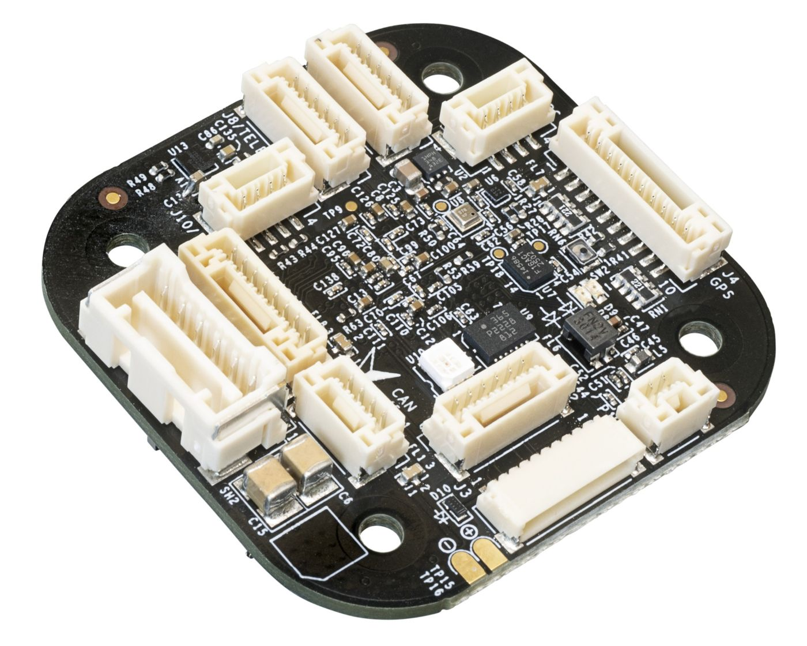
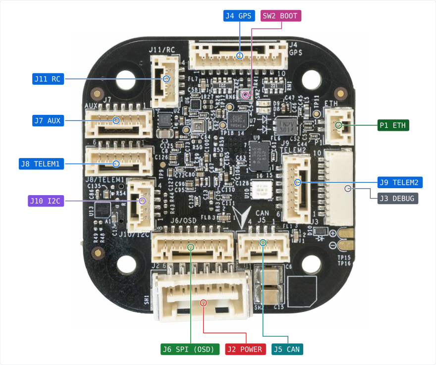
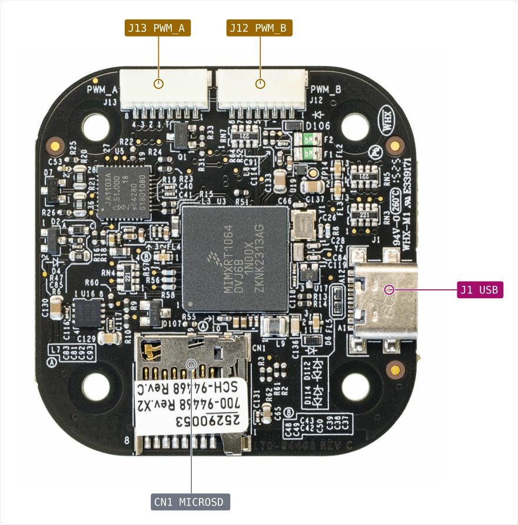

# NXP MR-TROPIC Flight Controller

<Badge type="tip" text="PX4 v1.18" />

:::warning
PX4 does not manufacture this (or any) autopilot.
Contact the [manufacturer](https://www.nxp.com) for hardware support (https://community.nxp.com/) or compliance issues.
:::

This is NXP's open source _reference design_ of a versatile VMU that can be used for drones, rovers, boats, and more.

As a reference/evaluation design, it is intended to be replicated, modified or integrated in production volume by others.

It has already gone through all FCC/CE ROHS REACH UKCA, EMI/RFI ESD certifications and is available globally.



Besides the standard interfaces, the carrier board offers 100Base-T1 (two-wire) automotive Ethernet.
It also removes the IO processor to enable 8 PWM ports, all of them providing DShot capability.

## Introduction

Inside the MR-VMU-TROPIC, you can find an NXP i.MX RT1064, paired with sensor technology from Bosch® and InvenSense®, giving you flexibility and reliability for controlling any autonomous vehicle, suitable for both academic and commercial applications.

The i.MX RT1064 Crossover MCU contains an Arm® Cortex®-M7 core running up to 600 MHz, has 1MB SRAM and 4 MB on-chip flash.

The board includes high-performance, low-noise IMUs, designed for better stabilization.

External sensor ports include an I2C bus for additional sensors and payload with I2C-interface, a CAN bus using the NXP TJA1462 transceiver, and with an integrated NXP TJA1103 Ethernet PHY, high-speed communication with mission computers via Ethernet is now possible.

The MR-TROPIC reference design is perfect for developers at corporate research labs, startups, academics (research, professors, students), and commercial application that like to try out T1 (2 wire) automotive Ethernet.

Note that since it is a reference design, this _particular_ board is not produced in high volume.
Similar variants will be available from our licensees.

## Key Design Points

- High performance [NXP i.MX RT1064 600 MHz Crossover MCU](https://www.nxp.com/products/i.MX-RT1064) with Arm® Cortex®-M7 core
- Compact flight controller: FMU, IMU, and other sensors on one compact board
- Redundancy: 2x IMU sensors on separate buses
- 100Base-T1 2-Wire Ethernet interface for high-speed mission computer integration
- CAN-FD with a NXP TJA1462ATK CAN Transceiver

## Processors & Sensors

- FMU Processor: NXP i.MX RT1064
  - 32 Bit Arm Cortex-M7, 600MHz
  - On-chip 4MB flash
  - 1 MB on-chip SRAM - up to 512 KB configurable as tightly coupled memory (TCM)
  - 100Base-T1 2-Wire Ethernet
  - USB HS 480Mbit/s
  - SD Card interface

- On-board sensors:
  - Accel/Gyro: TDK InvenSense ICM-45686
  - Accel/Gyro: Bosch BMI088
  - Magnetometer: Bosch BMM350
  - Pressure Sensor: Bosch BMP390

## Electrical Data

- Voltage Ratings:
  - Max input voltage: 5.5V
  - USB Power Input: 5V

- Current Ratings: typ. ~0.25–0.35 A @ 5V

## Mechanical Data (dimensions & weight)

- Dimensions:
  - Standard Baseboard: 46 x 45 x 1.57mm
- Weight:
  - Standard Baseboard: 12g

## Assembly/Setup

Wiring is similar to the [Holybro Pixhawk 6X](../flight_controller/pixhawk6x.md#connections) and other boards that follow the [Pixhawk Connector Standard](https://github.com/pixhawk/Pixhawk-Standards/blob/master/DS-009%20Pixhawk%20Connector%20Standard.pdf).

## Connections

_MR-VMU-TROPIC_ connectors follow a mix of Pixhawk (e.g debug) and Betaflight (e.g. motor control) connectors.

The key differentiators are:
  - CAN port
  - 100BaseT1 two-wire Ethernet

### Top side interface

* J2  - Power input
* J3  - Debug interface compliant to Pixhawk-DEBUG-FULL standard (aka DCD-F), including SWD and Console access.
* J4  - Primary GPS port
* J5  - CAN: Dual CAN-FD interfaces employing CAN-SIC (Signal Improvement) CAN phys
* J6  - OSD: SPI expansion connector
* J7  - Auxiliary UART connector
* J8  - Telemetry Port 1
* J9  - Telemetry Port 2
* J11 - RC receiver connector
* P1  - T1-ETH: 100BaseT1 Two wire 100Mbps Ethernet



### Back side interface

* J1  - USB-C interface
* J12 - PWM_A
* J13 - PWM_B
* CN1 - microSD card slot



### Detailed connector descriptions

All connectors are described in detail on the [NXP Robotics Github page](https://github.com/NXP-Robotics/MR-VMU-TROPIC).

## Serial Port Mapping

| UART   | Device     | Port        |
| ------ | ---------- | ----------- |
| UART2  | /dev/ttyS1 | GPS         |
| UART3  | /dev/ttyS2 | TELEM1      |
| UART4  | /dev/ttyS3 | AUX         |
| UART5  | /dev/ttyS4 | TELEM2      |
| UART6  | /dev/ttyS0 | Debug       |
| UART7  | /dev/ttyS5 | ESC ONEWIRE |
| UART8  | /dev/ttyS6 | RC          |

::: info
The AUX port is displayed as TEL3 in PX4 Firmware Configurator.
:::

## Voltage Ratings

_MR-TROPIC_ has two power rails: **POWER1** and **USB**.
The **POWER1** is supplied via the **J2** connector (the 6 circuit [2.00mm Pitch CLIK-Mate Wire-to-Board PCB Receptacle](https://www.molex.com/en-us/products/part-detail/5024430670)) and directly powers the following:  I2C (J10), GPS (J4), AUX (J7), CAN (J5), TELEM1 (J8), TELEM2 (J9), RC (J11) and SPI-OSD (J6) ports.

::: warning
Any device connected to these ports must be compatible with the **POWER1** voltage rail.
:::

### Normal Operation Maximum Ratings

| Rail       | Minimum | Maximum |
|------------|---------|---------|
| **USB**    | 4.5 V   | 5.5 V   |
| **POWER1** | 4.9 V   | 5.5 V   |

### Absolute Maximum Ratings

| Rail       | Minimum | Maximum |
|------------|---------|---------|
| **USB**    | 0 V     | 6 V     |
| **POWER1** | 0 V     | 6 V     |

### Voltage monitoring

Digital I2C battery monitoring is enabled by default (see [Quickstart > Power](../assembly/quick_start_pixhawk6x.md#power)).

::: info
Analog battery monitoring via an ADC is not supported on this particular board.
:::

## Building Firmware
> Most users will not need to build this firmware!
It is pre-built and automatically installed by _QGroundControl_ when appropriate hardware is connected.


To [build PX4](https://docs.px4.io/main/en/dev_setup/building_px4) for this target:

```sh
make nxp_mr-tropic
```

## Debug Port

The [PX4 System Console](https://docs.px4.io/main/en/debug/system_console) and [SWD interface](https://docs.px4.io/main/en/debug/swd_debug) run on the FMU Debug port.

The pinouts and connector comply with the [Pixhawk Debug Full](https://docs.px4.io/main/en/debug/swd_debug#pixhawk-debug-full) interface defined in the [Pixhawk Connector Standard](https://github.com/pixhawk/Pixhawk-Standards/blob/master/DS-009%20Pixhawk%20Connector%20Standard.pdf) interface (J3 JST SM10B connector).

| Pin      | Signal           | Volt  |
| -------- | ---------------- | ----- |
| 1 (red)  | `Vtref`          | +3.3V |
| 2 (blk)  | Console TX (OUT) | +3.3V |
| 3 (blk)  | Console RX (IN)  | +3.3V |
| 4 (blk)  | `SWDIO`          | +3.3V |
| 5 (blk)  | `SWCLK`          | +3.3V |
| 6 (blk)  | `SWO`            | +3.3V |
| 7 (blk)  | NC               |   -   |
| 8 (blk)  | NC               |   -   |
| 9 (blk)  | nRST             | +3.3V |
| 10 (blk) | `GND`            | GND   |

For information about using this port see:

- [SWD Debug Port](../debug/swd_debug.md)
- [PX4 System Console](../debug/system_console.md)


## Interfaces

- 8 PWM servo outputs, all 8 with DShot
- Dedicated R/C input for CRSF / ELRS
- 3 general purpose serial ports:
  - 2 with full flow control
- 1 GPS port
  - 1 full GPS plus Safety Switch Port
- 1 I2C port
- 1 Ethernet port
  - Transformerless Applications
  - 100Mbps
- 1 SPI bus (OSD)
  - 1 chip select line
  - 1 data-ready line
  - 1 reset line
- 1 CAN Bus for CAN peripheral
  - Termination resistor on-board (120 ohm)
- 1 Power input port with SMBus
- 1 Debug port

- Other Characteristics:
  - Operating & storage temperature: 0-85°c
