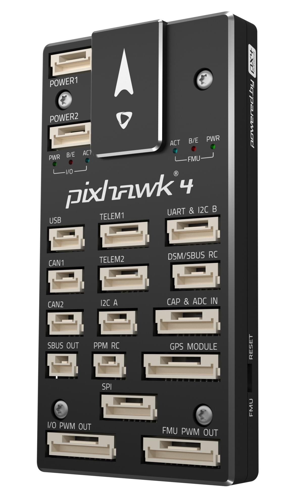
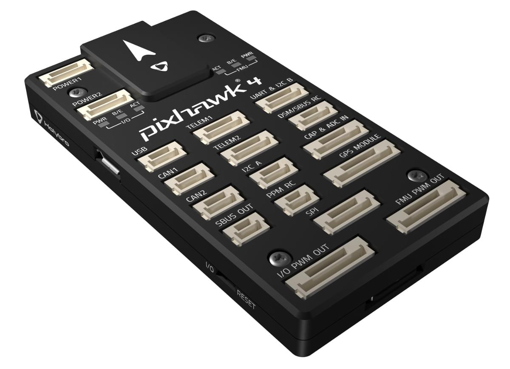
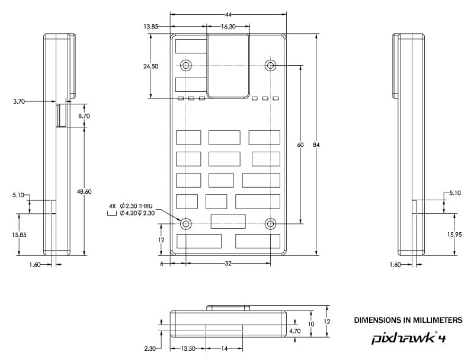
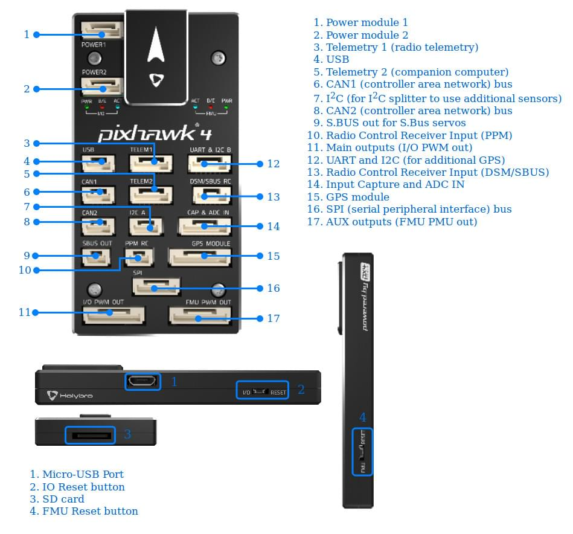
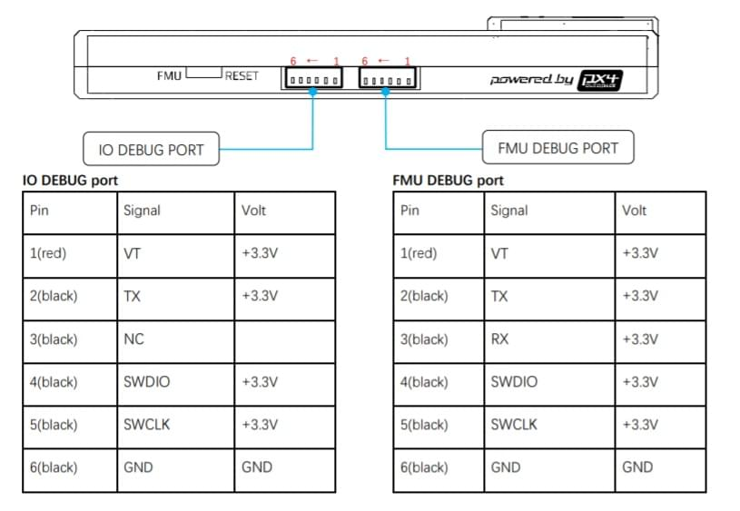

# Holybro Pixhawk 4 (Discontinued)

<Badge type="tip" text="PX4 v1.7" /> <Badge type="info" text="Discontinued" px4_current="v1.18" year="2026"/>

::: warning
This flight controller has been [discontinued](../flight_controller/autopilot_discontinued.md) and is no longer commercially available.
It is still supported by PX4.
:::

::: warning
PX4 does not manufacture this (or any) autopilot.
Contact the [manufacturer](https://holybro.com/) for hardware support or compliance issues.
:::

[_Pixhawk 4_](https://holybro.com/products/pixhawk-4)<sup>&reg;</sup> is an advanced autopilot designed and made in collaboration with Holybro<sup>&reg;</sup> and the PX4 team.
It is optimized to run PX4 v1.7 and later, and is suitable for academic and commercial developers.

It is based on the [Pixhawk-project](https://pixhawk.org/) **FMUv5** open hardware design and runs PX4 on the [NuttX](https://nuttx.apache.org/) OS.

 

::: tip
This autopilot is [supported](../flight_controller/autopilot_pixhawk_standard.md) by the PX4 maintenance and test teams.
:::

## Specifications {#specifications}

### Processor {#processor}

- **Main FMU processor:** STM32F765 (32 Bit Arm® Cortex®-M7, 216 MHz, 2 MB flash, 512 KB RAM)
- **IO processor:** STM32F103 (32 Bit Arm® Cortex®-M3, 72 MHz, 64 KB SRAM), or STM32F100 (32 Bit Arm® Cortex®-M3, 24 MHz, 8 KB SRAM) on earlier boards

### Sensors {#sensors}

- **IMU:** ICM-20689 (SPI1), and BMI055 or ICM-20602 (SPI1)
- **Barometer:** MS5611 (SPI4)
- **Magnetometer:** IST8310 (I2C3)
- **GPS module (external):** u-blox Neo-M8N GPS/GLONASS receiver, with integrated IST8310 magnetometer

### Interfaces {#interfaces}

- **PWM outputs:** 16 (8 IO `MAIN`, 8 FMU `AUX`)
- **Capture inputs:** 3 dedicated PWM/capture inputs on FMU
- **Serial ports:** 4 (`GPS MODULE`, `TELEM1`, `TELEM2`, `UART & I2C B`)
- **I2C buses:** 4 (I2C3 internal; I2C1 on `GPS MODULE`, I2C2 on `UART & I2C B`, I2C4 on `I2C A`)
- **SPI buses:** 4
- **CAN buses:** up to 2, for dual CAN with serial ESC
- **USB:** Micro-USB
- **RC input:** dedicated input for CPPM, and dedicated input for Spektrum/DSM and S.BUS with analog/PWM RSSI input
- **S.BUS output:** dedicated S.BUS servo output
- **Parameter storage:** FRAM (SPI2)
- **SD card:** MicroSD slot

### Electrical Data {#electrical_data}

- **Input voltage:** 4.9 V to 5.5 V (`POWER1`, `POWER2`), 4.75 V to 5.25 V (`USB`)
- **Max input voltage:** 6 V (`POWER1`, `POWER2`, `USB`)
- **Servo rail input:** 0 V to 36 V
- **Power monitoring:** analog inputs for voltage and current of 2 batteries, up to 120 A

### Mechanical Data {#mechanical_data}

- **Dimensions:** 44 × 84 × 12 mm
- **Weight:** 31.2 g (plastic case), 48.5 g (aluminium case)
- **Operating temperature:** -40 °C to 85 °C



Additional information can be found in the [Pixhawk 4 Technical Data Sheet](https://cdn.shopify.com/s/files/1/0604/5905/7341/files/Pixhawk4-DataSheet.pdf).

## Where to Buy {#store}

[Holybro](https://holybro.com/products/pixhawk-4) (No longer available).

## Pinouts {#pinouts}



::: warning
The `DSM/SBUS RC` and `PPM RC` ports are for RC receivers only.
These are powered! NEVER connect any servos, power supplies or batteries (or to any connected receiver).
:::

Download _Pixhawk 4_ pinouts from [here](https://cdn.shopify.com/s/files/1/0604/5905/7341/files/Pixhawk4-Pinouts.pdf).

::: info
Connector pin assignments are left to right (i.e. Pin 1 is the left-most pin).
The exception is the [debug ports](#debug_port) (pin 1 is the right-most, as shown below).
:::

## Power {#power}

The `POWER1` and `POWER2` ports are 6-pin inputs for analog power modules, which supply the board and report battery voltage and current.
See [Pixhawk 4 Wiring Quick Start > Power](../assembly/quick_start_pixhawk4.md#power) for wiring, and [Battery and Power Module Setup](../config/battery.md) for configuration.

## Voltage Ratings {#voltage_ratings}

_Pixhawk 4_ can be triple-redundant on the power supply if three power sources are supplied.
The three power rails are: `POWER1`, `POWER2` and `USB`.

::: info
The output power rails `FMU PWM OUT` and `I/O PWM OUT` (0 V to 36 V) do not power the flight controller board (and are not powered by it).
The output rails must be [separately powered](../peripherals/pwm_escs_and_servo.md) if it needs to power servos or other hardware.
You must supply power to one of `POWER1`, `POWER2` or `USB`, or the board will be unpowered.
:::

**Normal Operation Maximum Ratings**

Under these conditions all power sources will be used in this order to power the system:

1. `POWER1` and `POWER2` inputs (4.9 V to 5.5 V)
1. `USB` input (4.75 V to 5.25 V)

**Absolute Maximum Ratings**

Under these conditions the system will not draw any power (will not be operational), but will remain intact.

1. `POWER1`, `POWER2` and `USB` inputs (operational range 4.1 V to 5.7 V, 0 V to 6 V undamaged)
1. Servo input: `VDD_SERVO` pin of `FMU PWM OUT` and `I/O PWM OUT` (0 V to 42 V undamaged)

## PWM Outputs {#pwm_outputs}

The Pixhawk 4 has 8 IO PWM outputs (`MAIN`) on the `I/O PWM OUT` port, and 8 FMU PWM outputs (`AUX`) on the `FMU PWM OUT` port.

[DShot](../peripherals/dshot.md) can be used on FMU outputs 1-4 (group1).
[Bidirectional DShot](../peripherals/dshot.md#bidirectional-dshot-telemetry) is not supported.

The 8 FMU outputs are in 3 groups:

- Outputs 1-4 in group1 (Timer1)
- Outputs 5-6 in group2 (Timer4)
- Outputs 7-8 in group3 (Timer12)

All outputs within the same group must use the same output protocol and rate.

The 3 capture inputs (`FMU_CAP1` to `FMU_CAP3`, Timer2) are on the `CAP & ADC IN` port, and appear in the [actuator configuration](../config/actuators.md) as `PWM Capture 1-3`.
They can also be used as extra PWM or OneShot outputs.

## SD Card (Optional) {#sd_card}

The Pixhawk 4 has a MicroSD card slot.
See [SD Cards](../getting_started/px4_basic_concepts.md#sd-cards-removable-memory) and [Pixhawk 4 Wiring Quick Start > SD Card](../assembly/quick_start_pixhawk4.md#sd_card).

## Serial Port Mapping {#serial_port_mapping}

| UART   | Device       | Port                      | Flow Control |
| ------ | ------------ | ------------------------- | ------------ |
| USART1 | `/dev/ttyS0` | `GPS MODULE` (`GPS1`)     |              |
| USART2 | `/dev/ttyS1` | `TELEM1`                  | Yes          |
| USART3 | `/dev/ttyS2` | `TELEM2`                  | Yes          |
| UART4  | `/dev/ttyS3` | `UART & I2C B` (`TELEM4`) |              |
| USART6 | `/dev/ttyS4` | `DSM/SBUS RC`             |              |
| UART7  | `/dev/ttyS5` | `FMU Debug` (Console)     |              |
| UART8  | `/dev/ttyS6` | PX4IO                     |              |

## Assembly {#assembly}

The [Pixhawk 4 Wiring Quick Start](../assembly/quick_start_pixhawk4.md) provides instructions on how to assemble required/important peripherals including GPS, Power Management Board etc.

### Radio Control {#radio_control}

A remote control (RC) radio system is required if you want to manually control your vehicle (PX4 does not require a radio system for autonomous flight modes).
You will need to [select a compatible transmitter/receiver](../getting_started/rc_transmitter_receiver.md) and then bind them so that they communicate.

- Spektrum/DSM and S.BUS receivers connect to the `DSM/SBUS RC` port.
  A Spektrum/DSM receiver takes 3.3 V from pin 4, and an S.BUS receiver takes 5 V from pin 1.
- PPM receivers connect to the `PPM RC` port.
  PWM receivers, which have one wire per channel, need a [PPM encoder](../getting_started/rc_transmitter_receiver.md#connecting-receivers).
- [CRSF and GHST](../getting_started/rc_transmitter_receiver.md#compatible_receivers) receivers connect to a free `TELEM` port.
  Enable the driver by [setting](../advanced_config/parameters.md) [RC_CRSF_PRT_CFG](../advanced_config/parameter_reference.md#RC_CRSF_PRT_CFG) or [RC_GHST_PRT_CFG](../advanced_config/parameter_reference.md#RC_GHST_PRT_CFG) to that port.

### GPS & Compass {#gps_compass}

Connect a GPS module to the 10-pin `GPS MODULE` port, which also carries its compass (I2C), safety switch, safety LED and buzzer.
The board also has an internal IST8310 compass.
A second GPS can be connected to the `UART & I2C B` port: set [GPS_2_CONFIG](../advanced_config/parameter_reference.md#GPS_2_CONFIG) to `TELEM/SERIAL 4`.
See [Pixhawk 4 Wiring Quick Start](../assembly/quick_start_pixhawk4.md) and [Mounting a GPS/Compass](../assembly/mount_gps_compass.md).

### Telemetry Radios (Optional) {#telemetry}

A [telemetry radio](../telemetry/index.md) can be connected to `TELEM1` without further configuration.
You can also connect one to any spare serial port, such as `TELEM2`, and [configure MAVLink](../peripherals/mavlink_peripherals.md) on that port.

### CAN {#can}

The `CAN1` and `CAN2` ports can be used for [DroneCAN](../dronecan/index.md) peripherals.
DroneCAN is not enabled by default: set [UAVCAN_ENABLE](../advanced_config/parameter_reference.md#UAVCAN_ENABLE) to enable it.

## Building Firmware {#building_firmware}

::: tip
Most users will not need to build this firmware!
It is pre-built and automatically installed by _QGroundControl_ when appropriate hardware is connected.
:::

To [build PX4](../dev_setup/building_px4.md) for this target:

```sh
make px4_fmu-v5_default
```

## Debug Port {#debug_port}

The [PX4 System Console](../debug/system_console.md) (UART7) and [SWD interface](../debug/swd_debug.md) run on the `FMU Debug` port, while the IO console and SWD interface can be accessed via the `I/O Debug` port.
In order to access these ports, the user must remove the _Pixhawk 4_ casing.



The pinout uses the standard [Pixhawk debug connector pinout](https://github.com/pixhawk/Pixhawk-Standards/blob/master/DS-009%20Pixhawk%20Connector%20Standard.pdf): both debug ports are [Pixhawk Debug Mini](../debug/swd_debug.md#pixhawk-debug-mini) ports.
For wiring information see:

- [System Console > Pixhawk Debug Port](../debug/system_console.md#pixhawk_debug_port)

## Peripherals

- [Digital Airspeed Sensor](https://store-drotek.com/793-digital-differential-airspeed-sensor-kit-.html)
- [Telemetry Radio Modules](../telemetry/index.md)
- [Rangefinders/Distance sensors](../sensor/rangefinders.md)

## Supported Platforms / Airframes

Any multicopter / airplane / rover or boat that can be controlled with normal RC servos or Futaba S.BUS servos.
The complete set of supported configurations can be seen in the [Airframes Reference](../airframes/airframe_reference.md).

## Further Information {#further_information}

- [Pixhawk 4 Technical Data Sheet](https://cdn.shopify.com/s/files/1/0604/5905/7341/files/Pixhawk4-DataSheet.pdf) (Holybro)
- [FMUv5 reference design pinout](https://docs.google.com/spreadsheets/d/1-n0__BYDedQrc_2NHqBenG1DNepAgnHpSGglke-QQwY/edit#gid=912976165).
- [Pixhawk 4 Wiring QuickStart](../assembly/quick_start_pixhawk4.md)
- [Pixhawk 4 Pinouts](https://cdn.shopify.com/s/files/1/0604/5905/7341/files/Pixhawk4-Pinouts.pdf) (Holybro)
- [Pixhawk 4 Quick Start Guide](https://cdn.shopify.com/s/files/1/0604/5905/7341/files/Pixhawk4-quickstartguide.pdf) (Holybro)
