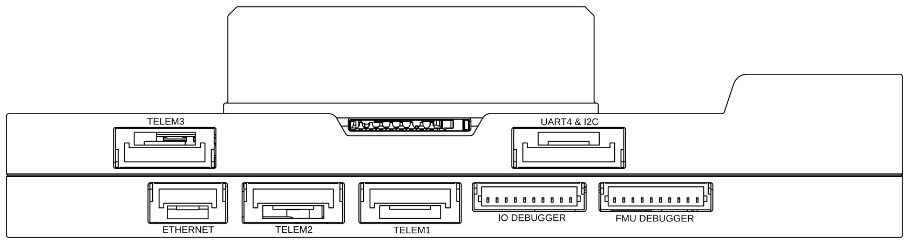
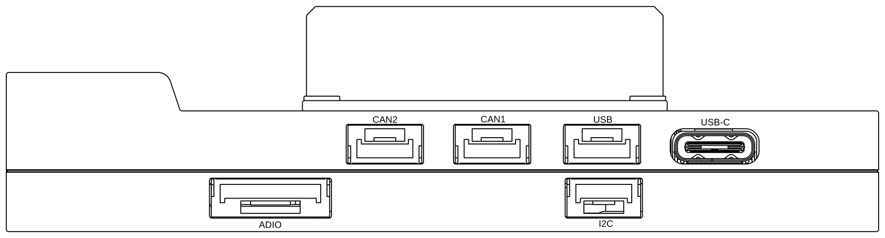
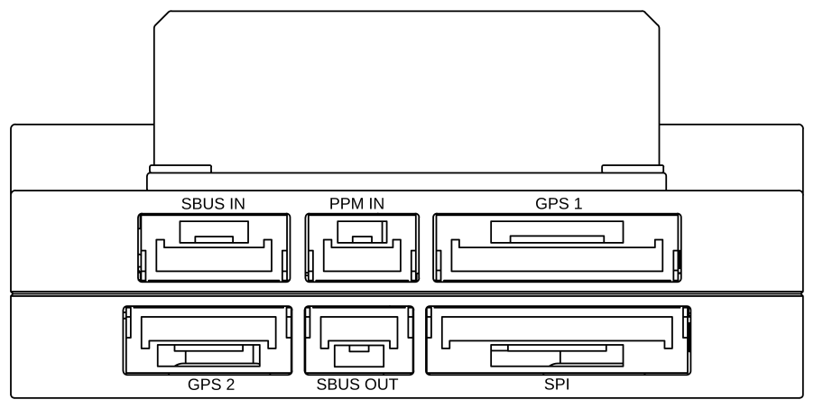
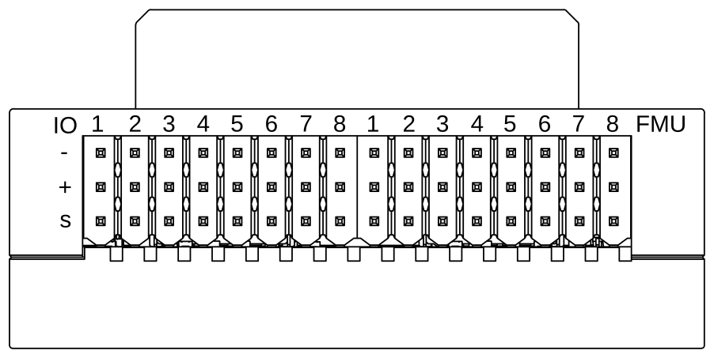
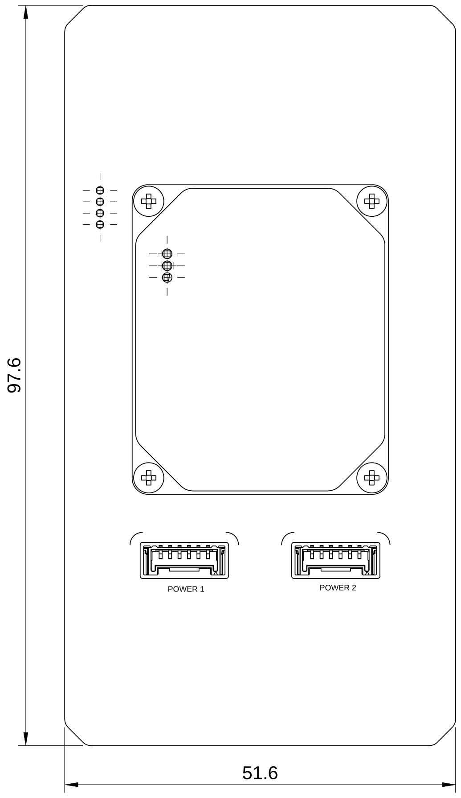
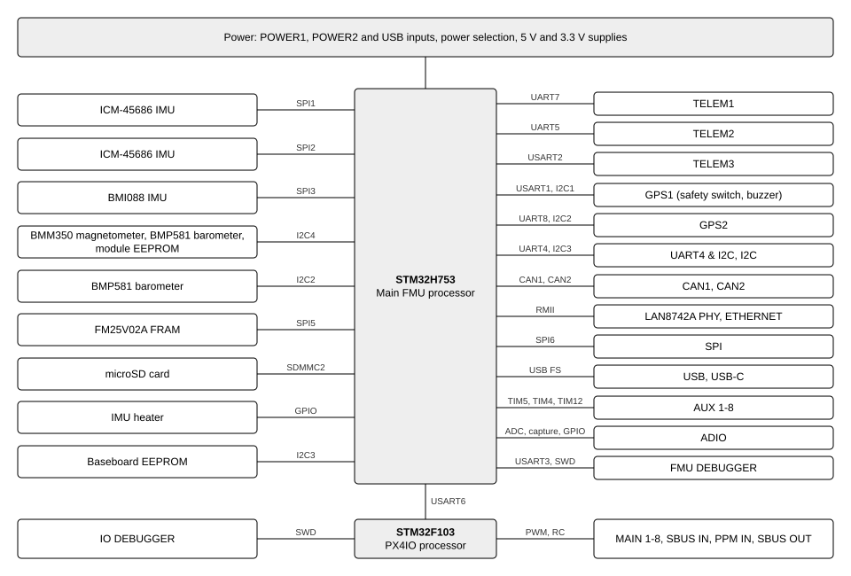

# Syro V6X

<Badge type="tip" text="main (PX4 v2.0)" />

::: warning
PX4 does not manufacture this (or any) autopilot.
Contact the [manufacturer](#store) for hardware support or compliance issues.
:::

The Syro V6X is a flight controller based on the FMUv6X reference design, with its own sensor set and PX4 board target.
It consists of a flight controller module with the STM32H753 main processor and sensors, and a baseboard that carries the PX4IO coprocessor, the Ethernet PHY and the external connectors.

<!-- TODO(Syro): add a product photo, stored under docs/assets/flight_controller/syro_v6x/, e.g.
 -->

::: info
This flight controller is intended for inclusion in the [manufacturer supported](../flight_controller/autopilot_manufacturer_supported.md) board list.
:::

## Specifications {#specifications}

- **Processors**
  - **Main FMU processor:** STM32H753 (32-bit Arm® Cortex®-M7, 480 MHz, 2 MB flash, 1 MB RAM)
  - **IO processor:** STM32F103 (PX4IO), on the baseboard
- **Sensors**
  - **IMU:** 2x InvenSense ICM-45686 (SPI1, SPI2), Bosch BMI088 (SPI3)
  - **Barometer:** 2x Bosch BMP581 (I2C2, I2C4)
  - **Magnetometer:** Bosch BMM350 (I2C4)
- **Storage**
  - FRAM (FM25V02A, SPI5) for parameters
  - microSD card (SDMMC2) for logs
  - EEPROMs on the module and baseboard holding the hardware IDs (see [Hardware Identification](#hardware_id))
- **Interfaces**
  - **PWM outputs:** 16 (8 from PX4IO, 8 from the FMU)
  - **Serial ports:** 6 for peripherals, plus the debug console
  - **Telemetry ports:** 3 (`TELEM1`, `TELEM2`, `TELEM3`), all with flow control
  - **GPS ports:** 2 (`GPS1` with safety switch and buzzer, `GPS2`)
  - **CAN buses:** 2
  - **Ethernet:** 100 Mbit/s (Microchip LAN8742A PHY)
  - **External SPI:** SPI6, with two chip selects and two data-ready inputs
  - **Power module inputs:** 2 digital (I2C) power module inputs
  - **Analog inputs:** 2 (3.3 V and 6.6 V range)
  - **RC input:** Yes, on the PX4IO
  - **USB:** Yes
- **Other**
  - IMU heater, enabled by default
  - Buzzer and safety switch on `GPS1`
- **Electrical data**
  - **Power inputs (`POWER1`, `POWER2`, USB):** 5 V nominal, valid from 3.81 V to 5.85 V
  - **Servo rail:** must be powered externally, and does not power the flight controller
- **Mechanical data**
  <!-- TODO(Syro): dimensions, weight and mounting-hole pattern of the module and the baseboard. -->

## Where to Buy {#store}

- [Syro Robotics](https://syrorobotics.com/)

## Connections











| Port                         | Connector                           |
| ---------------------------- | ----------------------------------- |
| `TELEM1`, `TELEM2`, `TELEM3` | 6-pin JST GH                        |
| `GPS1`                       | 10-pin JST GH                       |
| `GPS2`                       | 6-pin JST GH                        |
| `UART4 & I2C`                  | 7-pin JST GH                        |
| `I2C`                        | 4-pin JST GH                        |
| `CAN1`, `CAN2`               | 4-pin JST GH                        |
| `POWER1`, `POWER2`           | 6-pin Molex Micro-Lock Plus         |
| `ADIO`                       | 8-pin JST GH                        |
| `SPI`                        | 11-pin JST GH                       |
| `SBUS IN`                    | 5-pin JST GH                        |
| `PPM IN`                     | 3-pin JST GH                        |
| `SBUS OUT`                   | 3-pin JST GH                        |
| `FMU DEBUGGER`               | 10-pin JST SH                       |
| `IO DEBUGGER`                | 10-pin JST SH                       |
| `ETHERNET`                   | 4-pin JST GH                        |
| `USB`                        | 4-pin JST GH                        |
| `USB-C`                      | USB Type-C                          |
| `MAIN` 1-8, `AUX` 1-8        | 3-pin servo headers (`-`, `+`, `S`) |

## Pinouts

### TELEM1, TELEM2, TELEM3

| Pin | Signal | TELEM1 (UART7) | TELEM2 (UART5) | TELEM3 (USART2) |
| --- | ------ | -------------- | -------------- | --------------- |
| 1   | 5V     |                |                |                 |
| 2   | TX     | PE8            | PC12           | PD5             |
| 3   | RX     | PF6            | PD2            | PA3             |
| 4   | CTS    | PE10           | PC9            | PD3             |
| 5   | RTS    | PF8            | PC8            | PD4             |
| 6   | GND    |                |                |                 |

### GPS1

| Pin | Signal            | MCU pin      |
| --- | ----------------- | ------------ |
| 1   | 5V                |              |
| 2   | TX                | PB6 (USART1) |
| 3   | RX                | PB7 (USART1) |
| 4   | SCL               | PB8 (I2C1)   |
| 5   | SDA               | PB9 (I2C1)   |
| 6   | Safety switch     | PF5          |
| 7   | Safety switch LED | PD10         |
| 8   | 3.3V              |              |
| 9   | Buzzer            | PF9          |
| 10  | GND               |              |

### GPS2

| Pin | Signal | MCU pin     |
| --- | ------ | ----------- |
| 1   | 5V     |             |
| 2   | TX     | PE1 (UART8) |
| 3   | RX     | PE0 (UART8) |
| 4   | SCL    | PF1 (I2C2)  |
| 5   | SDA    | PF0 (I2C2)  |
| 6   | GND    |             |

### UART4 & I2C

| Pin | Signal    | MCU pin      |
| --- | --------- | ------------ |
| 1   | 5V        |              |
| 2   | TX        | PH13 (UART4) |
| 3   | RX        | PH14 (UART4) |
| 4   | SCL       | PA8 (I2C3)   |
| 5   | SDA       | PH8 (I2C3)   |
| 6   | NFC_GPIO  | PC0          |
| 7   | GND       |              |

### I2C

| Pin | Signal | MCU pin    |
| --- | ------ | ---------- |
| 1   | 5V     |            |
| 2   | SCL    | PA8 (I2C3) |
| 3   | SDA    | PH8 (I2C3) |
| 4   | GND    |            |

### CAN1, CAN2

| Pin | Signal |
| --- | ------ |
| 1   | 5V     |
| 2   | CAN_H  |
| 3   | CAN_L  |
| 4   | GND    |

### POWER1, POWER2

| Pin | Signal | POWER1     | POWER2     |
| --- | ------ | ---------- | ---------- |
| 1   | 5V     |            |            |
| 2   | 5V     |            |            |
| 3   | SCL    | PB8 (I2C1) | PF1 (I2C2) |
| 4   | SDA    | PB9 (I2C1) | PF0 (I2C2) |
| 5   | GND    |            |            |
| 6   | GND    |            |            |

### ADIO

| Pin | Signal             | MCU pin |
| --- | ------------------ | ------- |
| 1   | 5V                 |         |
| 2   | FMU_CAP1           | PE11    |
| 3   | FMU_BOOTLOADER     |         |
| 4   | FMU_RST_REQ        |         |
| 5   | nARMED             | PE6     |
| 6   | ADC1_3V3 (3.3 V range) | PC3 |
| 7   | ADC1_6V6 (6.6 V range) | PC2 |
| 8   | GND                |         |

### SPI

| Pin | Signal | MCU pin     |
| --- | ------ | ----------- |
| 1   | 5V     |             |
| 2   | SCK    | PB3 (SPI6)  |
| 3   | MISO   | PA6 (SPI6)  |
| 4   | MOSI   | PG14 (SPI6) |
| 5   | CS1    | PI10        |
| 6   | CS2    | PA15        |
| 7   | nSYNC  | PE9         |
| 8   | DRDY1  | PD11        |
| 9   | DRDY2  | PD12        |
| 10  | nRESET | PF10        |
| 11  | GND    |             |

### SBUS IN

| Pin | Signal           |
| --- | ---------------- |
| 1   | 5V               |
| 2   | SBUS / DSM input |
| 3   | RSSI input       |
| 4   | 3.3V (Spektrum)  |
| 5   | GND              |

### PPM IN

| Pin | Signal |
| --- | ------ |
| 1   | 5V     |
| 2   | PPM IN |
| 3   | GND    |

### SBUS OUT

| Pin | Signal        |
| --- | ------------- |
| 1   | Not connected |
| 2   | SBUS OUT      |
| 3   | GND           |

### ETHERNET

| Pin | Signal |
| --- | ------ |
| 1   | RX-    |
| 2   | RX+    |
| 3   | TX-    |
| 4   | TX+    |

### USB

| Pin | Signal |
| --- | ------ |
| 1   | VBUS   |
| 2   | D-     |
| 3   | D+     |
| 4   | GND    |

### MAIN, AUX

Viewed from the connector side, the left block of eight (`IO`) is `MAIN` 1-8 and the right block (`FMU`) is `AUX` 1-8.
The rows are, from top to bottom, ground (`-`), power (`+`) and signal (`S`).

### FMU DEBUGGER

| Pin | Signal    | MCU pin      |
| --- | --------- | ------------ |
| 1   | 3.3V      |              |
| 2   | Console TX | PD8 (USART3) |
| 3   | Console RX | PD9 (USART3) |
| 4   | SWDIO     | PA13         |
| 5   | SWCLK     | PA14         |
| 6   | SPI6_SCK  | PB3          |
| 7   | NFC_GPIO  | PC0          |
| 8   | PH11      | PH11         |
| 9   | nRST      |              |
| 10  | GND       |              |

### IO DEBUGGER

| Pin | Signal         |
| --- | -------------- |
| 1   | 3.3V           |
| 2   | IO USART1 TX   |
| 3   | Not connected  |
| 4   | IO SWDIO       |
| 5   | IO SWCLK       |
| 6   | IO SWO         |
| 7   | IO spare GPIO1 |
| 8   | IO spare GPIO2 |
| 9   | IO nRST        |
| 10  | GND            |

## Block Diagram



## Serial Port Mapping

| UART   | Device     | Port          | Flow Control |
| ------ | ---------- | ------------- | :----------: |
| USART1 | /dev/ttyS0 | `GPS1`        |      No      |
| USART2 | /dev/ttyS1 | `TELEM3`      |     Yes      |
| USART3 | /dev/ttyS2 | Debug Console |      No      |
| UART4  | /dev/ttyS3 | `UART4 & I2C` |      No      |
| UART5  | /dev/ttyS4 | `TELEM2`      |     Yes      |
| USART6 | /dev/ttyS5 | PX4IO/RC      |      No      |
| UART7  | /dev/ttyS6 | `TELEM1`      |     Yes      |
| UART8  | /dev/ttyS7 | `GPS2`        |      No      |

::: info
The mapping above applies to the running PX4 firmware.
The Syro V6X bootloader enables only `UART5` (`TELEM2`), at 1500000 baud.
When flashing firmware over a UART with [`px4_uploader.py`](https://github.com/PX4/PX4-Autopilot/blob/main/Tools/px4_uploader.py) you must connect to **TELEM2**.
:::

## I2C Buses

| Bus  | Type     | Connected to                                                           |
| ---- | -------- | ---------------------------------------------------------------------- |
| I2C1 | External | `GPS1` (compass), `POWER1` (power monitor)                             |
| I2C2 | External | `GPS2`, `POWER2` (power monitor), onboard BMP581 barometer (`0x46`)    |
| I2C3 | External | `UART4 & I2C`, `I2C`, baseboard EEPROM (`0x51`)                        |
| I2C4 | Internal | BMM350 magnetometer, BMP581 barometer (`0x47`), module EEPROM (`0x50`) |

Do not connect external devices that use address `0x46` to I2C2, or address `0x51` to I2C3, as these addresses are used by onboard devices.

## Power {#power}

The flight controller is powered from the `POWER1` and `POWER2` digital power module inputs, or from USB.
If more than one source is connected, the board selects one in the order `POWER1`, `POWER2`, USB.

PX4 supports INA226, INA228 and INA238 based digital power modules on these inputs.
Enable the matching driver with [SENS_EN_INA226](../advanced_config/parameter_reference.md#SENS_EN_INA226), [SENS_EN_INA228](../advanced_config/parameter_reference.md#SENS_EN_INA228) or [SENS_EN_INA238](../advanced_config/parameter_reference.md#SENS_EN_INA238).
If none of these parameters is set, PX4 tries to detect a supported power monitor automatically.

The power inputs are 5 V nominal.
The power path selector treats an input as valid between 3.81 V (undervoltage threshold) and 5.85 V (overvoltage threshold), and disconnects an input outside this range.

::: warning
The PWM output ports are not powered by the power module inputs.
The output rail must be [separately powered](../peripherals/pwm_escs_and_servo.md) if it needs to power servos or other hardware.
The output rail does not power the flight controller.
This is generally true for VTOL and fixed-wing vehicles, but not necessarily true for multicopters.
:::

For battery and power module configuration see [Battery and Power Module Setup](../config/battery.md).

## Radio Control {#radio_control}

A remote control (RC) radio system is required if you want to _manually_ control your vehicle (PX4 does not require a radio system for autonomous flight modes).

You will need to [select a compatible transmitter/receiver](../getting_started/rc_transmitter_receiver.md) and then _bind_ them so that they communicate (read the instructions that come with your specific transmitter/receiver).

The RC input is connected to the PX4IO coprocessor.
For PPM and S.Bus receivers, a single signal wire carries all channels.
If your receiver outputs individual PWM signals (one wire per channel) it must be connected via a PPM encoder.
For more information, see [RC receivers](../getting_started/rc_transmitter_receiver.md).

## GPS & Compass {#gps_compass}

PX4 supports GPS modules connected to the `GPS1` and `GPS2` ports.
GPS modules should be [mounted on the frame](../assembly/mount_gps_compass.md) as far away from other electronics as possible, with the direction marker pointing towards the front of the vehicle.

`GPS1` includes the safety switch and buzzer signals.
By default PX4 starts an IST8310 compass on `GPS1`, as used on Holybro GPS modules.
The common magnetometer drivers are also included, so other supported GPS/compass modules are detected.

## Telemetry Radios (Optional) {#telemetry}

[Telemetry radios](../telemetry/index.md) may be used to communicate and control a vehicle in flight from a ground station (for example, you can direct the UAV to a particular position, or upload a new mission).

The vehicle-based radio should be connected to a TELEM port — **TELEM1**, **TELEM2**, or **TELEM3**.
If connected to **TELEM1**, no further configuration is required.
The other radio is connected to your ground station computer or mobile device (usually by USB).

## Ethernet

The board has a 100 Mbit/s Ethernet port.
By default PX4 runs a MAVLink instance on Ethernet, broadcasting on UDP port 14550.

See [PX4 Ethernet Setup](../advanced_config/ethernet_setup.md) for the network configuration, and [uXRCE-DDS](../middleware/uxrce_dds.md) for using Ethernet to connect to ROS 2 on a companion computer.

## PWM Outputs {#pwm_outputs}

This flight controller supports up to 16 PWM outputs:

- 8 `MAIN` outputs, driven by the PX4IO coprocessor.
- 8 `AUX` outputs, driven by the FMU.

`AUX` outputs 1-6 support [DShot](../peripherals/dshot.md) and [Bidirectional DShot](../peripherals/dshot.md#bidirectional-dshot-telemetry).
`AUX` outputs 7-8 and all `MAIN` outputs do not support DShot.

The 8 `AUX` outputs are split into 3 groups:

- Outputs 1-4 are in group 1, using Timer 5.
- Outputs 5-6 are in group 2, using Timer 4.
- Outputs 7-8 are in group 3, using Timer 12.

All outputs within the same group must use the same output protocol and rate.

`AUX` output 5 can also be used as a PWM input.

## SD Card

The board has a microSD card slot, used for flight logs.

## Debug Port

The PX4 system console runs on `USART3` at 57600 baud.

The console and the SWD interface of the FMU are on the `FMU DEBUGGER` connector.
The SWD interface of the PX4IO is on the `IO DEBUGGER` connector.
Both are 10-pin JST SH connectors, see [Pinouts](#pinouts) for the pin assignment.

## Hardware Identification {#hardware_id}

The flight controller module and the baseboard each store a hardware ID in an EEPROM.
PX4 reads these at boot to identify the board and the hardware fitted on the baseboard:

- **Baseboard ID:** `0x110` (stored in the baseboard EEPROM on I2C3).
  It tells PX4 that the PX4IO, CAN2, the second power module input and Ethernet are present.
- **Module revision:** `0x10` (stored in the module EEPROM on I2C4).

Both values are written in production with the `mft_cfg` command:

```sh
mft_cfg set hwver -i 0x110
mft_cfg set hwrev -i 0x10
```

::: warning
If the baseboard EEPROM is blank, PX4 reports the board as not supported and starts without the PX4IO (`MAIN` outputs), CAN2, the second power module input and Ethernet.
:::

## Building Firmware

To [build PX4](../dev_setup/building_px4.md) for this target:

```sh
make syro_fmuv6x_default
```

Build and upload via USB:

```sh
make syro_fmuv6x_default upload
```

Build the bootloader:

```sh
make syro_fmuv6x_bootloader
```

## Bootloader / Board ID

- **Board ID:** 110 (`boards/syro/fmuv6x/firmware.prototype`)
- **USB VID/PID:** `0x3643` / `0x0001`
- **Bootloader USB product string:** `Syro BL FMU v6X`

## Maintenance

- **Vendor:** Syro
- **PX4 board target:** `syro_fmuv6x_default`
- **PX4 hardware type prefix:** `SyroV6X`
