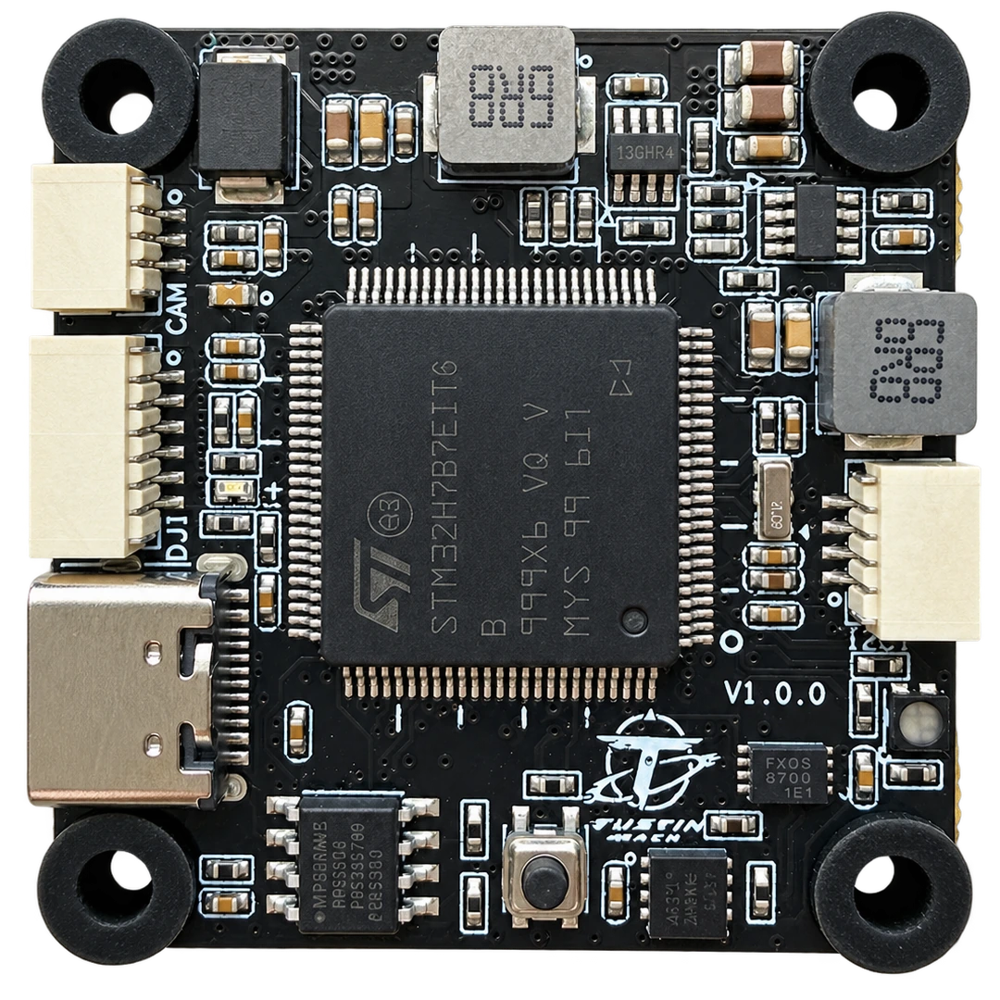
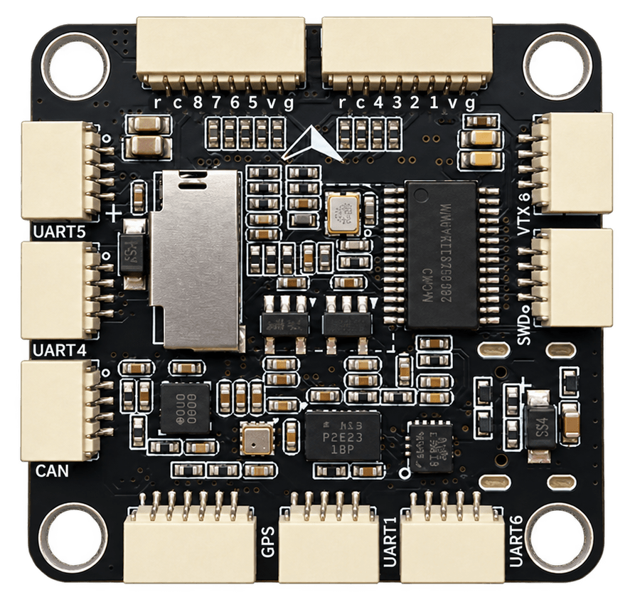

# Tustin MACH

<Badge type="tip" text="main (PX4 v2.0)" />

::: warning
PX4 does not manufacture this (or any) autopilot.
Contact the [manufacturer](https://tustindynamics.com) for hardware support or compliance issues.
:::

The [Tustin MACH](https://tustindynamics.com/products/tustin-mach) is a compact flight controller manufactured by Tustin Dynamics for small UAVs and research platforms.
It uses an STM32H743 processor, two IMUs, eight motor outputs, CAN, and onboard analogue video [OSD](../peripherals/osd.md#atxxxx-analog-osd).



::: info
This flight controller is [manufacturer supported](../flight_controller/autopilot_manufacturer_supported.md).
:::

## Specifications {#specifications}

### Processor {#processor}

- **Main FMU processor:** [STM32H743VIT6](https://www.st.com/en/microcontrollers-microprocessors/stm32h743vi.html) (Arm Cortex-M7, 480MHz, 2MB flash, 1MB RAM)

### Sensors {#sensors}

- **IMU:** [Bosch BMI088](https://www.bosch-sensortec.com/en/products/motion-sensors/imus/bmi088/) (SPI2), [InvenSense ICM-45686](https://www.invensense.tdk.com/en-us/products/6-axis/icm-45686) (SPI3)
- **Barometer:** InvenSense ICP-201xx (I2C2)
- **Magnetometer:** [iSentek IST8310](https://assets.isentek.com/public/documents/datasheet/HFH0n8I7hQ-IST8310_Datasheet_V1.8_Web.pdf) (I2C2)

### Interfaces {#interfaces}

- **PWM outputs:** 8, all supporting [DShot](../peripherals/dshot.md)
- **Serial ports:** 7 (`UART1`, `UART4`, `UART5`, `GPS`, `DJI`, `UART6`, and receive-only ESC telemetry on the ESC headers)
- **I2C buses:** 2 (I2C2 internal; I2C1 external, on `GPS` and `I2C1`)
- **CAN buses:** 1
- **USB:** USB Type-C
- **RC input:** Yes
- **Parameter storage:** FRAM (FM25V02A)
- **SD card:** microSD slot, for flight logging
- **OSD:** AT7456E analogue OSD, and serial [MSP OSD](../peripherals/osd.md#msp-osd) support
- **Remote ID storage:** 24LC64 EEPROM for the unique product identifier, used by the `tustin_mach_rid` build

### Electrical Data {#electrical_data}

- **Input voltage:** 3S–8S on `VBAT` (ESC headers), or 5V from USB
- **Power monitoring:** 1 analogue input (voltage, and current from `CUR` on the ESC headers)

### Mechanical Data {#mechanical_data}

- **Dimensions:** 36 x 36 x 8mm
- **Weight:** 10g
- **Mounting hole spacing:** 30.5 x 30.5mm, 4mm holes

## Where to Buy {#store}

Order from the manufacturer's [Taobao listing](https://item.taobao.com/item.htm?id=1084736032551).
See the [Tustin MACH product page](https://tustindynamics.com/products/tustin-mach) for hardware details and availability.

## Pinouts {#pinouts}

The following connector views and signal order are from the [manufacturer's pinout reference](https://tustindynamics.com/products/tustin-mach).
All signal connectors use SH1.0 (1.0mm pitch); USB uses a Type-C connector.
Read horizontal connectors from left to right and vertical connectors from top to bottom, with the board oriented as shown in the corresponding image.
The order below describes the board connectors, not the view into a mating cable plug.

### Connector Side



| Connector                   | Signal Order                                        |
| --------------------------- | --------------------------------------------------- |
| M5–M8 ESC                   | `RX7`, `CUR`, `M8`, `M7`, `M6`, `M5`, `VBAT`, `GND` |
| M1–M4 ESC                   | `RX7`, `CUR`, `M4`, `M3`, `M2`, `M1`, `VBAT`, `GND` |
| `UART5` (TELEM 3)           | `GND`, `5V`, `TX5`, `RX5`                           |
| `UART4` (TELEM 2)           | `GND`, `5V`, `TX4`, `RX4`                           |
| `CAN`                       | `5V`, `CANH`, `CANL`, `GND`                         |
| `VTX`                       | `TX2`, `VIDEO_OUT`, `GND`, `12V`                    |
| `SWD`                       | `SWCLK`, `SWDIO`, `GND`, `3V3`                      |
| `GPS` (GPS 1: UART3 + I2C1) | `5V`, `TX3`, `RX3`, `SCL`, `SDA`, `GND`             |
| `UART1` (TELEM 1)           | `GND`, `5V`, `TX1`, `RX1`                           |
| `UART6` (RC)                | `GND`, `5V`, `TX6`, `RX6`                           |

### Controller Side


| Connector                | Signal Order                             |
| ------------------------ | ---------------------------------------- |
| `CAM`                    | `VIDEO_IN`, `GND`, `12V`                 |
| `DJI` (GPS 2, DJI O3/O4) | `12V`, `GND`, `TX2`, `RX2`, `GND`, `RX6` |
| `I2C1`                   | `GND`, `SDA`, `SCL`, `5V`                |

### Shared Signals

- Both ESC headers connect to the same UART7 receive signal (`RX7`) and current-sense input (`CUR`).
  They are not independent telemetry or current-sense inputs.
- The `UART6` and `DJI` connectors share USART6 `RX6`.
  Connect only one receiver output to this signal.
- `VTX` `TX2` and the `DJI` serial interface share USART2, which runs [MSP OSD](#osd) by default.
  Reassign that serial port for any other device.
- The `GPS` and `I2C1` connectors share external I2C bus 1.

## Power {#power}

The ESC headers accept a 3–8S battery supply on `VBAT`.
USB can power the flight controller for setup and firmware installation.

::: warning
The power pins are not interchangeable.
`CAM`, `VTX`, and `DJI` provide 12V; general peripheral connectors provide 5V; `SWD` exposes 3.3V.
In particular, PX4's `GPS 2` port is the 12V `DJI` connector: do not connect a 5V-only GNSS module to its power pin.
Check both voltage and signal order before connecting peripherals or an ESC cable.
:::

The default analogue battery settings use a voltage divider of 21.0 and a current scale of 40A/V.
Set the battery cell count and calibrate voltage/current measurement for the connected power hardware using [Power Setup](../config/battery.md).

## Voltage Ratings {#voltage_ratings}

The board can be powered from `VBAT` on the ESC headers (3S–8S) and from USB (5V).

## PWM Outputs {#pwm_outputs}

All eight outputs are driven directly by the FMU and support PWM, [DShot](../peripherals/dshot.md) and [bidirectional DShot](../peripherals/dshot.md#bidirectional-dshot-telemetry).
M1–M4 are set to DShot300 by default ([PWM_MAIN_TIM0](../advanced_config/parameter_reference.md#PWM_MAIN_TIM0)).
They use the following timer groups:

| Outputs | Timer |
| ------- | ----- |
| M1–M4   | TIM1  |
| M5–M6   | TIM3  |
| M7–M8   | TIM4  |

Outputs in the same timer group must use the same protocol and rate.
Assign motor and servo functions in [Actuator Configuration](../config/actuators.md).

## SD Card (Optional) {#sd_card}

The microSD card slot is on the connector side, and is used for flight logging.
Parameters are stored in FRAM, not on the card.
For information about choosing and using an SD card see [SD Cards (Removable Memory)](../getting_started/px4_basic_concepts.md#sd-cards-removable-memory).

## Serial Port Mapping {#serial_port_mapping}

| UART   | Device       | Port               | Connector                         |
| ------ | ------------ | ------------------ | --------------------------------- |
| USART1 | `/dev/ttyS0` | `TELEM 1`          | `UART1`                           |
| USART2 | `/dev/ttyS1` | `GPS 2`            | `DJI`; `TX2` also on `VTX`        |
| USART3 | `/dev/ttyS2` | `GPS 1`            | `GPS`                             |
| UART4  | `/dev/ttyS3` | `TELEM 2`          | `UART4`                           |
| UART5  | `/dev/ttyS4` | `TELEM 3`          | `UART5`                           |
| USART6 | `/dev/ttyS5` | `Radio Controller` | `UART6`; `RX6` also on `DJI`      |
| UART7  | `/dev/ttyS6` | `UART 6`           | ESC headers (`RX7`, receive only) |

The PX4 port `UART 6` is hardware UART7 on this board; it is separate from the `UART6` connector (USART6).
To read [ESC telemetry](../peripherals/dshot.md#esc-telemetry) from `RX7`, set [DSHOT_TEL_CFG](../advanced_config/parameter_reference.md#DSHOT_TEL_CFG) to `UART 6`.
See [Serial Port Configuration](../peripherals/serial_configuration.md) to assign peripherals.

::: info
The bootloader enables no UART, so firmware can only be flashed over USB.
:::

## Assembly {#assembly}

### Radio Control {#radio_control}

A remote control (RC) radio system is required if you want to manually control your vehicle (PX4 does not require a radio system for autonomous flight modes).
You will need to [select a compatible transmitter/receiver](../getting_started/rc_transmitter_receiver.md) and then bind them so that they communicate.

Connect the receiver to the 4-pin `UART6` connector, a full-duplex FMU serial port (USART6, `/dev/ttyS5`).
`RX6` is also on the `DJI` connector, so connect only one receiver.

- No RC protocol is enabled by default.
  Set one of [RC_CRSF_PRT_CFG](../advanced_config/parameter_reference.md#RC_CRSF_PRT_CFG), [RC_DSM_PRT_CFG](../advanced_config/parameter_reference.md#RC_DSM_PRT_CFG), [RC_GHST_PRT_CFG](../advanced_config/parameter_reference.md#RC_GHST_PRT_CFG) or [RC_SBUS_PRT_CFG](../advanced_config/parameter_reference.md#RC_SBUS_PRT_CFG) to `Radio Controller`, then reboot.
  Only one protocol can be active on a port.
- PPM, SUMD and ST24 receivers are not supported by the default firmware, so PWM receivers can't be connected through a PPM encoder either.
- DSM receivers can't be bound from _QGroundControl_ on this board: bind them before connecting.

### GPS & Compass {#gps_compass}

The 6-pin `GPS` connector carries GPS (USART3, `GPS 1`) and I2C (I2C1) for the compass in a GPS module.
It has no safety switch, buzzer or LED signals.

The board has an onboard IST8310 magnetometer.
See [Mounting a GPS/Compass](../assembly/mount_gps_compass.md) for more information.

### Telemetry Radios (Optional) {#telemetry}

The board has three [telemetry](../telemetry/index.md) ports, `UART1` (`TELEM 1`), `UART4` (`TELEM 2`) and `UART5` (`TELEM 3`), each a 4-pin connector without flow control.
A telemetry radio connected to `UART1` needs no further configuration.

### CAN {#can}

The 4-pin `CAN` connector carries one CAN bus for [DroneCAN](../dronecan/index.md) peripherals.

DroneCAN is not enabled by default: set [UAVCAN_ENABLE](../advanced_config/parameter_reference.md#UAVCAN_ENABLE) to enable it.

### OSD {#osd}

The onboard AT7456E [analogue OSD](../peripherals/osd.md#atxxxx-analog-osd) overlays the video from the camera on the `CAM` connector (`VIDEO_IN`), and sends it to the [video transmitter](../vtx/index.md) on the `VTX` connector (`VIDEO_OUT`).
It is enabled for NTSC by default: set [OSD_ATXXXX_CFG](../advanced_config/parameter_reference.md#OSD_ATXXXX_CFG) to `PAL` for a PAL camera.

Connect a DJI O3/O4 air unit to the `DJI` connector.
[MSP OSD](../peripherals/osd.md#msp-osd) runs on its UART (USART2) by default ([MSP_OSD_CONFIG](../advanced_config/parameter_reference.md#MSP_OSD_CONFIG) = `GPS 2`).

### MS4525DO Airspeed Sensor

The `tustin_mach_default` and `tustin_mach_rid` firmware include the MS4525DO differential-pressure driver.
To use an external I2C MS4525DO sensor:

1. Connect the sensor to the external `I2C1` connector (`GND`, `SDA`, `SCL`, `5V`), matching signals rather than cable colours.
   Use a sensor module rated for the connector's 5V supply.
2. Set [SENS_EN_MS4525DO](../advanced_config/parameter_reference.md#SENS_EN_MS4525DO) to `1` ([how to set parameters](../advanced_config/parameters.md)) and reboot.
3. Check that the sensor is running in the [MAVLink Console](../debug/mavlink_shell.md):

   ```sh
   ms4525do status
   listener differential_pressure
   ```

4. Calibrate the sensor by running `commander calibrate airspeed` in the MAVLink Console.

## Building Firmware {#building_firmware}

::: tip
From PX4 v2.0, most users will not need to build this firmware!
It is pre-built and automatically installed by _QGroundControl_ when appropriate hardware is connected.
:::

To [build PX4](../dev_setup/building_px4.md) for this target:

```sh
make tustin_mach_default
```

The firmware is written to `build/tustin_mach_default/tustin_mach_default.px4`.
To install a locally built image, select the custom firmware option in [Loading Firmware](../config/firmware.md) and load that file.

The Remote ID variant, which uses the onboard 24LC64 EEPROM for the product identifier, is built with:

```sh
make tustin_mach_rid
```

The in-tree bootloader target is:

```sh
make tustin_mach_bootloader
```

## Debug Port {#debug_port}

The 4-pin `SWD` connector is the FMU [SWD interface](../debug/swd_debug.md) (`SWCLK`, `SWDIO`, `GND`, `3V3`).
It isn't a Pixhawk debug connector.

The firmware has no [PX4 System Console](../debug/system_console.md) UART, so use the [MAVLink Shell](../debug/mavlink_shell.md) over USB for a shell.

## Further Information {#further_information}

- [Tustin MACH product page](https://tustindynamics.com/products/tustin-mach) (manufacturer)
