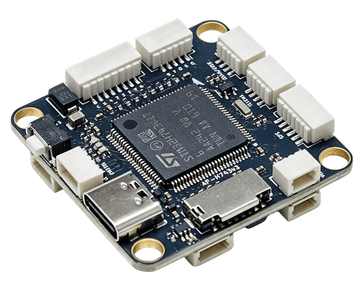
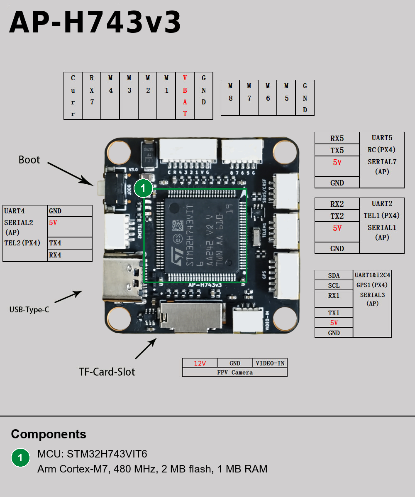
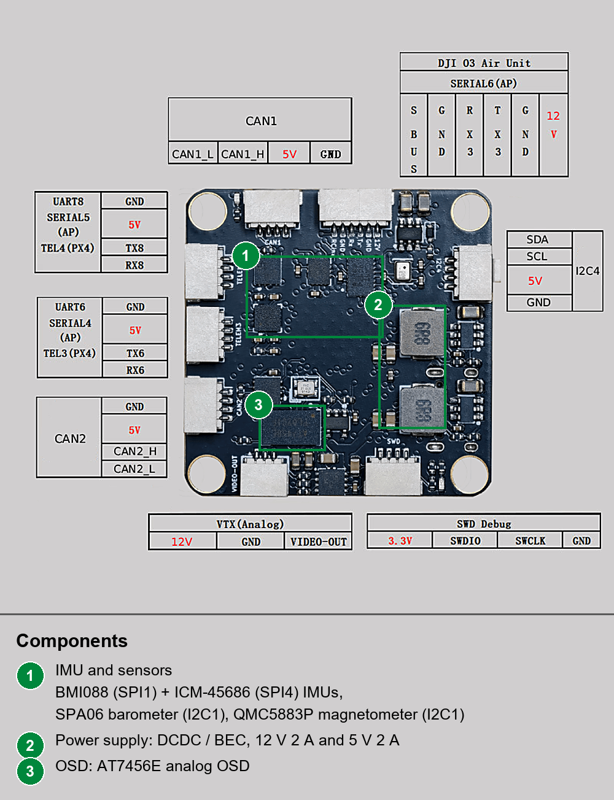
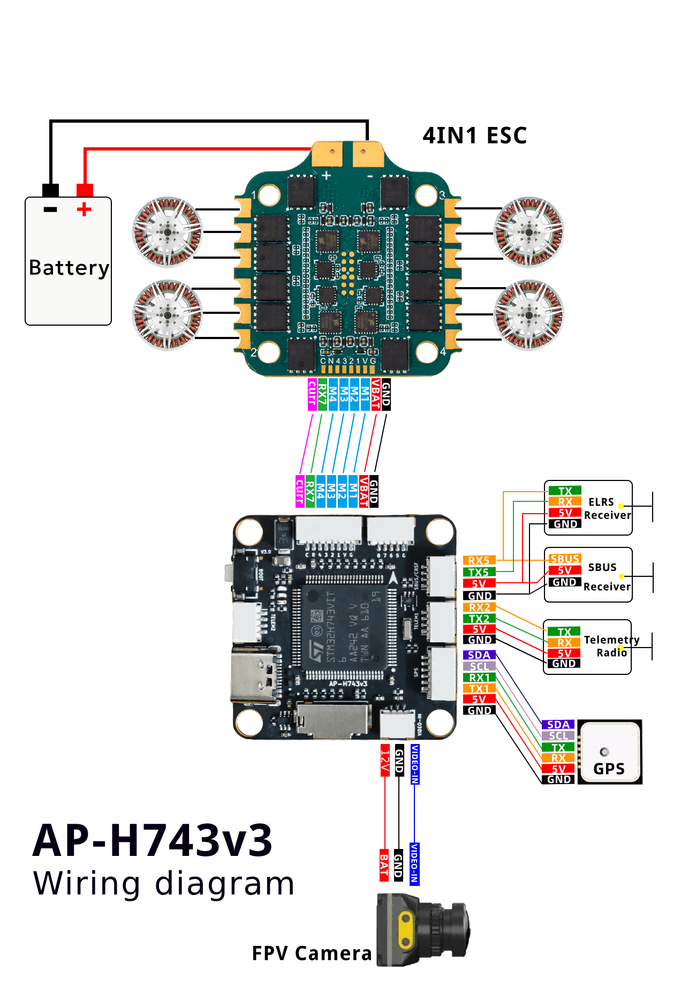
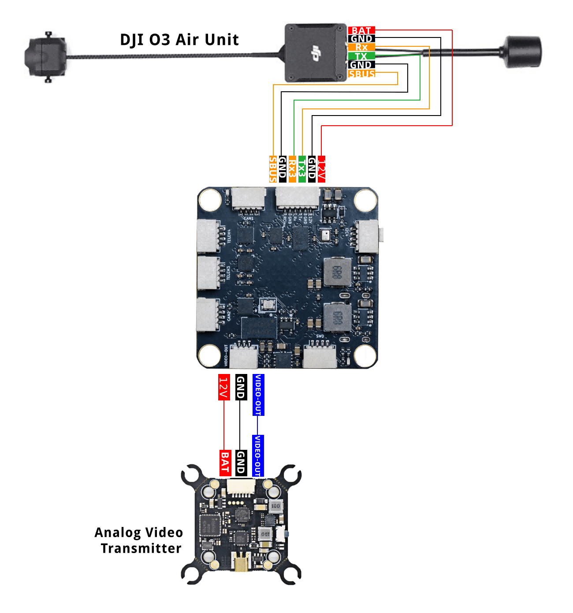

# X-MAV AP-H743v3

<Badge type="tip" text="main (PX4 v2.0)" />

::: warning
PX4 does not manufacture this (or any) autopilot.
Contact the [manufacturer](http://www.x-mav.cn/) for hardware support or compliance issues.
:::

The AP-H743v3 is a flight controller designed and manufactured by [X-MAV](http://www.x-mav.cn/).



::: info
This flight controller is [manufacturer supported](../flight_controller/autopilot_manufacturer_supported.md).
:::

## Specifications {#specifications}

### Processor {#processor}

- **Main FMU processor:** STM32H743VI (Arm Cortex-M7 at 480MHz, 2MB flash, 1MB RAM)

### Sensors {#sensors}

- **IMU:** BMI088 (SPI1), ICM-45686 (SPI4)
- **Barometer:** SPA06 (I2C1)
- **Magnetometer:** QMC5883P (I2C1)

### Interfaces {#interfaces}

- **PWM outputs:** 8
- **Serial ports:** 8
- **I2C buses:** 1 external (I2C4)
- **CAN buses:** 2
- **USB:** USB Type-C
- **SD card:** microSD slot
- **OSD:** AT7456E analog OSD
- **Debug:** SWD

### Electrical Data {#electrical_data}

- **Input voltage:** 2-8S (6-35V)
- **BEC outputs:** 12V 2A, 5V 2A

### Mechanical Data {#mechanical_data}

- **Mounting holes:** 30.5 x 30.5mm, Φ4mm
- **Dimensions:** 36 x 36 x 8mm
- **Weight:** 9g

## Where to Buy {#store}

**Purchase link**: [X-MAV Taobao Store](https://shop108812501.taobao.com/) (available in September 2026)

## Pinouts {#pinouts}

::: info
All the connectors used on the board are SH1.0.
:::





## Power {#power}

The board is powered from the `VBAT` and `GND` pins of the ESC connector.
It measures the battery voltage on `VBAT`, and reads an external current sensor on the `Curr` pin.
The voltage sensor can handle up to 8S LiPo batteries.

The default battery parameters are:

- [BAT1_A_PER_V](../advanced_config/parameter_reference.md#BAT1_A_PER_V): 17
- [BAT1_N_CELLS](../advanced_config/parameter_reference.md#BAT1_N_CELLS): 4
- [BAT1_V_CHARGED](../advanced_config/parameter_reference.md#BAT1_V_CHARGED): 4.2
- [BAT1_V_DIV](../advanced_config/parameter_reference.md#BAT1_V_DIV): 12.11
- [BAT1_V_EMPTY](../advanced_config/parameter_reference.md#BAT1_V_EMPTY): 3.2

::: info
These defaults are starting values.
Set `BAT1_A_PER_V` to match your current sensor.
See [Battery Estimation Tuning](../config/battery.md) for more information.
:::

## PWM Outputs {#pwm_outputs}

The AP-H743v3 supports up to 8 PWM outputs.

All outputs support [DShot](../peripherals/dshot.md) and [bidirectional DShot](../peripherals/dshot.md#bidirectional-dshot-telemetry).
Outputs 1-4 default to DShot300.

Outputs are grouped, and all outputs within the same group must use the same output protocol and rate:

- Group 1: outputs 1-4 (Timer1)
- Group 2: outputs 5-6 (Timer3)
- Group 3: outputs 7-8 (Timer2)

## SD Card (Optional) {#sd_card}

The AP-H743v3 has a microSD card slot.
For information about choosing and using an SD card see [SD Cards (Removable Memory)](../getting_started/px4_basic_concepts.md#sd-cards-removable-memory).

## Serial Port Mapping {#serial_port_mapping}

| UART   | Device     | Port                         |
| ------ | ---------- | ---------------------------- |
| USART1 | /dev/ttyS0 | `GPS`                        |
| USART2 | /dev/ttyS1 | `TELEM1`                     |
| USART3 | /dev/ttyS2 | DJI O3 Air Unit (`EXT2`)     |
| UART4  | /dev/ttyS3 | `TELEM2`                     |
| UART5  | /dev/ttyS4 | `SBUS/CRSF`                  |
| USART6 | /dev/ttyS5 | `TELEM3`                     |
| UART7  | /dev/ttyS6 | ESC telemetry (`RX7` on ESC) |
| UART8  | /dev/ttyS7 | `TELEM4`                     |

## Assembly {#assembly}

### Wiring Diagrams {#wiring_diagram}




### Radio Control {#radio_control}

A [Radio Control (RC) system](../getting_started/rc_transmitter_receiver.md) is required if you want to manually control your vehicle (PX4 does not require a radio system for autonomous flight modes).

The `SBUS/CRSF` port is connected to the FMU (UART5).
You can attach a receiver that uses DSM, S.BUS, CRSF, GHST, or another protocol listed in [Radio Control modules](../modules/modules_driver_radio_control.md).
PX4 detects the protocol automatically ([RC_INPUT_PROTO](../advanced_config/parameter_reference.md#RC_INPUT_PROTO)).

### GPS & Compass {#gps_compass}

The `GPS` port carries GPS (USART1) and I2C (I2C4), for a [GPS/compass module](../gps_compass/index.md).
The board also has an onboard QMC5883P magnetometer.
See [Mounting a GPS/Compass](../assembly/mount_gps_compass.md) for more information.

### Telemetry Radios (Optional) {#telemetry}

The board has four [telemetry](../telemetry/index.md) ports, `TELEM1` to `TELEM4`.
A telemetry radio connected to `TELEM1` needs no further configuration.

### CAN {#can}

The board has two CAN ports, `CAN1` and `CAN2`, for [DroneCAN](../dronecan/index.md) peripherals.
DroneCAN is not enabled by default: set [UAVCAN_ENABLE](../advanced_config/parameter_reference.md#UAVCAN_ENABLE) to enable it.

### OSD {#osd}

The onboard AT7456E [analog OSD](../peripherals/osd.md#atxxxx-analog-osd) overlays PX4 status on the video from the camera on `VIDEO-IN`, and outputs it on `VIDEO-OUT` to an analog VTX.
It is disabled by default: set [OSD_ATXXXX_CFG](../advanced_config/parameter_reference.md#OSD_ATXXXX_CFG) to `NTSC` or `PAL` and reboot.

For an HD system, connect the air unit to the DJI O3 Air Unit connector and configure [MSP OSD](../peripherals/osd.md#msp-osd) on `EXT2`.

## Building Firmware {#building_firmware}

To [build PX4](../dev_setup/building_px4.md) for this target:

```sh
make x-mav_ap-h743v3_default
```

## Installing PX4 Firmware {#installing_px4_firmware}

The firmware can be installed in any of the normal ways:

- Build and upload the source

  ```sh
  make x-mav_ap-h743v3_default upload
  ```

- [Load the firmware](../config/firmware.md) using _QGroundControl_.
  You can use either pre-built firmware or your own custom firmware.

## Supported Platforms / Airframes {#supported_platforms_airframes}

Any multicopter / airplane / rover or boat that can be controlled with normal RC servos or Futaba S-Bus servos.
The complete set of supported configurations can be seen in the [Airframes Reference](../airframes/airframe_reference.md).

The default airframe is Generic Quadcopter ([SYS_AUTOSTART](../advanced_config/parameter_reference.md#SYS_AUTOSTART) `4001`).

## Debug Port {#debug_port}

The board has no serial [System Console](../debug/system_console.md).

### SWD {#swd}

The [SWD](../debug/swd_debug.md) port is a 4-pin connector on the bottom side of the board (see [Pinouts](#pinouts)).
Pin definitions (from left to right):

| Pin | Signal     |
| --- | ---------- |
| 1   | VCC (3.3V) |
| 2   | SWDIO      |
| 3   | SWCLK      |
| 4   | GND        |
