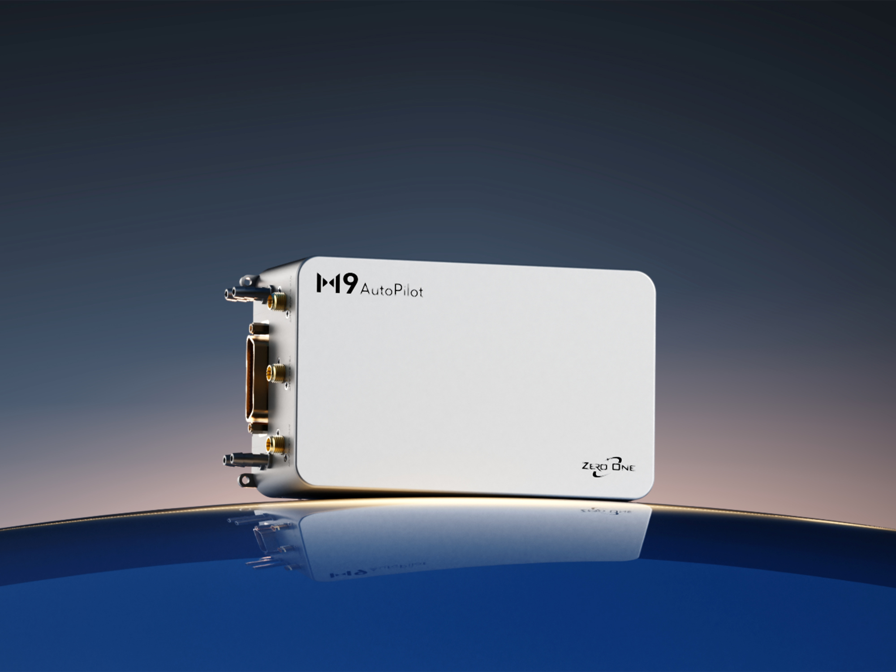
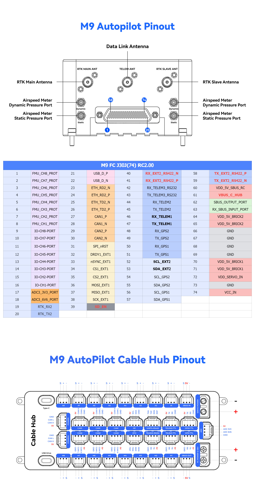

# ZeroOne M9

<Badge type="tip" text="PX4 v1.18" />

::: warning
PX4 does not manufacture this (or any) autopilot.
Contact [ZeroOne](https://01aero.com/about_us/) for hardware support and compliance questions.
:::

The ZeroOne M9 is an industrial flight controller based on the FMUv6X architecture.
It integrates three IMUs, dual-antenna RTK GNSS, two airspeed sensors, and a 900 MHz telemetry radio.
The Cable Hub connects to the flight controller through a 74-pin J30J connector and provides labelled ports for power, peripherals, and actuators.



::: info
This flight controller is [manufacturer supported](../flight_controller/autopilot_manufacturer_supported.md).
:::

## Specifications

### Processors

- STM32H753IIK6 flight management unit (FMU), with an Arm Cortex-M7 at 480 MHz, 2 MB flash, and 1 MB RAM.
- STM32F103 I/O processor running PX4IO.

### Sensors

| Function     | Device                                        | Bus           |
| ------------ | --------------------------------------------- | ------------- |
| IMU          | TDK IIM-42653                                 | SPI1          |
| IMU          | Analog Devices ADIS16507                      | SPI3          |
| IMU          | Murata SCH16T-K10 with FPGA FIFO              | SPI4          |
| Magnetometer | RM3100                                        | SPI4          |
| Barometer    | InvenSense ICP20100 (first hardware revision) | I2C           |
| Airspeed     | Two AUAV-L30D differential pressure sensors   | I2C2 and CAN1 |
| GNSS         | Integrated dual-antenna RTK receiver          | CAN1          |

The flight controller has an IMU heater and vibration isolation for the SCH16T-K10 and ADIS16507.
ZeroOne rates the airspeed sensors for 0–122.2 m/s (0–439.9 km/h).

### Interfaces

- Eight `MAIN` and eight `AUX` actuator outputs on the Cable Hub.
- Dedicated `SBUS-IN` and `SBUS-OUT` connectors.
- Three telemetry ports, two serial GNSS ports, and a separate RS-422 UART port.
- Two CAN buses, Ethernet, I2C, and two analogue inputs.
- USB Type-C for the flight controller and a separate `USB Drive` port for the log card reader.
- microSD logging and SPI FRAM parameter storage.

### Mechanical Data

| Component         | Dimensions         | Weight |
| ----------------- | ------------------ | ------ |
| Flight controller | 128 × 78 × 46 mm   | 585 g  |
| Cable Hub         | 133 × 53.5 × 22 mm | 238 g  |

The specified operating temperature range is −20 °C to 85 °C.

## Where to Buy {#store}

For manufacturer specifications and ordering enquiries, see the [ZeroOne M9 product page](https://01aero.com/product/m9/).

## Pinouts

The diagram shows the 74-pin J30J connector and the Cable Hub connectors.
Serial TX and RX labels are relative to the flight controller.
The Cable Hub uses JST JWPF connectors (`04R-JWPF-VSLE-S`) for its 4-pin ports.
For dimensioned drawings and an example avionics wiring diagram, see the [ZeroOne M9 hardware manual (Chinese)](https://docs.01aero.cn/docs/fGAPoT6G).



### Hardware Overview

```text
Cable Hub power inputs        Destination
  FC POWER           -------> Main flight controller power input
  POWER1 or POWER2   -------> 5 V flight controller inputs
  SERVO POWER        -------> Servo rail on A1–A8 and M1–M8

STM32H753 flight management unit
  ├─ SPI: three IMUs and RM3100 magnetometer
  ├─ I2C: barometers and one airspeed sensor
  ├─ CAN1: RTK GNSS receiver and the second airspeed sensor
  ├─ UART7: integrated telemetry radio and TELEM1-TTL
  ├─ FMU actuator outputs: A1–A8 (AUX)
  └─ USART6: STM32F103 (PX4IO) → M1–M8 (MAIN)
```

## Power

| Cable Hub Connector  | Purpose                                                  | Input Voltage       |
| -------------------- | -------------------------------------------------------- | ------------------- |
| `POWER1` or `POWER2` | Regulated flight controller supply with CAN              | 5.0–5.3 V           |
| `FC POWER`           | Main flight controller supply through the XT60 connector | 16–36 V recommended |
| `SERVO POWER`        | Separate supply for the servo rail                       | Up to 9.9 V         |

The pinout labels `FC POWER` as 12–36 V.
ZeroOne specifies 16 V as the minimum for normal operation.
Use `FC POWER` when using the integrated telemetry radio.
Use a servo supply voltage within the rating of the connected actuators.

See [Battery Estimation Tuning](../config/battery.md#basic_settings) for battery settings in PX4.

## PWM Outputs {#pwm_outputs}

The Cable Hub labels the eight PX4IO outputs `M1`–`M8` (`MAIN 1`–`MAIN 8` in PX4).
The eight FMU outputs are labelled `A1`–`A8` (`AUX 1`–`AUX 8`).
To assign functions to these outputs, see [Output Assignment and Configuration](../config/actuators.md#output-assignment-and-configuration).

| Cable Hub Outputs | Controller | FMU Timer | Supported Protocols |
| ----------------- | ---------- | --------- | ------------------- |
| `A1`–`A4`         | FMU        | TIM5      | PWM, DShot          |
| `A5`–`A6`         | FMU        | TIM4      | PWM, DShot          |
| `A7`–`A8`         | FMU        | TIM12     | PWM                 |
| `M1`–`M8`         | PX4IO      |           | PWM                 |

Outputs in the same FMU timer group must use the same protocol and rate.
See [DShot Configuration](../peripherals/dshot.md#configuration) for setup instructions.

Set `PWM_VOLT_SEL` to `0` for 3.3 V (default) or `1` for 5 V in the [QGroundControl parameter editor](../advanced_config/parameters.md#changing), then reboot.
The `SERVO POWER` input supplies the servo rail independently of this signal-level setting.

## Serial Port Mapping

| Interface | PX4 Device     | Cable Hub Label or Function                     |
| --------- | -------------- | ----------------------------------------------- |
| USB       | `/dev/ttyACM0` | `Type-C`                                        |
| USART1    | `/dev/ttyS0`   | `GPS1-TTL`                                      |
| USART2    | `/dev/ttyS1`   | `TELEM3-RS232`                                  |
| USART3    | `/dev/ttyS2`   | FMU debug console                               |
| UART4     | `/dev/ttyS3`   | `UART4-RS422` (`EXT2` in PX4)                   |
| UART5     | `/dev/ttyS4`   | `TELEM2-TTL`                                    |
| USART6    | `/dev/ttyS5`   | Internal PX4IO link                             |
| UART7     | `/dev/ttyS6`   | `TELEM1-TTL` and the integrated telemetry radio |
| UART8     | `/dev/ttyS7`   | `GPS2-TTL`                                      |

Match the peripheral's electrical interface to the port type (TTL, RS-232, or RS-422).
Use `TELEM2-TTL` for a separate TTL telemetry device while the integrated radio is in use.
For PX4 port assignments, see [How to Configure a Port](../peripherals/serial_configuration.md#how-to-configure-a-port).

## Connecting Peripherals

### Radio Control

Connect an S.BUS receiver to the Cable Hub's `SBUS-IN` connector.
The dedicated `SBUS-OUT` connector is connected to the I/O processor.
For receiver binding and radio calibration, see [Radio Control (RC) Setup](../config/radio.md).

### CAN and GNSS

The Cable Hub has three connectors for each CAN bus, labelled `CAN1` and `CAN2`.
The `POWER1` and `POWER2` connectors also carry CAN signals.
Attach the two GNSS antennas to `RTK MAIN ANT` and `RTK SLAVE ANT`.
To receive data from the integrated RTK receiver, enable [DroneCAN](../dronecan/index.md#px4-configuration) and the [`UAVCAN_SUB_GPS`](../advanced_config/parameter_reference.md#UAVCAN_SUB_GPS) subscription.
Connect an external serial GNSS receiver to `GPS1-TTL` or `GPS2-TTL`.

### Airspeed

Match each sensor's pressure lines to the fittings marked `Dynamic` and `Static` on the flight controller.
PX4 starts the onboard I2C airspeed driver during boot.
To receive data from the second airspeed sensor, enable the DroneCAN airspeed subscription [`UAVCAN_SUB_ASPD`](../advanced_config/parameter_reference.md#UAVCAN_SUB_ASPD).
Calibrate the sensors in _QGroundControl_ using the [Airspeed Calibration](../config/airspeed.md#performing-the-calibration) procedure.

### Ethernet

The Cable Hub's `ETH` connector uses the flight controller's LAN8742A Ethernet PHY.
For setup, see [PX4 Ethernet Network Setup](../advanced_config/ethernet_setup.md#px4-ethernet-network-setup) and [MAVLink configuration](../advanced_config/ethernet_setup.md#px4-mavlink-serial-port-configuration).

### Log Download

The Cable Hub's `USB Drive` connector exposes the log card as a USB storage device.
Use the separate `Type-C` connector to connect to the flight controller or load firmware.

::: warning
Disconnect the other power inputs before connecting the `USB Drive` port.
:::

## Building Firmware

Set up the build environment using the [NuttX build instructions](../dev_setup/building_px4.md#building-for-nuttx).
Build the M9 firmware from the PX4-Autopilot checkout.

```sh
make zeroone_m9_default
```

With the M9 PX4 bootloader installed, connect to the Cable Hub's `Type-C` port and select `build/zeroone_m9_default/zeroone_m9_default.px4` in the _QGroundControl_ [custom firmware installer](../config/firmware.md#custom).

### Bootloader

Build the M9 PX4 bootloader with the board-specific target.

```sh
make zeroone_m9_bootloader
```

The PX4 firmware and bootloader use board ID `5610` and USB VID/PID `0x3643:0x15EA`.
To install the bootloader using `build/zeroone_m9_bootloader/zeroone_m9_bootloader.elf`, follow [Debug Probe Bootloader Update](../advanced_config/bootloader_update.md#debug-probe-bootloader-update).
