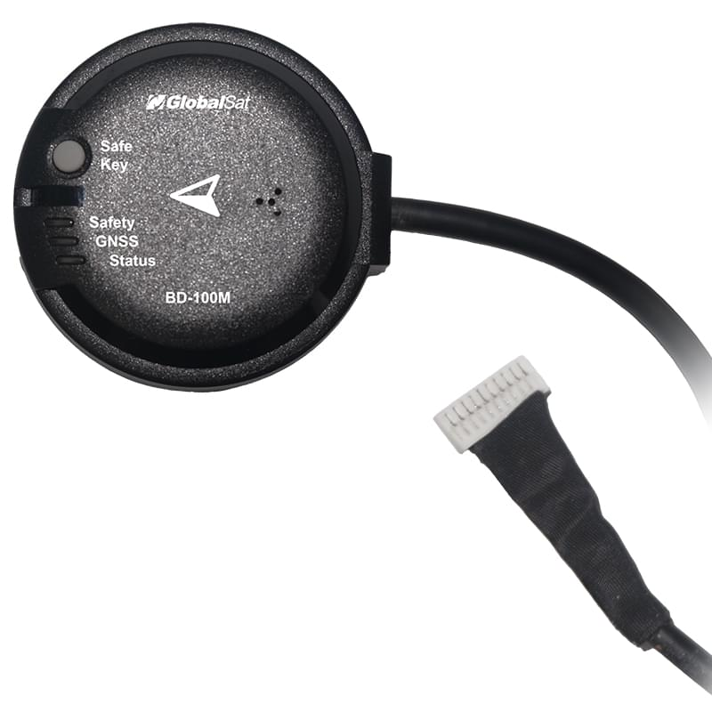
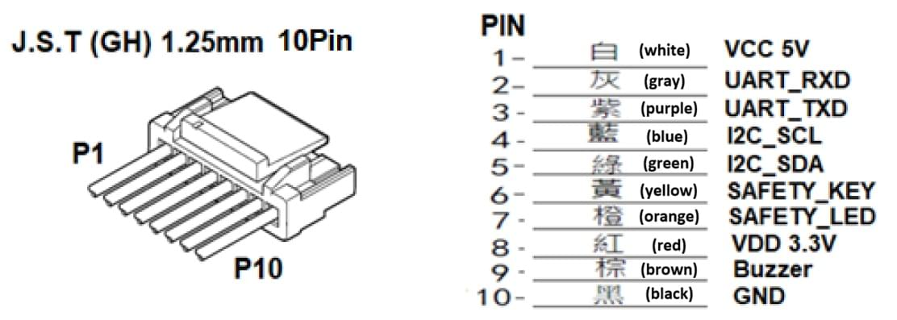

# GlobalSat BD-100M GNSS

The [GlobalSat BD-100M](https://www.globalsat.com.tw/en/product-285501/Dual-Band-GNSS-Receiver-for-Drone-and-Autopilot-BD-100M.html) is a compact, L1/L5 dual-band GNSS receiver that connects to the flight controller using UART.
It includes a compass, barometer, safety switch, buzzer and LED.

Typical applications include:

- Drone and autopilot location
- Flight-controller sensor integration
- Robotics and outdoor autonomous platforms

## Specifications {#specifications}

- **Constellations:** Multi-constellation, multi-frequency all-in-view tracking; SBAS ranging (WAAS, EGNOS, MSAS and GAGAN)
- **Bands:** L1 + L5
- **Protocol:** NMEA 0183 V3.01 / V4.1 (GGA, GSA, GSV, RMC, VTG, GLL, ZDA, GRS, GST); AIROHA PAIR proprietary commands (not supported on PX4)
- **Sensitivity:** High tracking sensitivity for operation in weak-signal environments; fast time to first fix (TTFF) under low-signal conditions
- **Compass:** Built-in
- **Barometer:** Built-in (not used by PX4)
- **Other:** Safety switch, buzzer and tri-colour LED (Pixhawk-compatible status indicators); backup power for hot-start performance
- **Antenna:** Integrated dual-band patch antenna
- **Interface:** UART (2.8 V TTL) on a 10-pin JST-GH connector
- **Input voltage:** 5 V
- **Power:** Low power consumption for UAV applications
- **Dimensions:** 47.0 mm diameter × 17.0 mm height (±0.2 mm)
- **Enclosure:** Water-resistant, with anti-slip bottom design
- **Made in:** Taiwan

## Where to Buy {#store}

Order this module from:

- [GlobalSat BD-100M](https://www.amazon.com/dp/B0HKZZRKZ9) GPS/GNSS

## Hardware Setup {#hardware_setup}

### Mounting {#mounting}

The module should be mounted with its arrow facing the front of the vehicle, as far away from the flight controller and other electronics as possible.
For more information, see [Mounting a Compass](../assembly/mount_gps_compass.md).

### Pinouts {#pinouts}

### Wiring {#wiring}

The GlobalSat BD-100M uses UART output via a JST-GH-10P connector.
Connect it to the 10-pin `GPS1` port (the "Full GPS + Safety Switch Port") on flight controllers that use the [Pixhawk Connector Standard](https://github.com/pixhawk/Pixhawk-Standards/blob/master/DS-009%20Pixhawk%20Connector%20Standard.pdf).
See [Pinouts](#pinouts) for the pin assignments.
The receiver is powered with 5 V from the port (pin 1); its UART signals are 2.8 V TTL and its I2C signals 3.3 V.

## PX4 Configuration {#px4_configuration}

PX4 communicates with this receiver using the NMEA protocol (this is not included in firmware for boards with constrained flash).
To enable, set [GPS_1_PROTOCOL](../advanced_config/parameter_reference.md#GPS_1_PROTOCOL) to `6` (`NMEA (generic)`) and reboot the vehicle.

To use the receiver as a secondary GPS, set [GPS_2_CONFIG](../advanced_config/parameter_reference.md#GPS_2_CONFIG) to the port it is connected to, and [GPS_2_PROTOCOL](../advanced_config/parameter_reference.md#GPS_2_PROTOCOL) to `6`, and reboot.
See [Secondary GPS Configuration (UART)](../gps_compass/index.md#secondary-gps-configuration-uart) for more information.

Set the position of the antenna relative to the vehicle's centre of gravity using [SENS_GNSS0_OFFX](../advanced_config/parameter_reference.md#SENS_GNSS0_OFFX), [SENS_GNSS0_OFFY](../advanced_config/parameter_reference.md#SENS_GNSS0_OFFY) and [SENS_GNSS0_OFFZ](../advanced_config/parameter_reference.md#SENS_GNSS0_OFFZ).

## LED Meanings {#led_meanings}

| LED colour | Status indicator  | Description                                                                                                                        |
| ---------- | ----------------- | ---------------------------------------------------------------------------------------------------------------------------------- |
| Red        | Safety LED        | Safety switch LED indicator. Drives the internal red LED in coordination with safety switch logic.                                 |
| Blue       | GNSS LED          | GNSS positioning status indicator.                                                                                                 |
| R, G, B    | System Status LED | Used to indicate various UAV flight and system statuses. Controlled via I2C (address 0x54) using the integrated IS31FL3195 driver. |

## Testing {#testing}

In the [QGroundControl MAVLink Console](../debug/mavlink_shell.md#qgroundcontrol-mavlink-console), run `gps status` to see the protocol, fix type and number of satellites, or `listener sensor_gnss` to see the published data.

## Further Information {#further_information}

- [GlobalSat BD-100M](https://www.globalsat.com.tw/en/product-285501/Dual-Band-GNSS-Receiver-for-Drone-and-Autopilot-BD-100M.html) (product page)
- [BD-100M/BD-100K User Manual](https://www.globalsat.com.tw/files/BD-100MK_user_manual_V1.0_20260910.pdf)
