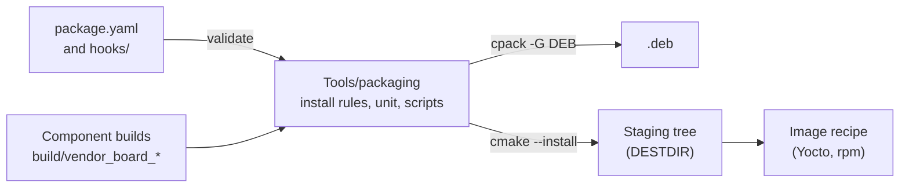
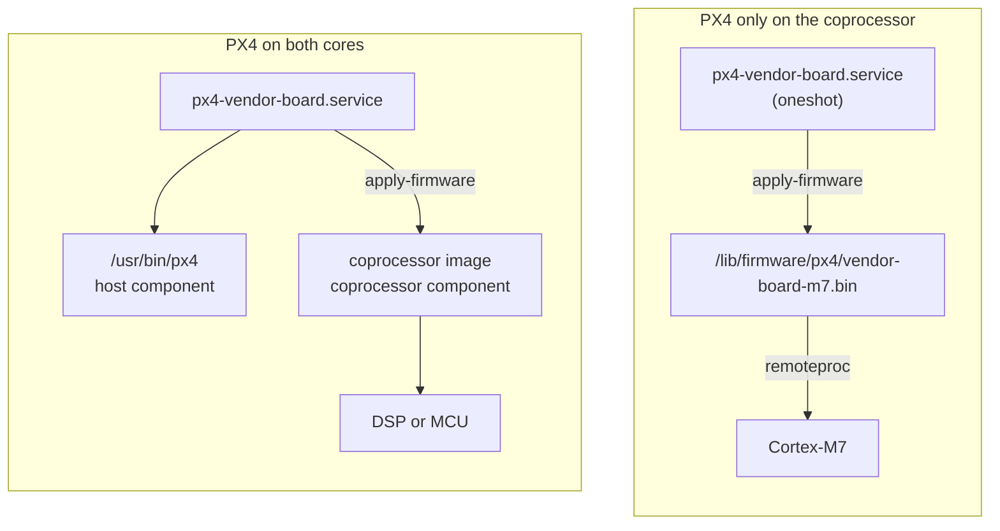

# Board Packaging

Flight controllers are moving onto compute modules: an application processor running Linux next to a real-time core or a DSP, with PX4 split across them.
Some boards run PX4 modules on the Linux side as well as on the coprocessor, others run everything on the coprocessor and only use Linux to deliver it.
In both cases Linux is where PX4 is installed, updated and started, and a _board package_ is how it gets there.

This page is for board vendors.
It explains how to describe the package for a board, how to build and inspect it, and how it is shipped.
What happens on the target when the package is installed and started is covered in [Board Packaging Hooks](board_packaging_hooks.md).

::: info
Boards that still carry a `cmake/package.cmake` override build as before, with a deprecation notice.
See [Legacy CPack Overrides](#legacy-cpack-overrides) for how to migrate.
:::

## Overview

A board describes its package in `boards/<vendor>/<board>/package.yaml`, the _package descriptor_.
It names the build targets that go into the package (the _components_), where their outputs land on the target filesystem, how a coprocessor image reaches its core, and what the systemd unit looks like.
`make <vendor>_<board>_deb` builds every component and packages them through one generic CMake project in [Tools/packaging](https://github.com/PX4/PX4-Autopilot/tree/main/Tools/packaging).



The target system only ever sees three things: the files the package installs, the hooks that run around installation and start-up, and the systemd unit.
Those three are the contract, and they are the same whether the files arrive in a `.deb`, through a Yocto recipe or in another package format.
PX4 does not assume a particular distribution either.
The runtime pieces are POSIX `sh` scripts and a systemd unit, and every installation path can be changed in the descriptor.

## Two Board Shapes

The descriptor covers both shapes of board that exist today.



- PX4 on both cores: a _host_ component is the PX4 binary that runs on Linux, and one or more _coprocessor_ components are images for other cores.
  The unit starts the host binary.
  The coprocessor image is placed where its loader expects it, or applied by a hook.
- PX4 only on the coprocessor: there is no host component.
  The package carries the image and is built as `Architecture: all`, because nothing in it runs on the Linux CPU.
  The unit is a `oneshot` that applies the firmware and runs the hooks.

## Components

Every component is a build target of the same board: `<vendor>_<board>_<label>`, with a `<label>.px4board` file next to the descriptor.

A host component must be a POSIX target (`CONFIG_PLATFORM_POSIX=y`).
Its build provides the `px4` binary, the `px4-<module>` symlinks, the ROMFS under `etc/` and the component metadata (`parameters.json.xz`, `actuators.json.xz`, `component_general.json.xz` and `events/all_events.json.xz`).
The share directory from the descriptor is compiled into the binary as `PX4_INSTALL_PREFIX`, so `px4` started without arguments finds its ROMFS there.
A descriptor has at most one host component.

A coprocessor component is any target whose build produces a file for another core: a NuttX image, a Hexagon DSP library, and later a Zephyr image.
The descriptor names the file (`artifact`, relative to `build/<target>/`), where it is installed (`install`, an absolute path) and how it reaches its core (`apply`):

| `apply`      | What happens when the unit starts                                                                                                                                                                                                         |
| ------------ | ----------------------------------------------------------------------------------------------------------------------------------------------------------------------------------------------------------------------------------------- |
| `none`       | Nothing. The coprocessor runtime loads the image from `install` by itself, for example a DSP loader that watches a fixed directory.                                                                                                       |
| `remoteproc` | The core is restarted on the installed image through the Linux remoteproc framework. `install` must be under `layout.firmware_dir`, and `remoteproc` names the device (`remoteproc0`) or the value of its `name` attribute (`imx95-cm7`). |
| `hook`       | The board's own `hooks/apply-firmware.d` scripts do it, for a vendor loader or an update agent.                                                                                                                                           |

Staging an image into an MCUboot slot is planned.
Until the staging command exists the descriptor rejects it, so the failure happens at build time rather than on a vehicle.

## Writing the Descriptor

A board that runs PX4 on the application processor and on a DSP:

```yaml
# boards/acme/widget/package.yaml
package:
  description: PX4 Autopilot for the ACME Widget
  maintainer: ACME Robotics <support@acme.example>
  formats:
    deb:
      depends:
        - acme-dsp-loader (>= 1.2)

service:
  exec_start: /usr/bin/px4 -d -w /var/lib/px4 -s /etc/px4/px4.config /usr/share/px4/etc
  after: [acme-dspd.service]
  requires: [acme-dspd.service]

components:
  - name: apps
    role: host
    target: acme_widget_default
  - name: dsp
    role: coprocessor
    target: acme_widget_dsp
    artifact: platforms/qurt/libpx4.so
    install: /usr/lib/rfsa/adsp/libpx4.so
    apply: none

files:
  - source: target/px4.config
    destination: /etc/px4/px4.config
```

With `default.px4board` cross compiled for `aarch64-linux-gnu` and `CONFIG_BOARD_ROOT_PATH="/var/lib/px4"`, this produces `px4-acme-widget_<version>_arm64.deb`.
The package name, the unit name and the paths all come from their defaults: binaries in `/usr/bin`, ROMFS and metadata under `/usr/share/px4`, writable data in `/var/lib/px4`.

A board that runs PX4 only on a Cortex-M7 behind Linux:

```yaml
# boards/acme/widget/package.yaml
package:
  description: PX4 Autopilot for the ACME Widget M7 core
  maintainer: ACME Robotics <support@acme.example>

components:
  - name: m7
    role: coprocessor
    target: acme_widget_m7
    artifact: acme_widget_m7.bin
    install: /lib/firmware/px4/acme-widget-m7.bin
    apply: remoteproc
    remoteproc: imx95-cm7
```

Nothing from PX4 runs on Linux here, so the package is `px4-acme-widget_<version>_all.deb`, the unit is a `oneshot`, and starting it restarts the `imx95-cm7` remoteproc on the installed image.

The descriptor is validated against [validation/package_schema.yaml](https://github.com/PX4/PX4-Autopilot/blob/main/validation/package_schema.yaml) plus the rules below.

### `package`

| Field          | Required | Default                | Meaning                                                                                                                                                                                                                                 |
| -------------- | -------- | ---------------------- | --------------------------------------------------------------------------------------------------------------------------------------------------------------------------------------------------------------------------------------- |
| `name`         | no       | `px4-<vendor>-<board>` | Package name: lower case letters, digits, `+`, `.` and `-`.                                                                                                                                                                             |
| `description`  | yes      |                        | One line. Also the unit `Description`.                                                                                                                                                                                                  |
| `maintainer`   | yes      |                        | `Name <email>`.                                                                                                                                                                                                                         |
| `architecture` | no       | derived                | `all`, `amd64`, `arm64` or `armhf`. Derived from the host component's `CONFIG_BOARD_TOOLCHAIN` (`aarch64-linux-gnu` gives `arm64`, `arm-linux-gnueabihf` gives `armhf`, `native` gives the build host), `all` without a host component. |
| `section`      | no       | `misc`                 | Debian section.                                                                                                                                                                                                                         |
| `formats.deb`  | no       |                        | `depends`, `recommends`, `conflicts`, `replaces` and `provides`: lists of Debian relations such as `acme-dsp-loader (>= 1.2)`.                                                                                                          |
| `formats.rpm`  | no       |                        | `requires`, `conflicts`, `obsoletes` and `provides`. Reserved for an rpm backend and validated for shape only.                                                                                                                          |

Dependencies are listed by hand because a cross compiled package cannot run `dpkg-shlibdeps`.

### `layout`

Every path is absolute.
Boards with an existing install base override these here rather than in CMake.

| Field          | Default                                                                 | Holds                                                                             |
| -------------- | ----------------------------------------------------------------------- | --------------------------------------------------------------------------------- |
| `bin_dir`      | `/usr/bin`                                                              | `px4`, the `px4-<module>` symlinks, `px4-alias.sh`, vendor scripts.               |
| `share_dir`    | `/usr/share/px4`                                                        | ROMFS (`etc/`), component metadata (`etc/extras/`), `package.json`.               |
| `data_dir`     | `CONFIG_BOARD_ROOT_PATH` of the host target, `/var/lib/px4` without one | Writable storage: parameters, logs, dataman. Created on install, kept on removal. |
| `config_dir`   | `/etc/px4`                                                              | Site configuration that the vendor or the operator edits. Created on install.     |
| `firmware_dir` | `/lib/firmware/px4`                                                     | Coprocessor images for the `remoteproc` apply method.                             |

PX4 compiles its storage path in from `CONFIG_BOARD_ROOT_PATH`, and the Kconfig default `/fs/microsd` is the NuttX SD card.
A host target therefore has to set it in its `.px4board`, for example `CONFIG_BOARD_ROOT_PATH="/var/lib/px4"`, and `data_dir` follows it.
A descriptor whose `data_dir` says something else is rejected.

### `service`

| Field                        | Default                        | Meaning                                                                                                                                   |
| ---------------------------- | ------------------------------ | ----------------------------------------------------------------------------------------------------------------------------------------- |
| `name`                       | the package name               | Unit name without `.service`.                                                                                                             |
| `exec_start`                 | required with a host component | The `ExecStart` line, usually `/usr/bin/px4 -d ...` or a vendor launcher installed through `files`. Not allowed without a host component. |
| `user`                       | root                           | `User=` for the main process. Hooks always run as root.                                                                                   |
| `after`, `requires`, `wants` |                                | Unit ordering and dependencies, for example a DSP daemon the host binary talks to.                                                        |
| `restart`                    | `on-failure`                   | `Restart=`: `no`, `on-failure`, `on-abnormal` or `always`. Only with a host component.                                                    |
| `enable`                     | `true`                         | Enable and start the unit on install, restart it on upgrade.                                                                              |

The unit is generated from these fields and installed to `/lib/systemd/system/<name>.service`.
Vendors do not ship a unit.
Directives the descriptor cannot express go into a drop-in installed through `files`, see [Board Packaging Hooks](board_packaging_hooks.md#the-unit).

### `components`

| Field        | Role        | Required                 | Meaning                                                                                  |
| ------------ | ----------- | ------------------------ | ---------------------------------------------------------------------------------------- |
| `name`       | both        | yes                      | Identifier (`[a-z][a-z0-9_]*`) used in hook environment variables and in `package.json`. |
| `role`       | both        | yes                      | `host` or `coprocessor`.                                                                 |
| `target`     | both        | yes                      | `<vendor>_<board>_<label>`; `<label>.px4board` must exist in the board directory.        |
| `artifact`   | coprocessor | yes                      | Build output, relative to `build/<target>/`.                                             |
| `install`    | coprocessor | yes                      | Absolute path of the installed image. A file, not a directory.                           |
| `apply`      | coprocessor | yes                      | `none`, `remoteproc` or `hook`.                                                          |
| `remoteproc` | coprocessor | with `apply: remoteproc` | remoteproc device or the value of its `name` attribute.                                  |
| `romfs`      | host        | no, `true`               | Package the build's `etc/` under `share_dir`.                                            |
| `metadata`   | host        | no, `true`               | Package the component metadata under `share_dir/etc/extras`.                             |
| `optional`   | both        | no, `false`              | Skip the component instead of failing the build when its artifact is missing.            |

### `files`

Extra files from the board directory, or from a component's build directory with `source: build:<component>/<path>`.

| Field         | Required | Meaning                                                                                       |
| ------------- | -------- | --------------------------------------------------------------------------------------------- |
| `source`      | yes      | Path relative to the board directory, or `build:<component>/<path>`.                          |
| `destination` | yes      | Absolute. A trailing `/` keeps the source file name.                                          |
| `mode`        | no       | Octal string such as `0640`. Executable sources default to `0755`, everything else to `0644`. |
| `optional`    | no       | Skip a missing source instead of failing.                                                     |

Use `files` for launcher scripts, board configuration under `config_dir`, udev rules, and systemd drop-ins.

### Hooks

Scripts under `boards/<vendor>/<board>/hooks/<point>.d/` are installed to `/usr/lib/px4/hooks/` and run at install, removal and start.
They are validated with the descriptor and described in [Board Packaging Hooks](board_packaging_hooks.md).

## Building

```sh
make acme_widget_deb
```

This builds each component target through the normal build system (`make acme_widget_default`, `make acme_widget_dsp`), configures the packaging project into `build/acme_widget_package` and runs `cpack -G DEB` there.
The path of the resulting package is printed at the end.

The descriptor is validated whenever one of its components is configured, so a mistake fails `make acme_widget_default` before anything is compiled.
To validate without building:

```sh
Tools/packaging/package_descriptor.py validate acme_widget
make validate_package_configs
```

The second form checks every descriptor in the tree and is what CI runs.
`Tools/packaging/build_package.py acme_widget --no-build` packages whatever `build/` already holds, and `--version` overrides the version derived from `git describe`.

Inspect the result before putting it on hardware:

```sh
dpkg-deb -I build/acme_widget_package/px4-acme-widget_*.deb
dpkg-deb -c build/acme_widget_package/px4-acme-widget_*.deb
```

On the target:

```sh
sudo apt install ./px4-acme-widget_1.17.0_arm64.deb
systemctl status px4-acme-widget
journalctl -u px4-acme-widget
```

## Other Package Formats and Image Builds

Every destination in the package is absolute, so the same project produces a staging tree for a distribution that does not use `.deb` files:

```sh
cmake -S Tools/packaging -B build/acme_widget_package -DPX4_PACKAGE_BOARD=acme_widget
DESTDIR=/path/to/staging cmake --install build/acme_widget_package
```

The tree under `DESTDIR` is the tree on the target.
The generated `postinst`, `prerm` and `postrm` in `build/acme_widget_package` are plain POSIX `sh` and call the same hook points, so a recipe can reuse them as its own install scripts.
A PX4 Yocto layer built on this is in preparation.
The `formats.rpm` relations are accepted today so a descriptor does not have to change when an rpm backend arrives.

## Versions

The package version comes from `git describe`, in a form that Debian sorts correctly.

| Git tag                    | Package version           | Note                                   |
| -------------------------- | ------------------------- | -------------------------------------- |
| `v1.17.0`                  | `1.17.0`                  | Release                                |
| `v1.17.0-beta1`            | `1.17.0~beta1`            | Pre-release, `~` sorts before `1.17.0` |
| `v1.17.0-beta1-42-gabcdef` | `1.17.0~beta1.42.gabcdef` | 42 commits after the beta tag          |
| `v1.17.0-42-gabcdef`       | `1.17.0.42.gabcdef`       | 42 commits after the release tag       |

## Continuous Integration

A board with a descriptor gets a `<vendor>_<board>_deb` target in the build matrix automatically.
That target builds the components and the package; coprocessor targets are not scheduled on their own.
The `.deb` is collected with the other build artifacts of the run, and `make validate_package_configs` runs as a gate check on every pull request.

## Legacy CPack Overrides

Before the descriptor, a board added `.deb` packaging with `cmake/package.cmake` (CPack variables), `cmake/install.cmake` (install rules), scripts and a unit under `debian/`, and a `companion_targets` file for CI.
That path still works and prints a deprecation notice at configure time.
A board cannot have both: the descriptor is rejected while any of those files exist.

| Legacy file                                            | Descriptor                                                                              |
| ------------------------------------------------------ | --------------------------------------------------------------------------------------- |
| `cmake/package.cmake` variables                        | `package` and `package.formats.deb`                                                     |
| `cmake/install.cmake` rules for `px4`, ROMFS, metadata | the host component                                                                      |
| `cmake/install.cmake` rules for companion outputs      | coprocessor components                                                                  |
| `cmake/install.cmake` rules for scripts and configs    | `files`                                                                                 |
| `debian/<name>.service`                                | `service`; the generated unit lives in `/lib/systemd/system`, not `/etc/systemd/system` |
| `debian/postinst`, `debian/prerm`                      | `hooks/post-install.d`, `hooks/pre-remove.d` and `hooks/pre-start.d`                    |
| `companion_targets`                                    | coprocessor `target`s, which CI reads from the descriptor                               |

## Checklist

1. Add `package.yaml` next to the `.px4board` files, with `description`, `maintainer`, the components and, with a host component, `service.exec_start`.
2. Set `CONFIG_BOARD_ROOT_PATH` in the host target's `.px4board`.
3. Put launcher scripts and configuration in `files`, install-time and start-time logic in `hooks/`.
4. Run `Tools/packaging/package_descriptor.py validate <vendor>_<board>`.
5. Run `make <vendor>_<board>_deb`, then `dpkg-deb -c` and `dpkg-deb -I` on the result.
6. Install it on the board and check `systemctl status` and `journalctl -u` for the unit.
7. Push. CI builds the package on every change from then on.
