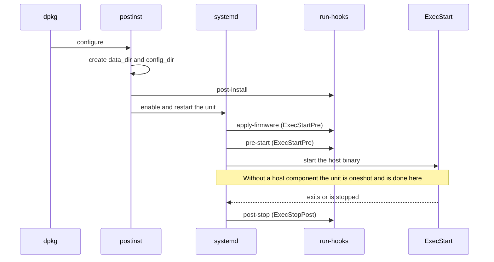
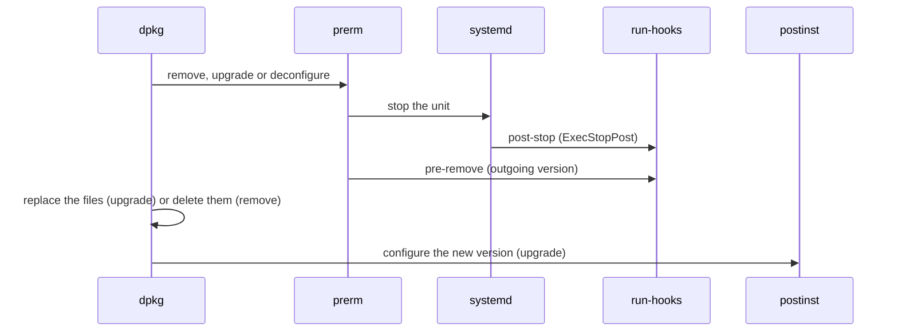
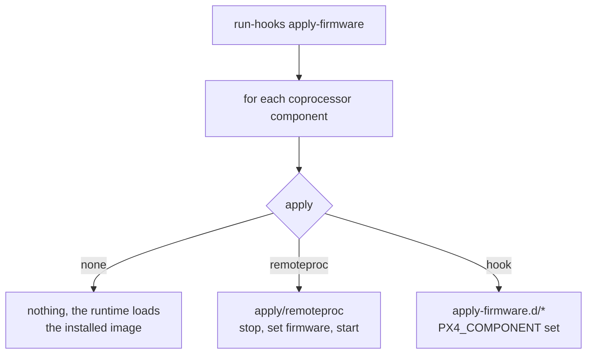

# Board Packaging Hooks

A board package copies files, and then there is everything else a board needs on the target: directories and ownership, a signature the DSP loader insists on, loading a core, waiting for a device.
That logic goes into _hooks_: POSIX `sh` scripts under `boards/<vendor>/<board>/hooks/<point>.d/`, installed to `/usr/lib/px4/hooks/<point>.d/` and run by `/usr/lib/px4/run-hooks` at fixed points.

This page describes the hook points, what runs them, the environment they see and the rules they follow.
How the package itself is described and built is covered in [Board Packaging](board_packaging.md).

## Hook Points

| Point            | Run by                   | When                                                                                                                                                           | Typical use                                                              |
| ---------------- | ------------------------ | -------------------------------------------------------------------------------------------------------------------------------------------------------------- | ------------------------------------------------------------------------ |
| `post-install`   | `postinst`               | After the files are on disk, before the unit is enabled and started. On every install and upgrade.                                                             | Create directories, set ownership, migrate data from an earlier version. |
| `pre-remove`     | `prerm`                  | After the unit is stopped, while the files are still on disk. On removal, and before an upgrade replaces the files.                                            | Undo `post-install`, remove generated files.                             |
| `apply-firmware` | the unit, `ExecStartPre` | Every start of the unit, once per coprocessor component. The board's scripts run only for components with `apply: hook`; `none` and `remoteproc` are built in. | Hand the image to a vendor loader or an update agent.                    |
| `pre-start`      | the unit, `ExecStartPre` | After `apply-firmware`, before `ExecStart`.                                                                                                                    | Wait for a device node, reset a core, check a signature.                 |
| `post-stop`      | the unit, `ExecStopPost` | After the main process exits or the unit is stopped.                                                                                                           | Power a core down, collect a crash log.                                  |

There is deliberately no `pre-install` or `post-remove` point.
dpkg runs a new package's `preinst` and an old package's `postrm` while the package files are not on disk, so there would be nothing to run.

On an upgrade, `pre-remove` runs from the version being replaced and `post-install` from the new one, with `PX4_OLD_VERSION` set.

## What Runs When

Installing or upgrading the package, then starting the unit:



Removing or upgrading the package:



On removal `postrm` reloads systemd, and on purge it clears the unit's enablement state.
Flight data under `data_dir` is kept even on purge.

`apply-firmware` dispatches on each coprocessor component's `apply` method:



## Writing a Hook

- Start with `#!/bin/sh` and stay POSIX.
  The interpreter is `dash` on Debian and Ubuntu and BusyBox `ash` on many Yocto images; `bash` is not guaranteed to exist.
  Validation rejects any other shebang.
  `shellcheck --shell=dash` catches most portability mistakes.
- Name scripts `NN-what-it-does` with no extension: letters, digits, `_` and `-` only.
  Scripts run in name order.
  A name with a dot in it (`10-dirs.bak`, `10-dirs.dpkg-old`) is skipped on purpose.
- Mark them executable in git (`chmod +x`); the install keeps the mode.
- Fail loudly.
  Use `set -e`; the first failing hook aborts the point.
  A failing `post-install` leaves the package unconfigured in dpkg, a failing `apply-firmware` or `pre-start` fails the unit start, and both are visible in `journalctl`.
- Be idempotent.
  `post-install` runs on every upgrade and `pre-start` on every boot.
- Keep package time to the filesystem.
  `post-install` and `pre-remove` also run inside image builds and chroots, where there is no hardware and no running systemd.
  Anything that touches a core, a bus or a device belongs in `apply-firmware`, `pre-start` or `post-stop`.
- Do not call `systemctl` from hooks.
  The maintainer scripts enable, reload and restart the unit, and systemd may not be running when a hook runs.
- All hooks run as root, including the unit's, which use `ExecStartPre=+` even when `service.user` is set.

A `post-install` hook that prepares the data directory for a board whose unit runs as the `px4` user:

```sh
#!/bin/sh
# hooks/post-install.d/10-data-dirs
set -e
mkdir -p "$PX4_DATA_DIR/log" "$PX4_DATA_DIR/param"
chown -R px4:px4 "$PX4_DATA_DIR"
```

A `pre-start` hook for a DSP whose loader refuses unsigned images:

```sh
#!/bin/sh
# hooks/pre-start.d/10-dsp-signature
set -e
if ! ls /usr/lib/rfsa/adsp/testsig-*.so >/dev/null 2>&1; then
	/usr/share/acme/generate-test-sig.sh
fi
```

An `apply-firmware` hook for a component declared with `apply: hook`.
It runs once per such component, so a board with several of them switches on `PX4_COMPONENT`:

```sh
#!/bin/sh
# hooks/apply-firmware.d/10-load
set -e
case "$PX4_COMPONENT" in
	m7) acme-loadfw --core m7 "$PX4_COMPONENT_FIRMWARE" ;;
esac
```

## Environment

`run-hooks` sources `/usr/lib/px4/package.env`, which the build generates from the descriptor, and exports the following to every hook:

| Variable                                                                             | Value                                                                                                                    |
| ------------------------------------------------------------------------------------ | ------------------------------------------------------------------------------------------------------------------------ |
| `PX4_PACKAGE`                                                                        | Package name.                                                                                                            |
| `PX4_BOARD`, `PX4_BOARD_VENDOR`, `PX4_BOARD_MODEL`                                   | `acme_widget`, `acme`, `widget`.                                                                                         |
| `PX4_VERSION`, `PX4_GIT_TAG`                                                         | Package version and the `git describe` tag it was derived from.                                                          |
| `PX4_SERVICE`                                                                        | Unit name without `.service`.                                                                                            |
| `PX4_BIN_DIR`, `PX4_SHARE_DIR`, `PX4_DATA_DIR`, `PX4_CONFIG_DIR`, `PX4_FIRMWARE_DIR` | The `layout` paths.                                                                                                      |
| `PX4_HOST_COMPONENT`                                                                 | Name of the host component, empty without one.                                                                           |
| `PX4_COPROCESSORS`                                                                   | Space separated names of the coprocessor components.                                                                     |
| `PX4_COPROCESSOR_<name>_TARGET`, `_FIRMWARE`, `_APPLY`, `_REMOTEPROC`                | Per coprocessor component: build target, installed image path, apply method, remoteproc device.                          |
| `PX4_HOOK`                                                                           | The hook point being run.                                                                                                |
| `PX4_ACTION`                                                                         | At package time, the maintainer script argument: `configure`, `remove`, `upgrade` or `deconfigure`. Empty from the unit. |
| `PX4_OLD_VERSION`                                                                    | On upgrade, the version being replaced. Empty otherwise.                                                                 |

During `apply-firmware` the component being applied is also described by `PX4_COMPONENT`, `PX4_COMPONENT_TARGET`, `PX4_COMPONENT_FIRMWARE`, `PX4_COMPONENT_APPLY` and `PX4_COMPONENT_REMOTEPROC`.

`package.env` is a plain shell file.
Source it in a terminal when debugging a hook by hand.

## Built-in Apply Methods

`none` does nothing.
Use it when the coprocessor runtime picks the image up from its install path by itself, as a DSP loader that watches a fixed directory does.

`remoteproc` restarts the core on the installed image through `/sys/class/remoteproc`.
It looks for `/sys/class/remoteproc/<remoteproc>` first, then for a device whose `name` attribute equals `<remoteproc>`.
If the core is not `offline` it is stopped, the firmware name (the install path relative to `/lib/firmware`) is written to the device's `firmware` attribute, and the core is started.
This is why `install` must be under `layout.firmware_dir`: the kernel resolves firmware names against its own search path.

## The Unit

The unit is generated from the descriptor's `service` section.
For the two core example in [Board Packaging](board_packaging.md#writing-the-descriptor) it is:

```ini
[Unit]
Description=PX4 Autopilot for the ACME Widget
After=acme-dspd.service
Requires=acme-dspd.service

[Service]
Type=simple
ExecStartPre=+/usr/lib/px4/run-hooks apply-firmware
ExecStartPre=+/usr/lib/px4/run-hooks pre-start
ExecStart=/usr/bin/px4 -d -w /var/lib/px4 -s /etc/px4/px4.config /usr/share/px4/etc
ExecStopPost=+/usr/lib/px4/run-hooks post-stop
Restart=on-failure

[Install]
WantedBy=multi-user.target
```

Without a host component the unit is `Type=oneshot` with `RemainAfterExit=yes`, has no `ExecStart` and no `Restart`, and exists to run `apply-firmware`, `pre-start` and `post-stop`.

The unit is installed to `/lib/systemd/system/<service>.service`.
A directive the descriptor does not express goes into a drop-in shipped through `files`, for example `destination: /lib/systemd/system/px4-acme-widget.service.d/override.conf`.

## Testing on the Target

```sh
sudo dpkg -i px4-acme-widget_*.deb
systemctl status px4-acme-widget
journalctl -u px4-acme-widget -b
cat /usr/lib/px4/package.env
sudo /usr/lib/px4/run-hooks pre-start
sudo env PX4_ACTION=configure /usr/lib/px4/run-hooks post-install
```

`/usr/share/px4/package.json` lists the components and the hooks the installed package shipped, which is useful when a board in the field does not behave like the one on the bench.
