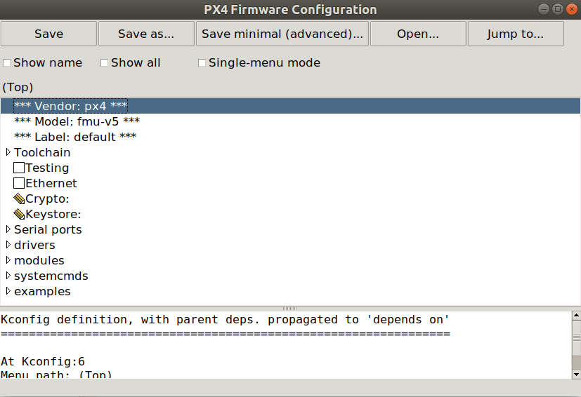
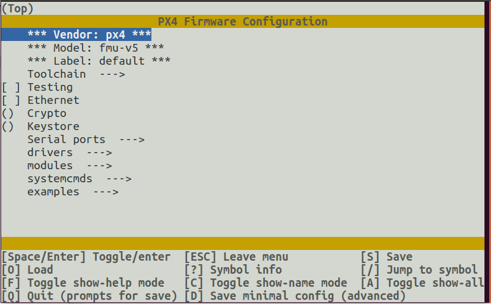

# PX4 Board Configuration (Kconfig)

The PX4 Autopilot firmware can be configured at build time to adapt it for specialized applications (fixed-wing, multicopter, rover or more), to enable new and experimental features (such as Cyphal) or to save flash & RAM usage by disabling some drivers and subsystems.
This configuration is handled through _Kconfig_, which is the same [configuration system used by NuttX](../hardware/porting_guide_nuttx.md#nuttx-menuconfig-setup).

The configuration options (often referred as "symbols" by the _kconfig_ language) are defined in `Kconfig` files under the **/src** directory.

## PX4 Kconfig Symbol Naming Convention

By convention, symbols for modules/drivers are named based on the module folder path.
For example, the symbol for the ADC driver at `src/drivers/adc/board_adc` must be named `DRIVERS_ADC_BOARD_ADC`.

To add symbols for driver/module specific options, the naming convention is the module name followed by the option name.
For example `UAVCAN_V1_GNSS_PUBLISHER` which is an option `GNSS_PUBLISHER` for the `UAVCAN_V1` module.
The options have to be guarded behind an `if` statement to ensure that the options are only visible when the module itself is enabled.

Full example:

```
menuconfig DRIVERS_UAVCAN_V1
    bool "UAVCANv1"
    default n
    ---help---
        Enable support for UAVCANv1

if DRIVERS_UAVCAN_V1
    config UAVCAN_V1_GNSS_PUBLISHER
        bool "GNSS Publisher"
        default n
endif #DRIVERS_UAVCAN_V1
```

::: info
Builds will silently ignore any missing or miss-spelled modules in the `*.px4board` configuration file.
:::

## PX4 Kconfig Label Inheritance

Each PX4 board must have a `default.px4board` configuration and can have an optional `bootloader.px4board configuration`.
However you can add also separate configurations under a different label e.g. `cyphal.px4board`.
Note that by default the configuration of `cyphal.px4board` inherits all settings set in `default.px4board`.
When changing the `cyphal.px4board` it only stores the delta of the Kconfig keys that are different compared to `default.px4board`, this is useful to simplify configurations management

::: info
When modifying a Kconfig key in `default.px4board` it will be modified in all derivative configurations of the same board that had the same config as well.
:::

## Packages and Groups

<Badge type="tip" text="main (PX4 v2.0)" />

Packages bundle the modules and commands that all vehicle types need (the core package), and the modules that each vehicle type adds (one package per vehicle type).
Groups bundle common drivers, modules or commands of a particular kind, such as the drivers for different RC protocols.
A board configuration enables the packages and groups it needs.
Both imply their content: everything in a package or group is enabled by default, and each item can still be disabled individually.

### Packages

The core package contains the modules and commands that the main [startup script](../concept/system_startup.md) `rcS` starts and runs for every vehicle type, and is defined in the `Kconfig` of `commander`.
Each vehicle package adds to the core the modules that its vehicle's startup script (`rc.<vehicle>_apps`) starts unconditionally, and is defined in the `Kconfig` of the module that includes that script and the vehicle's airframes in the build.
A board enables the core package and one or more vehicle packages.

| Package                | Content                                                                                                                                                                                    |
| ---------------------- | ------------------------------------------------------------------------------------------------------------------------------------------------------------------------------------------ |
| `PACKAGE_CORE`         | `commander`, `navigator`, `dataman`, `sensors`, `ekf2`, `mavlink`, `logger`, `events`, `load_mon`, `rc_update`, `manual_control` and the commands `param`, `ver`, `tune_control`, `reboot` |
| `PACKAGE_MULTICOPTER`  | `mc_rate_control`, `mc_att_control`, `mc_pos_control`, `flight_mode_manager`, `mc_hover_thrust_estimator`, `control_allocator`, `land_detector`                                            |
| `PACKAGE_FIXEDWING`    | `fw_rate_control`, `fw_att_control`, `fw_lateral_longitudinal_control`, `fw_mode_manager`, `fw_autotune_attitude_control`, `airspeed_selector`, `control_allocator`, `land_detector`       |
| `PACKAGE_VTOL`         | `vtol_att_control`, and always enables `PACKAGE_MULTICOPTER` and `PACKAGE_FIXEDWING`                                                                                                       |
| `PACKAGE_ROVER`        | Always enables `PACKAGE_ROVER_ACKERMANN`, `PACKAGE_ROVER_DIFFERENTIAL` and `PACKAGE_ROVER_MECANUM`                                                                                         |
| `PACKAGE_ROVER_<TYPE>` | The rover module of that type and `land_detector`                                                                                                                                          |
| `PACKAGE_UUV`          | `uuv_att_control`, `uuv_pos_control`, `control_allocator`                                                                                                                                  |
| `PACKAGE_SPACECRAFT`   | `spacecraft`, `control_allocator`                                                                                                                                                          |
| `PACKAGE_AIRSHIP`      | `airship_att_control`, `control_allocator`, `land_detector`                                                                                                                                |

Modules that a vehicle's startup script only starts when a parameter enables them are not part of its package and are enabled individually.
For example, the multicopter startup script only starts `mc_autotune_attitude_control`, `vision_target_estimator`, `mc_nn_control` and `mc_raptor` when their parameters enable them.

### Groups

Groups bundle a common set of drivers, modules or commands of one kind and are defined in the `Kconfig` of their directory.
For example, `COMMON_MAGNETOMETER` enables the usual external magnetometer drivers, and `COMMON_DIAGNOSTICS` the shell commands to inspect a running system (`dmesg`, `perf`, `top`, `listener`, `uorb`, `work_queue`).

### Disabling an Item of a Package or Group

To leave out an item that a package or group implies, set it to `n`.
For example, to remove the multicopter attitude controller (`mc_att_control`):

```sh
CONFIG_PACKAGE_MULTICOPTER=y
CONFIG_MODULES_MC_ATT_CONTROL=n
```

Note that you can't remove an item by commenting out or omitting its line, as the package or group includes it.

If you disable the item in [menuconfig](#px4-menuconfig-setup) (`boardconfig`) instead of editing the file, it writes the disabled item to the file as `# CONFIG_MODULES_MC_ATT_CONTROL is not set`.
Despite the `#`, this line isn't a comment: it disables the item in the same way as `=n`.

### Packages in Variants

A variant configuration such as `rover.px4board` [inherits](#px4-kconfig-label-inheritance) the packages of `default.px4board`, so a variant for a different vehicle type disables the inherited package and enables its own.
For example, a multicopter variant of a board whose default configuration enables `PACKAGE_VTOL`:

```sh
CONFIG_PACKAGE_VTOL=n
CONFIG_PACKAGE_MULTICOPTER=y
```

## PX4 Menuconfig Setup

The [menuconfig](https://pypi.org/project/kconfiglib/#menuconfig-interfaces) tool is used to modify the PX4 board configuration, adding/removing modules, drivers, and other features.

There are command line and GUI variants, both of which can be launched using the PX4 build shortcuts:

```
make px4_fmu-v5_default boardconfig
make px4_fmu-v5_default boardguiconfig
```

::: info
_Kconfiglib_ and _menuconfig_ come with the _kconfiglib_ python package, which is installed by the normal [ubuntu.sh](https://github.com/PX4/PX4-Autopilot/blob/main/Tools/setup/ubuntu.sh) installation script.
If _kconfiglib_ is not installed, you can do so using the command: `pip3 install kconfiglib`
:::

The command line and GUI interfaces are shown below.

### menuconfig GUI Interface



### menuconfig Command Line Interface



## Fortified Toolchain Compatibility

Some toolchains define `_FORTIFY_SOURCE` by default. Those toolchains generally require some optimization, which means PX4 configurations that use `-O0` may fail.

PX4 keeps the default debug optimization unchanged unless you explicitly opt in. To switch `PX4_DEBUG_OPT_LEVEL` from `-O0` to `-Og`, enable:

- `Toolchain > Fortified toolchain support`

This is the Kconfig symbol:

```sh
CONFIG_BOARD_SUPPORT_FORTIFIED_TOOLCHAIN=y
```

You can set it either in `boardconfig`/`boardguiconfig` or directly in your board's `*.px4board` file.
