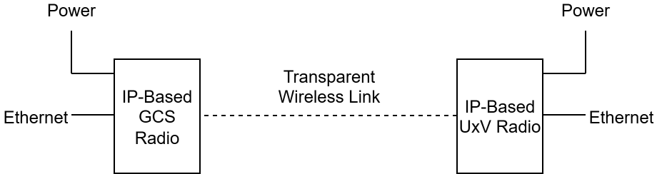
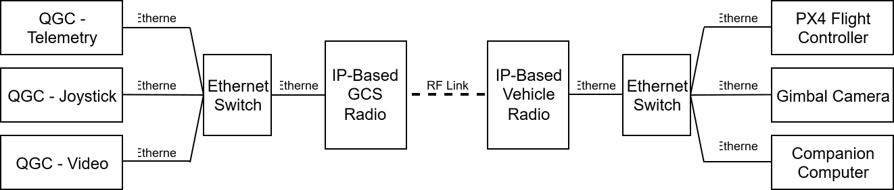
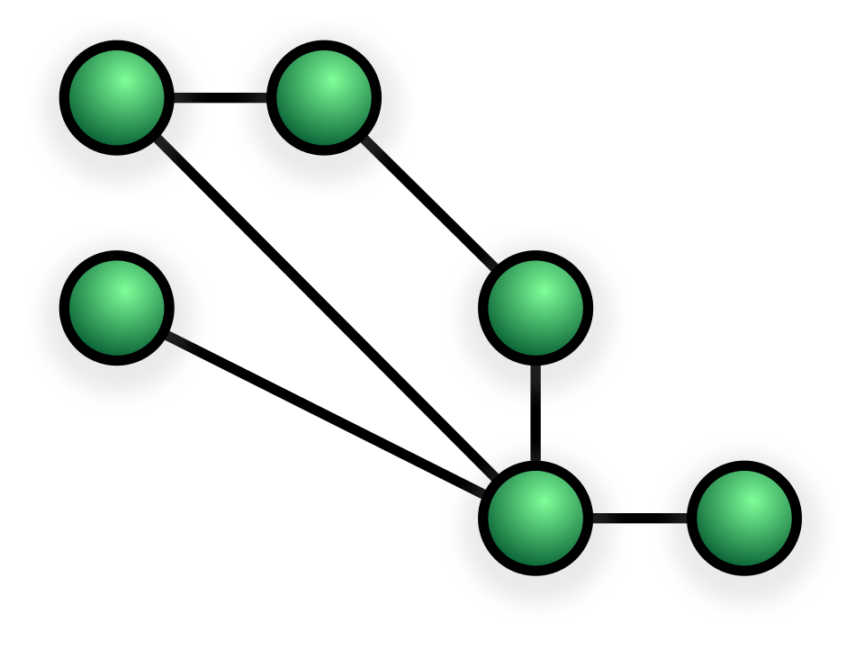
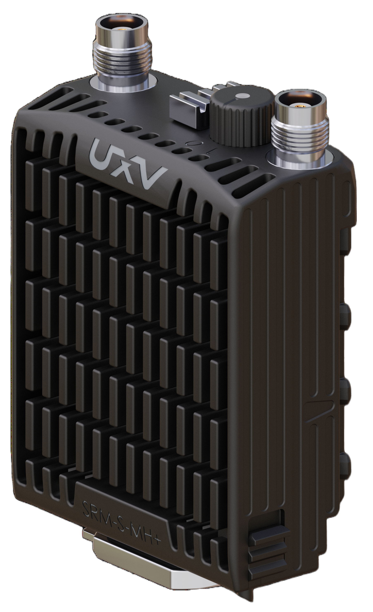

# IP-Based Radios

IP-based radios are wireless data links that carry standard Ethernet (IP) traffic instead of a single dedicated stream, such as [serial radio control](../getting_started/rc_transmitter_receiver).
To the vehicle and ground control stations (GCS), the link behaves like a network cable, which is replaced by radio.

This has several advantages:

- Many Ethernet-enabled devices can share the link within the available [bandwidth](<https://en.wikipedia.org/wiki/Bandwidth_(computing)>).
- Some radios support [mesh networking](#mesh-and-manet), which allows many vehicles and GCSs to connect to each other.

## Connectivity

Devices can connect to the radio using standard Ethernet, Ethernet over USB, serial, or other data formats, depending on the radio hardware.
The radio converts this data into Ethernet packets for transmission, sends them over RF, and the radio on the other side converts it back.

Because the devices on a vehicle can connect to the radio through a network switch, the number of Ethernet-enabled devices connected is limited by the bandwidth.

IP-based radios can usually be configured in a way to offer enough bandwidth to carry video, telemetry and manual control at the same time, usually with low latency and high reliability.
Actual performance depends on the radio model, the frequency band and the link conditions, so check the datasheet of your radio.

::: tip
Most IP-based radios can be configured to favour bandwidth, range or reliability.
Improving one usually costs some of the others, so choose the balance that suits your goals.
:::

## Mesh and MANET

Many IP-based radios also support [mesh networking](https://en.wikipedia.org/wiki/Mesh_networking).
In a mesh, devices on several PX4 vehicles can join the same network and communicate with each other, instead of being limited to a [point-to-point](<https://en.wikipedia.org/wiki/Point-to-point_(telecommunications)>) connection.

A diagram of a mesh network where all nodes are directly connected:

{width=30%}

### MANET

A [MANET](https://en.wikipedia.org/wiki/Wireless_ad_hoc_network) (mobile ad hoc network) is a mesh network in which the [nodes](<https://en.wikipedia.org/wiki/Node_(computer_networking)>) can move.
The network has no fixed infrastructure, such as a base station, and configures itself automatically.
Each node sends its own traffic and forwards traffic from other nodes, so data can reach a distant vehicle by hopping through other vehicles.

A diagram of a mesh network where the nodes move and not all of them are directly connected:

{width=30%}

## Point-to-point Connection Setup

Setting up a vehicle with an IP-based radio is currently only documented for flight controllers with an Ethernet port.
See the [list of supported PX4 flight controllers](../advanced_config/ethernet_setup.md#supported-flight-controllers).

::: tip
If your radio accepts only Ethernet and your flight controller does not have an Ethernet port, you can try a serial-to-Ethernet converter.
This approach is not documented for PX4.
:::

To set up the vehicle:

1. [Connect the flight controller to Ethernet](../advanced_config/ethernet_setup.md) on the vehicle side.
   The flight controller gets its own IP address on the network.
2. Connect the GCS to the Ethernet link on the GCS side.
3. Set up the radio link.
   Configuration steps will vary depending on your specific brand and model.
   Once established, this connection alone is sufficient for executing waypoint missions and fully autonomous flights.

   ::: warning
   Several devices on the network, usually also including the radios, each have their own IP address.
   Make sure that no two devices share the same address, and that all devices are on the same subnet.
   :::

4. For manual control of the vehicle, set up a [joystick](../config/joystick.md) input.

## IP-Based Radio Vendors

- [Doodle Labs](https://doodlelabs.com/) <!-- Tested by UXV Technologies on PX4 v 1.16.0 and QGC v5.0.8 -->
- [Microhard](https://www.microhardcorp.com/products.php) <!-- Used in the SKY-DRONES AIRLink Telemetry Set, mentioned in PX4 docs: https://docs.px4.io/main/en/flight_controller/airlink-->

::: info
Other IP-Based radios from brands such as [Domo Tactical](https://www.dtccodan.com/), [Persistent Systems](https://persistentsystems.com/), [Rajant Kinetic Mesh Network](https://rajant.com/technology/rajant-kinetic-wireless-mesh-networks/), [Silvus Technologies](https://silvustechnologies.com/), [Trellisware](https://www.trellisware.com/trellisware-radios/) should offer the same capabilities.
They have not been explicitly tested with PX4 and QGC.
:::

## Swappable Radio Modules (SRM)

[Swappable Radio Modules (SRM)](https://www.uxvtechnologies.com/products?series=SRM+Radios), as the name suggests, allow the radios to be easily swapped for one another.
This enables one [SRM-Compatible](https://www.uxvtechnologies.com/products?product-category=Ground+Control+Stations) Ground Control Station (GCS) to be used with different vehicles with different (IP-Based) radios, or in different situations.

<!-- Tested by UXV Technologies on PX4 v 1.16.0 and QGC v5.0.8 -->

{width=40%}

::: info
PX4 has been proven to work with SRM-S-DL+ and SRM-S-MH+, but other Ethernet-based radios should offer the same capability.
:::
