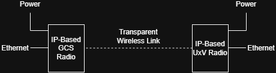

# IP-based radios

An IP-based radio is a wireless link that moves standard IP data (Ethernet packets) between two or more radios.

Devices connect to the radio using standard Ethernet (or Ethernet over USB), as if the radio were a [network switch](https://en.wikipedia.org/wiki/Network_switch).
The radio handles the wireless transfer.

Some radios also accept serial, USB or other data formats as input.
The radio converts this data into Ethernet packets for transmission, and the radio on the other side converts it back.

What defines an IP-based radio is that it offers IP connectivity on the user side (the non-RF side).

IP-based radios can offer enough bandwidth to carry video, telemetry and manual control at the same time, usually with low latency and high reliability.
Actual performance depends on the radio model, the frequency band and the link conditions, so check the datasheet of your radio.

:::tip
Most IP-based radios can be configured to favor [bandwidth](https://en.wikipedia.org/wiki/Bandwidth), range or reliability.
Improving one usually costs some of the others, so choose the balance that suits your goals.
:::

## Networking capabilities

Because devices on a vehicle connect to the radio through a network switch, the number of devices is limited mainly by the available bandwidth, not by the number of ports.
This is useful for complex PX4 vehicles that carry a [gimbal](../advanced/gimbal_control.md), a [companion computer](../companion_computer/), or other networked devices.

## Mesh and MANET

Many IP-based radios also support [mesh networking](https://en.wikipedia.org/wiki/Mesh_networking).
In a mesh, devices on several PX4 vehicles can join the same network and communicate with each other, instead of being limited to a [point-to-point](https://en.wikipedia.org/wiki/Point-to-point_(telecommunications)) connection.

A diagram of a mesh network where all nodes are directly connected:

{width=30%}

### MANET

A [MANET](https://en.wikipedia.org/wiki/Wireless_ad_hoc_network) (mobile ad hoc network) is a mesh network in which the [nodes](https://en.wikipedia.org/wiki/Node_(computer_networking)) can move.
The network has no fixed infrastructure, such as a base station, and configures itself automatically.
Each node sends its own traffic and forwards traffic from other nodes, so data can reach a distant vehicle by hopping through other vehicles.

A diagram of a mesh network where the nodes move and not all of them are directly connected:

{width=30%}

## Vehicle setup

Setting up a vehicle with an IP-based radio is significantly simpler if the flight controller has an Ethernet port.
See the [list of supported flight controllers](../advanced_config/ethernet_setup.md#supported-flight-controllers).

:::info
Some radios support a native serial connection (to `TELEM`) for flight controllers without an Ethernet port.
:::

:::warning
If your radio accepts only Ethernet and your flight controller does not have an Ethernet port, you can try a serial-to-Ethernet converter.
This approach is not documented for PX4.
:::

To set up the vehicle:

1. Set up the radio link.
   The steps depend on the brand and model of your radio.
1. [Connect the flight controller to Ethernet](../advanced_config/ethernet_setup.md) to get telemetry.
   The flight controller gets its own IP address on the network.
   This is sufficient for waypoint missions and fully autonomous vehicles.

   :::warning
   Several devices on the network each have their own IP address.
   Make sure that no two devices share the same address, and that all devices are on the same subnet.
   :::

1. For manual control, set up a [joystick](../config/joystick.md).

## IP-Based Radio Vendors

- __[Domo Tactical](https://www.dtccodan.com/)__

- __[Doodle Labs](https://doodlelabs.com/)__

- __[Microhard](https://www.microhardcorp.com/products.php)__

- __[Persistent Systems](https://persistentsystems.com/)__

- __[Rajant Kinetic Mesh Network](https://rajant.com/technology/rajant-kinetic-wireless-mesh-networks/)__

- __[Silvus technologies](https://silvustechnologies.com/)__

- __[Trellisware](https://www.trellisware.com/trellisware-radios/)__

- __And others...__

## Swappable Radio Modules (SRM)

[Swappable Radio Modules (SRM)](https://www.uxvtechnologies.com/products?series=SRM+Radios), as the name suggests, allow the radios to be easily swapped for one another. This enables one [SRM-Compatible](https://www.uxvtechnologies.com/products?product-category=Ground+Control+Stations) Ground Control Station (GCS) to be used different vehicles with different (IP-Based) radios, or in different situations.

{width=40%}