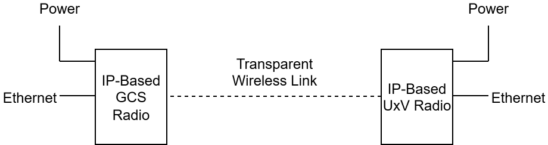
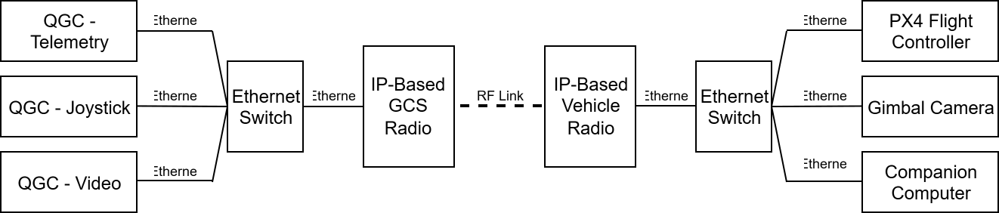
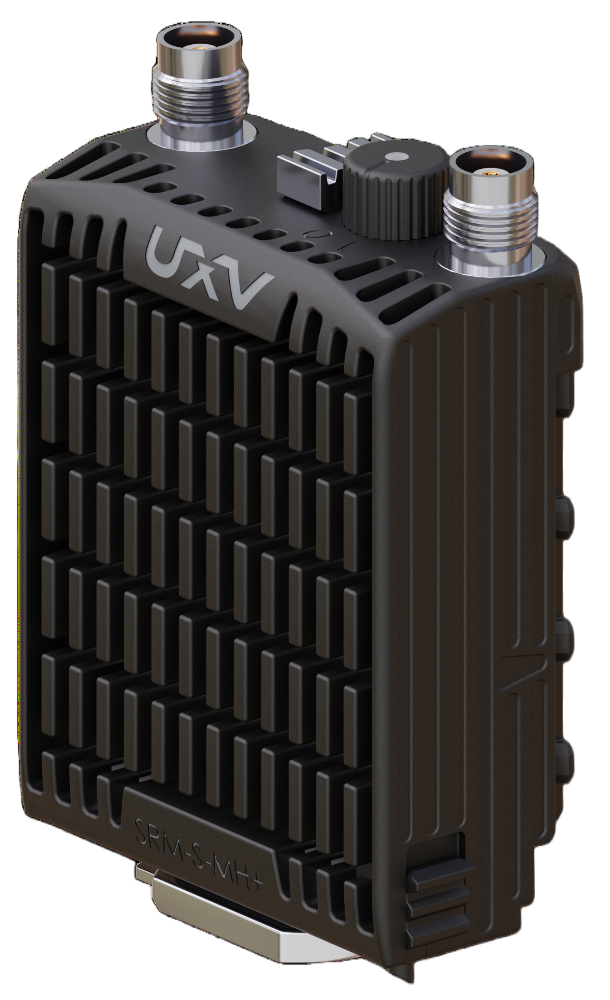
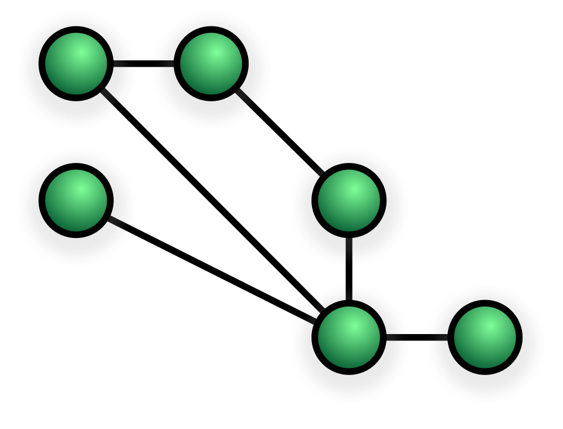

# IP-based Radios

IP-based radios provide wireless communication between networked devices, such as PX4 [Flight Controllers](../flight_controller/index.md), [companion computers](../companion_computer/index.md), and [ground control stations](../getting_started/px4_basic_concepts.md#ground-control-stations) (GCS).

Unlike conventional [serial telemetry radios](../telemetry/sik_radio.md), the radios act as a wireless network connection between the vehicle and GCS, similar to replacing an Ethernet cable with a radio link.

This has several advantages:

- Many communication streams can share the link within the available [bandwidth](https://en.wikipedia.org/wiki/Bandwidth_(computing)).
- Some radios support [mesh networking](#mesh-and-manet), which allows many vehicles and GCSs to connect to each other.

## Connectivity

They can transport multiple types of network traffic over the same wireless link, including [MAVLink telemetry](../mavlink/index.md), control commands, and video streams. 

Depending on the hardware, radios may provide several connection interfaces:

- [Ethernet](https://en.wikipedia.org/wiki/Ethernet) — For connecting flight controllers, companion computers, and other networked devices.
- [Serial](https://en.wikipedia.org/wiki/Serial_communication) — For transmitting serial data, such as MAVLink, through a serial-to-network gateway.
- [USB networking](https://en.wikipedia.org/wiki/Ethernet_over_USB) — For connecting compatible computers or other USB networking hosts without a physical Ethernet port.

::: info
Non-network data usually requires additional software to be transmitted over the IP-based radio link.
Refer to the vendor-specific documentation for further information.
:::

### Point-to-point Connection Setup

Setting up a vehicle with by using an IP-based radio with an ethernet interface is currently only documented for flight controllers with an Ethernet port.
See the [list of supported PX4 flight controllers](../advanced_config/ethernet_setup.md#supported-flight-controllers).

::: tip
If your radio accepts only Ethernet and your flight controller does not have an Ethernet port, you can try a serial-to-Ethernet converter.
This approach is not documented for PX4.
:::

To set up the vehicle:

1. [Configure Ethernet on PX4](../advanced_config/ethernet_setup.md), including its IP address and MAVLink interface.
   ::: tip
   PX4 can obtain an IP address automatically using [DHCP](https://en.wikipedia.org/wiki/Dynamic_Host_Configuration_Protocol) if a DHCP server is available on the network.
   This can simplify replacing flight controllers with identical MAVLink configurations, without manually assigning IP addresses.
   :::
1. Connect the flight controller to the vehicle-side radio.
1. Connect the GCS to the ground-side radio.
1. Configure the radio link according to the manufacturer's instructions.
   This may include configuring the RF link and network settings.
   ::: warning
   Several devices on the network, usually also including the radios, each have their own IP address.
   For a simple [P2P configuration](https://en.wikipedia.org/wiki/Point-to-point_(telecommunications)), sure that no two devices share the same IP address, and that all devices are on the same [subnet](https://en.wikipedia.org/wiki/Subnet).
   :::
1. [Configure QGroundControl](../advanced_config/ethernet_setup.md#qgroundcontrol-setup-example) to receive MAVLink traffic over the network.
1. For manual control, configure a [joystick](../config/joystick.md) in QGroundControl.

### Networking Capabilities

Multiple devices can share the same radio network through a [network switch](https://en.wikipedia.org/wiki/Network_switch).

Depending on the available bandwidth, the link can carry video, telemetry, and control data simultaneously.
Actual throughput, latency, and reliability depend on the radio model, configuration, and link conditions.

::: tip
Some radios allow users to favour throughput, range, or link reliability.
These properties often involve trade-offs, so choose settings appropriate for your application.
:::

## Supported IP-based Radios

- [Doodle Labs](https://doodlelabs.com/) <!-- Tested by UXV Technologies on PX4 v 1.16.0 and QGC v5.0.8 -->
<!-- Probably message the manufacturer-->
- [Microhard](https://www.microhardcorp.com/products.php) <!-- Used in the SKY-DRONES AIRLink Telemetry Set, mentioned in PX4 docs: https://docs.px4.io/main/en/flight_controller/airlink-->
<!-- Probably message the manufacturer-->

::: info
Other IP-based radios from brands such as [Domo Tactical](https://www.dtccodan.com/), [Persistent Systems](https://persistentsystems.com/), [Rajant Kinetic Mesh Network](https://rajant.com/technology/rajant-kinetic-wireless-mesh-networks/), [Silvus Technologies](https://silvustechnologies.com/), [Trellisware](https://www.trellisware.com/trellisware-radios/) should offer the same capabilities.
They have not been explicitly tested with PX4 and QGC.
:::

### Interfaces
- [UXV Technologies Swappable Radio Modules (SRM)](https://www.uxvtechnologies.com/news/increase-flexibility-and-efficiency-with-our-new-swappable-radio-modules) - Standard defined by UXV Technologies and later added to the US DoW Blue UAS Framework.
   It allows radios and GCS from various vendors to work together using a common interface.
{width=27%}
{width=45%}

## Mesh and MANET

Some IP-based radios support [mesh networking](https://en.wikipedia.org/wiki/Mesh_networking), including [mobile ad hoc networks (MANETs)](https://en.wikipedia.org/wiki/Wireless_ad_hoc_network).
These allow multiple vehicles and ground stations to communicate through intermediate radio nodes without fixed infrastructure.
MANETs can automatically adapt network routes as devices move or wireless links change.
Additional MAVLink configuration may be required for communication between vehicles.

The diagrams below show examples of mesh network topologies:

{width=30%}
{width=30%}

::: info
Mesh networking is an advanced use case that may require additional configuration and testing to operate reliably under real-world conditions.
:::
