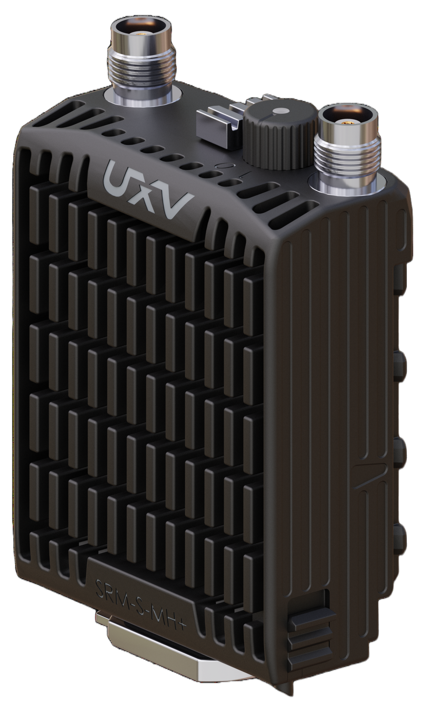
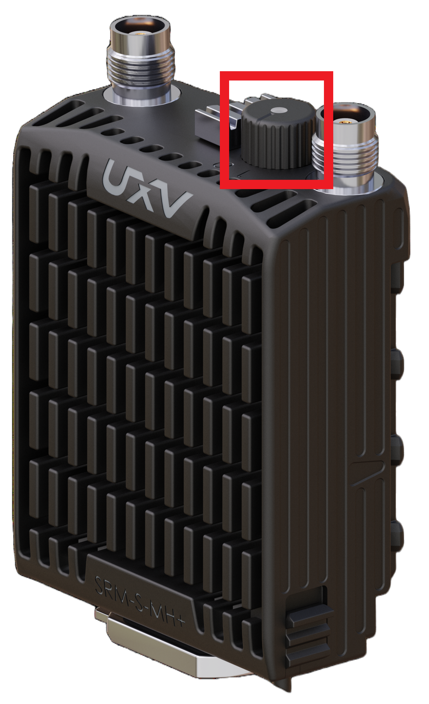

# UXV Technologies SRM Radios

UXV Technologies Swappable Radio Modules (SRMs) integrate [IP-based](index.md) radios from different manufacturers into a ruggedised enclosure with a common interface. Selected SRM products are included in the US DoW Blue UAS Framework.

The following images show both sides of the SRM interface:

{width=31%}
{width=50%}

## Hardware Configuration

::: info
This guide assumes that the SRM radios are already connected to the ground control station (GCS) through the UXV Technologies SRM interface and to the drone or vehicle through a UXV Technologies [SRM Airside ETH](https://www.uxvtechnologies.com/communication/srm-airside-ethernet) module.
:::

1. Connect suitable antennas to the radios.
   Different operating frequencies require compatible antennas.
   Radios supporting a wide frequency range may use suitable multifrequency antennas.

1. Power on the SRM radio by turning the switch at the top to the **ON** position.
   Ensure that the antennas are connected before powering on the radio, as operating without them may damage it.

{width=40%}

## PX4 Setup

UXV Technologies SRM radios integrate radios from different manufacturers, so the configuration procedure depends on the model.

Refer to the appropriate model-specific setup guide:

- [UXV Technologies SRM-S-DL+](uxv_technologies_srm_s_dl+.md)

## Mesh and Multipoint Modes

Some SRM radios support mesh and point-to-multipoint networking, allowing multiple vehicles to communicate over the same network.

Each vehicle must have a unique MAVLink system ID (`MAV_SYS_ID`). The maximum number of vehicles depends on the radio's capabilities, available bandwidth, and network configuration.

Refer to the model-specific guides for supported networking modes.