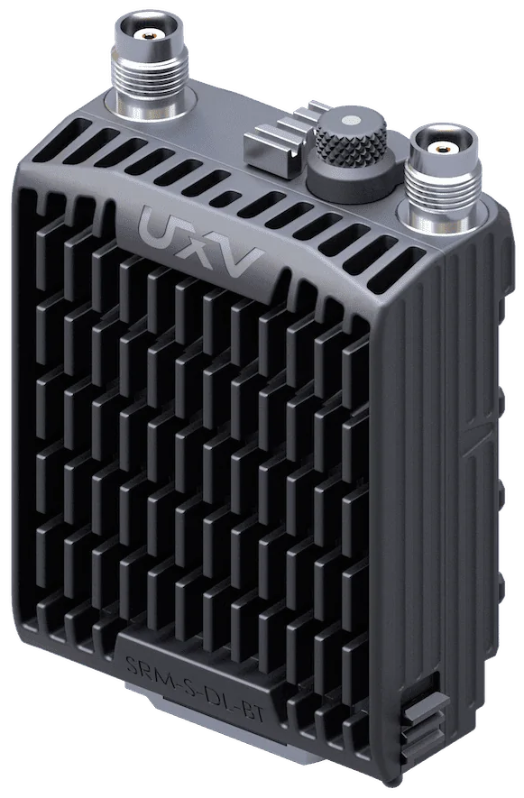

# UXV Technologies SRM-S-DL+

The UXV Technologies SRM-S-DL+ integrates a [Doodle Labs Mini](https://kb.doodlelabs.com/-product-index) [IP-based](index.md) radio into a ruggedised housing with the SRM interface.

{width=40%}

## Ethernet Connection Setup

The SRM-S-DL+ can be used to establish a wireless Ethernet connection for telemetry transmission between an [Ethernet-enabled](../advanced_config/ethernet_setup.md#supported-flight-controllers) PX4 flight controller and a ground control station (GCS) running *QGroundControl* (QGC).

A [joystick](../config/joystick.md) can optionally be used for manual vehicle control over the same connection.

1. Set up the [Ethernet connection](../advanced_config/ethernet_setup.md) on the flight controller.
   This allows you to connect to the flight controller from a computer using an Ethernet cable.

1. The radio is a network device running Mesh Rider firmware based on [OpenWrt](https://en.wikipedia.org/wiki/OpenWrt).
   Access the Doodle Labs radio through its web interface or via [SSH](https://en.wikipedia.org/wiki/Secure_Shell) to use the command-line interface (CLI).
   This procedure is described in detail in the Doodle Labs [Knowledge Base](https://kb.doodlelabs.com/quick-start-guide).

1. Configure the Doodle Labs radios to establish a wireless connection.
   For a simple bridged network, assign unique static IP addresses within the same subnet to the flight controller, GCS network adapter, and radios' management interfaces, or use DHCP where available.

   ::: info
   If the GCS and flight controller are on different IP subnets, additional network configuration may be required.
   This typically involves IP routing, although Network Address Translation (NAT) may be necessary in some configurations.

   The radios run firmware based on OpenWrt. Refer to the relevant configuration guides for more detailed instructions.
   :::

1. Verify network connectivity using the `ping` command from the GCS to test the connection to devices on the network, including the flight controller.
   The flight controller and radios should respond if they are reachable and configured to allow ICMP traffic.

1. Connect to the flight controller from QGC by following the [QGroundControl Setup Example](../advanced_config/ethernet_setup.md#qgroundcontrol-setup-example) in the Ethernet setup guide.

1. (Optional) Configure the UXV Technologies [SRM Airside ETH](https://www.uxvtechnologies.com/communication/srm-airside-ethernet) to expose additional Ethernet ports beyond those available in the default configuration.
   This is useful for connecting a [companion computer](../companion_computer/index.md) or a networked camera.

### Drone/Vehicle Integration Notes

The simplest setup on the drone or vehicle side is to use the UXV Technologies SRM Airside ETH module, which can expose up to two ethernet ports for other devices to connect to, depending on the configuration.

However, as the UXV Technologies SRM-S-DL+ integrates a Doodle Labs Mini radio, it can also communicate directly with a standalone Doodle Labs Mini radio.

This allows the same setup to be used with a standalone radio when space or weight constraints on the drone or vehicle prevent the use of an SRM.
The disadvantage is that the standalone radio is not ruggedised and does not offer the swappable capability of the SRM interface.

### Mesh Networking

For more information about mesh and MANET configuration, refer to the Doodle Labs [Knowledge Base](https://kb.doodlelabs.com).