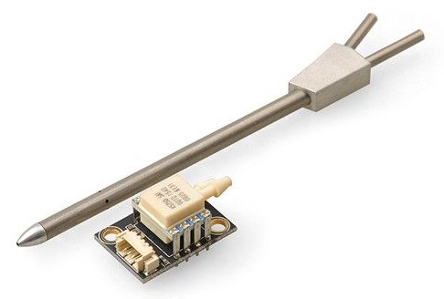

# Airspeed Sensors

Airspeed sensors are _highly recommended_ for fixed-wing and VTOL frames.
They are so important because the autopilot does not have other means to detect stall.
For fixed-wing flight it is the airspeed that guarantees lift — not ground speed!

## Hardware Options

Recommended digital airspeed sensors include:

- Based on [Pitot tube](https://en.wikipedia.org/wiki/Pitot_tube)
  - I2C MEAS Spec series (e.g. [MS4525DO](https://www.te.com/en/product-20003581-00.html), [MS5525](https://www.te.com/usa-en/product-CAT-BLPS0003.html))
    - [mRo I2C Airspeed Sensor JST-GH MS4525DO](https://store.3dr.com/airspeed-sensor-jst-gh-ms4525do/) (3DR store)
    - [Digital Differential Airspeed Sensor Kit - MS4525DO](https://store-drotek.com/793-digital-differential-airspeed-sensor-kit-.html) (Drotek).
    - [Holybro Digital Air Speed Sensor - MS4525DO](https://holybro.com/collections/sensors/products/digital-air-speed-sensor-standard)
    - [Holybro Digital Air Speed Sensor - MS5525DSO](https://holybro.com/collections/sensors/products/digital-air-speed-sensor-standard)
  - I2C Sensirion series (e.g. SDP33)
    - [ThunderFly TFPITOT01 Lightweight Pitot Tube](https://docs.thunderfly.cz/avionics/TFPITOT01/)
    - [Drotek SDP3x Airspeed Sensor Kit](https://store-drotek.com/848-sdp3x-airspeed-sensor-kit-sdp33.html)
  - I2C _Amphenol All Sensors_ Digital Low Voltage R-Series (DLVR) Pressure Sensors.
    Continuous-sampling sensors only (see for [SENS_EN_DLVR](../advanced_config/parameter_reference.md#SENS_EN_DLVR) for supported sensors).
    - [MATEKSYS Digital AirSpeed sensor ASPD-DLVR](https://www.mateksys.com/?portfolio=aspd-dlvr)
    - [RCDrone Digital AirSpeed sensor ASPD-DLVR](https://rcdrone.top/products/matek-mateksys-digital-airspeed-sensor-aspd-dlvr)
  - DroneCAN interface
    - [Holybro High Precision DroneCAN Airspeed Sensor - DLVR](https://holybro.com/collections/sensors/products/high-precision-dronecan-airspeed-sensor-dlvr)
    - [RaccoonLab Cyphal/CAN and DroneCAN Airspeed Sensor - MS4525DO](https://docs.raccoonlab.co/guide/airspeed/)
    - [Avionics Anonymous Air Data Computer with OAT probe](https://www.tindie.com/products/avionicsanonymous/uavcan-air-data-computer-airspeed-sensor/)
    - [UAV-DEV GmbH DroneCAN Airspeed and Barometer Sensor - AUAV](https://wiki.uav-dev.com/en/product/airspeed/auav)
- Based on [Venturi effect](https://en.wikipedia.org/wiki/Venturi_effect)
  - [TFSLOT](airspeed_tfslot.md) Venturi effect airspeed sensor.

## Configuration

### Enable Airspeed Sensors

Airspeed sensor drivers are not started automatically.
Enable each driver and/or variant using its [corresponding parameter](../advanced_config/parameters.md):

- **[Sensirion SDP3X](../modules/modules_driver_airspeed_sensor.md#sdp3x)** — [SENS_EN_SDP3X](../advanced_config/parameter_reference.md#SENS_EN_SDP3X)
- **[TE MS4525](../modules/modules_driver_airspeed_sensor.md#ms4525do)** — [SENS_EN_MS4525DO](../advanced_config/parameter_reference.md#SENS_EN_MS4525DO)
- **[TE MS5525](../modules/modules_driver_airspeed_sensor.md#ms5525dso)** — [SENS_EN_MS5525DS](../advanced_config/parameter_reference.md#SENS_EN_MS5525DS)
- **Eagle Tree airspeed sensor:** — [SENS_EN_ETSASPD](../advanced_config/parameter_reference.md#SENS_EN_ETSASPD)
- **[Amphenol All Sensors DLVR](../modules/modules_driver_airspeed_sensor.md#dlvr) (continuous-sampling sensors only)** — [SENS_EN_DLVR](../advanced_config/parameter_reference.md#SENS_EN_DLVR)

You should also check [ASPD_PRIMARY](../advanced_config/parameter_reference.md#ASPD_PRIMARY) is `1` (see next section - this is the default).

### Multiple Airspeed Sensors

<Badge type="tip" text="main (PX4 v2.0)" /> <Badge type="tip" text="Experimental" />

:::warning Experimental
Using multiple airspeed sensors is experimental.
:::

PX4 supports up to three airspeed sensors.
Each sensor is converted to airspeed independently, keeps its own zero-offset calibration, and is validated separately, so the selector can fall back to a healthy sensor if one fails in flight.

#### Selecting the Primary Sensor

[ASPD_PRIMARY](../advanced_config/parameter_reference.md#ASPD_PRIMARY) selects the source that is _preferred_:

- `0`: Groundspeed minus windspeed
- `1`: Airspeed sensor 1 (default)
- `2`: Airspeed sensor 2
- `3`: Airspeed sensor 3
- `4`: Thrust-based (synthetic) airspeed

The sensor numbers `1`, `2` and `3` refer to the **calibration entry** the sensor owns (recorded in `CAL_DPRES{n-1}_ID`).

::: tip
Calibrate every sensor before relying on `ASPD_PRIMARY`.
:::

#### Failover

The preferred sensor is used while it passes the airspeed checks ([ASPD_DO_CHECKS](../advanced_config/parameter_reference.md#ASPD_DO_CHECKS) configures which checks run).
If it fails, the selector switches to another valid sensor, preferring the configured primary.

[ASPD_FALLBACK](../advanced_config/parameter_reference.md#ASPD_FALLBACK) controls what happens when _no_ sensor is usable: stay without airspeed, fall back to groundspeed minus windspeed, or fall back to thrust-based airspeed.

::: warning
By default a sensor that fails its checks stays failed until the next reboot ([ASPD_FS_T_START](../advanced_config/parameter_reference.md#ASPD_FS_T_START) is `-1`).
Set it to a positive number of seconds to allow a recovered sensor to be used again in the same flight.
:::

The selected sensor is then used to [supply data to the estimator (EKF2)](../advanced_config/tuning_the_ecl_ekf.md#airspeed) and the controllers.

#### Per-Sensor Calibration

Each sensor stores its own zero offset in `CAL_DPRES{n}_OFF`, linked to the sensor's device ID in `CAL_DPRES{n}_ID`.
A single [airspeed calibration](../config/airspeed.md) calibrates every connected sensor.

### Sensor-specific Configuration

Other than enabling the sensor, sensor-specific configuration is often not required.
If it is needed, it should be covered in the appropriate sensor page (for example [TFSLOT > Configuration](airspeed_tfslot.md#configuration)).

The specific configuration for sensors that do not have a separate page is listed below:

- **Sensirion SDP3X:** [CAL_AIR_CMODEL](../advanced_config/parameter_reference.md#CAL_AIR_CMODEL) (provides overview of required settings), [CAL_AIR_TUBED_MM](../advanced_config/parameter_reference.md#CAL_AIR_TUBED_MM), [CAL_AIR_TUBELEN](../advanced_config/parameter_reference.md#CAL_AIR_TUBELEN).

## Calibration

Airspeed sensors should be calibrated by following the instructions: [Basic Configuration > Airspeed](../config/airspeed.md).

## Validation

For more advanced validation, configuration and debugging see [Airspeed Validation](../advanced_config/airspeed_validation.md).

## See Also

- [Airspeed Scale Handling](../config_fw/airspeed_scale_handling)
- [Using PX4's Navigation Filter (EKF2) > Airspeed](../advanced_config/tuning_the_ecl_ekf.md#airspeed)
- [Airspeed drivers](https://github.com/PX4/PX4-Autopilot/tree/main/src/drivers/differential_pressure) (source code)
- [VTOL Without an Airspeed Sensor](../config_vtol/vtol_without_airspeed_sensor.md)
