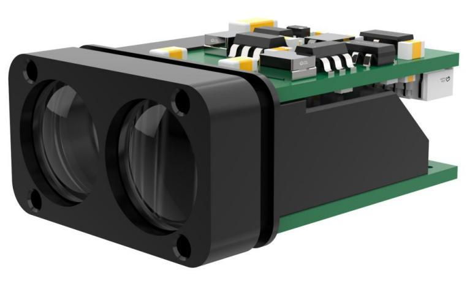

# JRT PTGL-100 Laser Rangefinder

The [JRT PTGL-100](mailto:sales@jrt-measure.com) is a UART laser rangefinder with a wavelength of 905±5 nm, a specified measurement range of 0.2–100 m and a measurement rate of 100 Hz.



Product rendering from the manufacturer's manual linked below.

The module must be set to 460800 baud, 8N1, with no flow control.
PX4 does not change the module's baud rate.

::: info
The rangefinder has been tested on the [Amovlab Flycore](../flight_controller/amovlab_flycore.md), which includes the driver in its default firmware.
:::

For electrical specifications and protocol details, see JRT's [PTGL-100 User and Maintenance Manual (Chinese)](../../assets/hardware/sensors/ptgl100/ptgl100_manual.pdf).

## Where to Buy

For PTGL-100 purchasing enquiries, contact JRT at [sales@jrt-measure.com](mailto:sales@jrt-measure.com), the sales address listed in the manual.

## Wiring

The manufacturer's packing list includes one module and one power cable.
The tested setup uses a GH1.25 connector at the Flycore end and a six-pin SH1.25 connector at the module end.

Connect the module to an unused flight controller UART.
UART signals use 3.3 V TTL levels.
The module requires a 3.3–5 V supply.

The Flycore hardware test used the following four connections to [TELEM3](../flight_controller/amovlab_flycore.md#telem3-port):

| Module Signal | Flycore TELEM3 Signal |
| ------------- | --------------------- |
| VCC           | VCC                   |
| GND           | GND                   |
| TXD           | RX                    |
| RXD           | TX                    |

Both TX and RX are required because PX4 sends the continuous measurement command.

## Configuration

1. Ensure that the wired UART is not mapped to another service, such as MAVLink or GNSS (see [Serial Port Configuration](../peripherals/serial_configuration.md)).
2. Set [SENS_PTGL100_CFG](../advanced_config/parameter_reference.md#SENS_PTGL100_CFG) to that port in _QGroundControl_ and reboot.
3. If the sensor is not mounted facing down, set [SENS_PTGL100_ROT](../advanced_config/parameter_reference.md#SENS_PTGL100_ROT) to its mounting direction and reboot.

For example, select `TELEM 3` (`103`) for a module connected to the Flycore TELEM3 connector.
The TELEM3 VCC and GND connections supply power to the module.
The driver sets 460800 baud directly; no `SER_*_BAUD` change is needed.
The default port setting is disabled, and the default orientation is downward (`25`).

Other boards can include the driver by enabling `CONFIG_DRIVERS_DISTANCE_SENSOR_PTGL100` in their board configuration.

The configuration that is common to all rangefinders, such as the sensor position offsets used by the estimator, is covered in [Rangefinders > Configuration/Setup](../sensor/rangefinders.md#configuration).

## Viewing Data

In the _QGroundControl_ MAVLink Console, run:

```sh
ptgl100 status
listener distance_sensor -n 10
```

`status` reports the UART, baud rate, topic instance, last distance and sample age, measurement status, and error counters.
If several distance sensors are connected, select the instance reported by `status`, for example:

```sh
listener distance_sensor -i 1 -n 10
```

The MAVLink Inspector shows `DISTANCE_SENSOR`; its distance fields are in centimetres, while `distance_sensor.current_distance` in ULog and the console is in metres.
The stream rate is set by the mode of the MAVLink instance in use (`MAV_X_MODE`), as it is for other distance sensors.
The default ULog profile records the first two `distance_sensor` instances at approximately 1 Hz whenever logging is active.
No custom MAVLink message or logger topic configuration is needed for a normal single-sensor installation.
For bench recording without arming, start recording with `logger on` while the logger is running.

The driver publishes laser type, 0.2–100 m limits, and the selected orientation.

## Developer Information

The [ptgl100](../modules/modules_driver_distance_sensor.md#ptgl100) driver starts continuous measurement and publishes the standard `distance_sensor` topic used by MAVLink and ULog.

### Diagnostics

The driver rejects corrupt frames and does not publish distance bytes from failed measurements.
During a communication outage it does not repeat an old distance with a new timestamp.
After one second without a complete measurement reply it retries the continuous measurement command, at most once per second.
Measurement failure replies count as communication with the module and are reported separately from communication errors.

To run the driver manually, after disabling automatic startup:

```sh
ptgl100 start -d /dev/ttyS3 -R 25
ptgl100 status
ptgl100 stop
```

The device name above corresponds to Flycore TELEM3.
When stopped, the driver attempts to send the stop measurement command before closing the UART.

### Validation

Hardware testing with the PTGL-100 module on the Amovlab Flycore has been completed.
The module was powered through the Flycore TELEM3 VCC and GND connections, with TX and RX connected for UART communication.

Build the firmware, then configure and run the driver-specific SITL tests with a current CMake installation:

```sh
make amovlab_flycore_default
cmake -S . -B build/px4_sitl_test -G Ninja -DCONFIG=px4_sitl_test -DTESTFILTER=PTGL100Parser
cmake --build build/px4_sitl_test --target px4 unit-PTGL100Parser
ctest --test-dir build/px4_sitl_test -R '^unit-PTGL100Parser$' --output-on-failure
```

Run the virtual UART integration test against the SITL test executable:

```sh
python3 src/drivers/distance_sensor/ptgl100/test_ptgl100.py --px4 build/px4_sitl_test/bin/px4
```

The integration test requires `pexpect`, `pymavlink`, and `pyulog`.
It uses a pseudo-terminal in a temporary directory and does not require a connected sensor or flight controller.

### Protocol

The driver parses an unsigned 24-bit big-endian distance in millimetres, converted to metres as `distance_m = raw / 1000.0`.

The supported measurement commands are `0x68` for single measurement and `0x69` for continuous measurement, as listed in the command table on [printed pages 6–7 (PDF pages 8–9)](../../assets/hardware/sensors/ptgl100/ptgl100_manual.pdf#page=8).
Measurement replies using `0x88` or `0x89` are rejected.

Frames contain eight bytes and start with `55 AA`.
The command checksum sums bytes 3–7 (one-based, excluding the header); the reply checksum sums bytes 1–7 (including the header).
Only the low eight bits of either sum are transmitted.

| Operation              | Command Bytes (Hexadecimal) |
| ---------------------- | --------------------------- |
| Single measurement     | `55 AA 68 FF FF FF FF 64`   |
| Continuous measurement | `55 AA 69 FF FF FF FF 65`   |
| Stop measurement       | `55 AA 8E FF FF FF FF 8A`   |

A measurement reply is `55 AA CMD STA D_0 D_1 D_2 SUM`.
`STA = 1` indicates success, and `(D_0 << 16) | (D_1 << 8) | D_2` is the distance in millimetres.
For example, `55 AA 69 01 01 86 A0 90` represents 100000 mm, published as 100 m.
The driver starts continuous measurement automatically; self-test (`0x80`) and stop replies are handled separately from measurements.
