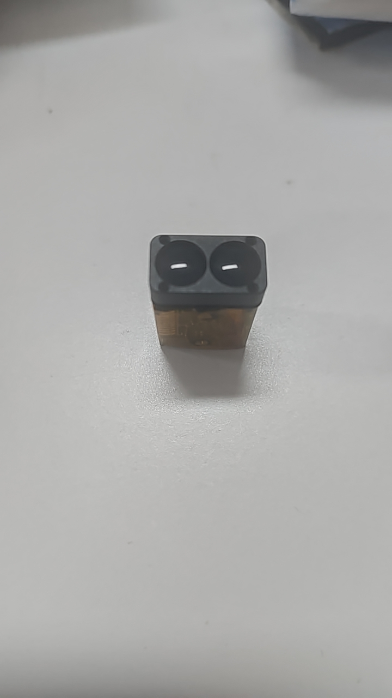

# JRT PTGL-100 Laser Rangefinder

<Badge type="tip" text="main (PX4 v2.0)" />

The [JRT PTGL-100](https://www.jrt-measure.com/) is a time-of-flight (ToF) laser [rangefinder](../sensor/rangefinders.md) operating at 905±5 nm, with a specified measurement range of 0.2–100 m (100 m against a 30% reflectance target) and a measurement rate of 100 Hz.
It connects to the flight controller using a UART (serial) port.



::: info
The driver is not included in the firmware for most boards.
See [Firmware Support](#firmware_support) for how to check your board and add it.

The rangefinder has been tested on the [Amovlab Flycore](../flight_controller/amovlab_flycore.md) `TELEM3` port, using a custom-made adapter cable.
The Flycore includes the driver in its default firmware.
:::

## Specifications {#specifications}

- **Technology:** ToF (IR laser), 905±5 nm
- **Range:** 0.2 m (90% reflectance) – 100 m (30% reflectance)
- **Update rate:** 100 Hz
- **Beam divergence:** ≤5 mrad (typical)
- **Accuracy:** ±3 cm up to 30 m, ±7 cm at 30–50 m, ±15 cm at 50–100 m (90% reflectance target)
- **Interface:** UART, 3.3 V TTL, 460800 baud (factory default)
- **Input voltage:** 3.3–5 V DC
- **Power consumption:** ≤0.45 W at 3.3 V and 25 °C (≤0.56 W at 60 °C)
- **Dimensions:** 10.7 × 16.8 × 22 mm
- **Weight:** 6±0.5 g
- **Operating temperature:** −20 to +60 °C
- **Ingress protection:** IP67
- **Laser class:** Class 1 (IEC 60825-1)

## Where to Buy {#store}

For PTGL-100 purchasing enquiries, contact Amovlab at [shudajun@amovauto.com](mailto:shudajun@amovauto.com) or JRT at [sales@jrt-measure.com](mailto:sales@jrt-measure.com).

## Sensor Configuration {#sensor_configuration}

PTGL-100 modules ship configured for 460800 baud, which is the rate the PX4 driver uses (8N1, no flow control).
The 115200 baud factory-default value in manual §4.1 is incorrect.
After purchase, the module can be reconfigured to 115200 baud under JRT's guidance, but it must be set to 460800 baud for use with this PX4 driver.
The driver doesn't change the module's baud rate.
To check or change a module's baud rate, contact JRT at [sales@jrt-measure.com](mailto:sales@jrt-measure.com) for instructions.

## Hardware Setup {#hardware_setup}

### Mounting {#mounting}

The driver assumes the sensor is mounted facing downward.
For any other direction, set [SENS_PTGL100_ROT](../advanced_config/parameter_reference.md#SENS_PTGL100_ROT) (see [PX4 Configuration](#px4_configuration)).

Keep glass and mirror-like surfaces out of the sensor's blind zone, and don't mount it facing another laser rangefinder at close range.
If the sensor is fitted behind a protective window, the manual (§3.4) recommends H-K9L or fused-silica glass, 2–4 mm thick, with an 855–955 nm anti-reflection coating and an air gap of less than 0.5 mm to the sensor.

### Pinouts {#pinouts}

| Pin | Signal | Description                                               |
| --- | ------ | --------------------------------------------------------- |
| 1   | GND    | Ground                                                    |
| 2   | VCC    | 3.3–5 V supply                                            |
| 3   | NC     | Not connected                                             |
| 4   | TXD    | UART TX (3.3 V TTL)                                       |
| 5   | RXD    | UART RX (3.3 V TTL)                                       |
| 6   | EN     | Enable: low for normal operation, high for low-power mode |

### Wiring {#wiring}

The manufacturer's packing list includes one module and one power/data cable.
The supplied cable has six-pin connectors at both ends for the module's `HC-0.8-6PWT` interface (0.8 mm pitch), and carries power and UART TX/RX.
It can be used as a module-side pigtail by adapting the flight-controller end to the required connector and pinout.
An adapter cable is needed to connect to flight controllers that follow the [Pixhawk Connector Standard](https://github.com/pixhawk/Pixhawk-Standards/blob/master/DS-009%20Pixhawk%20Connector%20Standard.pdf) (which use 1.25 mm pitch JST-GH connectors).
For Flycore, use its board-specific `TELEM3` pinout shown below.

The PTGL-100 can be connected to any unused serial port (UART), such as `TELEM2`, `TELEM3` or `GPS2`.
UART signals use 3.3 V TTL levels.
The module requires a 3.3–5 V supply and draws up to 0.45 W at 3.3 V and 25 °C (0.56 W at 60 °C).

| Module Pin | Module Signal | Connect To                |
| ---------- | ------------- | ------------------------- |
| 1          | GND           | Flight controller GND     |
| 2          | VCC           | 3.3–5 V supply            |
| 4          | TXD           | Flight controller UART RX |
| 5          | RXD           | Flight controller UART TX |
| 6          | EN            | GND                       |

For example, connect the module to the Flycore [`TELEM3`](../flight_controller/amovlab_flycore.md#telem3-port) port as follows:

| Module Pin | Module Signal | Flycore TELEM3 Pin | Flycore TELEM3 Signal |
| ---------- | ------------- | ------------------ | --------------------- |
| 2          | VCC           | 4                  | VCC                   |
| 1          | GND           | 3                  | GND                   |
| 4          | TXD           | 1                  | RX                    |
| 5          | RXD           | 2                  | TX                    |
| 6          | EN            | 3                  | GND                   |

Pin 6 (`EN`) must be connected to GND for normal operation.
You must join module pins 1 and 6 to `TELEM3` pin 3 in the adapter cable.
The `TELEM3` VCC pin supplies 5 V, within the module's 3.3–5 V input range.
This wiring, including `EN` connected to GND, has been tested on Flycore.

Both TX and RX are required because PX4 sends the module a command to start continuous measurement.

## Firmware Support {#firmware_support}

The rangefinder is supported by the [ptgl100](../modules/modules_driver_distance_sensor.md#ptgl100) driver, which is built into firmware by the [board configuration](../hardware/porting_guide_config.md) key `CONFIG_DRIVERS_DISTANCE_SENSOR_PTGL100=y`.
The driver is not part of the common set of rangefinder drivers (`CONFIG_COMMON_DISTANCE_SENSOR`), so it is only present in the firmware for boards that set this key.
At the time of writing these are: [Amovlab Flycore](../flight_controller/amovlab_flycore.md).

To check your board, look for the key in its configuration file, `boards/<vendor>/<board>/default.px4board`, or check whether [SENS_PTGL100_CFG](../advanced_config/parameter_reference.md#SENS_PTGL100_CFG) is listed in _QGroundControl_ (parameters are only shown for drivers that are in the firmware).

If the driver is missing, add the key to the board's `default.px4board` file, or enable it in [`boardconfig`](../hardware/porting_guide_config.md#px4-menuconfig-setup) under **Drivers > Distance sensors**, and then [build and upload the firmware](../dev_setup/building_px4.md).

The driver does not start until it is enabled using the parameters in [PX4 Configuration](#px4_configuration).

## PX4 Configuration {#px4_configuration}

1. Ensure that the wired UART is not used by another function, such as MAVLink or GNSS.
   If it is, see [Deconflicting Ports](../peripherals/serial_configuration.md#deconflicting-ports) in _Serial Port Configuration_.
2. [Configure the serial port](../peripherals/serial_configuration.md) on which the rangefinder will run using [SENS_PTGL100_CFG](../advanced_config/parameter_reference.md#SENS_PTGL100_CFG), and then reboot.
3. If the sensor is not mounted facing down, set [SENS_PTGL100_ROT](../advanced_config/parameter_reference.md#SENS_PTGL100_ROT) to its mounting direction and reboot.

For example, select `TELEM 3` (`103`) for a module connected to the Flycore `TELEM3` port.
There is no need to set the baud rate for the port (460800), as this is configured by the driver.
By default, the port is `Disabled` (`0`) and the orientation is `Downward facing` (`25`).

If the parameter is not available in _QGroundControl_ then the driver is not in the firmware: see [Firmware Support](#firmware_support).

The configuration that is common to all rangefinders, such as the sensor position offsets used by the estimator, is covered in [Rangefinders > Configuration/Setup](../sensor/rangefinders.md#configuration).

## Testing {#testing}

In the [_QGroundControl_ MAVLink Console](../debug/mavlink_shell.md#qgroundcontrol-mavlink-console), run:

```sh
ptgl100 status
listener distance_sensor -n 10
```

`status` reports the UART, baud rate, topic instance, last distance and sample age, measurement status, and error counters.
If no measurement reply has arrived in the last second, it warns "no recent measurement replies" and lists what to check: the sensor's power, the `EN` connection to GND, the TX/RX wiring, and the module's baud rate (see [Sensor Configuration](#sensor_configuration)).

If several distance sensors are connected, select the instance reported by `status`, for example:

```sh
listener distance_sensor -i 1 -n 10
```

See [Rangefinders > Testing](../sensor/rangefinders.md#testing) for how to view the data in the _QGroundControl_ MAVLink Inspector and other generic steps.

The driver publishes the sensor type (laser), the 0.2–100 m range limits, and the selected orientation.

## Developer Information {#developer_information}

The [ptgl100](../modules/modules_driver_distance_sensor.md#ptgl100) driver starts continuous measurement and publishes the standard `distance_sensor` topic used by MAVLink and ULog.

### Diagnostics

The driver rejects corrupt frames and does not publish distance bytes from failed measurements.
During a communication outage it does not repeat an old distance with a new timestamp.
After one second without a complete measurement reply it retries the continuous measurement command, at most once per second.
Measurement failure replies count as communication with the module and are reported separately from communication errors.

To run the driver manually, first disable automatic startup (set [SENS_PTGL100_CFG](../advanced_config/parameter_reference.md#SENS_PTGL100_CFG) to `Disabled` and reboot), then run:

```sh
ptgl100 start -d /dev/ttyS3 -R 25
ptgl100 status
ptgl100 stop
```

The device name above corresponds to the Flycore `TELEM3` port.
When stopped, the driver attempts to send the stop measurement command before closing the UART.

### Validation

Build the firmware, then configure and run the driver-specific SITL tests with a current CMake installation:

```sh
make amovlab_flycore_default
cmake -S . -B build/px4_sitl_test -G Ninja -DCONFIG=px4_sitl_test -DTESTFILTER=PTGL100Parser
cmake --build build/px4_sitl_test --target px4 unit-PTGL100Parser
ctest --test-dir build/px4_sitl_test -R '^unit-PTGL100Parser$' --output-on-failure
```

Run the virtual UART integration test against the SITL test executable:

```sh
python3 src/drivers/distance_sensor/ptgl100/test_ptgl100.py --px4 build/px4_sitl_test/bin/px4
```

The integration test requires `pexpect`, `pymavlink`, and `pyulog`.
It uses a pseudo-terminal in a temporary directory and does not require a connected sensor or flight controller.

### Protocol

The driver uses the `0x68` (single) and `0x69` (continuous) measurement commands, and rejects measurement replies that use the `0x88`/`0x89` commands.
For the frame format and checksums, request the PTGL-100 User and Maintenance Manual from JRT (see [Further Information](#further_information)).

## Further Information {#further_information}

- [ptgl100 driver](../modules/modules_driver_distance_sensor.md#ptgl100) (module reference)
- Contact [JRT](https://www.jrt-measure.com/) at [sales@jrt-measure.com](mailto:sales@jrt-measure.com) to obtain the latest PTGL-100 User and Maintenance Manual (Chinese).
