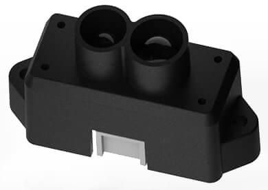

# Benewake TFmini LiDAR

<Badge type="tip" text="PX4 v1.7" />

The Benewake [TFmini-S](https://en.benewake.com/TFminiS/index_proid_325.html) and [TFmini Plus](https://en.benewake.com/TFminiPlus/index_proid_323.html) are small, low-power time-of-flight LiDAR [rangefinders](../sensor/rangefinders.md) with a range of 0.1–12 m (PX4 uses 0.4–12 m) and a 100 Hz default update rate.
They connect to the flight controller using a serial port (UART).



## Supported Models {#supported_models}

| Model                                                                  | Range    | Connection | `SENS_TFMINI_HW` value |
| ---------------------------------------------------------------------- | -------- | ---------- | ---------------------- |
| [TFmini-S](https://en.benewake.com/TFminiS/index_proid_325.html)       | 0.1–12 m | UART       | `1` (default)          |
| [TFmini Plus](https://en.benewake.com/TFminiPlus/index_proid_323.html) | 0.1–12 m | UART       | `1` (default)          |

PX4 reports distances from 0.4 m to 12 m for both models.

## Specifications {#specifications}

- **Technology:** Time-of-flight, 850 nm infrared (VCSEL on the TFmini-S, LED on the TFmini Plus)
- **Range:** 0.1–12 m at 90% reflectivity; 0.1–7 m (TFmini-S) or 0.1–4 m (TFmini Plus) at 10% reflectivity (PX4 uses 0.4–12 m)
- **Update rate:** 100 Hz by default, adjustable 1–1000 Hz
- **Field of view:** 2° (TFmini-S), 3.6° (TFmini Plus)
- **Accuracy:** ±6 cm below 6 m and ±1% from 6–12 m (TFmini-S); ±5 cm below 5 m and ±1% from 5–12 m (TFmini Plus)
- **Resolution:** 1 cm
- **Interface:** UART at 115200 baud, 8N1, 3.3 V (LVTTL); the sensors also support I2C, which the PX4 driver does not use
- **Input voltage:** 5 V ±0.1 V (TFmini-S), 5 V ±0.5 V (TFmini Plus)
- **Current draw:** ≤140 mA average, 200 mA peak (TFmini-S); ≤110 mA average, 140 mA peak (TFmini Plus)
- **Dimensions:** 42 x 15 x 16 mm (TFmini-S), 35 x 18.5 x 21 mm (TFmini Plus)
- **Weight:** 5 g (TFmini-S), 12 g (TFmini Plus)
- **Operating temperature:** 0–60 °C (TFmini-S), -20 °C to 60 °C (TFmini Plus)
- **Ingress protection:** IP65 (TFmini Plus)
- **Laser class:** Class 1 (TFmini-S)

## Where to Buy {#store}

- TFmini-S: [Benewake](https://en.benewake.com/TFminiS/index_proid_325.html), [Mouser](https://www.mouser.com/en/ProductDetail/Benewake/TFmini-S-Uart?qs=DPoM0jnrROXBvfO6mWli6w%3D%3D)
- TFmini Plus: [Benewake](https://en.benewake.com/TFminiPlus/index_proid_323.html), [Mouser](https://www.mouser.com/en/ProductDetail/Benewake/TFmini-Plus-Uart?qs=DPoM0jnrROWctNsxLIii7A%3D%3D)

## Hardware Setup {#hardware_setup}

### Mounting {#mounting}

Mount the sensor facing down: PX4 assumes a downward-facing sensor, and the orientation cannot be configured.

Readings below 0.4 m are reported as out of range.

### Pinouts {#pinouts}

The TFmini-S and TFmini Plus have a cable ending in a JST 1.25 mm 4-pin connector (Molex 51021-0400).
This is not the JST-GH connector used by flight controllers that follow the [Pixhawk Connector Standard](https://github.com/pixhawk/Pixhawk-Standards/blob/master/DS-009%20Pixhawk%20Connector%20Standard.pdf), so you will need an adapter cable to connect to those ports.
The cable can be extended, but Benewake recommends keeping it shorter than 1 m.

The wire colours are the same on both models, but the pin numbering differs.

TFmini-S:

| Pin | Wire colour | Signal                    |
| --- | ----------- | ------------------------- |
| 1   | Black       | GND                       |
| 2   | Red         | +5 V                      |
| 3   | White       | RX (UART receive, 3.3 V)  |
| 4   | Green       | TX (UART transmit, 3.3 V) |

TFmini Plus:

| Pin | Wire colour | Signal                    |
| --- | ----------- | ------------------------- |
| 1   | Red         | +5 V                      |
| 2   | White       | RX (UART receive, 3.3 V)  |
| 3   | Green       | TX (UART transmit, 3.3 V) |
| 4   | Black       | GND                       |

### Wiring {#wiring}

The TFmini can be connected to any unused serial port (UART), such as `TELEM2`, `TELEM3` or `GPS2`.

| TFmini wire | Connect to                           |
| ----------- | ------------------------------------ |
| Green (TX)  | Flight controller UART RX            |
| White (RX)  | Flight controller UART TX (optional) |
| Red (+5 V)  | 5 V supply                           |
| Black (GND) | Flight controller GND                |

The driver only reads from the sensor, so the sensor's RX wire does not need to be connected.

The TFmini-S needs 5 V ±0.1 V and up to 140 mA (200 mA peak); the TFmini Plus needs 5 V ±0.5 V and up to 110 mA (140 mA peak).
Neither has over-voltage or reverse-polarity protection.

## Firmware Support {#firmware_support}

The rangefinder is supported by the [tfmini](../modules/modules_driver_distance_sensor.md#tfmini) driver, which is built into firmware by either of the following [board configuration](../hardware/porting_guide_config.md) keys:

- `CONFIG_COMMON_DISTANCE_SENSOR=y`: the common set of rangefinder drivers, which includes this one.
- `CONFIG_DRIVERS_DISTANCE_SENSOR_TFMINI=y`: this driver on its own.

Most boards set `CONFIG_COMMON_DISTANCE_SENSOR`, so the driver is present in most firmware.
To check your board, look for either key in its configuration file, `boards/<vendor>/<board>/default.px4board`, or check whether [SENS_TFMINI_CFG](../advanced_config/parameter_reference.md#SENS_TFMINI_CFG) is listed in _QGroundControl_ (parameters are only shown for drivers that are in the firmware).

If the driver is missing, add either key to the board's `default.px4board` file, or enable it in [`boardconfig`](../hardware/porting_guide_config.md#px4-menuconfig-setup) under **Drivers > Distance sensors**, and then [build and upload the firmware](../dev_setup/building_px4.md).

The driver does not start until it is enabled using the parameters in [PX4 Configuration](#px4_configuration).

## PX4 Configuration {#px4_configuration}

[Configure the serial port](../peripherals/serial_configuration.md) on which the rangefinder will run using [SENS_TFMINI_CFG](../advanced_config/parameter_reference.md#SENS_TFMINI_CFG), and then reboot.
There is no need to set the baud rate for the port, as this is configured by the driver.
If the port is already used by another function, see [Deconflicting Ports](../peripherals/serial_configuration.md#deconflicting-ports) in _Serial Port Configuration_.

If the parameter is not available in _QGroundControl_ then the driver is not in the firmware: see [Firmware Support](#firmware_support).

The driver does not configure the sensor, so the sensor must be at its factory settings: UART interface, 115200 baud, and the `Standard 9 bytes (cm)` output format (not `Pixhawk` or `Standard 9 bytes (mm)`).
If these have been changed, reset the sensor to its defaults as described in the Benewake user manual.

[SENS_TFMINI_HW](../advanced_config/parameter_reference.md#SENS_TFMINI_HW) selects the model and sets the range limits PX4 reports.
Leave it at its default `1` (`TFMINI`) for the TFmini-S and TFmini Plus.

The configuration that is common to all rangefinders, such as the sensor position offsets used by the estimator, is covered in [Rangefinders > Configuration/Setup](../sensor/rangefinders.md#configuration).

## Testing {#testing}

You can check that the driver is running, and see its error counters, using the _QGroundControl MAVLink Console_:

```sh
tfmini status
```

You can observe the published measurements with:

```sh
listener distance_sensor
```

The sensor type is reported as laser, with minimum and maximum distances of 0.4 m and 12 m.

The measurements can also be viewed in the `DISTANCE_SENSOR` message in the _QGroundControl MAVLink Inspector_.
For more information see [Rangefinders > Testing](../sensor/rangefinders.md#testing).

## Further Information {#further_information}

- [Modules Reference: Distance Sensor (Driver): tfmini](../modules/modules_driver_distance_sensor.md#tfmini)
- [TFmini-S Datasheet](https://en.benewake.com/uploadfiles/2025/04/20250430175121856.pdf) and [User Manual](https://en.benewake.com/uploadfiles/2025/04/20250430175136263.pdf) (Benewake)
- [TFmini Plus Datasheet](https://en.benewake.com/uploadfiles/2025/04/20250430175207216.pdf) and [User Manual](https://en.benewake.com/uploadfiles/2025/04/20250430175221028.pdf) (Benewake)
