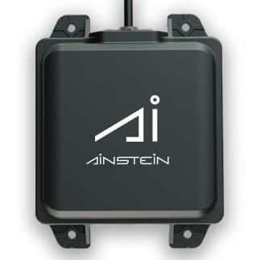

# Ainstein US-D1 Standard Radar Altimeter

<Badge type="tip" text="PX4 v1.7" />

The [Ainstein US-D1 Standard Radar Altimeter](https://ainstein.ai/us-d1-all-weather-radar-altimeter/) is a compact microwave radar [rangefinder](../sensor/rangefinders.md) with a range of 0.5–50 m and a 100 Hz update rate.
It connects to the flight controller using a serial port (UART).
It is useful for applications including terrain following and precision hovering (e.g. for photography), and can operate effectively in all weather conditions and over all terrain types (including water).



::: info
The US-D1 supersedes the _Aerotenna uLanding Radar_ (discontinued), and uses the same driver and setup.
:::

## Specifications {#specifications}

- **Technology:** Microwave radar (24 GHz)
- **Range:** 0.5–50 m (PX4 reports measurements from 0.315 m)
- **Update rate:** 100 Hz
- **Field of view:** 43° x 30°
- **Accuracy:** 6 cm below 1 m, 4 cm above 1 m
- **Interface:** UART, CAN (the PX4 driver uses UART at 115200 baud)
- **Input voltage:** 5–13 V DC (5.5 V recommended)
- **Power consumption:** 2 W at 5 V
- **Dimensions:** 108 x 79 x 20 mm
- **Weight:** 110 g
- **Operating temperature:** -20 °C to 65 °C
- **Ingress protection:** IP67 (with sealant)

## Where to Buy {#store}

- [US-D1: All-Weather Radar Altimeter](https://sensing.ai/collections/ainstein-radar-products/products/us-d1radar-altimeter) (Ainstein store)

## Hardware Setup {#hardware_setup}

### Mounting {#mounting}

Mount the US-D1 rigidly on the underside of the vehicle, with its front face (the radome) parallel to the ground and facing directly down.
Keep it well away from the landing gear and any other structure that could fall within its field of view, and do not cover or coat the radome.

PX4 assumes that the sensor is facing down (the orientation cannot be configured).

### Pinouts {#pinouts}

The US-D1 has a short cable terminated with a 4-pin Molex connector.

| Wire colour | Signal | Description            |
| ----------- | ------ | ---------------------- |
| Black       | GND    | Ground                 |
| White       | RX     | UART receive (3.3 V)   |
| Green       | TX     | UART transmit (3.3 V)  |
| Red         | VCC    | Power input, 5–13 V DC |

::: info
The US-D1 is shipped configured for either UART, CAN, or DroneCAN output.
The wiring above, and the setup on this page, are for the UART version.
:::

### Wiring {#wiring}

The US-D1 can be connected to any unused serial port (UART), such as `TELEM2`, `TELEM3` or `GPS2`.

| US-D1 wire  | Connect to                           |
| ----------- | ------------------------------------ |
| Black (GND) | Flight controller GND                |
| Green (TX)  | Flight controller UART RX            |
| White (RX)  | Flight controller UART TX (optional) |
| Red (VCC)   | 5–13 V DC supply (5.5 V recommended) |

The driver only reads from the sensor, so the sensor RX wire does not need to be connected.

The sensor consumes about 2 W (around 400 mA at 5 V).
Check that the flight controller port can supply this, or power the sensor from a separate supply that shares a ground with the flight controller.

## Firmware Support {#firmware_support}

The rangefinder is supported by the [ulanding_radar](../modules/modules_driver_distance_sensor.md#ulanding-radar) driver, which is built into firmware by either of the following [board configuration](../hardware/porting_guide_config.md) keys:

- `CONFIG_COMMON_DISTANCE_SENSOR=y`: the common set of rangefinder drivers, which includes this one.
- `CONFIG_DRIVERS_DISTANCE_SENSOR_ULANDING_RADAR=y`: this driver on its own.

Most boards set `CONFIG_COMMON_DISTANCE_SENSOR`, so the driver is present in most firmware.
To check your board, look for either key in its configuration file, `boards/<vendor>/<board>/default.px4board`, or check whether [SENS_ULAND_CFG](../advanced_config/parameter_reference.md#SENS_ULAND_CFG) is listed in _QGroundControl_ (parameters are only shown for drivers that are in the firmware).

If the driver is missing, add either key to the board's `default.px4board` file, or enable it in [boardconfig](../hardware/porting_guide_config.md#px4-menuconfig-setup) under **Drivers > Distance sensors**, and then [build and upload the firmware](../dev_setup/building_px4.md).

The driver does not start until it is enabled using the parameters in [PX4 Configuration](#px4_configuration).

## PX4 Configuration {#px4_configuration}

[Configure the serial port](../peripherals/serial_configuration.md) on which the rangefinder will run using [SENS_ULAND_CFG](../advanced_config/parameter_reference.md#SENS_ULAND_CFG), and then reboot.
There is no need to set the baud rate for the port, as this is configured by the driver.

If the parameter is not available in _QGroundControl_ then the driver is not in the firmware: see [Firmware Support](#firmware_support).

The configuration that is common to all rangefinders, such as the sensor position offsets used by the estimator, is covered in [Rangefinders > Configuration/Setup](../sensor/rangefinders.md#configuration).

## Testing {#testing}

You can check that the driver is running, and see its error counters, using the _QGroundControl MAVLink Console_:

```sh
ulanding_radar status
```

You can observe the published measurements with:

```sh
listener distance_sensor
```

The sensor type is reported as radar, with minimum and maximum distances of 0.315 m and 50 m.

The measurements can also be viewed in the `DISTANCE_SENSOR` message in the _QGroundControl MAVLink Inspector_.
For more information see [Rangefinders > Testing](../sensor/rangefinders.md#testing).

## Further Information {#further_information}

- [Modules Reference: Distance Sensor (Driver): ulanding_radar](../modules/modules_driver_distance_sensor.md#ulanding-radar)
- [US-D1 Technical User Manual](https://ainstein.ai/wp-content/uploads/US-D1-Technical-User-Manual-3.pdf) (Ainstein)
- [US-D1 Data Sheet](https://ainstein.ai/wp-content/uploads/US-D1-Data-Sheet-2.pdf) (Ainstein)
