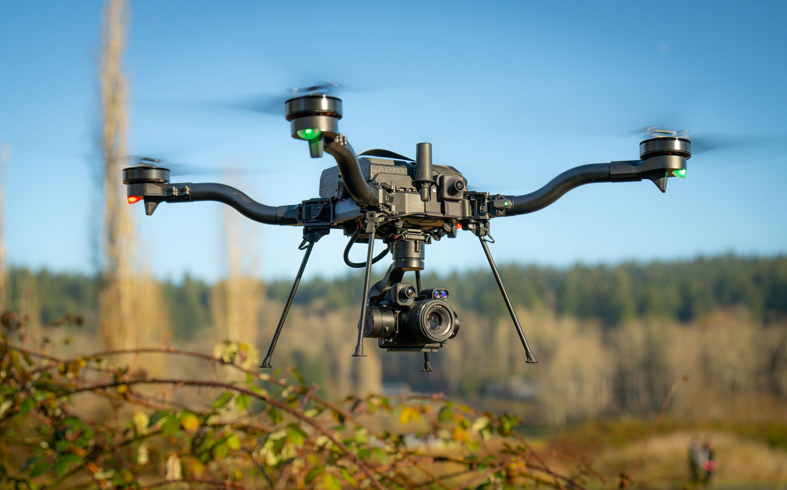

# Nexus Simulation

:::warning
This simulator is [community supported and maintained](../simulation/community_supported_simulators.md).
It may or may not work with current versions of PX4.
Nexus is in alpha, and its interfaces can change between releases.
:::

[Nexus](https://breuerpeter.github.io/nexus/) is an open-source quadrotor simulator designed for research, development, and testing.
It builds on [Newton](https://github.com/newton-physics/newton) and [Warp](https://github.com/NVIDIA/warp) for fast physics on GPU, [OpenUSD](https://openusd.org/) for vehicle and scene descriptions, and [Rerun](https://rerun.io) for logging and visualization.
Optional integrations are [Isaac Lab](https://github.com/isaac-sim/IsaacLab) for robot learning, [Omniverse RTX](https://developer.nvidia.com/omniverse) for sensor rendering, and [Isaac Sim](https://developer.nvidia.com/isaac/sim) with [Cesium](https://cesium.com/platform/cesium-for-omniverse/) for streaming photorealistic tiles.
Its extensible design lets you develop and test each part of a drone's flight stack, be it an estimator, a reinforcement learning policy, or an emulated companion computer.

PX4 [SITL](../simulation/index.md#sitl-simulation-environment) is a first-class controller in nexus.
The simulation runs in lockstep with PX4 over the [Simulator MAVLink API](../simulation/index.md#simulator-mavlink-api).

## Why nexus?

- **Simple setup.** One command builds and starts PX4 in a container, then runs the simulation. No PX4 toolchain needed.
- **Speed.** Built in Python for development speed, and designed around GPU kernels for runtime performance. See [Benchmarking](https://breuerpeter.github.io/nexus/reference/benchmarking/).
- **Visual debugging.** Interactive 3D views show PX4 data alongside ground truth on one timeline for fast insights. See [Observability in Rerun](https://breuerpeter.github.io/nexus/guide/running/#observability-in-rerun).
- **Built on OpenUSD.** Vehicle and scene files are plain OpenUSD, and they declare everything that runs, PX4 included. To fly your own assets, simply apply the nexus OpenUSD API schemas to them. See [Schemas](https://breuerpeter.github.io/nexus/reference/schemas/).
- **Easily extensible.** Add your own components, vehicles and scenes from a plain Python package in your own repository. No fork needed. See [Bringing your own component](https://breuerpeter.github.io/nexus/guide/your-own-component/) and [Bringing your own assets](https://breuerpeter.github.io/nexus/guide/your-own-assets/).

## Supported Vehicles

### Freefly Systems Astro Max

Astro is an industrial quadrotor for professional applications such as mapping and inspection.
Learn more on the [Freefly Systems](https://freeflysystems.com/) website.

:::warning
Nexus does not claim to accurately mimic the flight dynamics of Astro.
:::



Nexus manages PX4 SITL if the nexus vehicle declares it.
You only need to run the PX4 `make` target if you want to run PX4 manually.
See [PX4 as a peer](https://breuerpeter.github.io/nexus/guide/running/#px4-as-a-peer).

| Vehicle                           | Type        | PX4 target                             |
| --------------------------------- | ----------- | -------------------------------------- |
| Freefly Astro Max (`astro_max_*`) | Multicopter | `make px4_sitl_default none_astro_max` |

See the [asset catalog](https://breuerpeter.github.io/nexus/reference/assets/) for all nexus vehicles and scenes.

## Installation

You need a Linux (x86-64) machine with [Docker](https://docs.docker.com/engine/install/) and [uv](https://docs.astral.sh/uv/getting-started/installation/) installed.
A CUDA-capable NVIDIA GPU is recommended for significantly better performance.
It is required for RTX sensors and Isaac Sim.

To install nexus, simply install the package from [PyPI](https://pypi.org/project/nexus-uav/) into a new environment:

```sh
uv venv --python 3.12
uv pip install nexus-uav
```

## Usage

You can run nexus via the CLI or the Python API.
The examples below fly the `astro_max_base` vehicle in the `empty` scene.

### CLI

1. Start [QGroundControl](https://qgroundcontrol.com) and enable the virtual joystick under `Application Settings` → `General` → `Virtual Joystick`.
   QGroundControl listens on UDP port `14550` and connects when PX4 sends its first heartbeat.

2. Start the simulation with a vehicle and a scene:

   ```sh
   uv run nexus run --vehicle astro_max_base --scene empty --rtf 1
   ```

   The flag `--rtf 1` paces the simulation to real time, which flying by hand needs.
   Without it, the simulation runs as fast as it can.
   The first run on a machine fetches the PX4 commit that the release pins, and builds it.
   This takes some minutes once.

   ::: tip
   To fly your own PX4 checkout instead of the one the nexus release pins, set the `NEXUS_PX4_SITL_REF` environment variable to its absolute path. See [PX4 as a peer](https://breuerpeter.github.io/nexus/guide/running/#px4-as-a-peer).
   :::

3. Wait for QGroundControl to connect, then arm and fly with the on-screen virtual joysticks.
   Stop the simulation with `Ctrl+C`, which stops PX4 too.

See [Running a SITL flight](https://breuerpeter.github.io/nexus/guide/running/) for more information.

### Python API

A script runs the simulation with `nexus_uav.Sim` and commands PX4 over MAVLink with the offboard client:

```python
import nexus_uav as nx
from nexus_uav.px4 import OffboardClient

with nx.Sim("astro_max_base", scene="empty") as sim:
    sim.start()
    with OffboardClient.connect(sim, 10.0) as op:
        op.takeoff(2.0)
        sim.wait_until(op.at_target, sim_timeout=60.0)
```

See the [API reference](https://breuerpeter.github.io/nexus/reference/api/) for the current API.
See the [PX4 SITL example](https://breuerpeter.github.io/nexus/examples/px4-sitl/) for a longer flight, with a log you can explore in an embedded Rerun viewer.

## Further Information

- [Full documentation](https://breuerpeter.github.io/nexus/): the official nexus docs.
- [Simulation](../simulation/index.md): general information about simulators in PX4.
